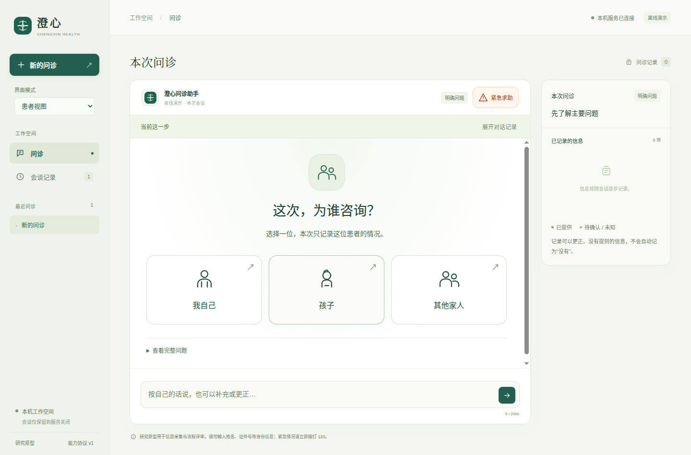
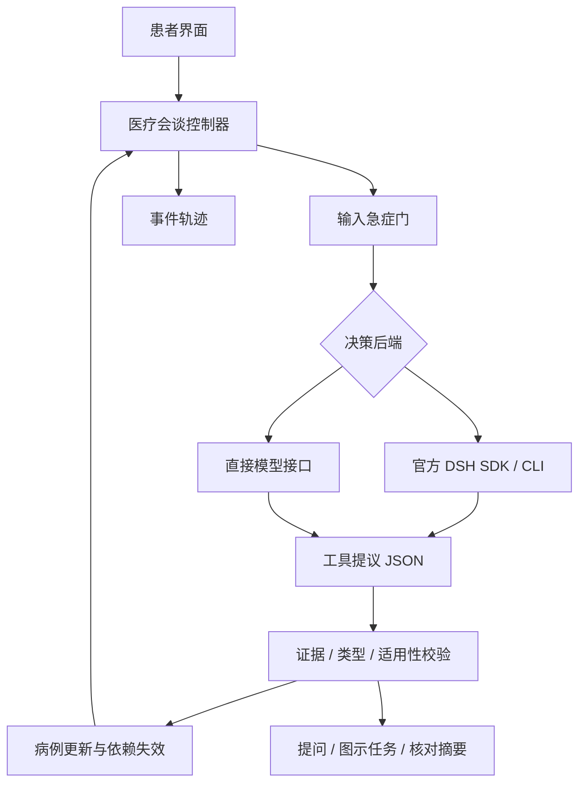

# 澄心问诊 · medical-agent

面向患者和照护者的中文门诊式问诊研究项目。当前源码版本 **0.11.17** 提供可视化问诊和官方 DSH 完整执行底座：工作区文件、终端、代码、联网搜索与子智能体。患者流程保留聚焦问题、分步图示、明确未知与更正；执行产物独立保存，不自动回写病例。

已经接入真实 **DeepSeek Harness CLI + 官方 SDK**。DSH 与直接模型接口共用医疗控制器；医疗状态、任务适用性和急症分流由本项目执行。默认离线演示保留作流程查看，界面会明确显示当前模式。

## 启动

Python 3.10+；DSH 模式另需 Node 22.19+。以下命令从项目根目录运行。

### Windows 原生环境（适配验证中）

Windows 使用独立的 Python、Node 和 Electron，直接显示原生 Windows 桌面窗口，无需 WSL。当前目标 Windows 10 19044+／Windows 11 x64。首次配置在项目根目录的普通 PowerShell 中运行：

```powershell
powershell -NoProfile -ExecutionPolicy Bypass -File .\scripts\windows.ps1 -Mode Setup
# 启动离线演示
powershell -NoProfile -ExecutionPolicy Bypass -File .\scripts\windows.ps1 -Mode Start
# 重新检查原生运行时、DSH、后端鉴权与实际窗口
powershell -NoProfile -ExecutionPolicy Bypass -File .\scripts\windows.ps1 -Mode Check
# Win32 文件／进程回归
powershell -NoProfile -ExecutionPolicy Bypass -File .\scripts\windows.ps1 -Mode Test
```

安装脚本下载 SHA256 固定的 Windows Python 3.14.8 与 Node 22.23.3 到 `.runtime/windows`，安装锁定依赖和 Electron，检查成功后创建桌面快捷方式。不修改系统 PATH，不要求预装 Windows Python、Node、Conda 或 pip。首次下载需要网络。

真实问诊可在界面配置模型；也可在原项目根目录自行填写 `.env` 后显式启动：

```powershell
if (-not (Test-Path .env)) { Copy-Item .env.example .env }
notepad .env
powershell -NoProfile -ExecutionPolicy Bypass -File .\scripts\windows.ps1 -Mode Start -Live
```

Windows 打包入口为 `-Mode Build`，产物在 `dist/desktop/Chengxin-0.11.17-win32-x64/`；整个目录携带 Python、Node 和 Electron，用户保留完整目录后运行 `Chengxin.exe`。当前仍在进行 Windows 实际验证，通用执行工作台的原生隔离也在接续中；不能把 Linux 通过的结果当成 Windows 已验收。进展以 `windows-native` 分支及 Windows 验收记录为准。

### 独立桌面应用（推荐）

当前电脑直接双击桌面的 **“澄心问诊”** 图标；会自动打开独立应用窗口，无需浏览器或手动启动服务。也可运行：

```bash
./scripts/start-desktop.sh
```

从干净源码环境准备桌面版：

```bash
npm ci --ignore-scripts
npm run desktop:setup
npm start
```

当前 Linux x64 桌面程序路径：`dist/desktop/Chengxin-0.11.17-linux-x64/Chengxin`。需要保留整个目录及系统 Python。查看 [桌面版使用、打包和验证](docs/桌面应用使用与打包.md)。

已经配置项目根目录 `.env` 时，可显式启动真实模型桌面版：

```bash
./scripts/start-desktop.sh --live
```

默认桌面图标保持离线演示；`--live` 才读取本地密钥和模型配置，适配 DSH 或直接接口。启动和初始会谈不自动调用模型，提交描述后才调用。

### 本地中文字体与跨系统显示

v0.11.17随包提供正文与标题的本地中文字体，页面和启动页共用，不访问字体CDN。独立Debian系统文件下复现了旧版“流程通过但中文为方框”的问题；新增检查核对实际渲染字形，而非只检查CSS或DOM文字。来源、许可证、约39.1MiB体积变化和验证范围见[字体与跨系统设计](docs/本地字体与跨系统界面验证.md)。

### 已确认定位的修改

v0.11.16 在问诊记录和摘要中提供“修改定位”。修改前保留原记录，确认后关联旧事实，取消则返回原问题；旧卡片不能再次提交。患者自然语言更正可通过revise_self_check建立核对卡，仅提议本轮明确修改，其余项标注为沿用原记录。新增补充失败可重试，不重复写事实。见[修改与接续设计](docs/已确认定位的修改与问诊接续.md)。

0.11.15另完成[全新真实模型原生问诊](docs/evaluations/2026-10-17/v0.11.15-full-flow/README.md)：普通病例、急症和恢复共21次真实请求；未把该呼吸道病例当作完整细化定位问诊。

### 问题与结构化定位答案

v0.11.15 将定位问题声明为大部位、具体位置、患者自己的左右与感觉范围，按需显示分步输入。自然语言先整理为可修改草稿，核对后记录；未提及的维度留空，明确说不清与没有填写分别处理。见[定位输入协议与验证](docs/结构化定位答案与患者核对.md)。验证范围与原始模型轨迹见上述文档；既有0.11.14程序独立保留。

### 部位图的可操作布局

v0.11.14 为已处理图示增加宿主完成上下文，服务重试保留原事实与来源，后续新输入清除该标记。位置含糊时可以在原图中直接澄清，不借用伴随症状字段；澄清不授予观察字段写权限。见[完成状态与定位澄清](docs/图示完成状态与定位澄清.md)。

v0.11.13 将图示期间的病史补充与结果录入分开：用药文字不再直接记成部位；自然语言部位先显示原话和待核对示意，确认后保留原轮来源。暂停后可继续同一次图示，步骤和选择草稿保留；更正、取消与求助使过期任务失效。见[对话接续与结果核对](docs/图示期间的对话与结果核对.md)。

v0.11.12 修复窄屏与小窗口中胸／腹按钮重叠的问题。人体图与独立选项联动，五个部位及其他／跳过入口使用至少44像素的点击目标；前后视图随所选类别切换，不推断左右或精确位置。小窗口保留问题、示意、选项、确认和输入同屏，分步说明按需展开。见[界面与验证](docs/图形界面设计与检查.md#v01112部位图与独立点击目标)。

### 图示任务的草稿与接续

v0.11.11 为每次图示任务提供宿主事件绑定的交互标识。部位选择、操作步骤和文字补充可分别恢复；同一次任务的录入错误不重置步骤，新一次任务从头开始。错误提示在完成页面布局后进入可见区域并获得焦点；未确认选择不写病史。标识用于展示接续，不是测量证明或授权令牌。见[交互协议](docs/结构化展示协议与组件扩展.md#v01111图示任务的交互身份与草稿)。

### 图形答案与文字补充

v0.11.10 将不适程度的图形选择与文字草稿分开：先选分数，再在卡片中明确确认，只提交该分数，不覆盖另写的补充。当前页面内切换会谈可恢复各自的选择；旧动作不能提交到新问题。900×680桌面用左右布局保留问题、刻度、确认和输入，窄屏使用两行刻度。见[界面与检查](docs/图形界面设计与检查.md#v01110图形答案与文字补充)。

### 就诊对象与会谈草稿隔离

v0.11.9 用简短对象卡区分父亲、母亲等已报告称谓，切换对象先新建独立问诊，不覆盖原病例；也可返回原问题或任务。不同会谈的未发送文字分别保留，固定选项不吞掉另外输入的草稿。新对象原话可核对、修改后发送，预填本身不调用模型。标题保留本会谈实际模型模式。见[对象边界、图形交互与验证](docs/就诊对象与会谈草稿隔离.md)。

### 计算请求中的同轮补充

v0.11.8 在完成或跳过换算后，继续处理同一句话中的症状、用药等补充。失败可重试原话，计算不重复执行；患者先提供新信息时，较早补充保留独立入口，不能覆盖后来更正的记录。纯换算继续保持零额外调用，混合补充需要实际模型处理。见[信息来源、状态和验证](docs/计算请求的同轮补充与接续.md)。

### 有来源的计算插件

v0.11.7 新增血糖单位换算，以第二个实例验证插件、输入核对、主／子智能体调用和结果渲染。输入卡明确项目与合法单位，结果显示近似标记，来源和显示规则可展开查看；纯换算的核对、计算与继续问诊不增加模型请求；v0.11.8起混合补充另行接续。输入组件不再固定五个单位，仍只加载受信策略，不判断诊断或用药。见[来源核对、设计与验证](docs/有来源的计算插件与血糖换算.md)。

### 测量时的完整补充

v0.11.6 在接受读数后继续处理同轮的用药、过敏及症状补充，不再直接返回原问题而漏掉信息。明确标注的单个摄氏读数可与另一小句中的用药次数并存；相邻的“读数不准／不确定”会保留为无法确认，其他字段未知不污染清楚的体温。补充处理失败可重试，已接受的读数不重复写入；纯读数仍沿用零额外调用的重复测量接续。见[完整反馈设计](docs/测量反馈与同轮补充.md)。

### 重复测量与原问诊接续

v0.11.5 在体温记录中提供“再测一次”：有效新读数替代当前值并保留旧值；无效输入留在图示任务，跳过或不确定的读数不清除已记录的值，并显示“上次记录／本次未完成”。测量结束后继续原问题、摘要或换算卡；明确报告的新腋温可直接核对，不必重填。核对和接续由控制器执行，不增加模型调用。见[重复测量的设计与验证](docs/重复测量与问诊接续.md)。

### 长问诊与原话核对

v0.11.4 为已记录项目补齐折叠的原话、来源与同轮上下文，保留被模型规范化时省略的患者补充；旧上下文不替代各项最新记录。长问诊中，已退出近期16条消息窗口的当前事实原话按来源轮次去重补回模型上下文，当前事实与更正优先。见[长问诊的信息保留与原话核对](docs/长问诊的信息保留与原话核对.md)。

### 否定证据与未知保护

v0.11.3 修复不确定原话被错误提议成“明确没有”的缺口。否定需有明确证据，并核对引文所在分句和紧邻的纯限定语；“记不清有没有用药”不能截成“没有用药”。也检查借 `present` 文本写入的未确认否认，以及规范化时遗漏的不确定限定。整批提议仍原子校验，失败返回模型修正，其他已说清的字段保留。见[规则、验证与限制](docs/事实断言与否定证据校验.md)。

### 待确认病史的原话与补充

v0.11.2 在摘要中保留未知字段的实际引文，区分“患者已提供的信息”与“尚未确认的事实”，支持直接补充／更正并带回当前引文。模型仅引用半句话时，可展开宿主保存的同轮原话；明确标注其中还包含其他字段的信息，不自动拆分或转成已知病史。长引文折叠，旧摘要仍可回看；新记录替代当前内容，历史保留。见[设计与验证](docs/待确认病史的原话与摘要.md)。

### 完整执行工作台

v0.11.1 增加按目录浏览、分页、隐藏项切换与文件相对路径直达，不再依赖最多200文件、8层深度的概览寻找产物。数量注明当前目录与筛选范围；扫描超限、不可读取或非UTF-8名称显示不完整和未知总数。目录条目变化会使旧翻页标记失效，重新从第一页读取；未出现在当前目录列表的已选文件不会被当作已删除。普通状态轮询不再递归扫描项目。见[目录与覆盖范围](docs/evaluations/2026-10-17/v0.11.1/README.md)。

v0.11.0 将实际产物直接可视化：静态PNG／JPEG图片、CSV／TSV表格、放大查看和原文切换。文件列表标记类型，预览显示尺寸、大小与读取快照；所选内容约每两秒进行有界摘要核对，变化或不可核对时提示重新读取。图片加载绑定内容摘要，HTML／SVG及表格公式保持原文。查看和恢复不调用模型，研究产物不自动成为临床回执。协议与限制见[产物展示](docs/结构化展示协议与组件扩展.md#v0110-执行产物的图像与表格)，最终验收见[0.11.0归档](docs/evaluations/2026-10-17/v0.11.0/README.md)。

v0.10.6 统一执行工具与完成门的参数校验：参数被拒绝且未运行的提议可以改正，不留下虚假的待验收项；有效调用失败或没有结果仍阻止完成。长检查在原任务剩余时间内持续读取同一作业；显式监控的缓存输入不会因扩大范围而丢失，全角与补充字符路径按一致顺序核对。参见 [新版验收](docs/evaluations/2026-10-17/v0.10.6/README.md)。新增四个公开任务的旧版对照实现验收为产品3/8、独立SDK0/8，联合交付为1/8、0/8，共313次请求；样本和配置不足以证明总体达到DSH，原始失败不被本版修复覆盖。[对照记录](docs/evaluations/2026-10-16/v0.10.5-transfer/README.md)。

v0.10.5 将交付检查与结束时的文件版本关联：交付前受检文件变化显示“需复验”，原命令重新运行后解除。同命令检查范围只能扩展，默认观察工作区，也可显式指定代码、测试和配置范围；只检查报告不自动变成修复。文件摘要不返回源码文本。退出0仍不证明断言质量、需求覆盖或临床有效性。见 [文件版本与复验设计](docs/通用执行底座与能力评测设计.md)。

v0.10.4 增加显式 `delivery_check`：实际运行检查、保存退出状态，必需检查失败或缺少有效回执时，在原额度与时限内给一次纠错机会；仍未通过则保持未完成。仅检查报告可设 `required=false`，不自动扩展为改代码。同一命令的必需声明不能降级，主／子任务共用原预算。桌面用简短检查标记呈现最近状态，支持查看失败历史和离线恢复。三个真实 DeepSeek 定向合成场景共 14 次请求通过；这不是整体编码能力或临床效果证明。见 [交付检查与验证边界](docs/通用执行底座与能力评测设计.md)。

v0.10.3 允许显式后台等待最长 600 秒，仍受本轮截止时间和停止控制约束；前台默认 10 秒、上限 30 秒保持不变。患者问诊在模型等待时仍可选择“紧急求助”，已有规则识别的紧急描述也可优先处理；迟到回复不能覆盖求助状态。卡片完整保留控制器的操作说明，原因按需展开。真实 DeepSeek 三个合成工程场景共 4 次请求通过；临床识别覆盖率和整体 DSH 能力未因此得到证明。详见 [本轮设计与验收](docs/首版产品与技术设计.md#v0103-模型等待与优先求助)。

v0.10.2 补齐隔离运行环境的只读 Matplotlib 与系统字体配置。真实 SDK 检查已执行 NumPy/SciPy、生成并验证 PNG，随后观察代码报错、修复并委托子任务；这改善研究产物生成，不代表新增了患者图像诊断能力。公开 TEST 随机样本的独立对照另行记录，未证明整体达到 DSH。

在独立桌面切换“研发视图 → 执行工作台”。填写任务后，可实际创建和编辑文件、运行代码、调用官方 `web_search/web_fetch`、委托和控制子智能体，并查看工具事件与文件。需要 Linux `bwrap`、Node 22.19+ 和已配置模型；`--live` 可复用根目录 `.env`。这是实际模型执行，会消耗所选调用额度。

v0.10.1 支持执行中的结构化澄清：主任务和子任务可提出必要问题，显示简短选项或自由输入，实际回答后接续原工具调用。等待不额外轮询模型，也不重置原预算；停止、超时和重启使未完成问题失效。见 [执行澄清与用户回答](docs/执行澄清与用户回答.md)。

点击“打开本地项目”，可通过原生文件夹选择器在已有项目中直接读写、运行代码和委托子任务；修改保存在原位置，记录与基线单独保存。选择目录不调用模型，只有提交任务才执行。所选目录中的文件可被读取或修改，包括其中自行放置的配置；应用运行目录、私有记录目录及系统／账户保护目录不能作为项目。详见 [本地项目设计与范围](docs/本地项目目录与原位执行.md)。

工作区默认保存在桌面的“澄心工作区”目录。正常后续回合保留同一 DSH 进程和会话；可停止前台、后台进程及子任务。源码版也可通过 `medagent.execution.ExecutionManager` 使用；默认文件夹为项目 `workspaces`。运行时隔离看不到项目密钥与其他用户目录，网络明确允许。普通无鉴权开发网页不开放执行 API。

0.9.3 新建的工作区支持关闭应用后恢复：从选择器打开历史，离线查看文件和任务记录；配置原模型服务与当前密钥后继续原 DSH 会话。配置密钥不写入宿主索引；执行任务记录会明文保存在本机，适用于合成研究任务。患者问诊仍不持久化。详情见 [工作区恢复与存储](docs/执行工作区恢复与存储.md)。

v0.9.5 将患者计算改为“提出换算 → 可编辑输入卡 → 用户核对后计算 → 继续原问诊”。缺参数留空，结果突出数值、单位和公式；核对与继续不增加模型请求，输入已核对仍不代表测量质量已验证。见 [患者计算交互](docs/患者计算输入与问诊衔接.md)。

v0.9.4 将受信注册计算接入完整 DSH：主智能体与子智能体可查询能力、提交带用户原文的参数、观察错误并修正。成功回执渲染为结果、单位、输入和公式卡片，可跨重启查看；任意脚本或 JSON 文件不会获得同样的回执。当前仅开放单位换算，输入仍待核对，结果不写入病例。见 [注册计算工具与执行回执](docs/注册计算工具与执行回执.md)。

实现与验收边界见 [通用执行底座与能力评测设计](docs/通用执行底座与能力评测设计.md)。不宣称已有临床验证或整体能力超过 DSH；使用其官方完整运行时并不能替代独立能力对照。

v0.9.9 增加不依赖 Git 的逐轮文件变更查看：主、子智能体可调用 `workspace_changes`，界面可直接审阅新增、修改、删除与代码差异，跨重启离线查看。默认 3 分钟时限保留，界面可显式选择 10／30 分钟；到期覆盖前台和后台任务。该版本当时仅支持应用管理的独立工作区；0.10.0 起另支持原生选择已有项目。见 [文件变更与长任务预算](docs/通用执行底座与能力评测设计.md#12-v099-文件变更与长任务预算)。

v0.9.8 补齐只读系统动态库链接与缓存，真实 SDK 已执行 NumPy/SciPy 数值运算并继续修复和委托任务。新增明确文件保护契约，四个额外公开 DEV 任务的原始/参考预检和离线重建通过；已有旧任务提示与报告保持原样。本轮通过 **159 项后端、21 组界面、源码与打包版各 8 组原生检查、6 项桥接/状态断言**。新对照的方法与结果见 [明确契约与新增公开任务](docs/执行能力对照评测.md#8-v098-明确契约与新增公开任务)，整体 DSH 能力和临床有效性仍未证明。 新增四题各两次的实现检查为产品 6/8、SDK 5/8；加上独立的明确需求复核，共 360 次真实请求。SQL 的原始描述与上游验收存在规格差异，原始失败全部保留，不能与旧四题分数直接比较。

v0.9.7 改用 SDK 规范工具结果提供结构化运行观察，不再从终端打印的文字推断退出码；状态与主/子会话、回合和调用关联，近期观察可跨重启离线查看。异常入口始终可见并可定位详情。真实 DeepSeek 定向验收共 7 次请求，实际退出 0/7、后台退出 9、子任务执行与离线恢复检查通过；不代表整体编码能力提高。见 [结构化反馈与验证边界](docs/通用执行底座与能力评测设计.md#9-v097-结构化运行观察)。 本轮通过 156 项后端、21 组界面、源码与打包版各 8 组原生检查，以及 6 项桥接/状态检查。

v0.9.6 将调用与返回合并为状态卡，显示前后台退出码和模型调用数；长命令默认等待 10 秒、最多 30 秒后交还同一后台任务，Bash 默认保留管道失败状态。通过 **154 项后端、21 组界面、源码与打包版各 8 组原生检查**。四个公开 DEV 任务各两次、308 次真实请求的独立实现检查为产品 **4/8**、SDK **4/8**；产品准确率尚未高于上一版，整体 DSH 能力目标仍未证明。[改进、结果与边界](docs/执行能力对照评测.md#6-v096-执行反馈与可视化迭代)。

历史 v0.9.5 的同类配对使用 289 次真实请求，实现检查为产品 4/8、SDK 3/8。联合评分还包含文件字节保护门，其任务描述存在歧义，不能直接当作用户约束遵守能力结论。原始结果与修正说明见 [开发集首轮记录](docs/执行能力对照评测.md#5-公开仓库-dev-任务补充)。

### 浏览器开发预览（可选）

```bash
PYTHONPATH=src python3 -m medagent.server --backend demo --port 18765
```

访问 `http://127.0.0.1:18765`。`demo` 是固定规则演示，不调用模型。

默认患者视图提供**问诊、会谈记录**；左侧切换到研发视图后，增加**图示任务库、运行检查、能力与模板、模型配置**。已有会谈继续使用创建时的后端与能力版本。会谈、连接和组合配置只保存在当前服务进程，重启后丢失。

在“能力与模板”中可切换研究模板、启停图示内容包，选择“单位换算”可独立执行 `1.25 kg → 1250 g`，检查实际公式与结果。换算不写入临床事实。见 [能力插件、模板与扩展协议](docs/能力插件与问诊模板.md)。



查看 [图形界面设计、实际截图与评审步骤](docs/图形界面设计与检查.md)。本机工作台尚无用户认证，适合合成病例与内部评审。

结构化展示的后续选型见 [开源项目调研、A2UI 适配实验与接入方案](docs/结构化界面项目调研与接入方案.md)。实验已将现有计算结果转换为通过官方契约校验的 A2UI 消息；桌面应用仍使用当前渲染器。

v0.4 已实际接入自有 `medical-ui/v1` 展示协议和受控组件注册表：问诊回复、图示任务、计算、摘要与求助提示统一渲染，未知类型与格式错误有独立回退。温度任务按步骤放大图示，摘要支持更正后再次核对，确认后才结束。见 [结构化展示协议与组件扩展](docs/结构化展示协议与组件扩展.md)。官方 A2UI 渲染器仍处于后续接入阶段。

v0.5 已使用 DeepSeek 官方真实 API 完成迭代：DSH 的 13 个工程场景通过；直接接口的对应场景分两组通过。等请求数缓存探测的未命中输入从 5,743 降到 724 token。原始报告、早期失败、统计边界和复现命令见 [缓存优化与真实模型评测](docs/缓存优化与真实模型评测.md)。这些合成结果不代表临床验证。

历史 v0.6 执行了 80 次真实调用，发现并修复请求遗忘与摘要收尾的额外模型依赖。当轮通过 94 项 Python 测试、13 组浏览器测试和实际桌面检查；真实失败轨迹的零网络重放通过，最后修改当时尚未重新完成全新在线问诊。这个缺口由 v0.7 补齐。历史结果见 [v0.6 原始记录](docs/缓存优化与真实模型评测.md#v06-多轮状态与待办迭代)。

v0.7 补齐了全新在线完整问诊和真实原生窗口验收。本轮共 155 次真实调用，保留基线与首次原生失败；修复后原生完整问诊、文件导出、历史恢复、急症绕过和注入故障后的重试全部通过，最终另有 5 个定向接口场景通过。当前通过 103 项 Python 检查、13 组浏览器测试。详细过程、截图和复现命令见 [全流程验收记录](docs/缓存优化与真实模型评测.md#v07-全流程验收与迭代)。这些仍是合成工程验收，未经过临床验证。

v0.8 完成多轮患者视觉界面迭代，通过 105 项 Python 检查、19 组界面交互和源码、打包版各 2 组原生检查。真实 DSH 原生完整问诊、急症绕过、故障重试全部通过，共 29 次真实调用。图示和交互仍需临床与目标用户验证。见 [可视化交互验收](docs/缓存优化与真实模型评测.md#v08可视化交互验收)。

v0.9 完整执行底座通过 111 项 Python 检查、19 组界面交互和源码/打包版各 3 组原生检查。七轮真实模型评估共 174 次请求，保留早期失败、高精度数值反例及后续修复；详见 [执行底座验收](docs/缓存优化与真实模型评测.md#v09完整执行底座与真实产物验收)。另已建立独立官方 SDK 路径、冻结项目和隐藏检查的 [DSH 对照评测](docs/执行能力对照评测.md)，整体不劣于 DSH 尚未得到证明。

v0.9.1 根据独立配对暴露的问题优化执行效率，并增加输出截断后一次有限接续。当轮通过 119 项 Python 检查、19 组患者界面、源码与打包各 4 组原生检查；另以 5 次真实请求验证提供商截断后的自动接续和实际代码产物。三组冻结项目各重复两次，产品 6/6、同约束 SDK 基线 1/6；样本范围不足以证明全面优势。见 [对照与恢复验收](docs/缓存优化与真实模型评测.md#v091独立dsh对照与截断恢复)。

v0.9.2 修复工作目录被移动或替换后的异常，以及旧预览报错覆盖新工作区的问题；不可读取的文件数量显示未知，恢复原目录后可继续。当轮通过 121 项后端、19 组患者界面、源码/打包各 4 组原生检查，另有 3 次真实请求验证正常文件路径。见 [文件边界验收](docs/缓存优化与真实模型评测.md#v092文件边界与预览状态)。

v0.9.3 支持执行工作区跨应用恢复、无凭据历史查看、配置原服务后接续，以及双窗口占用保护。通过 130 项后端、19 组患者界面、源码/打包各 5 组原生检查；6 次真实请求确认新进程首个请求已有原模型上下文。范围和版本差异见 [冷恢复验收](docs/缓存优化与真实模型评测.md#v093原会话冷恢复与离线查看)。

### DSH 问诊

```bash
npm ci --ignore-scripts
npm run dsh:check

export MEDAGENT_LLM_BASE_URL="https://api.deepseek.com/anthropic"
export MEDAGENT_LLM_API_KEY="你的API密钥"
export MEDAGENT_LLM_MODEL="deepseek-v4-flash"
PYTHONPATH=src python3 -m medagent.server --backend dsh --port 18765
```

DSH 模式使用固定发行版的 DeepSeek Messages 协议。端点必须支持这个协议；普通 `/chat/completions` 端点应使用下面的 `compatible` 模式。项目不会自动读取 `.env`，请在启动环境导出变量。不要把真实密钥写进仓库。

### 直接模型问诊

```bash
export MEDAGENT_LLM_BASE_URL="https://你的服务/v1"
export MEDAGENT_LLM_API_KEY="你的API密钥"
export MEDAGENT_LLM_MODEL="你的模型ID"
PYTHONPATH=src python3 -m medagent.server --backend compatible --port 18765
```

此模式需要兼容 Chat Completions 和 JSON 输出的服务。配置不完整会在启动时报错，服务失败会明确返回可重试状态，不会静默伪装成模型问诊。

## 当前关键能力

- 开放式开场；一次回答可以提议多个事实，减少重复问题。
- 同一阶段内可跳转追问；固定问题之外支持有主题、有限次数的简短澄清。
- 十三种受约束工具：记录事实、查看病例、查询候选问题、提问、澄清、登记图示请求、展示图示任务、重复测量、核对摘要、执行注册能力、切换咨询对象入口、提议部位核对、重新核对已记录定位。
- 整批校验事实字段、类型、原文引文和显式更正；无效批次不写入。
- 每轮在模型调用前检查明确急症输入；新事实或自查结果触发升级后立即转路径。
- 图示腋温记录与主观症状定位；允许跳过，区分未知、未执行和无法解析。
- 更正按字段依赖撤回旧信息；同一患者更正年龄保留体温并重评风险；更换咨询对象另建会谈。
- 图示请求保存原文证据，等待急症筛查等前置条件，再由控制器展示任务；不依赖模型回忆旧对话。
- 版本过期的字段更正返回冲突，保留草稿；会谈恢复一次读取同一版本的病例和事件。
- 任务清单可声明明确的请求与取消短语；取消保存为未知且未执行，明确重开后保留旧尝试历史。
- 未提及的信息保持缺失；记录未知需要患者明确的不确定性表达。更正会继续此前的追问，不再把更正文本交给模型重复提取。
- 摘要核对后结束；服务失败可以重试上一轮原文；动作版本防止旧回答串入新问题。
- 事件记录包含实际模型输入输出、工具提议、拒绝原因、事实证据和 DSH 运行事件。

患者手工填入的体温是**患者报告的读数**，默认质量未评价；只有未来直接接入设备才可声明设备来源。类型校验通过不等于临床含义正确。

v0.3 还提供两个图示内容包、一个十进制单位换算插件和两个研究模板。每个会谈固定模板、能力版本与内容摘要；新配置只影响新会谈。计算输入、输出均校验，结果保留为待核对草稿。当前只加载项目内受信实现，不含第三方安装、依赖解算或后端代码沙箱。

## 架构与 DSH 复用



实际使用的 DSH CLI、SDK 和协议包统一固定为 `0.2.0-rc.2`，完整依赖及校验值在 `package-lock.json`。源码已经下载到 `vendor/deepseek-harness` 用于接口核对，检查过的提交记录在 `vendor/upstream.lock.json`；上游源码保持原样。可运行 `python3 scripts/fetch_dsh.py` 复现该源码检查目录。

`integrations/dsh/medical.patch.yml` 覆盖官方 `sdk-minimal`：关闭 shell、终端、子进程、会话日志上传和插件清单上传；使用独立临时工作区与 DSH home，调用结束后回收。模型只返回提议，医疗工具由 Python 控制器校验后执行。这里是进程级后端接入，未宣称是已发布的 DSH 原生医疗插件。

这既复用了官方 agent loop、模型适配和事件能力，也把医学业务保留为独立模块，便于换模型、做对照实验和逐步扩展内容。参照 [DSH 源码](https://github.com/deepseek-ai/deepseek-harness)、[SDK 参考](https://github.com/deepseek-ai/deepseek-harness/blob/master/packages/sdk/client/README.md)。预览版本升级需要重新验证，不能直接按主分支文档覆盖已固定发行版。

## 验证

```bash
# Python 行为测试，真实 DSH 测试默认跳过
PYTHONPATH=src python3 -m unittest discover -s tests -v

# DSH 配置与桥接测试
npm run dsh:check
npm run test:dsh

# Chrome 真实界面验收（默认 /usr/bin/google-chrome，可设置 CHROME_BIN）
npm run test:ui
npm run format:check

# 独立桌面窗口与服务生命周期验收（需要图形会话）
npm run test:desktop

# 启动真实官方 DSH，用本机合成模型响应验证适配器和会话
npm run test:dsh:integration

# 患者 HTTP API → 医疗控制器 → 真实 DSH → 本机模型 → 工具执行
RUN_DSH_INTEGRATION=1 PYTHONPATH=src python3 -m unittest tests.integration.test_dsh_e2e -v
```

上述集成测试使用合成病例及本机确定响应，不需要真实模型密钥，也不证明模型的临床性能。尚未使用真实模型完成问诊质量评价或临床验证。

## 文件导航

| 文件 | 职责 |
| --- | --- |
| `src/medagent/agent.py` | 模型驱动的医疗工具循环、终止条件、重试与核对 |
| `src/medagent/agent_tools.py` | 工具参数与原文证据校验 |
| `src/medagent/backends.py` | DSH 和直接模型后端 |
| `src/medagent/web/` | 响应式图形工作台、配置、图示步骤与检查面板 |
| `desktop/` | 独立应用窗口、菜单、实例隔离和进程生命周期 |
| `src/medagent/desktop_service.py` | 桌面专用私有本地服务 |
| `src/medagent/workspace.py` | 进程内连接配置、会谈索引与后端切换 |
| `src/medagent/consultation.py` | 通用会谈状态操作与离线演示 |
| `src/medagent/extensions/` | 受信能力、内容清单、组合模板和契约校验 |
| `src/medagent/domain.py` | 事实、来源、质量、阶段与动作版本 |
| `src/medagent/content/` | 提示、固定问题与图示任务 |
| `integrations/dsh/` | 官方 SDK 桥接、医疗覆盖配置与检查 |
| `vendor/upstream.lock.json` | 源码检查提交及运行发行版 |

继续阅读 [现行产品与技术设计](docs/首版产品与技术设计.md)、[实验与验收方案](docs/实验与验收方案.md)、[研究背调](docs/门诊式问诊与图示自查背调.md)。

当前仍是研究原型：问题与风险规则尚未完成临床审核，图示尚未经过患者理解与操作试验；自由澄清的词语检查不能保证医学内容正确。默认不持久化；可选事件日志为明文开发日志，不能把它当作具备访问控制、恢复与删除策略的生产病例库。尚未实现视觉动作判断、诊断、处方、医保与穿戴接入。
