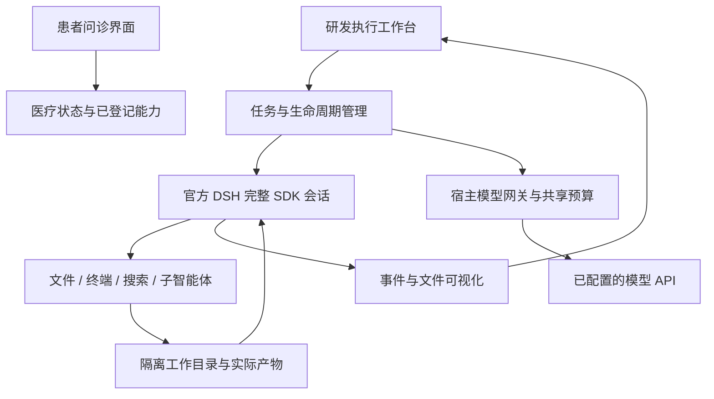

# 通用执行底座与能力评测设计

设计日期：2026 年 10 月 16 日。实现目标版本：0.9。当前采用固定官方 DSH 0.2.0-rc.2；下文将实现、验收与尚未证明的目标分开记录，不以“使用了 DSH”替代能力评测。

## 1. 目标与结构

把现有固定医疗工具循环扩展为能操作环境的系统：读写文件、编写和运行代码、联网检索、委托子智能体、检查结果、修复错误和继续工作。保留患者聚焦界面及现有问诊状态规则。医疗公式的输入、单位、适用条件与来源仍需核对，程序执行成功不自动构成医疗结论。



问诊引擎仍通过原来的 JSON 决策协议操作已登记医疗工具。执行工作台使用官方完整 `sdk` profile，直接继承其真实工具循环、文件工具、终端、任务、搜索、子智能体和上下文管理。没有重写另一套同名工具来假装实现 DSH 能力，也不修改上游依赖源码。

## 2. 执行能力与权限

每个工作区拥有持久文件夹和独立 DSH 运行资料。正常后续回合复用同一运行进程、会话和文件。创建工作区、打开页面或配置模型不自动发送模型请求；提交任务才开始执行。既有工作区固定创建时的模型设置。

执行运行在 Linux bubblewrap 文件命名空间：只读系统运行时、只读项目依赖与适配代码、可写 `/workspace`、该工作区自己的 `/state`、私有临时目录。项目源码目录、项目 `.env`、用户主目录以及其他工作区不挂载。`/proc` 对应私有 PID 命名空间。隔离不可用时启动失败，不回退到宿主无限制命令。

网络明确允许，未宣称提供网络命名空间隔离或完整资源配额。官方匿名网页获取只访问公开 HTTP(S) 地址并验证连接目的地；终端仍具备授权的网络能力。因此这不是多租户不可信代码托管服务。

真实提供商密钥只存在宿主进程。SDK 运行时接收可撤销的随机网关凭证；模型及子智能体共享同一调用预算，不能通过新建子智能体获得额外额度。网关限制请求路径、拒绝重定向、限制请求体和请求时间；提供商响应与事件流对真实密钥和临时凭证进行替换。宿主不把患者病例、桌面鉴权令牌或环境中的其他密钥传入执行环境。

当前执行 API 仅在独立桌面已有的随机令牌鉴权内开放，另检查 Origin。普通无鉴权开发服务器返回拒绝；切换“研发视图”本身不是鉴权。

显式配置且不含嵌入凭据的 HTTP(S) 系统代理会传入执行环境；本机模型网关始终绕过代理。网页提供商复用官方代理与公开目的地策略，不把代理环境中的虚拟 DNS 地址直接当成公开 IP 放行。含凭据的代理配置不直接传给模型环境。

## 3. 生命周期、取消与失败

状态为 `created → starting → running → completed / failed / cancelled`，取消期间为 `cancelling`。同一工作区同时仅允许一个新回合；重复提交返回冲突。当前每轮可选择 12、24、48 次调用，服务端允许范围为 1–64，单运行进程累计最多 200 次，单轮执行时间上限 180 秒。

官方 SDK 没有取消线协议。第一方 Cordis 适配器在私有 Unix socket 上调用官方 `Agent.cancel`、等待 Agent 空闲，并停止本运行时拥有的任务。正常取消保留 SDK 进程和会话；无法确认取消时关闭运行时以保证停止，而不假装仍可无损接续。控制接口不提供宿主命令或宿主文件访问能力。连接使用 fd 相对路径，避免用户长目录超过 Unix socket 路径上限。

只有实际 `turn/end` 的原因是完成，且存在最终回复，才显示本轮完成。服务错误、空回复、超时和预算耗尽均不得归类为完成。后台任务需单独展示运行状态，根 Agent 空闲不代表后台进程全部结束。关闭桌面或宿主管道断开时回收运行时和进程树。

每次模型决策可读取宿主网关给出的真实共享剩余预算与时间，避免子任务并行时无法掌握额度。普通执行采用官方默认推理配置，每次输出上限 8192 token。根回合返回后，后台子任务沿用仍受调用数和时间限制的预算租期，事件订阅持续有效；不会因为主回复先完成就切断子智能体的模型访问。后台结果单独呈现。

v0.9.1 对明确的 `max-tokens` 结束增加最多一次自动接续：剩余调用至少 2 次、进程累计余额至少 2 次、原截止时间剩余超过 15 秒且未取消时，使用同一官方会话继续原任务。调用计数、预算租期、截止时间和进程均不重置。第二次仍截断则报告失败；服务错误和额度耗尽不进入该恢复。界面显示“继续未完成的执行”，最终仍按真实完成状态判定。

v0.9.6 将前台等待与任务总时限分开：命令默认等待 10 秒，单次最多 30 秒；超过后由官方 job runtime 保留同一进程并返回任务 ID。`job_output` 默认等待 10 秒、最多 30 秒，等待结束时仍可继续读取同一任务，180 秒总时限与共享调用额度继续生效。用户仍可停止任务。第一方 `execution-shell.mjs` 继承固定官方 `SandboxBashExecutor`，为 Bash 命令默认启用 `pipefail`，使 `python ... | tail` 保留前面命令的非零退出码。它保留原有执行、后台任务、取消和文件隔离机制；嵌套 shell 与脚本内部自行处理的错误仍服从调用方语义。

覆盖配置使用“禁用原 `bash-sandbox`、插入派生执行器”，因为官方补丁机制会拒绝直接改变既有插件名称。`dsh:check` 现在同时展开医疗最小 profile 和完整 SDK profile，核对替换实例、等待配置及后台移交；真实集成检查另验证退出码 7 和请求等待 600 秒时实际约 30 秒后交还控制、同一后台进程继续完成产物。患者问诊保留原受控工具路径。

配对评测发现简单任务追加复核会耗尽额度，因此提示改为按需委托、通过必要检查后收尾，避免重复检查和未请求的长报告；工具能力与权限没有因此减少。这是待真实重复评测验证的行为优化，不以修改提示本身视为效果已证明。

## 4. 可视化与文件

执行工作台显示用户任务、实际工具调用和返回、子智能体启动与返回、当前状态、实际生成文件及 UTF-8 文本/代码预览。事件增量更新，查看已展开详情时不被轮询重建打断。纯文本与代码通过 `textContent` 展示；不执行模型 HTML、脚本或 SVG。

v0.9.6 按会话与调用 ID 合并工具调用和返回，一次调用对应一张可展开状态卡；调用次数集中在标题栏，原始模型请求仍留在详细事件中。前台非零退出与后台 `completed, exit code: N` 分别显示红色退出状态，移交或继续等待显示琥珀色时钟。输出过长时保留头尾，退出标记不会因只截取开头而消失。状态卡反映工具返回的执行状态，任务正确性仍由独立检查判定。

文件预览逐级使用目录 fd 和 `O_NOFOLLOW`，拒绝越界、符号链接和特殊文件，并限制大小。文件列表同样通过目录 fd 遍历，避免链接替换竞争造成宿主目录遍历；限制数量与深度。运行输出文件保留在本机。v0.9.3 的执行工作区新增宿主索引和官方 DSH 冷恢复：可以离线查看近期任务、关闭及重新打开工作区，匹配原配置后继续原模型会话。患者问诊仍保持原有内存状态方式。范围见 [执行工作区恢复与存储](执行工作区恢复与存储.md)。

v0.9.2 在会话存续期间保留根目录 fd，固定原目录 inode，避免移走或删除再创建后静默采用同名新目录。列表、预览和提交执行均检查目录身份。不可读取时状态接口仍返回可解析结果和存储提示，不影响停止入口；恢复原目录后清除提示。界面不以零替代未知文件数量，也不会把旧工作区延迟返回的预览错误写进新工作区。这不构成对具有同一操作系统用户权限的恶意进程的完整隔离保证。

桌面工作区默认位于桌面“澄心工作区”目录，可通过 `MEDAGENT_EXECUTION_ROOT` 指定。源码直接调用管理器时默认项目 `workspaces`，测试指定临时目录。打包排除工作区、密钥、病例日志和评测产物。

## 5. 插件与医疗能力接入

已有 `medical-capability/v1` 继续描述医疗计算和观察能力；通用执行底座复用 DSH 的 Cordis 插件组合。第一方执行覆盖配置、控制适配器与图形投影独立维护。第三方代码安装属于另外的信任与权限决策，不能仅通过一个任意 manifest 宣称已获得沙箱权限。

v0.9.4 已将注册单位换算接入完整 DSH 的 `medical_capabilities` / `medical_calculate`：固定能力与实现摘要，核对用户原文中的数值和原单位，返回公式、单位与待核对回执，并在原生界面渲染与保存。当前没有自动送入医疗状态控制器，后续临床公式需逐项审核。详见 [注册计算工具与执行回执](注册计算工具与执行回执.md)。自由编写的脚本持续标为研究产物。当前未把任意终端执行开放给患者问诊，也未自动将文件结果回写病例。

## 6. 验收门与 DSH 对照

| 目标 | 能证明的证据 |
| --- | --- |
| 文件与代码执行 | 实际文件内容、真实运行结果和独立隐藏输入检查 |
| 观察错误并修复 | 第一轮故意运行失败，后续请求确实包含错误，修复后实际运行成功 |
| 子智能体 | 官方 lineage 通知、独立子会话工具事件及实际复核产物 |
| 持续会话 | 同一进程、会话、已有文件用于后续回合 |
| 取消和接续 | 长进程被中止，后续副作用文件未出现，同会话再次执行成功 |
| 联网 | 真实搜索和打开网页的结果，来源可访问且确实来自工具返回 |
| 共享预算 | 主任务、辅助搜索、子任务共用额度，越限不再请求上游 |
| 文件隔离 | 命令无法读取未挂载的宿主密钥或写入宿主保护区域；路径/链接/特殊文件检查 |
| 问诊回归 | 原有患者流程、自查、未知、更正、摘要与急症门仍通过 |
| 桌面交付 | 实际打包应用运行上述交互，包含停止、文件预览和进程回收 |

与 DSH 的比较需固定同一版本、模型、提示、预算、任务、依赖和网络环境，重复运行文件编辑、调试、跨文件修改、搜索、委托和中断等任务；由独立检查器判定成功，并记录成本、耗时和失败。已有三个冻结项目各两次的同约束配对，产品 6/6、官方 SDK 基线 1/6。这些自建项目样本不足以代表整体能力；还需独立设计者的广泛保留集及大型项目等任务，不宣称“顶尖”“无错误”或全面不劣于 DSH。

已建立独立官方 SDK 驱动、冻结项目及隐藏产物检查，具体匹配条件、正反验证和统计边界见 [执行能力对照评测](执行能力对照评测.md)。完整执行底座的首批真实调用与失败修复见 [v0.9 验收记录](缓存优化与真实模型评测.md#v09完整执行底座与真实产物验收)。

现已补充四个真实公开仓库 DEV 任务、每个重复两次。严格判定产品 2/8、SDK 基线 1/8；恢复冻结测试、配置和依赖后的实现检查为 4/8、3/8，共 289 次请求。发现接口语义遗漏、修改受保护测试和执行收尾问题；当前可靠性不足，整体不劣于 DSH 仍未证明。该本机适配没有采用官方 SWE-bench harness，也不覆盖临床有效性。[逐项结果与原始证据](执行能力对照评测.md#5-公开仓库-dev-任务补充)。

## 7. 可复现命令

```bash
# 真实 DSH + 本地确定模型，无外部模型花费
npm run test:execution

# 原生桌面实际文件、子智能体、停止与接续
DISPLAY=:1 XAUTHORITY=/run/user/1000/gdm/Xauthority npm run test:desktop

# 真实 API，只使用合成任务；宿主读取 .env，报告拒绝写入密钥
PYTHONPATH=src python3 scripts/evaluate_execution.py \
  --max-total-calls 60 --output .runtime/evaluations/new-execution-round/report.json
```

真实评测应保留失败记录，不覆盖同一报告。代码检查在相同隔离策略下执行，不能把模型生成代码拿到持有密钥的宿主直接 import 来验证。网络失败不替换为虚构搜索结果。最终验收记录应补充实际通过项、源码哈希与尚未验证的范围。

## 8. v0.9.6 记录的缺口与本轮处理

1. 结构化工具反馈：0.9.7 已通过正式 `tools/result` 扩展点独立投影退出码、信号、后台任务 ID 与状态，并验证误导输出、后台非零退出、子会话及冷恢复。实现与边界见第 9 节。
2. 任务契约仍须与判定一致。明确“保护文件逐字不变”与“保留原断言但允许追加测试”的区别，声明允许的新文件、输入、产物及检查命令；若比较算法能力，两条路径应得到相同契约。保持旧报告原样，不能把消除任务歧义后的提升全部归因于模型能力。
3. 后台准备阶段已新增真实 SDK 检查。原记录推测 preparing 会产生 starting 作业状态；核对固定发行版源码后，该推测不成立，其准备阶段实际属于 running。0.9.7 验证准备中保留预算、结束唤醒、拒绝关闭与取消，不声称修复了一个已复现的 starting 生命周期缺陷。适配层对额外 starting 值的容忍属于边界补齐。

已知 DEV 任务可用于开发与故障定位；还需信息充分的独立保留任务、长期上下文与真实问诊质量评估。当前代码正确性样本不足以证明整体达到 DSH，临床与目标用户验证仍是单独的验收门。

## 9. v0.9.7 结构化运行观察

终端输出中的“[exit code: 7]”可以只是程序打印的字符串。0.9.7 使用官方 `tools/result` 钩子的规范 `result.value`，独立传递研发运行观察；原模型工具文本保持原样。前台 Bash 采用 `exitCode`、`signal`、`timedOut`、`aborted` 等字段；后台移交采用任务 ID。`job_output` 采用任务状态，且仅对 Bash 生产者解析其独立 `job.detail` 的退出码或信号，不扫描命令输出，也不将其他生产者的描述当作进程状态。

`execution-observation/v1` 保留运行 epoch、递增序号、SDK 会话/回合/步骤/调用标识、宿主任务归属和有限状态字段，不保存 stdout 副本。工作进程将 SDK 调用与观察关联后传给宿主；同一个调用与返回渲染为一张卡。重复的调用 ID 可通过不同 SDK 回合区分；未知结果显示状态未提供，不能猜测为成功。子会话沿用实际会话标识，不合并为主任务的同名调用。

控制 socket 保留最近 256 条观察，每页最多 64 条，工作进程按游标读取；观察被覆盖时发出缺失事件。宿主整批校验字段、类型、归属和标识，拒绝无效批次、去重并保存最多 128 条近期观察，且只保留仍存在的近期任务。旧 v1 索引未带观察字段时仍可读取；不会根据旧回复补造观察。冷恢复产生明确标记的已保存运行观察，不重放命令或自动请求模型。原始工具输出未因此全部进入宿主恢复索引。

主回复结束不等于所有命令正确。界面顶部另列“本轮出现 N 项运行异常”，可以定位首项详情；对同一后台进程的重复读取按任务 ID 去重。该提示记录本轮曾出现的异常，修复后仍保留过程证据，不将它等同于最终任务失败。没有运行观察时也不推断检查已通过。

后台准备、运行和停止均不得被宿主误当作已静止。固定 SDK 0.2.0-rc.2 的作业类型实际为 `running/stopping/completed/killed/failed`，其中进程准备也属于 running；适配层额外容忍 starting，但本轮没有声称固定 SDK 会发出该作业状态。真实 SDK 测试通过测试目录内的延迟执行器制造准备阶段，验证主回复完成后保留预算、后台结束自动唤醒、准备中拒绝关闭、取消后不生成迟到文件。生产代码没有增加测试开关，也没有修改上游依赖。

这些观察来自与智能体代码同一执行环境的 SDK，通过该环境内的控制 socket 传递，属于研发反馈，不是对抗同一用户权限恶意程序的证明或医疗受信回执。患者注册计算仍使用独立的宿主校验与回执通道；任意终端状态或 JSON 不会自动写入临床事实。

本地真实 SDK 验收包含实际失败、打印误导状态但退出零、子会话关联、跨回合及无凭据冷恢复。原生界面实际检查 0/7/9 的卡片、异常定位、长输出与离线恢复。真实 DeepSeek 定向实验使用相同合成任务，7 次请求全部 HTTP 200，11 项检查通过，69 个冻结运行与评测文件在结束时保持一致。这里只证明所测反馈链路，未重测宽泛编码能力，也不代表临床验证。

```bash
# 本地模型 + 真实 SDK；无付费调用
RUN_DSH_EXECUTION=1 PYTHONPATH=src python3 -m unittest \
  tests.test_execution_observations tests.test_execution.FullDshExecutionTests -v

# 只显示评测任务，不读取 .env 或请求模型
PYTHONPATH=src python3 scripts/evaluate_execution_observations.py \
  --output /tmp/unused-observations.json

# 显式真实模型；全新路径，单次12–32、父目录累计64次上限
PYTHONPATH=src python3 scripts/evaluate_execution_observations.py --live \
  --max-calls 24 --output .runtime/evaluations/observation-new/report.json
```


## 10. v0.9.8 数值运行时与明确任务契约

数值代码不仅依赖 Python 包，也依赖系统动态库的真实解析路径。原隔离环境未挂载 /etc/alternatives，系统 NumPy/SciPy 经该目录解析 BLAS/LAPACK 时失败。当前将该系统目录和 /etc/ld.so.cache 只读挂载；工作区与运行资料的写入边界保持原策略。真实 SDK 回归实际执行 SciPy 对 NumPy 单位矩阵的行列式，随后继续原有错误修复、子智能体和状态恢复，不仅检查配置中存在挂载字符串。此修复同样用于独立官方 SDK 对照。

宿主已有 NumPy/SciPy 与评测工作区自己的依赖分开：新增任务使用的 pandas/h5py 等 wheel 只解压在固定评测工作区，不因此成为产品默认全局依赖。项目仍仅验证当前 Linux x64 环境，未宣称支持任意主机或全部数值库。

新任务契约由 scripts/execution_task_contract.py 同一份目录、文件名和规则定义生成用户提示和判定，明确已有测试不能追加，新测试位于 regressions/test_*.py。原四题的旧提示哈希保持不变，新四题另立实验。具体任务、原始/参考预检、历史 Python 兼容、测试 ID 截断处理和比较边界见 [新增公开任务设计](执行能力对照评测.md#8-v098-明确契约与新增公开任务)。


## 11. 尚需完成的能力验收

工作区当前展示文件列表和代码预览，没有独立于 Git 的逐轮变更快照与受保护文件差异工具。新实验中留下了可能来自上游 CLI 测试的 fixed-suffix 产物，说明仅靠提示要求核对文件还不够。下一步应让主任务和子任务查询本轮新增、修改、删除的实际文件，在界面中直接定位；自动清理必须区分原始文件与本轮临时产物，不能猜测后删除用户文件。

当前每轮总时限 180 秒、可选调用量最多 48 次（API 上限 64），单工作进程累计最多 200 次。这适合受控研究任务，尚不足以证明长时间、大仓库任务能力。后续应提供显式可选的长任务预算并验证到期停止、后台任务、恢复和共享额度，保持默认额度可预期；独立 SDK 对照也须使用相同预算条件。

原 issue、现有接口与测试要求冲突时，应明确展示待核对需求。新的 SQL 实验显示，猜测维护目标或扩大既有行为都会影响验收；一组已知任务的需求澄清复核不能替代更广泛的真实任务质量与临床验证。
