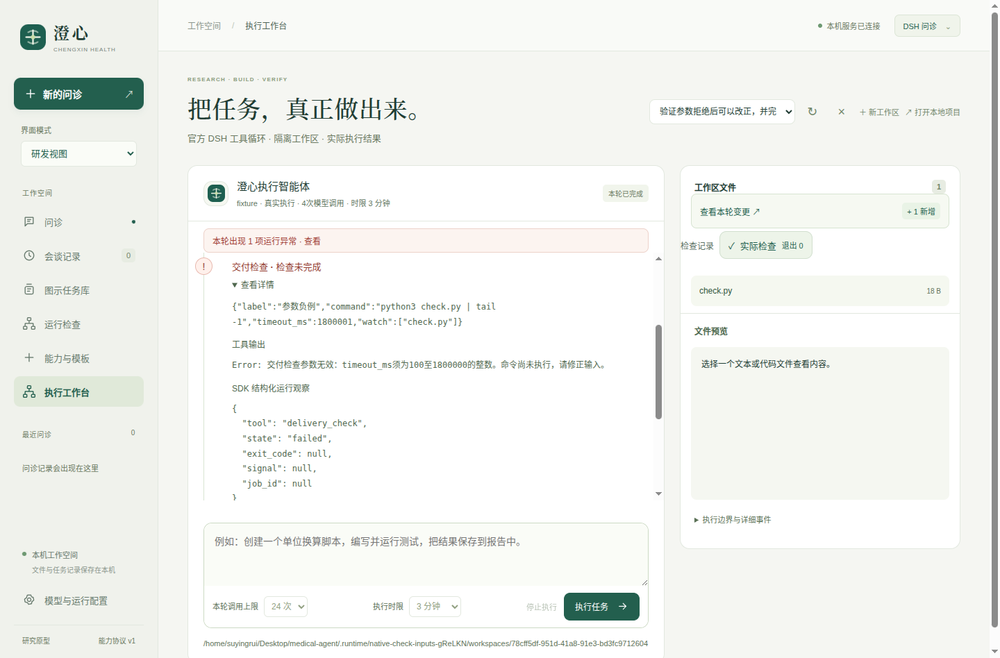

# 0.10.6：交付检查恢复、长任务与范围一致性

本版修复真实公开任务暴露的错误完成门，并发布新的Linux x64桌面包。源码和打包版各16组原生检查、24组患者界面、21项Node断言通过；真实DeepSeek定向合成验收使用3次请求通过。详细计数、长任务和文件哈希见[verification.json](verification.json)。工程通过不等于医疗有效性或总体达到DSH／Codex。

## 改动与边界

- **无效提议可纠正。** 工具与宿主共用参数校验；被拒绝且未执行的调用保留错误详情，不登记虚假必需项。有效失败、丢失回执、未知文件版本仍阻止完成，不能用无效重试或无关成功清除。
- **长检查持续等待同一作业。** 参数默认60秒，上限30分钟，同时受原任务剩余时间约束。每段后台等待最多600秒，不重新运行命令、不增加模型请求、不重置截止时间。实际142秒与605秒命令均已验证；后者约606秒、两段等待、同一个作业。
- **监控范围不丢失显式缓存输入。** 根目录的默认缓存排除不能吞掉`node_modules/pkg`等显式范围；只扫描所选子树。合并、覆盖判断与Python扫描使用一致语义，普通`.git`文件仍作为文件处理。
- **混合Unicode路径可核对。** Node和Python按一致的标量顺序规范化路径，覆盖全角和补充字符组合。

历史异常和实际成功检查分开显示。参数负例未执行，改正后的检查实际退出0；右侧只出现真正登记的检查标记。47号实际打包截图已人工查看：



## 验证内容

常规全量后端230项，227通过、3项长时间检查按开关跳过。三项随后在最终源码上分别实测通过：185秒总预算接续、142秒检查、605秒跨等待边界检查，合计230个不同后端测试均有通过证据。日志与最终状态见verification；不能将这些分次执行描述为一次全量全部开启的运行。最早一轮常规全量未开启集成开关，另有3项集成被跳过，该记录也保留；最终开启集成的全量以`v0106-backend-with-integration.log`为准。

真实模型场景明确要求：先提交超过上限的检查参数，观察拒绝，再使用合法240秒参数执行另一条检查并收尾。3次真实请求完成，负例文件没有出现，拒绝回执没有作业，合法检查退出0、文件版本为当前，没有额外自动纠错，离线历史一致。提示包含预期流程，属于工具符合性验证，不是开放式医学或编码能力分数。240秒是该请求的时限参数；命令自身很短，长时能力由独立实测验证。

[real-provider/round1.json](real-provider/round1.json)保存原始结果和131份调用期冻结文件摘要。最终快照进一步保存204份源码、测试、启动脚本及随附元数据，并另有97个包内项目文件逐字核对、544个适用生产依赖版本核对。版本核对不是全部传递依赖内容的完整性审计；包未内置Python解释器，仍依赖本机运行条件。

## 保存决策的离线重放

3次真实决策在新目录、无`.env`、复用已安装Node依赖的冻结项目中重放，相同符合性、退出状态和源文件检查通过，外部模型调用0。

另取旧版公开任务Matplotlib第二次产品运行保存的20次根决策，在新版控制器下执行原工具并运行独立上游检查及新增测试。旧版根任务因未执行的240秒提议留下验收项而失败；新版两条合法命令实际执行，根任务结束、70个上游节点与3个新增测试通过，文件契约及联合交付通过。冻结项目再次重放相同20次决策也通过。这里没有让模型重新推理，不能算作20次新的真实调用，也不能把旧版产品分数从1/8改为2/8。

旧313次请求、16份候选和原始失败见[冻结对照](../../2026-10-16/v0.10.5-transfer/README.md)。该对照实现验收产品3/8、SDK0/8，联合交付1/8、0/8，产品耗时更长；样本分层、环境、规格差异与公开数据污染风险均保留。

## 复现

普通重放无需模型密钥，先复制最终快照到未使用目录，并复用本机依赖。以下命令从项目根目录执行：

```bash
cp -a docs/evaluations/2026-10-17/v0.10.6/snapshot-final /tmp/chengxin-0106-replay
ln -s "$PWD/node_modules" /tmp/chengxin-0106-replay/node_modules
python3 -B docs/evaluations/2026-10-17/v0.10.6/replay.py \
  --project /tmp/chengxin-0106-replay --output /tmp/chengxin-0106-replay.json
```

公开任务重放需要先按旧版归档的`restore_environment.py`恢复55份冻结环境输入到另一个新目录，再将本版`snapshot-final/.`覆盖到该目录，保留已恢复的任务和准备环境；随后运行：

```bash
python3 -B docs/evaluations/2026-10-17/v0.10.6/replay_public.py \
  --project /tmp/chengxin-0106-public --output /tmp/chengxin-0106-public.json
```

产物输出必须未使用。当前Linux x64、bubblewrap及系统运行库仍需可用。`matplotlib-counterfactual-driver.py`保留首次执行时脚本，依赖当时项目的`.runtime`路径；可移植复现使用上述`replay_public.py`。

## 尚未完成的验证

本轮闭合了参数、等待和范围的工程缺口。跨仓库稳定成功率、复杂长任务的预算利用、新增测试预期是否正确，仍需后续独立样本验证；旧对照中Sphinx、Flask等失败没有被本版自动解决。患者图示理解、临床问诊质量及医学公式适用性仍需目标用户与临床审核。当前注册计算主要是单位换算，不能把通用终端能力视作所有临床公式已经实现。

归档不含本地配置或实际密钥，文件及ZIP解码成员的精确密钥扫描与SHA256清单分别保存。此前0.10.4、0.10.5和313请求对照归档保持原样。
