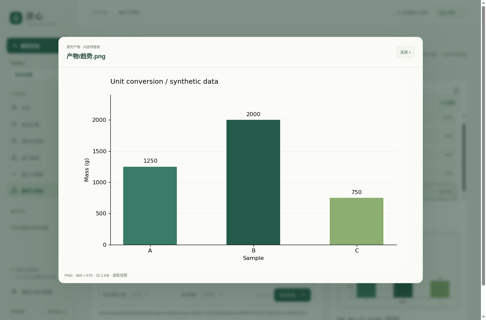
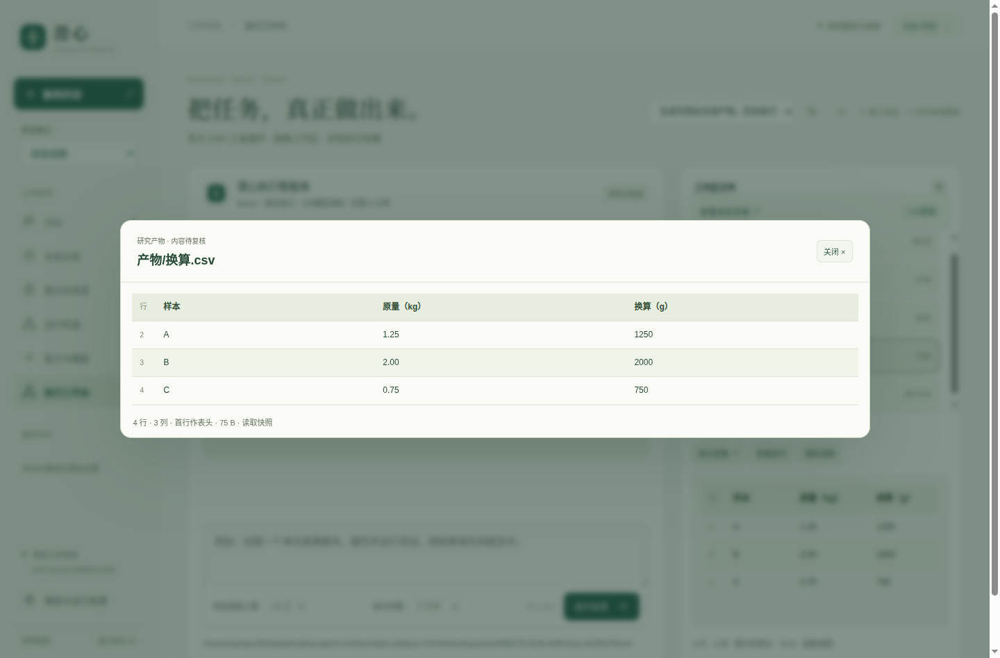

# 0.11.0：实际产物的图像与表格预览

本版让执行工作台直接呈现代码生成的图表与数据表：静态PNG／JPEG、CSV／TSV、放大查看、原文切换、类型标记和文件变化提示。研究产物与患者受信计算、病例事实继续分开。用户可从桌面图标启动，Linux x64程序为`dist/desktop/Chengxin-0.11.0-linux-x64/Chengxin`。





## 工程与交互验证

最终计数、源码／包核对、阶段差异和截图复查见[verification.json](verification.json)。常规后端239项中236通过、3项长时间检查按开关跳过；本版未重跑185／142／605秒检查，先前证据保留在0.10.6，不将它们描述为本版通过。患者界面24组、Node21项、源码与打包版各17组原生检查通过。

新增原生检查通过真实SDK命令运行Matplotlib与CSV写入，确认PNG及JPEG由浏览器实际解码、中文文件路径、表格／原文切换、HTML与公式字符串不执行、摘要失效与破损图片反馈、迟到响应隔离、文件刷新后的键盘焦点、900像素窗口放大层，以及无模型密钥的离线恢复。查看、放大与恢复未增加模型请求。这是本机确定模型的工程测试，不是真实患者或真实模型临床评价。

第一轮后端检查发现大小与时间戳在快速改写后可能不变，因此不把列表元数据当作内容证明；最终所选文件由有界字节摘要复核。预览仍是读取快照，不保证原子性或两次观察间未变化。图片加载也要求与元数据投影相同的摘要。相关错误、首轮记录和最终日志均保留。

真实模型调用后，另发现稳定文件的重复核对会重写同样状态文字，原生DOM观察的负例得到1次变化。最终只在文字或摘要提示属性真正变化时更新，回归扩大到文本及属性观察；源码与打包版另行验收。该最后修改只涉及`execution-artifact-ui.js`，不改变执行底座、persona、任务或评分；因此最终前端与第二轮调用期前端有一处已记录差异，不能声称整份最终映射与调用期完全相同。

## 真实DeepSeek：失败与迭代

两轮使用同一任务、同一评分、相同每轮8次上限，总计12次真实请求。任务要求为A=1.25kg、B=2.00kg、C=0.75kg计算克数，实际写入CSV、生成带单位的PNG并自检。

| 维度 | 首轮 | 第二轮 |
| --- | ---: | ---: |
| 实际请求 | 7 | 5 |
| 独立CSV数值核对 | 通过 | 通过 |
| 实际静态PNG及表格投影 | 通过 | 通过 |
| 离线恢复投影 | 通过 | 通过 |
| 根任务正常结束 | 失败 | 通过 |

首轮模型将`1250.00`与`1250.0`的格式差异当作测试错误，并登记了相互矛盾的内联自检命令；改正其中一条没有消除另一条有效失败，完成门正确保留未完成。独立数值检查按Decimal比较，因此两轮数值都正确；不因图片看起来正确而改写首轮失败。

随后仅补充通用执行指引：优先复用既有测试；新增自检先写稳定测试文件；按真实规格修正断言并重用原命令；数值精度与文本格式分别判断。第二轮模型写出固定`test_plot.py`、实际执行检查、调用`read_image`后正常结束。该自检仍使用固定CSV文本断言，不能声称模型已经普遍采用数值语义测试；独立评分另行按数值比较。

真实输出图已人工查看，A/B/C数值与CSV和纵轴单位相符；自动程序只验证数值表、静态图片结构／尺寸／摘要及真实检查，未自动识别图中内容。这是一个明确合成任务的符合性验证，未证明普遍提升准确率、节约成本或达到DSH／Codex总体能力。

原始报告为[首轮](real-provider/round1.json)和[第二轮](real-provider/round2.json)，每轮分别冻结134份调用期文件且调用期间未改变。两轮调用期映射仅`execution.patch.yml`不同，用户任务与评分代码保持一致。第二轮实际自检文件另从已关闭工作区收集，与原始规范工具写入内容逐字一致，记录在`additional-files`；不是新调用或评分修订。

## 离线重放与边界

最终快照包括源码、测试、JPEG测试素材、启动脚本及包内元数据。两轮保存的7／5次决策在无`.env`的新目录、复用已安装Node依赖的环境中重放，首轮仍失败、第二轮仍成功，数值与图像检查一致；外部模型调用0。首轮原persona不同，保存决策在最终代码下执行不等于原始运行全部条件完全重现，也不是两轮新的模型评测。

从项目根目录执行，目标与输出必须未使用：

```bash
cp -a docs/evaluations/2026-10-17/v0.11.0/snapshot-final /tmp/chengxin-0110-replay
ln -s "$PWD/node_modules" /tmp/chengxin-0110-replay/node_modules
python3 -B docs/evaluations/2026-10-17/v0.11.0/replay.py \
  --project /tmp/chengxin-0110-replay --output /tmp/chengxin-0110-replay.json
```

需要本机Linux x64、bubblewrap、系统Python及Matplotlib／字体运行环境；没有打包成可移植实验容器。文件投影使用Python标准库，生成图表的示例依赖本机Matplotlib。图片最多4MiB、8192单边及16,777,216像素；表格最多128,000字节、前100条非空记录和24列，首行作表头并提供原文，限制与格式问题直接提示。

HTML／SVG不执行，表格公式不求值。图像或脚本不是注册医疗能力回执。患者查体动作的视觉核验、医学公式适用性、临床效果及目标用户理解均未因此得到验证；原公开任务失败仍保留。完整协议见[产物展示设计](../../../结构化展示协议与组件扩展.md#v0110-执行产物的图像与表格)。归档另有精确密钥扫描及SHA256清单，旧版本归档保持原样。
