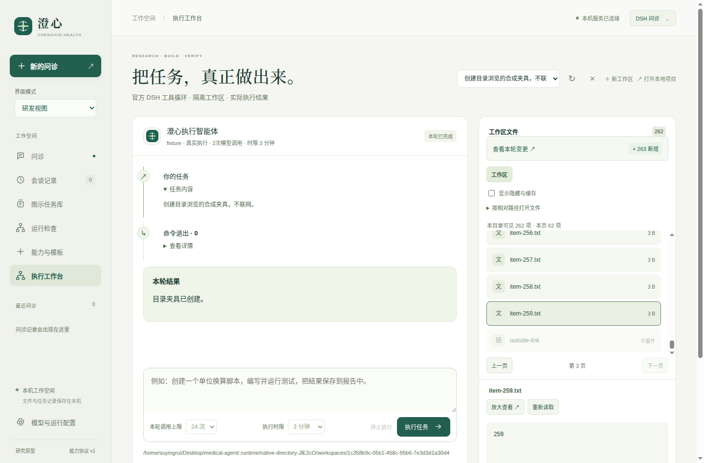
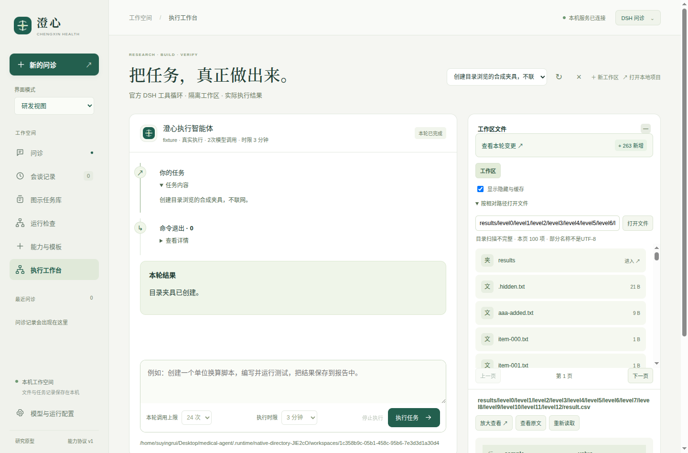

# 0.11.1：可达的文件浏览与明确的列表范围

修复执行工作台只能依赖最多200个文件、1000个遍历条目和8层深度概览的问题。新版按目录逐层浏览、每页100项，提供目录导航、隐藏与缓存切换、相对路径直接打开；文件是否存在不再由当前页是否包含它推断。Linux x64桌面包为`dist/desktop/Chengxin-0.11.1-linux-x64/Chengxin`，桌面图标指向新版启动脚本。



## 已验证的行为

后端全量249项，246通过、3项长时检查按开关跳过；10项新增目录检查包含275个文件加两个子目录的完整分页、13层路径、目录变更使游标失效、实际10,005文件触发默认扫描边界后仍可直接访问文件、非法UTF-8名称、路径隔离及桌面HTTP鉴权。3项185／142／605秒检查本版未重跑，历史证据保持0.10.6版本归属。

患者界面24组、Node21项、源码与打包版各18组原生检查，以及101个包内项目文件逐字核对和544个适用生产依赖版本核对，逐项结果见[verification.json](verification.json)。计数不是临床有效性或总体达到DSH／Codex的证据。

原生新流程由真实DSH SDK运行合成命令建立260个文本文件、子目录、链接、隐藏项和深层CSV。实际验证第3页文件预览、目录变化后返回第一页、隐藏项筛选、13层文件相对路径打开、回到根目录后所选CSV仍可查看、不可显示名称的未知数量、旧工作区迟到响应隔离及无凭据恢复。交互前后本地确定模型请求均为2；本轮外部模型调用0，未重新评价模型编码准确率或视觉理解。

## 原始缺口与后续修正

[基线探针](file-coverage-baseline.json)记录实际深层CSV存在且原预览接口可读取，但原概览返回空且没有覆盖说明。兼容概览现在提供`artifact_scan`，明确是否扫描、是否完整及范围原因；界面状态轮询使用`include_artifacts=0`，保留根目录存在／身份检查而不递归扫描项目。

复查发现后台目录请求会禁用相对路径输入，原生延迟响应负例得到“Expected enabled / Received disabled”；日志、错误上下文和trace保留。修正后区分后台读取与主动导航，输入、隐藏项选择与新操作不会被后台请求锁住。最终检查实际暂停目录响应，验证输入仍有焦点、可以继续打字与切换到下一页，再切换工作区，确认旧响应不覆盖新结果。错误不会被改写成已通过。另一个原生负例将正在查看的13层子目录临时移走，发现旧条目和数量仍残留；最终读取失败会清除旧列表、数量显示未知，恢复目录后自动重新读取并可再打开CSV。

首轮整包回归另有一次测试采样竞态：本地项目路径已显示，选择器还在异步更新，测试过早保存空ID，后续实际UUID被错误地与空值比较。原始失败保留；测试现先等待有效ID，再验证相同项目身份、7次本地模型请求不增加及离线恢复，不修改产品的身份复用逻辑。



## 范围与语义

计数只指当前目录的当前筛选，包含子目录、普通文件和链接。默认隐藏点名称及常见缓存；显式目录路径仍可访问其中的可见项。链接只显示、不跟随。当前目录没有条目不代表整个工作区没有产物。

单次最多观察10,000项，使用约1秒循环预算；底层慢文件系统调用不保证能在该预算内中断。无法读取、非法UTF-8名称或达到边界时，`scan_complete=false`、`total_entries=null`，显示不完整及原因，不将部分列表当成完整总量。目录导航最多64层、4096字符；文件直接预览另外遵循既有安全读取和大小限制，可访问未包含在概览或当前页的实际文件。

游标关联目录身份、路径、筛选和已观察名称／类型摘要。文件内容改变不强制回到第一页；目录条目变化时旧游标返回409，界面从第一页重读。它不是事务快照或权限令牌，不证明并发变化期间获得了原子目录视图，也不证明部分扫描之外的稳定性。选择文件的内容状态仍由有界SHA256复核，与目录分页相互独立。

## 冻结源码复验

最终快照包含214份源码、测试、JPEG素材、启动脚本及包内元数据。无`.env`、无Node安装的新目录使用冻结代码实际运行24项目录、预览和工作区读取检查，通过后再核对源文件未改变；外部模型调用与下载均为0。该复验没有重跑原生Electron流程，也没有运行临床评价。

从项目根目录执行，输出和目录必须未使用：

```bash
cp -a docs/evaluations/2026-10-17/v0.11.1/snapshot-final /tmp/chengxin-0111-check
python3 -B docs/evaluations/2026-10-17/v0.11.1/verify.py \
  --project /tmp/chengxin-0111-check --output /tmp/chengxin-0111-check.json
```

需要当前Linux及Python 3.10+；原生桌面另需已安装的Node／Electron和图形会话。完整协议见[目录与覆盖设计](../../../结构化展示协议与组件扩展.md#v0111-目录浏览与覆盖范围)。打包版仍依赖系统Python，不是跨平台安装包。

此前0.10.4、0.10.5、313次调用对照、0.10.6和0.11.0归档保持原样。本轮保留的源码、诊断、截图和日志纳入SHA256清单；精确密钥扫描涵盖普通文件及ZIP解码成员，归档不含本地配置。工程验证不代替患者问诊质量、图示理解或临床审核，整体优化目标仍未完成。

下一项已定位的问诊质量核查是[演示解析器的部分未知叙述](next-audit/demo-partial-uncertainty.json)：直接解析合成输入“昨晚用过药物甲，用量不清楚”时，整个字段被标为未知。该探针尚未评价完整控制器的原文保留或真实模型问诊，不构成临床结果；本轮文件浏览改动没有解决这一待核查项，整体目标保持进行中。
