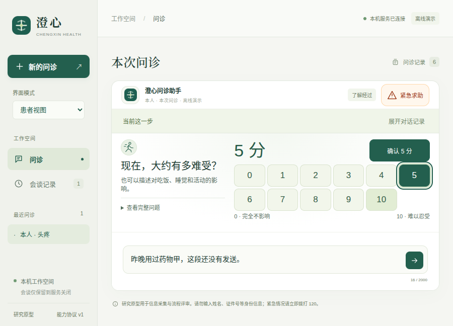

# v0.11.10：图形答案与文字草稿分开

点选不适分数不再覆盖患者另写的文字。程度卡片采用“选择 → 明确确认”，确认只提交该分数，文字补充仍待发送。当前页面内切换会谈可恢复同一动作的选择；旧控件不能回答新问题。900×680原生窗口采用问题与刻度左右布局，标题、全部刻度、确认及输入同屏。

本轮为合成工程验证，没有新增临床内容或真实模型评估，不证明患者理解效果、诊断效果或整体DSH／Codex能力。[组件交互设计](design.md) · [机器结果](results.json)。

## 先复现，再改动

在旧v0.11.9中，先在输入框写“昨晚用过药物甲，这段还没有发送”，再点击5分，文字会被替换为“5分”。[原始失败日志](logs/baseline.log)和[完整轨迹](baseline-failure/)保留。修改后，同样的文字保持不变，选择本身不改变病例或事件；确认只产生一条“5分”发言，用药文字不被暗中发送。

第一版交互修正通过了窄屏检查，但900×680原生检查发现：刻度获得焦点后，问题标题被滚动挤出视野。[第一次原生失败](logs/native-first.log)、[原始轨迹](native-first-failure/)保留。最终改为短窗口下左侧问题、右侧数值和两行刻度；检查继续要求标题可见，没有删除该断言。[修正后](logs/native-second.log)。

## 要求与证据

| 要求 | 证据 | 范围 |
| --- | --- | --- |
| 选择不写病例、不覆盖文字 | [共享真实控制器流程](source/tests/fixtures/visual-answer-drafts.mjs) | 选择前后事实与事件一致 |
| 确认只提交所选分数 | 同一流程核对仅新增一条5分原话、程度值为5、文字仍保留 | 不自动发送用药补充 |
| 会谈间分别恢复 | [新增界面检查](source/tests/ui/visual-answer-drafts.spec.mjs) | 同页面、同会谈与动作；不保证刷新恢复 |
| 0与10、键盘、只读与忙碌 | 同一流程及只读／忙碌／无提交回调检查 | 未选无默认值，不能借重新启用按钮触发动作 |
| 旧动作不能回答新问题 | [绑定上下文](source/src/medagent/web/app.js)、共享流程中的强制旧按钮点击 | 客户端绑定与既有服务端动作检查共同执行 |
| 小窗口内保留问题和操作 | [原生检查](source/tests/desktop/visual-answer-drafts.spec.mjs)、[CSS](source/src/medagent/web/styles.css) | 900×680、390×844及1440×1080实际几何和截图检查 |

实现位于[受信问题组件](source/src/medagent/web/visual-question.js)。`question`服务端协议不变，模型不下发处理器。组件草稿由宿主注入，文字使用独立草稿；二者都只保存在页面内存中，不写localStorage、不自动上传。改变动作后不沿用旧选择，确认也不等于临床验证。

## 检查结果

- 默认后端收集331项，277项通过、54项显式跳过。[原始日志](logs/backend-full.log)。本轮未另跑其中51项DSH／SDK和3项长时限检查；不把旧版结果计成本版新增通过数。
- 浏览器完整**52组通过**，新增4组覆盖独立草稿、会谈恢复和无效交互。[完整日志](logs/ui-full.log)、[最初定向通过](logs/ui-first.log)、[扩展后10组](logs/ui-second.log)。原有程度用例从“写进输入框再发送”改为验证明确确认后的实际服务器状态，保留“选择不写入”的要求。
- 源码与打包版分别**30组原生检查通过**，包括已有真实DSH运行时配合本机确定模型的工作台回归，以及新程度卡片。[源码](logs/native-source-full.log)、[打包版](logs/native-package-full.log)。本机确定响应不是实际提供商判断。
- DSH桥接21项、固定运行时配置和Prettier检查通过。[桥接](logs/bridge.log)、[配置](logs/dsh-check.log)、[格式](logs/format.log)。

## 模型与来源范围

本轮新增真实提供商调用为**0**。与已封存v0.11.9比较86个医疗控制器、内容、桌面宿主及DSH接入文件，仅两个Python文件的应用／策略版本文字变化；其余来源完全相同。[字节比较](core-source-comparison.json)。变化集中在图形答案、页面动作绑定、布局、界面测试与文档，不据此声称交互行为没有变化。

上一版[17次真实DeepSeek调用](../v0.11.9/README.md)和51项独立DSH／SDK结果作为既有证据保留，未冒充本轮调用或新通过数。当前完整原生回归会再次实际启动相同DSH运行时、执行命令和子任务，但使用本机模型fixture。病例均为合成内容，未开展临床审核或真实患者易用性研究。

## 截图与冻结复验



[390像素窄屏](screenshots/70-mobile-degree-draft.png) · [宽屏](screenshots/70-wide-degree-draft.png)。所有截图均为真实应用操作生成，采用离线演示后端。

[276个冻结文件](source/)、[摘要](source-files.json)、[离线验证器](verify.py)及[153项选定检查结果](frozen-verification.json)。验证器不调用外部模型、不下载数据，冻结范围不包括操作系统和全部依赖。运行输出应使用新的归档外路径：

```bash
python3 -B docs/evaluations/2026-10-17/v0.11.10/verify.py \
  --project docs/evaluations/2026-10-17/v0.11.10/source \
  --output .runtime/visual-answer-frozen-replay.json
./scripts/start-desktop.sh
```

最终Linux包109个自有文件与当前来源一致，544个适用生产依赖版本与锁文件一致。[包核对](package-audit.json)。这不是全依赖内容完整性审计。全部验证后扫描文件与解码ZIP中的精确配置凭据值，再封存；扫描不保证发现任意秘密。

构建前将旧生成包0.9.7／0.9.8无损压缩保留在`dist/desktop/archives/`，分别验证29,518个条目的内容、权限和链接。确认无进程使用后移除展开副本；当前、上一版和历史评测归档保留。[0.9.7记录](old-bundle-0.9.7-storage.json)、[0.9.8记录](old-bundle-0.9.8-storage.json)含恢复命令，索引和[原整理脚本](archive-old-bundles.py)一并归档。存储整理不计入智能体能力。
