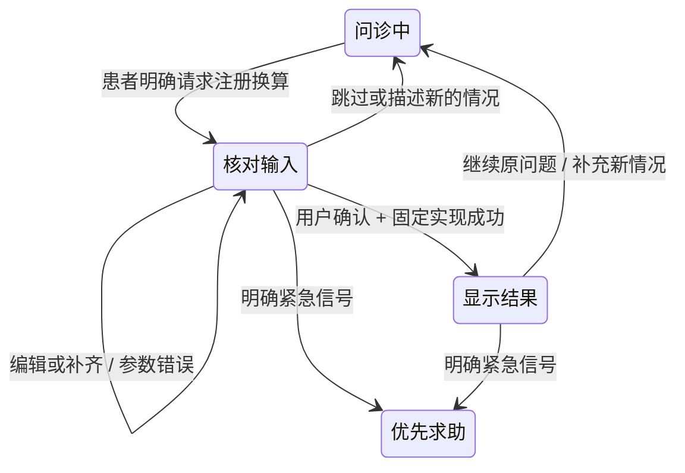

# 患者计算输入与问诊衔接

v0.11.8扩展：纯换算保留零额外调用；包含其他信息的请求将完整原话带回问诊继续处理。见[同轮补充与接续](计算请求的同轮补充与接续.md)。

版本：0.9.5，2026 年 10 月 16 日。患者问诊中的 `run_capability` 改为提出换算和展示输入卡；实际计算由用户核对后触发。完整 DSH 执行工作台的 `medical_calculate` 仍服务研发任务，协议与权限不混用。

## 交互



主交互区域一次显示一张输入卡或结果卡。输入卡突出数值、原单位、目标单位与方向；缺失字段保持空白，没有示例值冒充患者输入。用户可直接编辑、核对后计算或跳过。原话和适用范围按需展开，不占主视觉。手机端使用上下两层输入，确认按钮保持在可见区域。


成功后显示最终数值、单位、最终输入和公式。“输入已核对”仅表示用户确认了计算参数，测量质量仍未评价；结果不写入临床事实。点击“继续问诊”恢复此前未回答的问题，包括原来的澄清措辞；若此前问题已完成，交回问诊规划器决定下一步。患者也可以直接描述新情况，结束当前计算交互。


## 模型与控制器分工

模型使用现有工具名，参数增加本轮原文证据：

```json
{
  "tool": "run_capability",
  "arguments": {
    "id": "calculate.units",
    "input": {"value": "1.25", "from_unit": "kg", "to_unit": "g"},
    "evidence": "请把1.25kg换算成g"
  }
}
```

`input` 可只包含已知字段或为空；显式 null/空字符串按缺失处理，不支持的字段仍会被拒绝。临床模型目录分别提供 `proposal_input_schema`（无必填项）和 `execution_input_schema`（完整输入），避免缺参数时绕回无关病史问题。数值与原单位同时给出时，复用完整原文的数量核对策略，拒绝伪造、错数、负号或数字片段截取。不能可靠预填时需要留空或补问。目标单位即使在原文中出现，也只作为待核对提议，不能据此声称已理解其医学含义。

控制器只为声明了受信 `patient_form: unit_conversion/v1` 且参数契约匹配的能力展示此组件。能力清单本身不能导入代码。新能力需受信实现、匹配的交互与证据策略，不能仅改 ID 就得到任意患者工具。此版本只开放固定同量纲单位换算，没有新增诊断、药物剂量、摄入量估算或查体动作。

提出输入卡即结束当前模型循环；在用户明确确认前不调用计算实现。计算、错误回显与恢复已知问题均可由控制器完成。若需要重新规划问诊，才调用模型。输入卡不是执行任意代码的审批入口，不向患者开放终端或联网工具。

## 提交与状态一致性

仍使用 `POST /api/sessions/{id}/messages`，增加可选 `calculation` 数据。确认请求携带当前动作版本与提议 ID：

```json
{
  "text": "核对换算：2 kg → g",
  "choice_value": "confirm_calculation",
  "expected_action_id": "当前页面动作标识",
  "calculation": {
    "proposal_id": "当前卡片提议标识",
    "input": {"value": "2", "from_unit": "kg", "to_unit": "g"}
  }
}
```

缺失或过期的版本/提议标识返回冲突，不先写入新用户回合或计算结果。重复确认不能再次执行。额外字段、非法数值、类型错误与跨量纲换算不生成成功回执；有效的编辑内容保留供修正。更正病例使旧提议失效，全局能力启停继续只影响新会谈。

回执保存初始提议、最终确认输入、最初请求原话、请求及确认回合和能力版本。用户可以把最初的 1.25 改为 2；结果按最终 2 计算，同时保留修改前后信息，不能把最初引文当成对新数值的独立证明。来源为 `patient_confirmed_form`，质量始终 `not_assessed`。

如果服务已完成计算但界面没有收到可用响应，按同一快照恢复最新结果，不自动重放确认请求。浏览器与原生故障检查均模拟这一情况；原生测试通过正常 Electron 鉴权链提交请求，未放宽鉴权。

紧急信号在处理卡片动作之前检查，即便动作版本过期也优先转入现有求助路径，并取消待核对计算。现有急症规则覆盖有限；本次没有新增或验证医学阈值。患者会谈与卡片仍保存在服务内存，刷新可恢复，关闭服务后不会保留为病例数据库。

共享的数量证据策略抽为独立模块，注册表也增加了患者组件声明，因此原执行工作区的能力绑定可能检测到实现/清单变化。旧回执仍可读取，通用终端等执行保留；要使用新版本注册计算需新建工作区，不静默替换旧绑定。

## 验证

```bash
PYTHONPATH=src python3 -m unittest discover -s tests \
  -p test_patient_calculations.py -v

npm run test:ui -- --grep 'patient calculation confirms'

DISPLAY=:1 XAUTHORITY=/run/user/1000/gdm/Xauthority \
  npm run test:desktop -- --grep 'native patient calculation'

# 真实 API + 实际原生窗口；仅合成数据，明确限制请求数。
DISPLAY=:1 XAUTHORITY=/run/user/1000/gdm/Xauthority \
  PYTHONPATH=src python3 scripts/evaluate_patient_calculations.py \
  --max-calls 24 --binary dist/desktop/Chengxin-0.9.5-linux-x64/Chengxin \
  --output .runtime/evaluations/new-patient-calculation-round/report.json
```

实际结果与失败记录见 [真实模型评测](缓存优化与真实模型评测.md)。工程通过不代表临床有效性，也不证明整体能力已不低于 DSH。
