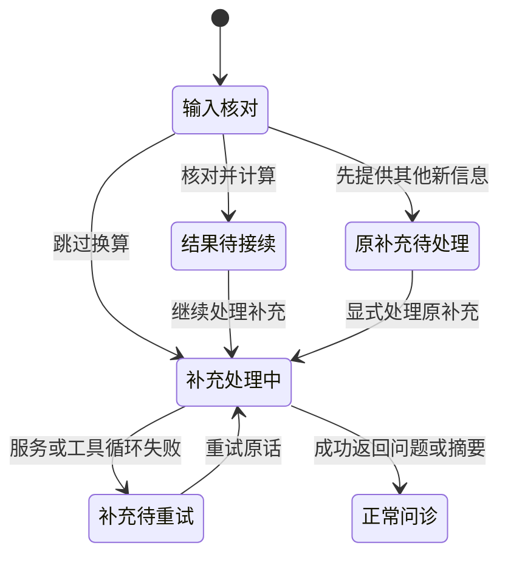

# 计算请求的同轮补充与接续

实现版本：0.11.8。修复患者在一句话中同时提出换算并补充病史时，计算优先路径跳过剩余信息的缺口。

## 复现与目标

原型接受“我自己32岁，咳嗽两天；请把1.25kg换算成g；昨晚用过药物甲”。若模型先选择计算，v0.11.7完成计算后直接回到开场，只有1次模型请求，病例仍空；完整原话虽在对话中，却没有待处理提示，也没有被接续处理。保存原话不等于处理原话。

新行为：换算卡保留同轮完整输入；核对或编辑后由宿主计算，结果不自动成为病例事实。患者点“继续处理补充”后，将完整原话和原来源轮次送回实际问诊循环，处理补充，再选问题或核对摘要。跳过换算也会处理同轮补充；不会把跳过解释为否认病史。

## 状态与输入来源



`calculation_feedback`是宿主会谈中的待接续状态，保存完整原话、来源轮次、提议ID、能力ID、执行／跳过状态及当时事实版本。公开投影`calculation_followup`只暴露必要的来源与状态，不暴露内部事实快照。

- `pending`：尚待接续或需要重试。
- `forwarded`：完整原话已带入问诊且本轮成功返回可见动作，不保证全部语义已正确记录。
- `unprocessed`：求助等更高优先级路径结束会谈，没有宣称补充已处理。

重复处理原话不会再次计算或重开同一输入卡。已计算结果保留；服务错误重试使用原始内容和来源，而不是按钮文字。若患者先说新的情况，处理当前新话，原补充继续显示待处理入口；两者不拼成伪造的一轮患者发言。较早补充未解决前不以新计算覆盖它，当前实现最多保留一条这类待接续输入。

## 时间顺序与原子性

接续原话时，每次事实写入仍经过原有的连续引文、类型、断言与更正校验。若当前事实版本已在原话之后更新，较早原话不能覆盖它。依赖失效也受同样保护：旧主诉更正不能间接移除后来记录的用药；先检查所有受影响字段，再取消任务或修改事实。被拒绝的整批提议反馈给模型修正。

患者在服务失败后作显式字段更正，属于新的操作，不会因此把先前补充标记为已处理。待处理补充存在时，摘要可查看，但不能直接确认结束；处理后重新核对。明确求助和已有风险路径仍优先，不等待补充模型调用。

## 纯换算与可视化

使用有限的请求词、已注册单位和数字词法识别简单换算请求。匹配已知简单表达时，核对、换算和返回原问题仍为零额外模型请求；出现不认识的剩余文字，则保留整段原话待接续。它不是完整的临床意图识别，可能多触发一次接续，但不靠模型缩短的引文来丢弃其他内容。词法逐段前进，避免在长输入上做歧义嵌套回溯。

混合请求在输入卡显示一个折叠状态；结果主按钮明确写“继续处理补充”，原话放在可展开依据内。错误显示简短待重试状态，已计算结果保留在记录。患者先说新情况时，当前问题上方提供“处理补充”，历史入口不能操作当前会谈。原话按普通文本渲染，不生成可执行界面代码。

## 验证与边界

本地检查覆盖完整／缩短引文、核对和跳过、失败重试、不重复计算、新旧输入分开、直接更正与间接失效保护、摘要确认、过期动作、求助优先及重复测量中断计算。界面使用真实控制器和确定模型，检查窄屏、原生小窗口、页面恢复和来源轮次。真实DeepSeek合成评估另冻结运行前源码并设调用上限，不能以本机模拟模型结果代替在线结果。

```bash
PYTHONPATH=src python3 -B -m unittest tests.test_calculation_supplements -v
npm run test:ui -- tests/ui/calculation-supplements.spec.mjs
DISPLAY=:1 XAUTHORITY=/run/user/1000/gdm/Xauthority npm run test:desktop -- tests/desktop/calculation-supplements.spec.mjs
```

这是信息保留与流程接续的工程改进，不新增诊断、药物或视觉测量能力，也不代表临床验证。原始轨迹、截图和最终结果见[v0.11.8归档](evaluations/2026-10-17/v0.11.8/README.md)。
