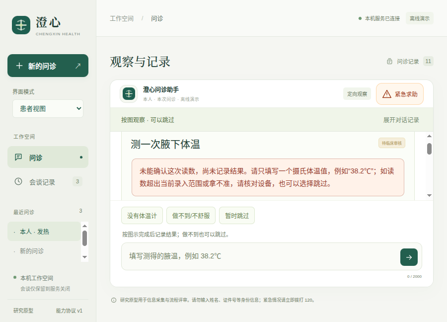

# v0.11.11：图示任务草稿与同一次操作的接续

为每次图示任务绑定宿主事件身份。部位选择、步骤与文字补充分别保存，切换会谈、展开历史再返回可恢复同一次任务；录入错误保留当前步骤，新一次同名任务从头开始。错误提示在完整布局后进入可见区域并获得焦点，避免患者只看到旧图而不知道为什么没有记录。

本轮为合成工程验证，未新增临床内容、实际提供商评估或患者理解研究。[交互设计](design.md) · [机器结果](results.json)。

## 缺口与原始失败

旧v0.11.10的部位图把未确认选择保存在DOM闭包中，切换会谈后输入文字可恢复，部位选择却丢失。[首次复现](logs/baseline.log)、[原始轨迹](baseline-failure/)保留。新的部位草稿不自动写病例，确认只提交部位，另写的文字仍待发送。

图示步骤原先按会谈、任务名称、版本和重复标记保存，首次任务使用共用的initial标记。新协议区分每次实际提供，既避免新一次同名任务复用旧进度，也允许明确接续较早任务。原型实现曾只选择最新offered事件，导致恢复较早任务后再遇录入错误时身份变化；[复现失败](logs/resume-first.log)和[修正后38项定向回归](logs/backend-second.log)保留。

900×680截图另发现：测温错误在DOM中存在，却被保留的旧滚动位置藏在视野外。[原始失败](logs/native-error-first.log)、[原始轨迹](native-error-failure/)、[失败截图](screenshots/native-error-before.png)。第一次仅重置滚动仍失败，因为后续快捷选项使任务区域再次变小；[第二次失败](logs/native-second.log)、[轨迹](native-second-failure/)保留。最终在完整布局后检查整段错误的实际几何位置并给予焦点，[通过日志](logs/native-third.log)没有删除可见性断言。

首次扩展界面回归的两项失败来自测试驱动：移动端没有先打开菜单，纯发热场景也被误假定已跳过呼吸相关问题。修正为走真实菜单和实际问题后通过，没有修改产品以绕过这些流程。[失败日志](logs/ui-second.log)、[原始轨迹](ui-second-failure/)、[14项通过](logs/ui-third.log)。

## 要求与证据

| 要求 | 证据 | 范围 |
| --- | --- | --- |
| 身份来自本会谈宿主事件 | [标识投影](source/src/medagent/task_interactions.py)、[9项新增检查](source/tests/test_task_interactions.py) | 初次提供、实际重复尝试、会谈隔离和旧动作回退 |
| 不污染内容目录与临床事实 | 同一检查及[回复记录](source/src/medagent/consultation.py) | 先复制任务，元数据不是测量证明或授权令牌 |
| 同一次恢复，新一次重置 | 新增后端检查与[界面检查](source/tests/ui/self-check-drafts.spec.mjs) | 明确恢复较早任务后，错误仍沿用被恢复的身份 |
| 部位、步骤和文字独立 | [共享真实控制器流程](source/tests/fixtures/self-check-drafts.mjs)、[页面绑定](source/src/medagent/web/app.js) | 确认前事实及事件不变，确认只增加一次部位发言 |
| 旧控件、只读与忙碌保护 | 同一界面流程、[受信组件](source/src/medagent/web/structured-ui.js)、[部位组件](source/src/medagent/web/visual-question.js) | 恢复草稿，不沿用旧回调；界面不是服务端授权边界 |
| 错误可见，保留第3步 | [原生流程](source/tests/desktop/self-check-drafts.spec.mjs) | 实际录入错误、零读数写入、错误整段位于900×680任务视野 |

步骤按会谈、任务、内容版本和interaction_id保存；页面私有交互草稿复用现有机制，文字仍独立。未确认选择不上传、不写localStorage，刷新／关闭后不保证恢复。较大图示仍在任务区域内滚动，本轮不声称所有图示、说明及操作在所有窗口同时可见。

## 本轮验收

- 默认收集340项，286项通过、54项显式跳过。其中51项实际DSH／SDK检查单独全部通过，合计**337项不同后端检查通过**。三个历史长时限检查本轮未跑。[默认日志](logs/backend-full.log)、[51项日志](logs/sdk-full.log)。SDK使用本机确定模型，实际运行官方运行时和工具，不代表真实提供商规划能力。
- 浏览器完整**56组通过**，新增4组覆盖宽／窄屏部位草稿、真实测温错误与任务发生次序。[完整日志](logs/ui-full.log)。
- 源码与最终打包版分别**31组原生检查通过**，包含现有工作台、代码执行、子任务、计算、测量、摘要和优先求助回归。[源码](logs/native-source-full.log)、[打包版](logs/native-package-full.log)。
- DSH桥接21项、固定运行时配置、Prettier和4个本轮Python文件Black检查通过。[桥接](logs/bridge.log)、[配置](logs/dsh-check.log)、[Prettier](logs/format.log)、[Black](logs/black.log)。配置的零宿主工具指患者决策传输，独立执行工作台保留完整工具。

## 模型范围与来源

本轮实际提供商请求为**0**。两个独立Python进程分别从复制的v0.11.10与冻结的新源码构造模型固定提示，11个医疗工具和静态前缀摘要完全相同。[旧前缀](prefix-before.json)、[新前缀](prefix-after.json)、[无模型调用的驱动](prefix_probe.py)。这只核对固定提示，不证明所有动态模型输入或临床结果相同。

当前验证覆盖宿主展示元数据和接续行为，没有增加医学动作、修改任务适用性、测量解析或风险规则。已有[v0.11.9的17次真实DeepSeek合成评估](../v0.11.9/README.md)保留为历史证据，不冒充本轮调用，也不用于宣称本轮已通过新的真实模型判断。更复杂的图示内容、动作识别和患者理解仍需独立验证。

## 截图与冻结复验



[宽屏的部位选择恢复](screenshots/72-wide-location-draft.png) · [窄屏](screenshots/72-mobile-location-draft.png) · [原生窗口滚动后的部位确认区](screenshots/73-native-location-draft.png)。均为真实应用操作和离线演示，不是患者结果或摄像头验证。

[281个冻结文件](source/)、[摘要](source-files.json)、[复验器](verify.py)及[162项选定离线检查结果](frozen-verification.json)。冻结范围不含全部依赖和操作系统，复验器不重跑浏览器、Electron或真实提供商。

```bash
python3 -B docs/evaluations/2026-10-17/v0.11.11/verify.py \
  --project docs/evaluations/2026-10-17/v0.11.11/source \
  --output .runtime/self-check-draft-frozen-replay.json
./scripts/start-desktop.sh
```

[最终包核对](package-audit.json)确认110个自有文件与当前来源相同，544个适用生产依赖版本与锁文件一致；不是全部依赖内容完整性审计。完成验证后才扫描文件和解码ZIP中的精确配置凭据值并封存；扫描不保证发现任意秘密。

构建前将旧生成包0.9.5／0.9.6无损压缩保留在`dist/desktop/archives/`，分别核对29,513／29,514个条目的内容、权限与链接，确认无进程使用后移除展开副本。当前及上一版仍展开，历史评估归档未改动。[0.9.5记录](old-bundle-0.9.5-storage.json)、[0.9.6记录](old-bundle-0.9.6-storage.json)含恢复命令，索引和[原脚本](archive-old-bundles.py)一并保留。存储整理不计入智能体能力。
