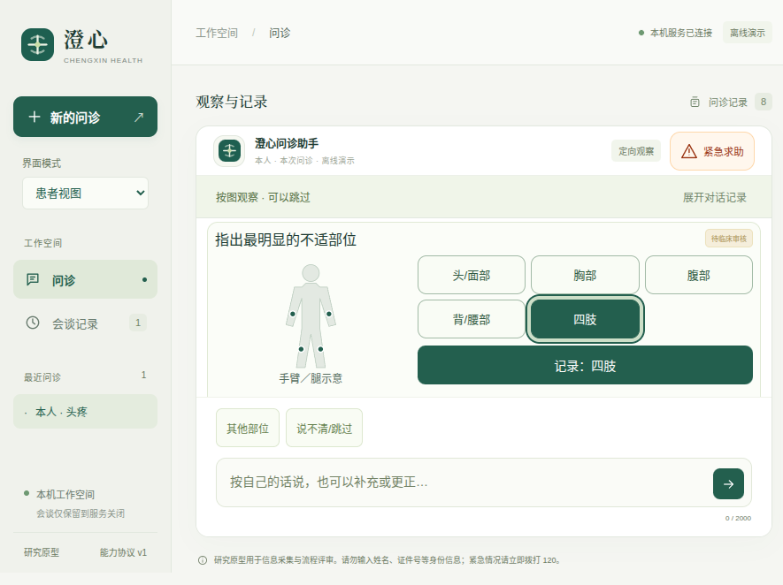

# v0.11.12：部位图与独立点击目标

人体示意与部位选项分开布局，选择后联动高亮、朝向和确认按钮。五个部位及其他／跳过入口均测量到至少44×44 CSS像素；分步原文保留在可展开说明里。本轮只改变展示，不增加医学内容、动作识别或诊断能力。[机器结果](results.json)。

**重要的未解决问题：**额外语义探针发现，定位任务进行中说“昨晚用过药物甲。”，宿主会把整句同时写入位置字段，即使脚本模型正确提取了用药。这在复制的v0.11.11与冻结v0.11.12都复现，属于原有控制器路由缺口，不能被本轮绿色界面回归掩盖。[旧版完整状态](observation-routing-before.json)、[本版完整状态](observation-routing-final.json)、[零外部调用探针](observation_routing_probe.py)。下一优先级是区分病史补充与自查结果，并保留原任务的接续。整个项目目标尚未完成。

## 实际界面与几何



[原生测量](native-proof/measurements.json)记录实际二进制、版本0.11.12、离线后端与900×648内容视野。浏览器在1440×1080、390×844、900×648三个视野逐一选择五个部位，每次检查问题、人体图、选项、确认、输入、求助和研究说明的真实矩形，共105项几何观察；受检目标无重叠。[汇总](geometry-summary.json)、[宽屏](geometry-wide.json)、[窄屏](geometry-mobile.json)、[小窗口](geometry-short.json)。这是工程可见性和点击目标检查，不是患者理解率研究。

旧版胸／腹目标在两种视野中重叠：[原始失败](logs/baseline.log)、[失败轨迹](baseline-failure/)、[从原始轨迹提取的几何](baseline-geometry.json)。最初独立基线PNG路径被后续同名测试覆盖，所以不将其当作旧截图归档。首次网格原型仍显示两个轮廓，人工截图检查后改为单一轮廓并加入断言。把其他／跳过也增大到44像素后，小窗口首次失败；保留[失败日志](logs/ui-fourth.log)和[轨迹](ui-fourth-failure/)，通过回收标题留白修正，没有删除几何断言。

## 验证范围

- 默认后端收集340项，286项通过、54项跳过；51项可选SDK检查及3项长时限检查没有在本轮单独重跑。[日志](logs/backend-full.log)。
- 最终源码浏览器59组通过，另有3组几何重放；源码和最终打包程序各31组原生检查通过。[浏览器](logs/ui-final.log)、[源码原生](logs/native-source-full.log)、[打包原生](logs/native-package-full.log)。
- DSH桥接21项、Prettier和2个版本元数据Python文件Black检查通过。[桥接](logs/bridge.log)、[最终格式](logs/format-final.log)、[Black](logs/black.log)。第一次格式失败也保留。
- [283个冻结文件](source/)、[摘要](source-files.json)、[162项冻结复验](frozen-verification.json)、[复验器](verify.py)。首次全UI后有两个文件的格式／选择器范围调整；[首次摘要](source-first.json)、[两个旧文件](earlier-source/)、[差异](post-first-freeze-changes.json)保留，最终59组和两套原生检查均在最终源码上运行。
- [最终包审计](package-audit.json)核对110个自有文件、544个适用生产依赖版本；不是全部第三方依赖字节审计。
- 新增实际提供商请求为0。[核心源码比较](core-source-comparison.json)核对87个非Web相关文件，除两处版本文本外相同；不因此声称旧医疗语义正确。后续语义修复需要独立模型评估。

```bash
python3 -B docs/evaluations/2026-10-17/v0.11.12/verify.py --project docs/evaluations/2026-10-17/v0.11.12/source --output .runtime/location-frozen-replay.json
```

存储整理将旧生成包0.9.3／0.9.4无损压缩保留在dist/desktop/archives，分别核对29497／29510条内容、权限和链接，确认未使用后才移除展开副本。[0.9.3记录](old-bundle-0.9.3-storage.json)、[0.9.4记录](old-bundle-0.9.4-storage.json)保留恢复信息；历史评估未改动。此项不计入智能体能力。
