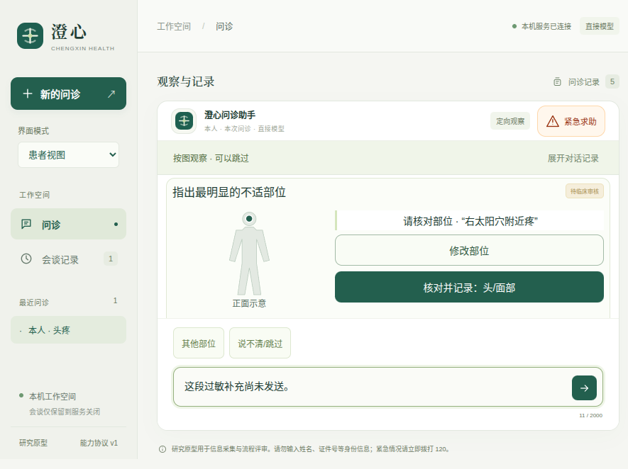

# v0.11.13：图示期间的对话与结果核对

修复旧版将“昨晚用过药物甲”直接写成身体位置的问题。图示期间的普通补充先交由模型理解，任务可暂停后接续；自然语言部位需先显示原话和待核对示意，患者确认才记入，仍保留自述来源和未评估质量。[设计](source/docs/图示期间的对话与结果核对.md) · [机器结果](results.json)。



此图来自实际0.11.13二进制、900×680原生窗口及本机预设模型服务，不是实际患者或摄像头识别。[原生证明](native-proof/measurements.json)保留窗口、版本、几何与本机请求数；此项外部提供商调用为0。[宽屏](screenshots/wide.png)、[窄屏修改选项](screenshots/mobile.png)、[小窗口其他部位](screenshots/short.png)使用同一受信渲染器。默认只显示原话、示意、确认和修改入口，展开修改后可选择其他部位；不通过缩小点击目标隐藏复杂度。

## 要求与证据

| 要求 | 证据 | 边界 |
| --- | --- | --- |
| 用药补充不成为部位 | [旧版完整状态](observation-routing-before.json)、[本版完整状态](observation-routing-fixed.json)、[相同探针](observation_routing_probe.py) | 同样的正确脚本模型提取，宿主误写由true变为false；零付费调用 |
| 自然语言部位先核对 | [16项新增后端检查](source/tests/test_self_check_conversation.py)、[宿主实现](source/src/medagent/task_conversation.py) | 模型只能提议固定选项；引文匹配不证明类别语义正确 |
| 接续保留发生身份、选择和步骤 | [共享界面流程](source/tests/fixtures/self-check-conversation.mjs) | 同一次interaction_id；页面草稿不上传为事实，不跨关闭保证 |
| 确认保留来源，改选不借用旧引文 | 同一检查、[三种视野](source/tests/ui/self-check-conversation.spec.mjs)、[原生检查](source/tests/desktop/self-check-conversation.spec.mjs) | 原轮引文与原轮ID另关联核对事件，quality不升级 |
| 引文不删掉不确定限定 | [原始反例](logs/qualifier-baseline.log)、[修正后的检查](logs/backend-review.log)、[最终模型案例](live-final.json) | 扩展所在分句及明确相邻位置限定；有界语言规则，复杂话语仍可能需要澄清 |
| 更正、换人、求助和旧控件 | 16项检查与共享界面流程 | 不恢复失效任务，不回滚事实，旧核对在写入用户事件前拒绝 |
| 测量与重复流程继续成立 | [最终后端回归](logs/backend-final.log)、[重复期间补充探针](repeat-supplement-probe.json)、[最终模型评估](live-final.json) | 旧读数不变，病例补充可按原规则取消重复尝试；完整年龄等叙述进入规划，错误测量格式仍拒绝 |

位置解析器现在拒绝未分类的任意文字。旧状态测试曾要求“我38岁／体重／血糖／发烧38天”都在测温时保持零模型报错，现将这些完整叙述移至模型路由检查；其余错单位、多读数、异常数字仍保留拒绝断言。新检查也保留明知模型可能提错类别时未确认不写入的反例。

## 模型评估与仍需改进的地方

第一次评估命令在导入本地测试夹具时失败，外部调用为0；修正脚本路径后，首轮三个合成场景共11次请求通过。人工复核又发现模型可截去“可能”，新增定向失败后修正宿主范围检查；最终四个场景共16次请求通过。两轮合计**27次真实DeepSeek请求**，全部上游200，总上限36没有重置。[汇总](live-evaluation-summary.json)、[首轮原始事件](live-second.json)、[最终原始事件](live-final.json)、[评估驱动](source/scripts/evaluate_self_check_conversation.py)。初始病例由脚本准备，后续决策才使用真实模型，不是四个全新完整门诊，更不是临床准确率。

最终场景通过仍不等于智能体已经完善：日志显示确认部位后模型重复提议两次，测温后尝试写入未开放的temperature_c字段，均被宿主拒绝；不确定位置也曾被写成伴随症状后才澄清。前两项造成额外调用，后一项提示字段语义仍需改进。独立临床内容与患者理解审阅尚未完成。**项目整体目标保持未完成；下一步优先改进确认后的状态接续与语义字段选择。**

## 工程验证与快照范围

- 最终默认后端收集356项，302项通过、54项跳过。[最终日志](logs/backend-final.log)。本轮较早完整启用SDK的快照收集352项，349项通过、3项长时限检查跳过，其中51项为可选DSH／SDK检查；最后另重跑1项患者DSH桥接通过。[较早组合日志](logs/backend-sdk-full.log)、[最终桥接](logs/bridge-integration-final.log)。不把重复回归次数相加为不同测试。
- 浏览器较早全量62组通过；来源范围修正后相关10组通过；原生驱动修正后新增3组再次通过。[全量](logs/ui-full.log)、[10组](logs/ui-final.log)、[最终3组](logs/ui-native-driver.log)。
- 原生首次31组通过、1组因测试驱动使用浏览器baseURL而失败。[失败日志](logs/native-source-full.log)、[轨迹](native-source-results/)。改为当前窗口的fetch后，源码全量32组及最终打包版全量32组通过。[源码最终](logs/native-source-final.log)、[打包最终](logs/native-package-full.log)。未修改产品以绕过该测试。
- DSH桥接21项、固定配置、Prettier和10个Python文件Black检查通过。[桥接](logs/bridge.log)、[配置](logs/dsh-check.log)、[最终格式](logs/format-final-after-driver.log)、[Black](logs/black-check.log)。
- [290个最终冻结文件](source/)、[摘要](source-files.json)、[178项最终冻结复验](frozen-verification-final.json)、[复验器](verify.py)。首次快照、第一轮模型快照、最终模型快照与最后仅修测试驱动的快照分别留存摘要及必要旧文件，不声称所有检查在一个相同快照上运行。
- [最终包核对](package-audit.json)确认111个自有文件和544个适用生产依赖版本；不是第三方依赖完整字节审计。最后的测试驱动变化不在应用包中。

[首次摘要](source-first.json)、[首次旧文件](earlier-source/)、[首轮模型摘要](source-live.json)、[首轮评估脚本](earlier-source-live/scripts/evaluate_self_check_conversation.py)、[最终模型摘要](source-provider-final.json)、[仅原生驱动旧文件](earlier-source-before-native/)、[驱动差异](native-driver-only-change.json)、[前期差异](post-first-freeze-changes.json)支持重建各阶段字节。早期界面驱动使用的错误选择器也保留于[原始界面失败](ui-second-results/)。

```bash
python3 -B docs/evaluations/2026-10-17/v0.11.13/verify.py --project docs/evaluations/2026-10-17/v0.11.13/source --output .runtime/self-check-conversation-replay.json
./scripts/start-desktop.sh
```

病例和接续帧仍只存在当前服务进程。没有新增病例数据库、患者身份系统、摄像头动作验证、任意第三方插件安装或临床部署授权。
