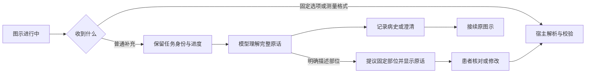

# 图示期间的对话与结果核对

v0.11.13将图示结果录入与普通对话分开。旧版在定位图出现后会把任何文字记成身体位置；即便模型正确提取用药，宿主仍会先写错位置。旧失败保留在[v0.11.12归档](evaluations/2026-10-17/v0.11.12/README.md)。

固定部位按钮仍直接提交原注册值。文字“右太阳穴附近疼”交由模型提出head选项及连续引文，界面显示原话、示意、核对按钮和“修改部位”；核对前不写观察事实。药名、用药时间等文字不再直接进入位置解析器。模型提议仍可能理解错误，所以患者核对是明确的状态转换，不把引文匹配当作语义正确性证明。不确定部位不能直接当作“其他部位”阳性。宿主将唯一引文扩展为所在分句，并保留相邻的明确位置限定，避免模型截去“可能”“具体位置不确定”；其他分句中明确属于用药的未知不扩大为部位未知。该范围检查仍是有界语言规则，不能证明任意复杂语句的语义正确。

患者核对后的事实引用原轮部位引文和原轮ID，另记核对事件。患者主动改选则使用本次固定选项和本次来源，不借用旧提议引文。观察仍是患者／照护者报告，quality为not_assessed；不推断精确坐标、左右侧、查体质量或诊断。

普通补充可引出新的问题，原图示保存在会谈内的接续帧，问题下提供继续入口。该帧只保存任务及其宿主发生身份、旧结果ID和未确认提议，不回滚病史。恢复时核对适用性、前置条件及旧结果身份；接续保留同一interaction_id、选择草稿和步骤，不登记为一次新图示。更正事实、取消或求助会按已有依赖规则使任务失效；换人咨询使用既有对象检查点，不能把新人的文字写入当前病例。

测温期间的普通病史也交由模型理解，测量格式仍由宿主解析。错误数字、多读数、错单位或假设读数保留原拒绝行为；年龄、体重、血糖、持续时间等完整叙述不会直接成为体温。路由模式只减少明显串字段，不保证理解任意语言；涉及温度词的复杂混合语句仍受当前读数解析器约束。重复测量仍沿用既有取消与结果保留规则，病例补充可使旧重复尝试失效，不恢复过期测量。

本轮新增工具propose_self_check_result，只能用于未完成body_location、原固定选项和本轮连续引文。不能用它生成温度、任意查体动作或临床结论。接续和核对按钮需匹配当前动作ID；旧按钮重放在写入用户事件前拒绝。源码离线演示没有模型理解能力，不能据此评估自然语言路由。

验证包括[后端语义检查](../tests/test_self_check_conversation.py)、[共享界面流程](../tests/fixtures/self-check-conversation.mjs)、[三种尺寸](../tests/ui/self-check-conversation.spec.mjs)与[原生窗口](../tests/desktop/self-check-conversation.spec.mjs)。界面检查覆盖独立文字草稿、步骤恢复、修改选项、其他部位、确认来源、旧按钮和关键元素几何可见性。预设模型检查证明控制链路；真实模型合成评估单独记录，不能替代临床或患者理解研究。

患者数据和任务帧仍仅存在当前服务进程；页面草稿仅存在当前页面。没有新增患者账户、病例数据库、摄像头动作识别或第三方插件安装。
