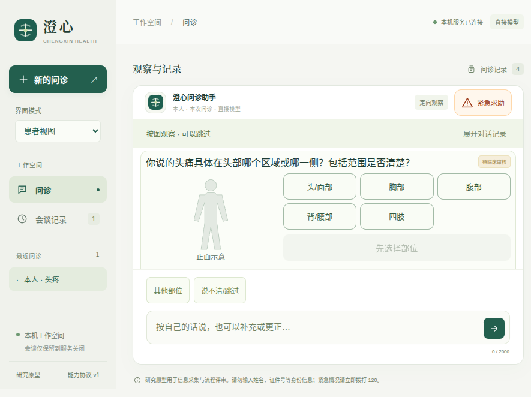

# v0.11.14：图示完成状态与定位澄清

让模型明确知道宿主已经处理了哪次图示结果；服务重试保留原事实和来源，新输入不重复带入完成标记。位置含糊时在原图内补问，不借用伴随症状字段。补问替换标题，保留选项、步骤和可跳过入口。[设计](source/docs/图示完成状态与定位澄清.md) · [机器结果](results.json)。



本图来自实际0.11.14二进制、900×680原生窗口。问题文字取自本轮真实模型输出，随后通过本机预设服务回放；不是再次向真实模型发起整段问诊。[问题来源与替换范围](actual-question-source.json)、[回放夹具](actual-question-replay.mjs)、[原生证明](native-proof/measurements.json)。回放还实际注入一次服务失败，核对已保存事实、重试和独立输入草稿，外部提供商请求为0。[宽屏](screenshots/wide.png)、[窄屏](screenshots/mobile.png)、[小窗口](screenshots/short.png)采用较短的预设问题，不将两种文案混为一份截图。

## 实际回放发现的未解决缺口

实际回放中，模型询问头部具体区域、左右与范围，但当前body_location图只有大范围部位选项；文字输入仍可回答，现有按钮不能单独表达这些细节。下一步须把提问绑定到匹配的结构化答题组件。 已保存的截图直接显示此问题。几何可见性通过不能证明提问与答题方式匹配，本轮没有宣称该可视化已经合理完善。

## 具体要求与证据

| 要求 | 证据 | 范围 |
| --- | --- | --- |
| 下一次决策能看到已处理结果 | [9项新增检查](source/tests/test_observation_completion.py)、[宿主写入](source/src/medagent/consultation.py)、[上下文投影](source/src/medagent/observations.py) | 任务、事实ID、来源轮次、断言和质量由宿主创建；不表示质量已验证 |
| 重试不重写，下一输入不重放 | 同一检查、[共享界面流程](source/tests/fixtures/observation-completion.mjs) | 实际503、保留同一事实ID、重试沿用完成上下文；患者另写草稿保留 |
| 失效结果不能冒充当前，保留旧读数不能冒充本次读数 | 同一检查 | 重新比较事实身份；未知重复观察没有本次新事实ID |
| 位置未知留在图示中 | [定位控制器](source/src/medagent/task_conversation.py)、[模型原始事件](live-first.json) | 使用clarify的当前symptom_location主题，不新增该字段写权限 |
| 图示补问简短且受限 | [工具校验](source/src/medagent/agent.py)、[渲染契约](source/src/medagent/web/structured-ui.js) | 当前部位图限定、80字、最多两次、既有动作限制；不把词语限制当作完整语义审核 |
| 问题、图与操作可见 | [三种视野](source/tests/ui/observation-completion.spec.mjs)、[原生检查](source/tests/desktop/observation-completion.spec.mjs)、[实际模型文案回放](native-proof/measurements.json) | 6个关键元素的真实几何，保留原图身份和步骤 |

首次5项定向检查在旧实现上失败，分别显示缺少完成上下文和缺少定位澄清入口。[原始失败](logs/baseline.log)。随后扩展为9项，不将新增断言数当作临床有效性或独立病例数。已有测量混合叙述、纯重复测量零模型接续、事实更正、换人和优先求助回归仍保留。

## 真实模型与较严格的验收

本轮**11次真实DeepSeek请求**，4个脚本准备的初始病例、后续实际DSH／模型决策通过新检查。部位确认后和体温录入后各用**1次模型请求**接续，没有重复提议已完成自查，也没有尝试写入宿主管理的观察字段。不确定位置未写成伴随症状，最终通过原图的定位补问继续。[原始报告与上下文](live-first.json)、[评估驱动](source/scripts/evaluate_self_check_conversation.py)。单次上限14、同目录累计上限28，本轮没有重置额度。

仍有一次不确定位置提议，被宿主按原话限定拒绝后，模型改为定位澄清。该拒绝完整保留；没有宣称所有工具提议一次正确，也不把这个定向结果当作临床准确率。

上一版旧报告的通过门较宽。[新标准对旧轨迹的审计](previous-trace-audit.json)引用已封存的v0.11.13报告及其摘要：旧轨迹中位置未知写入了伴随症状，所以不满足新标准。旧报告及其“通过”值保持原样，不覆写历史。当前两段接续各1次请求只是这次定向观察，不是整体成本或效果的统计对照。

实际交给DSH后端的动态上下文另行记录，完成标记确实出现于部位确认和读数之后。固定工具／目录前缀仍与病例数据分开；本轮没有据此声称新的缓存命中率或总体推理能力。更广的完整新建病例与临床、患者理解评估仍未完成，项目整体目标保持进行中。

## 工程检查与快照

- 默认后端收集365项，311项通过、54项显式跳过；本轮没有单独重跑其中51项可选SDK检查或3项长时限检查。[完整日志](logs/backend-full-first.log)。患者DSH桥接集成1项通过，[日志](logs/bridge-integration.log)。
- 浏览器全量65组，源码与最终打包版各33组原生检查通过。[浏览器](logs/ui-full.log)、[源码](logs/native-source-full.log)、[打包版](logs/native-package-full.log)。新增3组浏览器和1组原生检查；另有实际模型文案的打包回放。
- DSH桥接21项、固定配置、Prettier及8个本轮Python文件Black检查通过。[桥接](logs/bridge.log)、[配置](logs/dsh-check.log)、[格式](logs/format.log)、[Black](logs/black-check.log)。
- [295个冻结文件](source/)、[摘要](source-files.json)、[187项冻结复验](frozen-verification.json)、[复验器](verify.py)。提供商调用期间的[首次摘要](source-first.json)另存；之后只修正文档工具表和生成0.11.14的发行元数据，[差异](post-first-freeze-changes.json)及[两个旧文件](earlier-source/)保留。控制器、提示和渲染器未在模型评估后改变。
- [最终包审计](package-audit.json)核对111个自有文件和544个适用生产依赖版本；不是所有第三方依赖字节审计。

```bash
python3 -B docs/evaluations/2026-10-17/v0.11.14/verify.py --project docs/evaluations/2026-10-17/v0.11.14/source --output .runtime/observation-completion-replay.json
./scripts/start-desktop.sh
```

打包前将旧生成包0.9.1／0.9.2无损压缩保留在dist/desktop/archives，分别核对29495个条目的内容、权限和链接，确认没有进程使用后才移除展开副本。[0.9.1记录](old-bundle-0.9.1-storage.json)、[0.9.2记录](old-bundle-0.9.2-storage.json)、[原脚本](archive-old-bundles.py)保留恢复命令；历史评估未改动。这不是智能体能力提升。

病例和任务状态仍仅存在当前服务进程，页面草稿仅存在当前页面。没有增加患者身份系统、病例数据库、摄像头动作验证或任意第三方插件安装。
