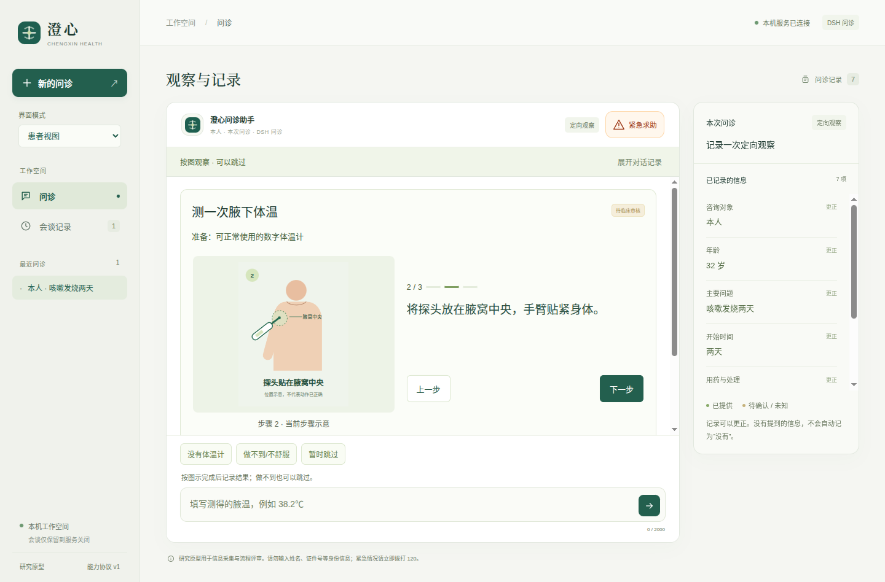

# 0.11.15：全新真实模型原生问诊

在实际0.11.15打包程序中新建会谈，从开场运行到摘要确认，没有脚本预先写入患者事实或替换模型回复。所有患者信息均为合成输入。完整普通病例19次提供商请求、急症门0次、服务恢复2次，共21次；另注入1次不访问提供商的本机503。[原始报告](live-first.json)、[运行日志](live-first.log)、[核对结果](validation.json)。

普通病例覆盖咳嗽发热主诉、危险信号筛查、病情变化、不适程度、伴随不适、呼吸道定向信息、用药、过敏、既往史和目标。主动请求的测温实际展示；无效380不写读数且不调用模型，38.25℃以患者报告、质量未评价记录。年龄从32更正40不调用模型、不删除读数，也不再次追问年龄。早期用药原话、未知过敏、病史更正、摘要确认、原生导出和历史回看均通过各自检查。[来源核对截图](artifacts/live-partial-report.png)、[更正后摘要](artifacts/live-corrected-summary.png)、[合成导出](artifacts/synthetic-session-export.json)。

急症案例直接输入明确危险描述，在模型请求前进入求助路径；未产生模型请求事件。服务恢复案例先注入503，显示重试入口，随后复用原文并保留明确年龄与未知过敏。各项结果在原报告中独立列出，不用普通病例通过替代急症或恢复证据。

当前源码303个文件与[本轮起始摘要](source-first.json)一致，可在相邻[已封存的源码](../v0.11.15/source/)中逐字重建；打包程序113个自有文件核对一致。实际驱动为[原生脚本](../v0.11.15/source/tests/live/workflow.spec.mjs)与[带限额的网关](../v0.11.15/source/scripts/test_live_desktop.py)。单轮上限40、该目录累计上限80，本次只运行一轮，未重置额度。

这是一个呼吸道病例的完整工程流程，不能证明所有专科、所有病例或患者的实际理解效果。0.11.15的细化定位协议在[此前定向案例](../v0.11.15/README.md)中验证；本次普通病例没有经历该定位表单，不能把两者拼接成同一次完整定位问诊。部位确认后的专用修改入口仍待补齐，临床审核与目标用户研究仍未完成。
