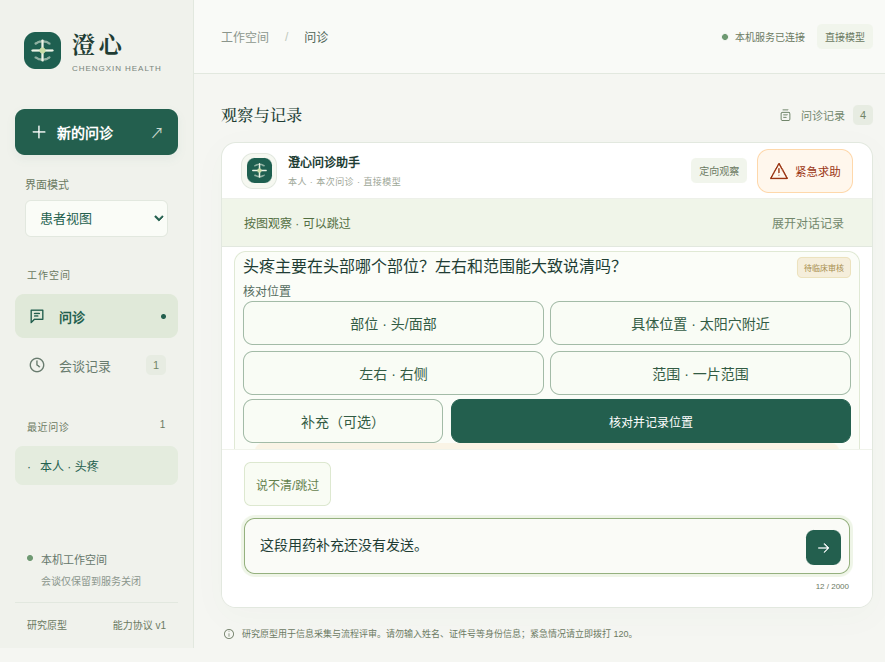

# v0.11.15：问题与结构化定位答案

模型询问具体区域、左右和范围时，患者现在可以逐项选择、核对并修改。大部位图、区域示意、自述文字和明确未知共用已注册的输入契约；未报告的维度留空，草稿不直接写病史。[设计](source/docs/结构化定位答案与患者核对.md) · [机器结果](results.json)。



这张图来自实际0.11.15程序、900×680原生窗口。问题取自本轮真实模型输出，回放时使用本机预设服务，四个输入维度与实际模型声明一致；其他开场及后续回答仍是脚本准备。[问题与来源](actual-question-source.json)、[回放代码](actual-question-replay.mjs)、[原生测量](native-proof/measurements.json)。回放仅4次本机请求，0次外部提供商请求，不冒充另一段真实模型问诊。[区域示意](native-proof/actual-question-area.png)、[感觉范围](native-proof/actual-question-extent.png)、[窄屏范围](screenshots/77-mobile-location-answers-extent.png)、[自述与未知](screenshots/77-custom-location-answers-review.png)。

## 实现与验证

| 要求 | 权威证据 | 边界 |
| --- | --- | --- |
| 问题与可回答维度对应 | [注册内容](source/src/medagent/extensions/packs/location.json)、[输入契约](source/src/medagent/location_answers.py) | 仅已注册定位组件；当前只有头部区域预设，其他位置可自述 |
| 自然语言先整理，患者核对后才记录 | [控制器](source/src/medagent/task_conversation.py)、[18项定向检查](source/tests/test_location_answers.py) | 草稿不写事实；不能绕过所需维度，过期／重复提交拒绝 |
| 未提及与明确未知分开 | 同上 | 已知大部位下的范围仍可未知；区域示意不提供距离／面积测量 |
| 修改不借用旧引文，失败重试不重写 | 同上、[共享界面流程](source/tests/fixtures/location-answers.mjs) | 确认轮次与原草稿来源分开，质量保持not_assessed |
| 草稿与对话接续 | [渲染组件](source/src/medagent/web/location-answer-ui.js)、共享界面流程 | 当前页面内恢复；新模型草稿更换身份，未确认不会自动写入 |
| 窄屏、小窗口和按钮可读 | [5组定向场景](source/tests/ui/location-answers.spec.mjs)、[最终日志](logs/ui-contrast-final.log)、原生测量 | 问题、字段、导航／确认、输入与求助的真实几何；目标至少44像素；实际按钮颜色对比检查 |

先前的几何检查仍漏掉了视觉问题：手机范围标签换行，主按钮悬停时深色文字落在深色背景。人工看图后修正；新增检查在旧样式上测得对比约1.29而失败，修复后5组场景通过。[原失败](logs/ui-contrast-baseline.log)、[旧样式与当时检查](contrast-baseline-source/)、[失败轨迹](failed-ui-traces/contrast-baseline/)。初始小窗口裁切、图标污染按钮名称及一次测试选择器错误也保留在早期日志和轨迹中。

## 真实模型

两轮各9次、合计18次真实DeepSeek请求，四类定向案例最终均通过：完整描述后修改左右、没说范围、位置明确但范围未知、位置本身不确定。[首次原始报告](live-first.json)、[最终原始报告](live-second.json)、[评估器](source/scripts/evaluate_location_answers.py)。三个确认后的接续在每轮均各1次请求，没有重新提议观察或尝试写观察字段。

初始状态由脚本准备，确认由合成患者显式提交；这不是全新完整问诊、临床准确率或人群统计。最终通过也不表示所有提议首次正确：第一轮有两次拒绝；第二轮不确定位置先出现参数不一致及确定化提议，均被宿主拒绝，随后模型改为图示澄清。原始错误和实际上下文完整保留。单轮最多14次，同目录累计最多28次，未重置额度。

第一轮之后修复了逐项引文末尾标点的过度拒绝，并增加检查。[两文件差异](post-first-runtime-changes.json)、[旧文件](earlier-source/)、[第一轮运行文件摘要](runtime-source-first.json)、[第二轮摘要](runtime-source-final.json)保留。两轮运行中对应文件均未改变。之后只调整CSS和界面检查，不改控制器、模型提示或输入契约；[渲染差异](post-model-rendering-changes.json)、[模型评估时的旧CSS](earlier-rendering/)可重建运行快照。

## 工程与打包

- 默认后端383项，329通过、54按开关跳过；另单独通过注册计算真实SDK检查1项及患者DSH桥接集成1项。剩余可选SDK和长时限检查未单独重跑。[后端](logs/backend-full-final.log)、[SDK](logs/sdk-calculation.log)、[桥接集成](logs/bridge-integration.log)。
- 浏览器全量70组通过；最后CSS与颜色检查调整后，5组定向界面再次通过。[全量](logs/ui-full.log)、[最终定向](logs/ui-contrast-final.log)。
- 源码原生基线34组、打包版稳定基线34组通过；最后按钮对比修改后，最终打包程序的定向原生1组和实际问题回放另行通过。[源码](logs/native-source-full.log)、[稳定打包基线](logs/native-package-stable.log)、[最终定向](logs/native-contrast-final.log)、[最终回放](logs/native-proof-contrast-final.log)。没有把基线与最后样式当作逐字相同的一次全量运行。
- 一次打包测试与重新构建重叠，出现24通过、10启动失败，包含resources.pak暂不可用；这是测试编排错误，该次不作为验收。原日志和轨迹保留，随后在固定程序上完整重跑34组通过。[废弃运行](logs/native-package-full.log)、[原轨迹](failed-ui-traces/overlapping-package-run/)。
- Node桥接21项、固定DSH配置、格式与本轮Python检查通过。[桥接](logs/bridge.log)、[格式](logs/format-final.log)、[Black](logs/black-check.log)。
- 最终[303个冻结文件](source/)、[摘要](source-files.json)、[205项冻结复验](frozen-contrast-final-verification.json)、[复验器](verify.py)。[包审计](package-contrast-final-audit.json)核对113个自有文件与544个适用生产依赖版本，非第三方全部字节审计。

```bash
python3 -B docs/evaluations/2026-10-17/v0.11.15/verify.py --project docs/evaluations/2026-10-17/v0.11.15/source --output .runtime/location-answers-replay.json
./scripts/start-desktop.sh
```

旧生成包0.8.0／0.9.0无损压缩到dist/desktop/archives，核对内容、权限和链接且确认未使用后才移除展开副本；存储记录、条目索引和恢复命令另存，不解释为能力提升。此前0.11.14归档保持不变。

项目整体目标仍进行中。当前新协议的全新完整真实模型问诊、临床及患者理解评估尚未完成；没有新增确认后的专用部位重选、摄像头动作验证、患者数据库或任意第三方插件安装。
