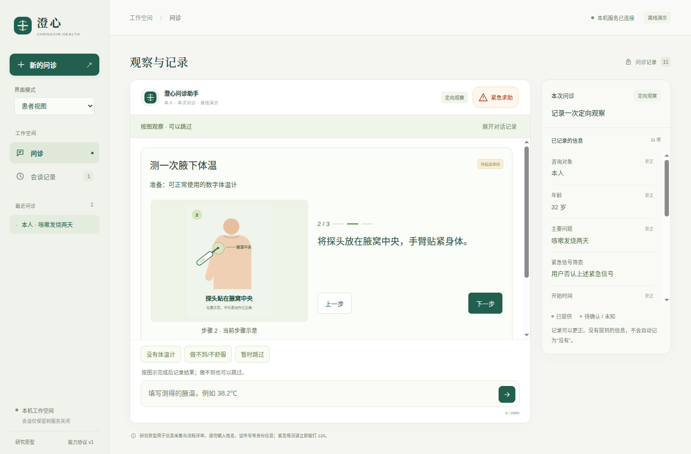

# 0.11.16 同机隔离用户环境交付补验

最终程序在空用户目录、只读交付包、系统Python与断网命名空间内，完成了原生界面的演示问诊、体温图示、无效输入处理和摘要确认。最终14项断言全部通过，未调用真实模型，未修改产品代码或交付包。

这是**同一台机器上的隔离用户环境检查**。系统库和显示服务仍来自本机，没有验证另一台机器或全新操作系统上的安装。原[0.11.16验收归档](../v0.11.16/README.md)保持原样。



[问诊摘要截图](final/summary.png) · [最终原始结果](final/probe.json) · [合成病例与事件](final/synthetic-case.json)。截图已实际查看；本轮没有修改视觉样式或医学内容。

## 环境与实际检查

| 范围 | 证据 |
| --- | --- |
| 用户目录 | 开始时`/home/clean`为空；实际应用资料写到该用户的新目录，退出后tmpfs销毁 |
| 开发环境 | 不挂载原开发源码目录、用户主目录或`.env`；不继承宿主凭据环境变量 |
| 应用代码 | `/app`只读挂载，`/proc/self/mountinfo`确认只读；实际应用路径`/app/resources/app` |
| Python | `/usr/bin/python3` 3.10.12；模块来自交付包，不使用Anaconda或项目venv |
| 网络 | 独立网络命名空间，仅有loopback，外部地址连接返回ENETUNREACH；患者事件中0次模型请求 |
| 原生窗口 | Electron实际启动，页面sandbox／contextIsolation启用、Node integration关闭；普通无凭据HTTP请求返回401 |
| 完整流程 | 图形入口→人口信息→呼吸道问题→测温→背景→摘要→患者确认；最终状态closed |
| 无效读数 | 380显示错误；通过病例API确认未写入体温事实，随后38.2℃正常记录 |
| 来源与未知 | 体温仍为patient／not_assessed；过敏仍为unknown |
| 生命周期 | 关闭应用后私有服务不再可访问，渲染器无pageerror |

Node为22.23.3。仅额外挂载三个自动化依赖：`@playwright/test`、`playwright`、`playwright-core`。它们位于独立测试工具路径，未加入应用Python路径。图形通道使用本机X11及只读授权文件，授权内容没有写入报告。

Playwright自动加了`--no-sandbox`，实际参数保留在原始结果中。页面安全配置检查和外层Linux命名空间检查均不代表已验证Chromium进程沙箱有效，不能据此作出新的安全保证。

## 两次运行与冻结范围

首次探针12项通过，见[first原始报告](first/probe.json)。随后只补强测试驱动：增加只读挂载及凭据环境检查，明确确认无效体温未写事实，从实际包元数据核对版本，并移除重复响应监听。最终14项通过，见[final报告](final/probe.json)。两次都没有真实模型请求；不是两个临床样本。

`source/`只冻结最终两个探针脚本及更新后的完成审查。各次`identity.json`保存实际运行时的驱动和启动器摘要；初版驱动没有作为可复现源码冻结，初版报告仅保留历史，结论以最终冻结驱动和final结果为准。产品源码和依赖继续由相邻0.11.16归档及[测试后程序核对](package-after-probe.json)约束：114个项目文件、544个适用生产依赖版本仍匹配。

## 复现

在已安装项目依赖的Linux图形会话中，从项目根目录运行：

```bash
DISPLAY=:1 XAUTHORITY=/run/user/1000/gdm/Xauthority \
  python3 -B scripts/verify_clean_desktop.py \
  --package dist/desktop/Chengxin-0.11.16-linux-x64 \
  --output-directory .runtime/clean-desktop-fresh
```

显示和授权路径按实际会话调整；必须使用新的输出目录。缺少bubblewrap、Node、Python、图形会话或Playwright时，不回退为使用开发目录的运行。工具不加载模型配置；它使用应用离线演示路径。若缺少上述条件，应记录失败并补齐环境，而非认为新机器已验收。

本轮未覆盖独立机器、其他系统库、缺少系统Python／Node的安装、真实模型连接、DSH联网与完整执行、摄像头或临床效果。完整工程原型的剩余事项见[当前完成审查](../../../当前版本完成审查与后续接续.md)。
