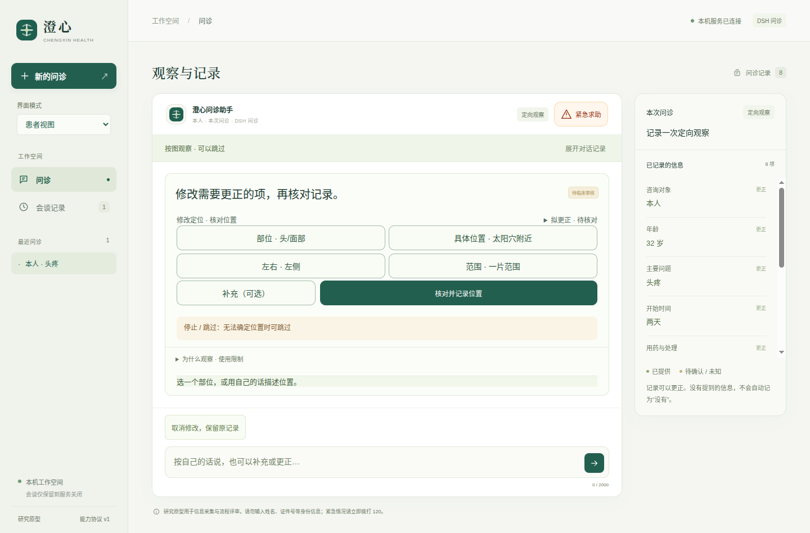

# 0.11.16 定位更正、问诊接续与完整流程验收

已确认定位现在可以修改。界面或自然语言请求先打开核对卡，患者确认后生成新事实，保留旧记录与来源，并继续原问题；取消保留原记录。修改期间的新病史继续处理，摘要修改后需再次确认。实现见[定位修改设计](source/docs/已确认定位的修改与问诊接续.md)。

本目录保存最终源码、早期失败、界面截图、真实模型报告与打包核对。所有病例均为合成输入。临床审核、患者理解与操作研究尚未完成，不能据此声称具有诊断能力或总体达到DSH／Codex表现。

## 患者交互



上图来自最终0.11.16程序、真实DeepSeek与从零开始的头痛问诊。确认前仍保留原来的右侧记录，卡片展示拟更正的左侧，患者确认后才替代；质量仍为患者报告、未评估。此次头痛补验15次请求，未重试，开始与结束均核对患者视图。

[900×680实际程序](native-proof/actual-correction-review.png) · [390像素布局](screenshots/78-mobile-location-revision.png) · [完整摘要](full-flow/patient/live-location-summary.png)。900×680图使用真实模型的两条工具提议在本地重放，6次本地模拟请求、0次外部请求，不能重复计为新的真实问诊。

## 软件验证

| 范围 | 实际结果 | 证据 |
| --- | --- | --- |
| 默认Python回归 | 收集398项，344通过、54按开关跳过 | [日志](logs/backend-full-final.log) |
| 单独SDK注册计算 | 1项通过 | [日志](logs/sdk-calculation.log) |
| 单独患者DSH桥接 | 1项通过 | [日志](logs/bridge-integration.log) |
| 浏览器交互 | 74组通过 | [日志](logs/ui-full.log) |
| 源码原生窗口 | 35组通过 | [日志](logs/native-source-full.log) |
| 最终打包原生窗口 | 35组通过 | [日志](logs/native-package-full.log) |
| 桥接Node断言 | 21项通过 | [日志](logs/bridge.log) |
| 最终冻结源码重放 | 312文件哈希一致，220项通过、无跳过 | [报告](final-frozen-verification.json) |
| 最终程序核对 | 114个项目文件、544个适用生产依赖版本匹配 | [测试后报告](package-post-test-audit.json) |

[格式检查](logs/format-final.log)、[核心Python格式](logs/black-check.log)、[在线评测脚本格式](logs/black-live-driver.log)、[DSH配置检查](logs/dsh-check.log)均通过。54项跳过包含其他可选SDK及长时检查，不能把上表两个单独检查解释为全部跳过项已经补跑。

本版新增15项定位修改后端用例、4组浏览器交互及1组原生流程。覆盖取消、跳过、旧表单、原事实已更正、紧急中断、已有输入卡、备注失败重试、关闭摘要重开、照护者来源、同轮新病史以及未发送刻度草稿恢复。首次缺少导入、首轮界面入口未显示等失败保留于[原始日志](logs/)与[失败界面轨迹](failed-ui-traces/)。

## 真实模型：请求、失败与复验

| 运行 | 请求尝试 | 实际结论 |
| --- | --- | --- |
| [定位定向](live-first.json) | 4 | 两类脚本准备的既有定位记录通过：明确改左侧、不确定哪一侧；不是从零问诊 |
| [首次完整流程](full-flow/first.json) | 24 | 呼吸道21次失败，急症0次通过，注入故障恢复2次通过，头痛1次失败；整轮失败 |
| [选定失败病例复验](full-flow/selected.json) | 33 | 呼吸道18次、头痛15次通过，均未重试；头痛继承研发视图 |
| [患者视图头痛补验](full-flow/patient.json) | 15 | 完整定位、自然语言更正、原问题恢复和摘要确认通过；未重试 |

本版合计76次实际提供商请求尝试，其中完整流程72次、定向4次。同一个完整流程工作目录还保留早先0.11.15的21次请求，因此累计93次；不能把93次全部归给本版。

首次24次中有两次网关40秒超时，报告状态502；末次请求在退出前没有记录最终状态，保留为null。头痛首轮服务错误的底层原因未得到独立定位，不统一归因于模型医学推理。注入的本地503没有转发给提供商，另计，不混入真实请求尝试数。

复验增加按病例选择，避免重复已经通过的病例；头痛允许一次显式服务重试，与呼吸道一致，两次通过的头痛实际都用了0次重试。查看截图发现继承研发视图后，仅修改测试驱动，使头痛开始前切回患者视图，并增加开始／结束DOM断言；产品控制器、提示、渲染器没有随之修改。为补验这个新发现的界面缺口，目录累计上限由80显式提高至100，原78次仍累计；见[额度调整记录](patient-view-followup-scope.json)。这些测试规则变化不覆盖原始失败。

[四病例证据矩阵](full-flow-matrix.json)跨首次失败、选定复验和患者视图补验汇集通过证据，**不是一次四病例整轮全通过**，也不是临床准确率、可靠性区间或性能基准。

## 源码阶段与可复现性

- `source/`与`source-files.json`保存最终312项文件，包括此前漏入清单、现已补齐的`playwright.live.config.mjs`。补齐后重新运行冻结重放220项。
- 定向调用时117项清单见`runtime-source-first.json`；在最终源码上叠加`earlier-model-source/`可逐字重建，唯一后续差异是新增第15项后端测试。没有修改被评估的运行时代码。
- 三病例驱动310项、首次四病例311项、选定复验311项、患者视图补验311项的清单与旧文件分别保存。`earlier-evaluation-source/`、`before-selected-case-driver/`、`before-patient-mode-driver/`、`earlier-documentation/`只用于重建对应历史，不覆盖最终源码。
- `frozen-verification.json`为较早310文件重放；`frozen-verification-before-live-config.json`为311文件重放；最终结果以`final-frozen-verification.json`的312文件为准。
- 完整流程后仅补齐测试配置及更新桌面使用、图形界面两份说明。`source-before-handoff-documentation.json`与`before-handoff-documentation/`保存说明更新前的312项版本，对应`frozen-verification-before-handoff-documentation.json`；更新后再次重放220项。没有修改运行时代码或模型提示。
- `verify_evidence.py`核对上述阶段、原始报告运行时与驱动哈希、请求数量、矩阵、原生测量和旧归档。它不重新访问模型或执行GUI。

在项目根目录运行，输出写到归档外的新位置：

```bash
python3 -B docs/evaluations/2026-10-17/v0.11.16/verify.py \
  --project docs/evaluations/2026-10-17/v0.11.16/source \
  --output /tmp/medagent-v01116-frozen-fresh.json
python3 -B docs/evaluations/2026-10-17/v0.11.16/verify_evidence.py
python3 -B scripts/verify_desktop_package.py --output /tmp/medagent-v01116-package-fresh.json
```

以上核对使用本地依赖，不新增外部模型调用。GUI复现需要已安装Electron与Linux图形会话；完整执行另需Node和bubblewrap。`prove-native-correction.mjs`保留原`.runtime/<工作目录>/`布局假设；复现时将本目录复制到新的`.runtime/<名称>/`，使用相应0.11.16程序，避免在密封归档内写产物。全新真实问诊需另行显式设定有限请求额度，不属于上述离线命令。

程序启动：`./scripts/start-desktop.sh`；读取已配置模型用`./scripts/start-desktop.sh --live`。只有提交后才发起模型请求。

旧0.11.11／0.11.12程序已逐项核对后压缩保存到`dist/desktop/archives/`，原文件内容、权限和链接见本目录两份`old-bundle-*-index.json`与`old-bundle-*-storage.json`。最终0.11.16程序保持展开可运行。较早[0.11.15](../v0.11.15/README.md)与[该版完整流程](../v0.11.15-full-flow/README.md)归档保持原样。

## 仍未验证

真实患者问诊质量、图示理解与动作正确率、临床内容与危险信号覆盖、通用图像诊断和处方均未获得验证。默认患者病例仍仅存在服务内存，执行工作区另有本机持久记录；本版没有生产病例数据库或跨重启患者恢复。搜索、终端与子智能体仍在研发执行工作台，未自动接入患者问诊。第三方插件安装、摄像头动作核验、手环与医保延续后续计划。
