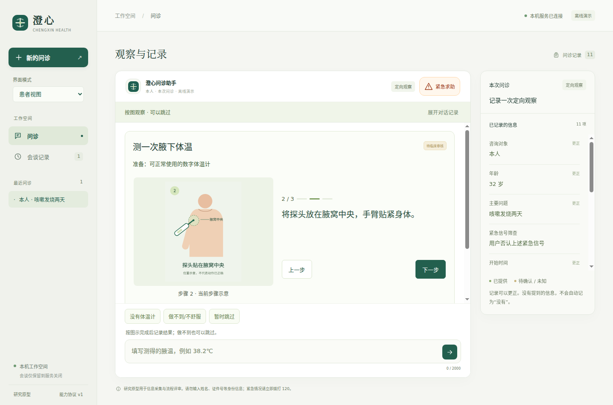

# 0.11.17 本地字体、图示字形与跨系统验证

修复没有系统中文字体时的页面与代码文本的缺字：页面／启动页随包提供中文字体，图片中的17处标签生成为矢量轮廓。问诊问题、医疗工具策略、风险规则与模型提示未改；应用版本17，医疗工具策略标识保留16。当前仍为研究原型。



[第1步](final-font-chains/temperature-step-1.png) · [第3步](final-font-chains/temperature-step-3.png) · [部位图](final-font-chains/body-location-preview.png) · [摘要](final-font-chains/summary.png)。这些图已逐张实际检查，图示动作与临床适用性尚未经临床人员审核。

## 失败与迭代

| 阶段 | 实际结果 | 原始证据 |
| --- | --- | --- |
| 旧0.11.16＋独立Debian系统文件 | 流程可以完成，但246个页面汉字均无系统字体覆盖；16项中仅字形门失败 | [报告](without-cjk/probe.json)、[方框截图](without-cjk/summary.png) |
| 0.11.17页面字体候选 | 16项通过，页面两种字体各渲染246字；人工查看发现SVG内部仍为方框。这个通过只覆盖当时的页面门 | [报告](bundled-body-first/probe.json)、[图内方框](bundled-body-first/temperature.png) |
| 图示补齐候选 | 17项通过；正文／标题使用随包字体，图片17处标签独立于系统字体；当时尚未检查实际等宽字体链 | [报告](final-debian/probe.json) |
| 补充实际字体链检查 | 发现pre仍使用系统等宽字体；字体检查失败，未进入最终摘要确认，不算完整问诊通过 | [报告](without-mono-fallback/probe.json) |
| 最终0.11.17 | 17项通过；正文／标题／代码三条实际CSS字体链各246字均来自随包字体，图片17处标签均为矢量 | [报告](final-font-chains/probe.json)、[病例与事件](final-font-chains/synthetic-case.json) |

没有把较早通过改写为覆盖后来增加的图示门。早期失败、候选代码与实际驱动哈希均保留。初次新增原生测试因Playwright形参格式不符而没有运行；修正后源码及最终程序全量均通过，原日志保留。

## 最终软件检查

| 范围 | 结果 | 记录 |
| --- | --- | --- |
| 默认Python | 398收集、344通过、54按开关跳过 | [日志](logs/backend-mono.log) |
| 浏览器 | 74组通过 | [日志](logs/ui-mono.log) |
| 源码原生 | 36组通过 | [日志](logs/native-source-mono.log) |
| 最终程序原生 | 36组通过 | [日志](logs/native-package-mono.log) |
| Node桥接／执行断言 | 21项通过 | [日志](logs/node-bridge.log) |
| 冻结患者控制器重放 | 220项通过，源码文件数见报告 | [报告](frozen-verification.json) |
| 图示生成一致性 | 两图、17处标签与文字源图及字体一致 | [日志](logs/illustration-mono.log) |
| 程序核对 | 120项目文件与544适用生产依赖版本匹配 | [测试后报告](package-post-test.json) |

[格式](logs/format-mono.log)、[Python格式](logs/black-mono.log)和[DSH配置](logs/dsh-check.log)通过。没有将54项跳过算作通过；本轮没有补跑全部可选SDK或长时检查，也没有新增真实模型请求。原生测试中的模型响应为本地确定夹具。

## 实际渲染与资产来源

字体加载检查不只查看CSS声明：CDP实际返回`NotoSansCJKsc-Regular`及`NotoSerifCJKsc-Regular`，两者均为自定义加载字体；按界面计算后CSS字体链检查正文、标题和pre代码文本，每条均实际渲染当次页面246个汉字。不以强制指定字体的检查替代实际字体链。原生检查另外验证文件协议的启动页与HTTP患者页面。

字体为[Noto CJK固定提交](https://github.com/notofonts/noto-cjk/tree/f8d157532fbfaeda587e826d4cd5b21a49186f7c)的原始字节。版权、版本、源URL、Git blob摘要及SHA256见[字体来源](source/src/medagent/web/font-sources.json)，[OFL全文](source/src/medagent/web/fonts-OFL.txt)随包。两个文件共40,980,444字节，约39.1MiB，不访问字体CDN。

SVG原文字保存在`source/assets/illustrations/`。生成工具保留title／desc、步骤ID、标签原文和原图文字锚点，用同一字体生成轮廓；[生成摘要](source/src/medagent/web/illustration-labels.json)关联源图与输出。实际图内文字显示已逐图检查；文字变成路径不会使实际动作变成已核验。

## 独立系统文件的范围

宿主为Ubuntu 22.04，本次额外准备官方Debian镜像`bookworm-20261005-slim`的amd64系统文件，镜像索引、配置、层与manifest摘要见[镜像锁](image-lock.json)。只有新系统的`/usr`、`/lib`、`/lib64`、`/etc`及`/var`挂入验证环境，未借用宿主图形库或字体。仍共用宿主内核、X11通道，以及用于自动化的Node22.23.3，不是另一台物理机器。

实际Python3.11.2、glibc2.36；[219个已安装包及剩余配置状态](installed-final.tsv)、[空的dpkg问题清单](dpkg-final-audit.txt)、[空的系统中文字体清单](system-chinese-fonts.txt)保留。应用只读，用户HOME为空且临时销毁；验证时仅loopback，外网不可用。目录中不包含整个rootfs或镜像层，需要按镜像锁重新取得对应系统文件。

系统依赖准备时曾因单UID映射的chown限制及只读CA证书挂载而失败；保留[首次安装](logs/install-runtime.log)及[修复日志](logs/configure-runtime-repair.log)。后改用仅供bootstrap的CA文件、fakeroot，以及`dbus-x11`替代依赖默认选中的特权DBus帮助程序，最终[安装成功](logs/install-runtime-x11.log)，dpkg审核为空。所有安装只发生在临时rootfs，未安装到宿主系统。fakeroot不验证真实服务用户的文件归属或权限行为。

Playwright实际参数包含`--no-sandbox`。页面sandbox／contextIsolation配置通过，不代表Chromium进程沙箱有效性或生产隔离安全性已获证明。

## 源码阶段与复现

- `source/`和`source-files.json`冻结最终项目、字体、可编辑源图与工具；`verify.py`重放选定220项患者状态／计算／呈现检查，不重跑GUI或临床研究。
- `baseline-runtime/`冻结旧0.11.16的114个项目文件与生产package元数据，共115项；[清单](baseline-runtime-files.json)与旧归档一致。固定SDK依赖仍由原锁文件和版本核对约束。
- `before-fonts-source/`保存旧系统字体门驱动；`before-illustrations-source/`保存页面字体候选驱动、旧SVG及egg-info清单，可在最终源码上叠加重建早期119个程序文件。
- `before-mono-source/`和`source-before-mono.json`保留补齐等宽规则前的327文件快照差异；`mono-probe-source/`固定揭示该问题的实际字体链探针。原先页面／图示候选及其程序核对报告均保留。
- [最终证据核对](evidence-verification.json)通过；`verify_evidence.py`核对上述阶段、实际渲染、原图文字、资产摘要、程序文件与旧归档；它不访问外网或请求模型。

在项目根目录执行，输出必须新建且位于密封归档外：

```bash
python3 -B docs/evaluations/2026-10-17/v0.11.17/verify.py \
  --project docs/evaluations/2026-10-17/v0.11.17/source \
  --output /tmp/medagent-v01117-frozen-fresh.json
python3 -B docs/evaluations/2026-10-17/v0.11.17/verify_evidence.py
python3 -B scripts/outline_illustration_labels.py --check
```

图示重生成／一致性检查为开发工具，需fontTools（已验证4.25.0），患者运行时不依赖它。GUI、独立系统文件的复现命令与前提见[设计说明](source/docs/本地字体与跨系统界面验证.md)。源码与程序均可从`./scripts/start-desktop.sh`入口检查；`--live`显式读取已配置模型，不自动发送描述。

为保留构建空间，已将未运行的0.11.13／0.11.14程序逐项核对内容、模式和链接后压缩到`dist/desktop/archives/`；两份`old-bundle-*-storage.json`保存摘要与恢复命令。当前0.11.17及旧0.11.16程序仍可用，旧[0.11.16](../v0.11.16/README.md)和[同机隔离补验](../v0.11.16-clean-environment/README.md)归档未改写。

用户已说明当前暂无临床审核或用户研究资源。临床内容、独立病例评价、患者理解与操作研究仍未完成；本轮字形、流程和程序检查不能替代这些证据，也不证明总体达到DSH／Codex能力表现。
