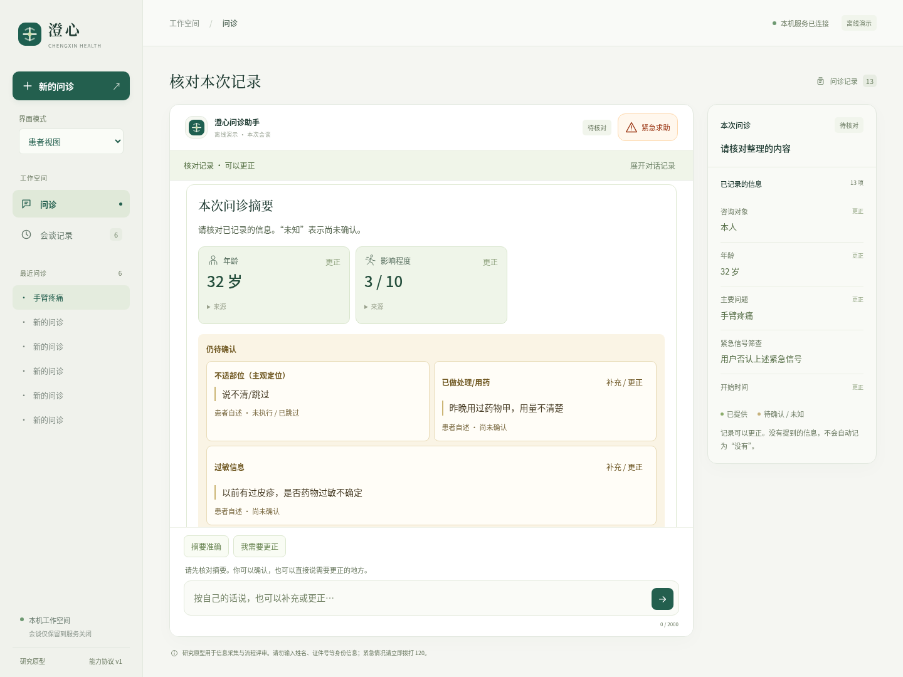
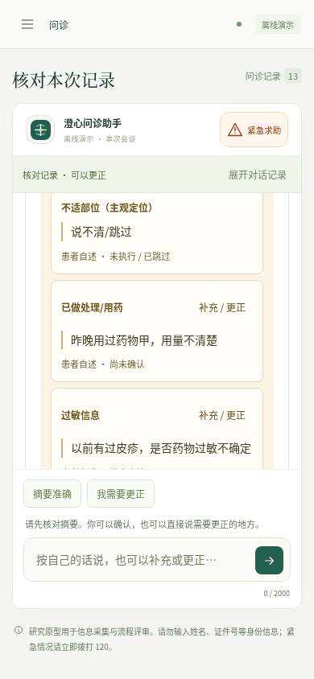

# 0.11.2：未知病史中的原话不再从摘要中消失

患者已提供的内容与未确认状态同时保留。摘要展示当前字段的实际引文、来源、跳过状态及直接补充入口；超过160字符的引文折叠。模型仅选取半句时，可展开宿主保存的同轮原话，并注明其中仍含其他字段的信息。未知不自动转成已知值、计算参数或临床结论。

桌面包：`dist/desktop/Chengxin-0.11.2-linux-x64/Chengxin`。桌面图标仍通过项目启动脚本打开新版，需保留整个应用目录以及系统Python／Node环境。当前交付为Linux x64，患者会谈仍仅保存在服务内存。



## 证据与边界

[完整演示基线](demo-baseline.json)记录“昨晚用过药物甲，用量不清楚”和“以前有过皮疹，是否药物过敏不确定”的原话仍在事实证据中，但旧摘要仅列未知标签，未显示这些内容。新版不对这两句话推断药物剂量、过敏原因或已确认诊断。

[真实首轮](live-round1.json)6次DeepSeek请求中，两场景的过敏引文均只剩“是否药物过敏不确定”。家属场景实际到达摘要但遗漏皮疹上下文；本人场景停在急症筛查。首轮评测器只提交一次描述，不回答后续问题，因此本人场景未到摘要不能单独判定问诊流程错误。错误的急症阳性提议被原有控制器拒绝，实际拒绝记录保留。

[第二轮](live-round2.json)7次请求中，允许回答实际提出的急症筛查问题，本人和家属场景均由真实控制器进入摘要。药物报告与剂量未知可见，过敏未知的短引文可展开实际原轮的皮疹陈述。第二轮评分接受明确限定范围的原轮上下文，交互步数也与首轮不同，因此不将两轮通过数解释为模型准确率提升。

两轮各自在运行前后核对同一源码哈希。首轮保留哈希与完整合成事件，未保存对应全部源码字节；第二轮另冻结84份医疗决策相关源码与评测输入到`live-round2-source`。最终224份源码、测试、包内元数据与相关设计文档另存`snapshot-final`。没有修改医疗提示词、事实断言协议或原始评分记录。

[保存决策重放](v0112-replay-final.json)在最终冻结代码中实际重放首轮家属场景的3个决策：短引文、`unknown/null`仍相同，宿主同轮上下文找回皮疹陈述。重放外部模型调用0，不计作新模型样本。没有原始回合、引文不匹配或跨会谈时不推造上下文；更正只显示当前事实对应的原话，历史另留。

## 工程验收

结果见[verification.json](verification.json)。后端默认253项中200通过、53跳过；再按实际测试身份单独运行其中50项SDK／隔离／本地接口检查，50通过。按身份去重后250项通过，3项长时检查本轮未重跑。不能把默认53项跳过都算作通过，也不把4项最终定向复验重复计数；清单见[覆盖核对](v0112-backend-coverage.json)。185／142／605秒长检查保持0.10.6历史证据归属。

浏览器27组，源码和打包版各19组原生桌面检查通过。新增4项后端、3组界面和1组原生检查覆盖完整问诊、390像素窗口、照护者、跳过、连续更正、上下文回合隔离、只读历史、HTML惰性显示、长原话及旧摘要兼容。首次界面测试误用了测温任务的“暂时跳过”按钮名，实际部位任务按钮为“说不清／跳过”；原始失败trace保留在`ui-first-fixture-failure`。修正为读取服务实际注册的skip选项，未修改产品跳过语义。

新桌面包101份项目文件逐字匹配，544个适用生产依赖版本匹配；这是项目文件与版本核对，不是完整依赖内容签名审计。冻结源码在未复制`.env`或`node_modules`的新目录实际运行57项问诊／摘要／医疗控制器检查，全部通过、无跳过；文件哈希前后保持。另核对所列6份既有不可变归档，未改变其内容。



## 冻结复验

从项目根目录执行，目标目录与输出文件必须未使用；只需Python 3.10+，无模型、下载或Node依赖：

```bash
cp -a docs/evaluations/2026-10-17/v0.11.2/snapshot-final /tmp/chengxin-0112-check
python3 -B docs/evaluations/2026-10-17/v0.11.2/verify.py \
  --project /tmp/chengxin-0112-check --output /tmp/chengxin-0112-check.json
python3 -B docs/evaluations/2026-10-17/v0.11.2/replay.py \
  --project /tmp/chengxin-0112-check --output /tmp/chengxin-0112-replay.json
```

本轮共13次外部模型调用，之后的界面、重放和冻结复验均不增加调用。所有患者描述均为合成数据；本版没有验证临床有效性、用户理解率或总体DSH／Codex能力，也没有完成细分药名、剂量和过敏类型的可靠结构化提取。整体优化目标继续保持进行中。
