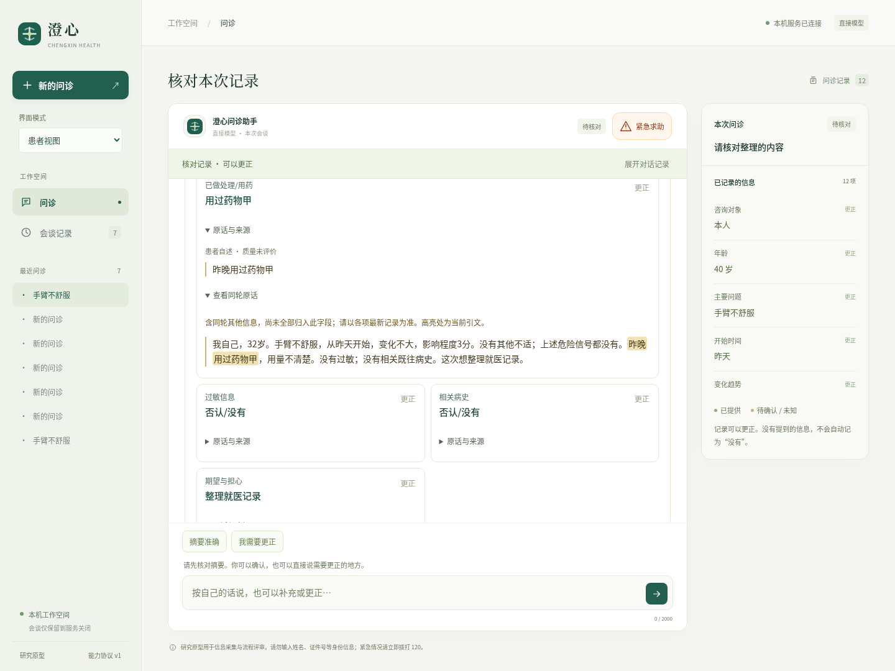
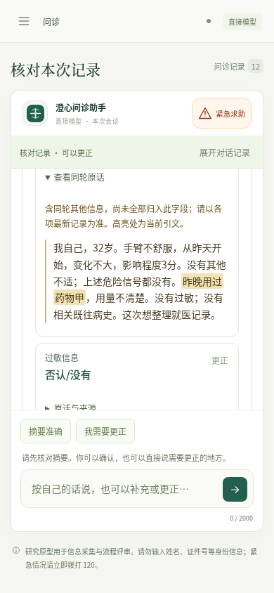

# 0.11.4：长问诊中的原话与部分信息

已记录项目也能展开核对原话、来源和同轮上下文。展开卡片使用整行，唯一字面引文高亮；引文出现多次时不猜测位置。长问诊中，已退出近期16条消息窗口的当前事实原话按来源回合去重补回模型输入。旧原话是只读资料，当前事实与更正优先，不能冒充本轮写入证据。

桌面包为`dist/desktop/Chengxin-0.11.4-linux-x64/Chengxin`，桌面入口已指向新版。需保留整个应用目录及系统Python／Node环境；当前交付为Linux x64研究原型。



## 实际缺口

[完整控制器探针](present-context-baseline.json)中，患者说“昨晚用过药物甲，用量不清楚”，脚本模型如实提议“用过药物甲”，引文仅覆盖“昨晚用过药物甲”。原话仍在本会谈事件里，但旧摘要不显示剂量未知。这是确实存在的部分报告，不应为了展示而编造剂量或把用药本身改成未知。

新版已记录项目增加可选`evidence/context`。只从当前会谈、当前事实对应回合、实际包含引文的患者／照护者原话生成上下文，不推造缺失来源；更正后只展示该字段的新来源。原轮文字可能包含已更正年龄等其他信息，界面明确提示以各项最新记录为准。

模型的`earlier_source_turns`只补充已退出近期窗口的相关原轮；同轮只保留一份，事实用`source_context_id`引用。原话仍在近期消息中时不额外复制。旧源文不能直接用于新的`record_facts`写入；新增测试实际尝试从旧目录恢复已更正用药，提议被现有本轮证据门拒绝。

## 真实长流程

[0.11.3原版打包基线](baseline-native.json)实际执行完整问诊、急症绕过与故障重试：26／0／2次DeepSeek调用，三场景通过。[0.11.4扩展打包流程](expanded-native.json)为22／0／2次，三场景通过。两阶段共52次真实调用，另各有一次本机注入503，不转发上游。

新版初始描述提前提供了用药部分信息和过敏未知，检查也更强，因此不能将26→22解释成性能提升。新版实际验证了：测温畸形输入不记录且不调用模型；38.25℃读数在年龄更正为40岁后保留；程度、趋势、伴随不适及呼吸道信息来自对应回答；原话实际进入窗口外来源目录；更正年龄没有被再次追问或改回；早先提供的用药／过敏无需重新问；摘要、原话展开、核对、更正、历史和导出均可运行。

本例有9次实际模型请求含一个去重来源，当前年龄均为40岁。它证明来源数据可供模型读取及本次流程没有相应回归，不证明长期记忆准确率或模型一定使用了每条原话。实际模型保留了完整用药限定；“短引文遗漏剂量未知”的场景另由固定控制器反例和界面检查验证，不伪称是本次模型自然错误。

基线预冻结231份文件，新版预冻结236份。原测试驱动保存了运行后源码与协议哈希；与预冻结的交集均匹配。两次手工预冻结列表遗漏了`playwright.live.config.mjs`，该配置的运行后匹配字节单独保存在`baseline-post-only`和`expanded-post-only`，不冒称预先冻结；范围见对应`*-source-verification.json`。最终239份快照补入了三个Playwright配置。

## 工程验证

结果见[verification.json](verification.json)。默认后端266项中213通过、53跳过；单独运行其中50项SDK／隔离／本机接口检查，50通过。按实际测试身份去重为263通过，3项长时检查本版未重跑，保持0.10.6历史归属，见[计数核对](backend-coverage.json)。

新增4项后端、3组界面和1组原生检查。界面31组、源码与打包版各21组原生流程通过。覆盖部分报告、来源目录去重、更正优先、缺失与跨会谈来源、系统推断隔离、默认折叠、键盘与窄窗口、HTML惰性文本、重复引文不猜位置、旧摘要兼容及展开不额外调用模型。

首次界面安全测试把组件自带的两个SVG图标也算作注入，导致预期0、实际2。原始日志和trace保留在`ui-first-fixture-failure`；修正测试范围为原话容器内的SVG以及所有注入图片／脚本，继续检查执行标记不存在。渲染器没有执行来源HTML。

最终239份源码、测试、配置、包内元数据及相关文档存于`snapshot-final`。未复制`.env`或`node_modules`的新目录实际运行70项患者流程检查，通过且无跳过。新包102份项目文件逐字匹配，544个适用生产依赖版本匹配；它不是完整依赖内容签名审计。



## 冻结复验

从项目根目录运行，目标目录和输出必须未使用；Python 3.10+，无外部模型调用或下载：

```bash
cp -a docs/evaluations/2026-10-17/v0.11.4/snapshot-final /tmp/chengxin-0114-check
python3 -B docs/evaluations/2026-10-17/v0.11.4/verify.py \
  --project /tmp/chengxin-0114-check --output /tmp/chengxin-0114-check.json
```

完整设计见[长问诊的信息保留与原话核对](../../../长问诊的信息保留与原话核对.md)。当前只是合成工程验证，不证明临床有效性、完整中文语义理解或总体DSH／Codex能力；未将源文自动分解为经验证的药名、剂量等细项。整体优化目标保持进行中。
