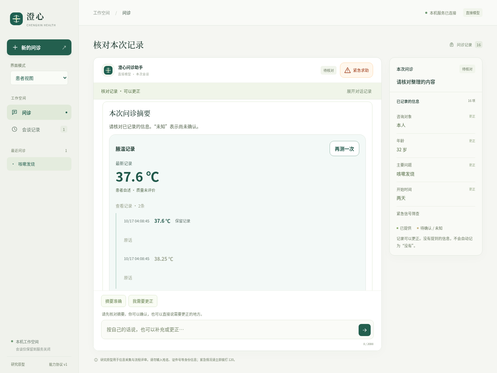
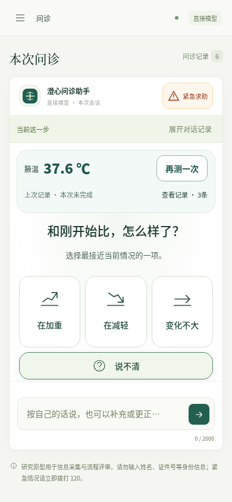
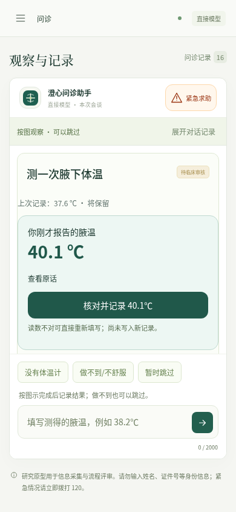
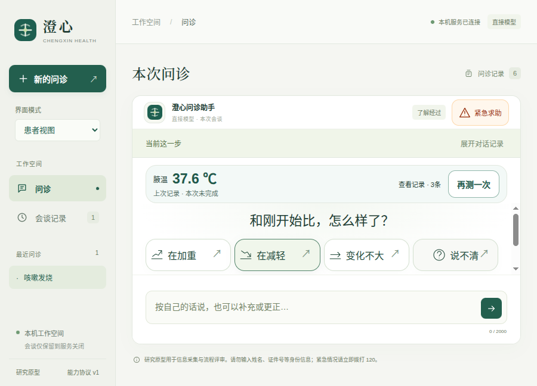

# v0.11.5 · 重复测量与问诊接续

本版修复已有体温后无法重新测量的流程缺口。有效新值关联旧记录；未完成保留上次值并标注，完成后恢复原问题、摘要或计算卡。候选值需核对，原话与确认动作分开保留；沿用原有风险规则，没有新增临床阈值。

- [完整验收索引](verification.json)
- [设计与实现边界](snapshot-final/docs/重复测量与问诊接续.md)
- [真实DSH合成检查](live.json)：3次实际提供商请求，全部200；后续重复测量零新增请求。只有一个新会谈，不能推导模型工具选择覆盖率或临床准确率。
- [最终包校验](package-audit.json)：103项自有源码／随附文件、544项适用生产依赖版本；不是全部依赖内容完整性或签名审计。
- [冻结副本复验](frozen-verification.json)：247个选择冻结文件，83项患者控制器／展示／来源／重复测量检查，零模型、零下载。
- [事前源码摘要](source-before-live.json)、[最终源码摘要](source-files.json)、[调用后变更说明](post-live-changes.json)。真实调用后仅调整界面、相关测试／文档和发行元数据，医疗控制器、提示词、工具及内容包字节保持一致。

## 可见结果







重复完成后，窄屏采用紧凑记录条，将回答选项留在主区域。检查要求390像素下四个回答按钮及输入框完整处于视口内，原生桌面另检查900×760及最小900×680窗口，并核对窗口实际尺寸。



## 工程验收口径

后端默认收集279项，226通过、53跳过；另行运行其中50项真实SDK／隔离检查并通过，合计276项不同后端检查。3项长时任务未在本版重跑，既有0.10.6历史结果不能冒充本版结果。新增重复观察用例13项包含在上述276项中。

最终界面回归37项通过；最终风险配色另有2项定向复验通过。记录卡颜色仅跟随既有控制器风险。源码及打包版的最终原生结果见索引和各自日志，不以浏览器检查替代真实Electron窗口。真实提供商检查与本机确定响应的SDK／界面检查分开统计；只有live.json对应本轮3次实际DeepSeek请求。

首次后端回归发现旧的“跳过后重新请求”被重复测量快捷路径接管；修正为只对已有有效值自动匹配，原回归无需改动后通过。首次界面失败来自测试模型命令顺序与控制器自动展示不一致、错误回退选择器；新增接续测试曾混用innerText与textContent，修正为先一致比较完整DOM文本，再独立核对可见选项。全部早期日志和相应失败轨迹保留，没有删除失败后声称首次全绿。

截图复核另发现原接续卡虽状态正确却挤走窄屏回答选项，因此压缩为记录条并增加完整视口断言；旧包／冻结结果以pre-compact前缀保留，最终包另建并复验。研究SDK基准的旧分数未改写，本版不声称整体达到或超过DSH／Codex。

## 记录与复现

`baseline-next-repeated-observation-audit.json` 为旧版零模型反例，其原始探针假定直接更新；新版明确要求候选核对，因此不能拿旧探针的静默写入条件当新版验收。新增测试实际执行核对后检查当前值、supersedes链、原话轮次及风险路径。

`pre-live-source/` 保存实际调用前选择冻结源码，`snapshot-before-compact/`保存首轮冻结检查副本，`snapshot-final/`为最终选择冻结源码。不是完整依赖或操作系统快照；未包含.env、node_modules、二进制目录及所有历史文档。

复验可把snapshot-final复制到新的临时项目，在归档外写报告：

```bash
python3 -B verify.py --project /path/to/copied-project --output /path/to/new-verification.json
```

此前21个已封存归档的最终摘要检查见[历史归档核对](previous-archives-verification.json)。最初审计器误把旧版平铺／对象型manifest当统一字符串映射，错误报告保留为previous-archives-first-audit.json；格式识别修正后全部核对通过，没有修改旧档。

矮桌面原生检查发现选项受高度限制后增加针对性布局；900×680与900×760的窗口尺寸经过实际getSize核对，未只凭用例名称推断。相关首次失败轨迹与尺寸参数修正日志保留。

本版仍是工程研究原型，图示理解、自查动作与临床有效性尚未获得临床验证。
