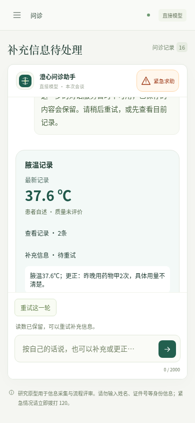
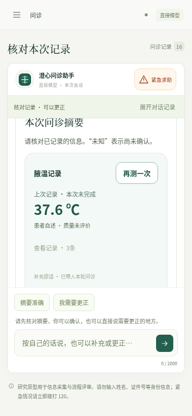

# v0.11.6 · 完整测量反馈与同轮补充

修复患者测温时补充的病史被漏掉、下一小句的读数限定没有生效，以及测量录入被另一小句的用药次数干扰。接受读数后仍处理整轮原话；失败可重试，同一个读数不重复写入。原型仍不能替代临床验证。

- [完整验收索引](verification.json)
- [输入、执行与展示设计](snapshot-final/docs/测量反馈与同轮补充.md)
- [同探针旧版复现](baseline-reproduced.json)与[新版结果](fixed-probe.json)：零外部调用，固定响应驱动实际控制器，不是模型正确率对比。
- [真实DSH检查](live.json)：明确预置的合成病例，随后3类补充场景共5次实际提供商请求；不是完整新会谈或临床试验。
- [冻结源码复验](frozen-verification.json)：254个选择冻结文件、95项相关测试，零模型、零下载。
- [最终包核对](package-audit.json)：104项自有文件和544项适用生产依赖版本；不是完整依赖内容／签名审计。

## 可见结果





界面区分“待重试”“已带入本轮问诊”“尚未结构化”。带入不代表所有语义已正确解释；病史、原话与摘要仍需核对。接口失败时不再突出旧摘要，页面与输入提示明确指向待处理补充。紧凑记录中的补充放入已有折叠，避免挤走回答选项。

## 验收范围

默认后端291项：238通过、53跳过；其中50项SDK／隔离检查另行通过，合计288项不同后端检查。3项长时任务未在本版重跑。新增12项测量反馈检查包含在288项中。

最终40项界面回归通过；源码完整25项原生回归通过，最后提示文案另有1项定向原生复验。最终打包版结果以索引与完整日志为准，不把浏览器测试当作原生窗口验证。真实提供商请求只有live.json中的5次，接口故障、重试、渲染与绝大部分回归使用本机确定响应。

真实模型在原先“没有用药”的状态上，保留了药物甲／乙／丙及“用量不清楚”的更正。未知读数未覆盖上次温度；有病史但尚无读数的再测请求先处理病史，再由待办展示任务。最后纯读数没有增加提供商请求。样本与设计不足以证明通用语义正确率或临床效果。

## 源码与早期失败

[事前摘要](source-before-live.json)对应pre-live-source；[最终摘要](source-files.json)对应snapshot-final。调用后只增加／修正展示契约测试、待处理标题与输入提示及相关界面断言，见[变更列表](post-live-changes.json)。医疗控制器、解析器、提示词、内容包和真实评估脚本字节保持一致。

旧版与新版的compare_probe.py采用相同输入和固定提议，原来用药维持absent、两条读数限定被当present，新版用药实际更新，两条限定为unknown；另一小句用药数字不再阻止明确摄氏读数。旧版项目从已封存0.11.5选择冻结源码复制到临时目录，不在旧档内执行或写入缓存。

早期限定规则在“不太确定”上有范围处理错误，已修正并保留失败日志；重复请求含补充时的旧测试预期改为先排队处理补充，不从血糖猜温度。首次界面发现旧摘要遮住错误卡；后续测试曾把工具观察包装当作初始上下文、把新测试误放入测试函数，已修正测试并保留相关失败轨迹。最终回归与早期记录分开，没有覆盖失败。

## 复现和存储

把snapshot-final复制到临时项目后，在归档外写报告：

```bash
python3 -B verify.py --project /path/to/copied-project --output /path/to/new-verification.json
```

为完成新包构建，旧0.10.4展开程序包已逐条核对后压缩为dist/desktop/archives/Chengxin-0.10.4-linux-x64.tar.gz；29,541个条目的文件内容、模式与链接一致，当前包及历史验收档保留。[压缩摘要和恢复命令](old-bundle-storage.json)。压缩文件在dist下，不复制进本归档；它仍可恢复旧程序目录。

此前22个封存档的内容核对见[历史归档验证](previous-archives-verification.json)。本归档包含选择冻结源码和合成事件，不是全部依赖、操作系统或临床环境快照。
