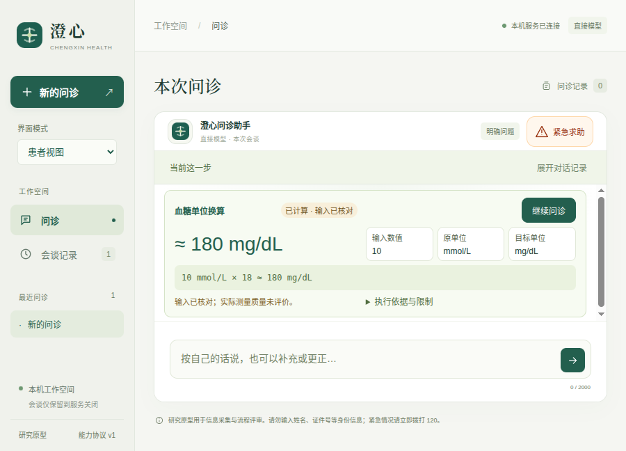

# v0.11.7：有来源的计算插件与问诊接续

本轮完成第二个受信计算 `calculate.glucose` 0.1.0。患者和研发主／子智能体使用同一实现；输入卡不再固定五种质量／体积单位。结果标注项目、数值、单位、近似与公式，来源和范围可展开。900×760／900×680短窗口首屏保留继续按钮、读数、三个输入与公式。

这是合成工程验收，不证明临床有效性、任意公式插件能力或整体达到DSH／Codex。完整设计见[本轮设计副本](design.md)，机器可读结果见[results.json](results.json)。

## 要求与证据

| 要求 | 实现与可核查证据 | 结论／边界 |
| --- | --- | --- |
| 有来源的显式计算 | [清单](source-final/src/medagent/extensions/packs/glucose.json)、[实现](source-final/src/medagent/extensions/glucose.py)、[数值及出处测试](source-final/tests/test_glucose_capability.py) | 固定18近似约定；拒绝不匹配的检验项目，不推导诊断或用药 |
| 插件接入统一输入组件 | [受信策略](source-final/src/medagent/extensions/conversion_forms.py)、[患者草稿](source-final/src/medagent/patient_calculations.py) | v1兼容；v2由受信策略提供单位、项目与范围。不是任意多变量表单或任意代码安装 |
| 缺参、编辑、计算后接续 | [患者检查](source-final/tests/test_glucose_capability.py)、[真实请求轨迹](live-first.json) | 缺参空白；核对和接续不增加模型请求；计算不自动写入病例事实 |
| 研究主／子调用与纠错 | [真实SDK测试](source-final/tests/test_glucose_sdk.py)、[测试日志](logs/glucose-sdk-regression.log) | 本地确定模型驱动真实DSH工具，拒绝无项目引文后改正，父／子回执及离线恢复通过 |
| 来源渲染与可见回退 | [界面测试](source-final/tests/ui/glucose-calculation.spec.mjs)、[最终定向日志](logs/glucose-ui-final-targeted.log) | 缺少必要依据或非HTTPS／含凭据来源拒绝；标题按文本显示；旧展示仍可读 |
| 短窗口首屏可操作 | [共享交互检查](source-final/tests/fixtures/glucose-calculation.mjs)、[原生测试](source-final/tests/desktop/glucose-calculation.spec.mjs)、[打包版日志](logs/glucose-native-package.log) | 检查继续按钮实际边界，900×760／900×680通过；展开依据允许滚动 |
| 源码与包一致 | [最终包核对](package-audit-final.json) | 107个自有随包文件与源码字节一致，544个适用生产依赖版本匹配；不等于完整传递依赖内容审计 |
| 冻结后离线复现 | [最终清单](source-files.json)、[验证器](verify.py)、[结果](frozen-verification.json) | 258个选定文件、125项测试通过；不是整个仓库／操作系统快照或原生、在线临床复现 |

## 实际运行结果

- 后端默认收集303项，249通过、54跳过。另运行原有50项真实SDK／集成检查以及1项新增血糖SDK检查，合计**300项不重复后端检查通过**。3项长时间主动选择的检查本轮未重跑，不能将历史结果计为本轮通过。[默认日志](logs/glucose-backend-full.log)、[50项日志](logs/glucose-sdk-full.log)、[新增SDK所在定向日志](logs/glucose-sdk-regression.log)。
- 浏览器完整42组通过；最终短窗口布局和文案调整后，受影响5组再次通过。[完整日志](logs/glucose-ui-full.log)、[最终定向日志](logs/glucose-ui-final-targeted.log)。
- 源码原生首次完整26组中25通过、1失败：旧生命周期测试直接执行默认选项，新增工具排序后实际选中了血糖换算，却仍断言1250g。改为显式选择质量／体积工具后，相关生命周期与两种短窗口共4组通过。早期失败[日志](logs/glucose-native-full.log)、[轨迹](native-first-failure/trace.zip)保留；[修正后定向日志](logs/glucose-native-short-final.log)。最终**打包版完整27组通过**。[最终日志](logs/glucose-native-package.log)。
- DSH桥接21项通过；项目规定的Prettier检查通过，16个本轮相关Python文件的Black检查通过。额外的全树Black探查曾报告14个格式文件，其中本轮触及的初始化文件随后已格式化；其他13个未作无关改写。本轮不宣称全树Black通过。[桥接](logs/glucose-bridge.log)、[Prettier](logs/glucose-format-final.log)、[相关Python](logs/glucose-black-scoped-final.log)、[原始探查](logs/glucose-black.log)。

## 真实提供商与冻结范围

只读取根目录`.env`，真实凭据留在父进程评估网关，应用收到临时令牌。两个全新合成患者请求共**2次真实DeepSeek请求，均HTTP200**：明确血糖读数的换算请求，以及未提供数字／单位的换算请求。两者都产生正确能力输入卡，核对后得到宿主结果并返回原问题；核对与接续均零额外调用。没有临床数据或完整诊断问诊，也没有本轮真实提供商驱动的研发工作台、视觉模型或临床验证。[原始报告](live-first.json)、[评估脚本](source-final/scripts/evaluate_glucose_calculations.py)。

单轮上限8次、同输出目录累计16次；本轮只使用2次，不额外消费额度。运行前保存[253文件快照](source-before-provider/)及[摘要](source-manifest.json)。调用期间摘要保持一致。随后只调整紧凑布局、提醒文案、初始化文件空白、发行元数据、测试和设计文档，保留[逐文件变化](post-provider-changes.json)。计算实现、患者控制器、出处策略和模型提示逻辑未变；不将在线结果冒充对最终视觉布局的真实提供商复测。最终布局由浏览器和原生检查核对，最终冻结为[258文件](source-final/)。

旧工作区的计算绑定不会静默升级；旧回执无需当前实现可离线读取。兼容测试还去掉新增名称字段，检查旧回执的展示重新生成与读取。

## 截图



其他视图：[900×760结果](screenshots/65-native-760-glucose-result.png)、[宽屏结果](screenshots/63-glucose-result.png)、[窄屏缺参输入](screenshots/64-mobile-glucose-input.png)。截图使用合成输入；首次原生截图保留在目录中，不能用其证明最终紧凑布局。

## 复现与存储

从项目根目录运行：

```bash
python3 -B docs/evaluations/2026-10-17/v0.11.7/verify.py \
  --project docs/evaluations/2026-10-17/v0.11.7/source-final \
  --output .runtime/glucose-frozen-replay.json
./scripts/start-desktop.sh
```

验证器禁止写入pycache，输出须选择新的归档外路径。它仅运行所声明的离线选择集；不要把之后改动的工作区结果归入本轮。

为释放构建空间，未运行的旧生成包0.10.3与0.10.5已无损压缩到`dist/desktop/archives/`；逐项校验29,539／29,545个文件、目录与链接的内容、权限及目标后移除展开副本。当前与上一发布版本保留展开目录，历史评测归档未改写。恢复命令、摘要和校验结果见[0.10.3记录](old-bundle-0.10.3-storage.json)、[0.10.5记录](old-bundle-0.10.5-storage.json)；索引和[所用脚本](archive-old-bundles.py)同时保留。这是存储整理，不计入智能体能力。

本目录在验证成功后才扫描配置凭据并封存；扫描范围为原始文件与解码ZIP成员中的精确配置值，不能声称任意秘密检测。后续不得原地更新封存文件。
