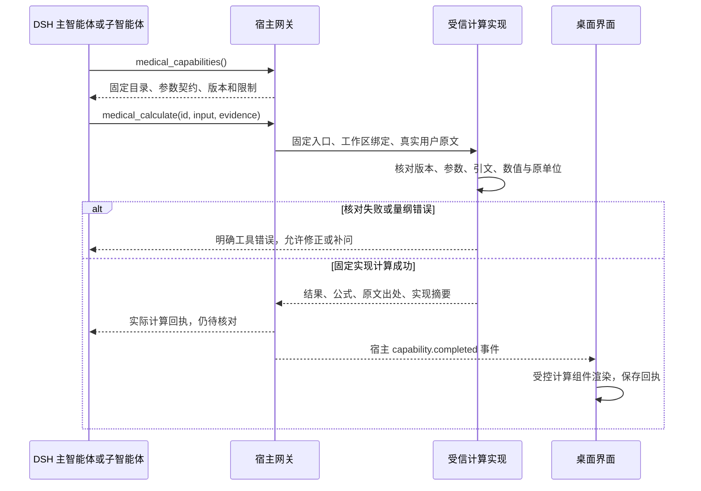

# 注册计算工具与执行回执

当前扩展：v0.11.7 的 `calculate.glucose` 已复用这条调用链路，增加检验项目出处、近似规则和清单来源；旧回执仍可阅读。见[新插件设计](有来源的计算插件与血糖换算.md)。

版本：0.9.4，2026 年 10 月 16 日。完整 DSH 执行工作台新增两个真实工具，把已注册计算、模型的错误修正循环和结构化展示连通。该历史版本仅开放 `calculate.units`，不包含药物剂量、诊断或饮食摄入量推导。

## 实际执行路径



模型仍保留官方终端、文件、搜索和子智能体工具。注册计算由宿主选择的固定 Python 入口执行；请求不接受命令、模块或文件路径，计算子进程仅带必要的 PATH/LANG，不继承提供商密钥或桌面鉴权环境。模型环境不能挂载项目源码和宿主索引。受信实现运行在宿主，不是第三方不可信代码的执行沙箱。

## 工具契约

`medical_capabilities` 无参数，返回该工作区固定的计算及输入契约。未建立绑定的旧工作区返回 `capability_binding_missing`，需要新建工作区才能使用注册计算，不悄悄新增权限。

`medical_calculate` 接收三个字段：

```json
{
  "capability_id": "calculate.units",
  "input": {"value": "1.25", "from_unit": "kg", "to_unit": "g"},
  "evidence": "1.25 kg"
}
```

`evidence` 必须是宿主收到的近期真实用户任务中的连续引文。宿主在完整原文中定位数量，核对数值及原单位，拒绝伪造引用、错数、错单位、截掉负号、截取科学计数或千位分组的片段、范围和复合量纲。支持普通非负十进制及已登记单位/中文别名；没有可靠解析的格式需要补问，不猜测。原文存在多个同值候选时，不宣称已经理解其对象或临床含义。

数量与原单位匹配只证明一部分输入出处。目标单位仍是模型提议，实际测量质量、用户意图和临床适用性尚未确认。成功结果固定保留 `input_status=unconfirmed`、`quality=not_assessed`，不自动写入病例。

相同质量或体积量纲内使用固定 SI 前缀比例与 Decimal 计算。质量到体积缺少密度时返回 `calculation_rejected`；未知或关闭的能力返回 `capability_unavailable`。模型应依据真实错误修正参数或补问，不以临时脚本替代注册回执。

## 版本与保存

新建工作区时固定当前模板、启用能力 ID、注册表摘要，以及计算入口和相关受信 Python 源码的实现摘要。全局启停只影响新工作区；主智能体和子智能体使用同一绑定。清单或实现变化后返回 `capability_version_unavailable`；已有回执仍能查看，通用执行不因计算版本不可用而被禁止。

目录和计算共用每轮 32 次、当前运行进程累计 256 次的独立工具调用上限；计算不额外调用模型。主任务和子任务共用这些上限、取消状态与原回合截止时间。原有模型调用额度仍独立计数并覆盖主任务、搜索和子任务。

近期最多 32 条回执存入模型环境看不到的宿主 `.index`，与近期任务一同保存；已裁掉的所属任务不单独保留回执。记录包括输入、公式、原文及回合、能力版本、实现/组合摘要、执行 ID 和时间。读取时核对展示与数据一致性。重启后可以无密钥查看，查看不触发模型调用，旧工具事件也不会伪造为本轮执行。

回执与任务记录是本机明文研究资料，不是签名的第三方证明，也不防御具备同一操作系统账户权限的修改者。提供商密钥不写入索引。患者问诊状态仍不因此持久化。

## 可视化与信任边界

复用 `medical-ui/v1` 标准计算组件：突出结果和单位，邻近列出输入、公式及待核对状态，原文、实现摘要与限制按需展开。只有宿主回执事件及其保存记录进入组件；模型回复、终端输出和工作区 JSON 文件保持普通文本，不能靠声明 `type: calculation` 获得受信展示。


截图使用本地合成模型，右侧 `9999` 是测试用的未核验文件；左侧 `1250 g` 来自宿主注册工具，两者不会混为同一类结果。

## 后续插件接入要求

1. 在受信注册表中登记版本、封闭输入输出契约、适用范围、限制与审核状态；manifest 不能动态导入代码。
2. 在第一方实现映射中绑定固定函数，并添加该能力的输入出处核对策略。现有策略只处理数值与原单位，不能直接充当任意医疗公式的证据校验。
3. 扩展回执与受控组件时同时扩展契约验证，未知格式可见回退；输入不完整、量纲错误和版本不可用返回真实错误。
4. 用独立算例、反例、真实 DSH 循环、子任务、取消、恢复和原生渲染验收。临床公式另需审核与临床验证，代码测试不能替代。

患者问诊暂不拥有任意终端权限；研发回执也不会自动变成医疗建议。这轮交付的是可扩展的计算工具路径，不是已经完成的通用临床推理能力。

## 验证入口

```bash
RUN_DSH_EXECUTION=1 PYTHONPATH=src python3 -m unittest discover \
  -s tests -p test_execution_capabilities.py -v

DISPLAY=:1 XAUTHORITY=/run/user/1000/gdm/Xauthority \
  npm run test:desktop -- --grep 'native registered calculation'

# 使用已授权的本地 .env，仅合成数据。
PYTHONPATH=src python3 scripts/evaluate_capabilities.py --max-calls 32 \
  --output .runtime/evaluations/new-capability-round/report.json
```

实际结果、失败与修复记录在 [真实模型评测](缓存优化与真实模型评测.md)。
