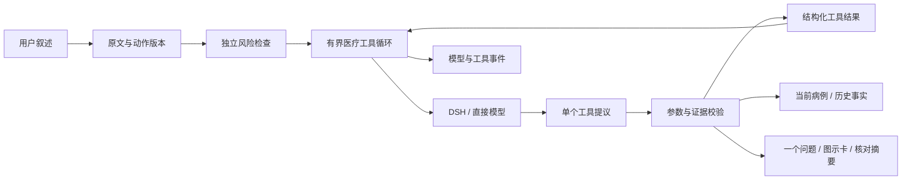
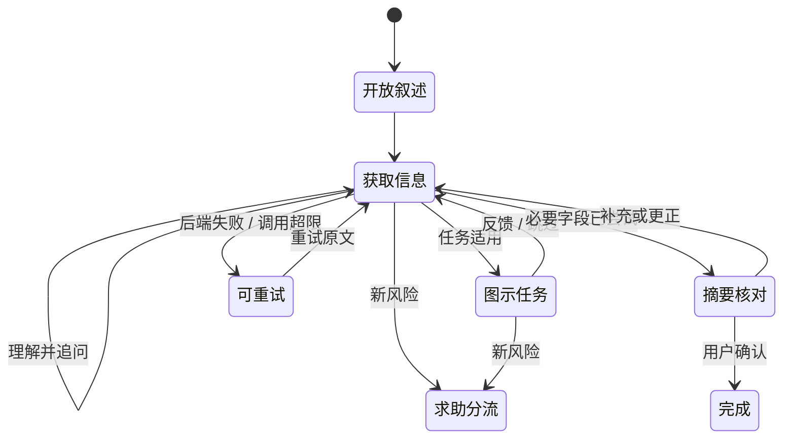

# 门诊式问诊智能体：产品与技术设计 v0.11.6

更新时间：2026 年 10 月 17 日。本文描述患者问诊路径；“固定问题排序器”作为 `demo` 保留，模型问诊使用共享医疗控制器和 DSH/直接模型后端。独立的完整 DSH 执行工作台见 [通用执行底座](通用执行底座与能力评测设计.md)。

## v0.10.3 模型等待与优先求助

普通输入等待模型时，会谈锁通过公开的 `threading.Condition` 释放；HTTP 外层快照锁的递归层级也一并释放和恢复。已有规则识别的紧急描述或用户显式选择的“优先求助”可以中断等待。普通并发补充返回可识别的 409，不与正在处理的输入混写；不同会谈互不污染。

优先求助先关闭普通问诊、生成新的动作版本并通知等待者。旧模型成功或失败均只保留失效事件，不再提交事实、重开问诊或覆盖新卡片；已经合法写入的事实仍保留。同一求助原文重试返回已有结果，不新增修订；不同补充仍记录。主动求助只记录用户选择，不能伪造呼吸困难或急症筛查事实。

患者在普通等待期间仍可打开“紧急求助”，用独立弹窗提交可选描述；失败保留草稿，重复提交受控。前端同时校验会谈、请求代次、动作及病例修订，阻止迟到结果、错误提示与 finally 清理覆盖新会谈。求助卡片以本地固定图标、完整操作说明和可展开原因呈现；不从自然语言拆解或另行生成急救动作，也不声称已替患者呼叫急救。

DSH 决策桥接中断后会终止并回收其进程组，Python 父进程清理自己创建的临时根。直接模型接口的逻辑中断立即返回，但其底层 HTTP 请求可能持续至原 45 秒超时；每个问诊引擎最多允许 8 个未结束决策工作线程，容量耗尽时保留输入并提供重试。不能把逻辑中断描述为已撤销提供商计费。

真实 DeepSeek 三个合成场景共 4 次请求：正常批量记录后继续提问、缓冲真实响应时输入已有规则识别的紧急描述、缓冲真实响应时主动求助。两次本机引擎优先路径各约 1 毫秒，旧等待在释放缓冲前返回，迟到提议不写入病例。这里有意制造响应等待，不代表真实患者端到端延迟或临床识别性能。完整证据见 [本轮归档](evaluations/2026-10-16/v0.10.3/README.md)。


v0.9.5 将患者计算改为明确请求、可编辑输入卡、用户核对、固定实现计算和继续原问题。提议与执行使用不同契约：提议允许缺参数，执行必须完整；参数核对不升级测量质量。具体状态、协议和截图见 [患者计算输入与问诊衔接](患者计算输入与问诊衔接.md)。

v0.3 增加患者/研发视图、集中式图示任务、受信能力与模板组合、会谈版本快照。DSH 保持已固定发行版。详见 [能力插件与问诊模板](能力插件与问诊模板.md)。

v0.6 优先修复多轮状态一致性：患者明确提出的图示请求先登记待办；更正按字段依赖处理；旧页面更正需要原事实版本；病例和事件通过同一快照恢复。v0.5 的缓存布局和模型接入保留。

v0.7 通过真实接口和独立桌面全流程找出并修复明确请求漏记、未知错误填充、更正后丢失追问及原生导出测试的缺口。已进行全新在线问诊，并在真实 Electron 窗口验证测温、更正、摘要确认、文件导出、历史恢复和服务故障重试。记录见 [全流程验收](缓存优化与真实模型评测.md#v07-全流程验收与迭代)。

## 1. 这次修正了什么

v0.1 的主要限制不在模型大小：它把整条回答交给当前字段的简单解析器，并把模型限制为排序器。用户一次说清年龄、起病和用药后，系统仍可能重复询问；对补充、纠错和含糊回答也缺少自然的处理能力。

v0.2 将基本单元改为“输入—事实提议—工具观察—下一动作”。模型可以从整轮输入提议多条事实，查看执行结果后继续选择动作；系统负责类型、证据、来源、观察质量、任务适用性、风险优先级与终止条件。一个协调器承担交互决策，暂不增加多智能体之间的一致性成本。

## 2. 体验目标

开场先允许用户描述主要问题，并交代为谁咨询。后续每轮输出一个主要问题或一个任务。患者可以主动补充、回答不知道、纠错、跳过任务或要求核对摘要。

系统学习门诊交互的功能：理解主诉、按价值补充病史、持续关注紧急信号、选择适合的观察、解释当前安排、确认信息。它不要求把所有真实门诊中的查体动作直接搬到家中。

例如，用户说“我自己32岁，咳嗽两天，昨晚吃过某药”，模型可以提议咨询对象、年龄、主诉、起病和已用药五条事实。验证后只继续询问未解决的信息；如果药名或时间不清，可针对用药字段澄清。若用户补充明确危险信号，控制器会在下一次模型请求前中断。

## 3. 运行结构



决策传输使用统一的 JSON 工具提议：

```json
{
  "tool": "record_facts",
  "arguments": {
    "facts": [
      {"key": "age_years", "value": 32, "assertion": "present", "evidence": "32岁", "correction": false}
    ]
  }
}
```

工具由医疗控制器执行；结果再交回模型。DSH 运行时内部不注册 shell 等宿主工具。这里有两层职责：DSH 提供官方模型调用与会话生命周期；医疗控制器提供患者交互、医学数据和业务工具。当前采用外部工具控制协议，未实现原生 DSH 临床工具插件。

## 4. 工具及执行边界

| 工具 | 可做什么 | 校验与限制 |
| --- | --- | --- |
| `record_facts` | 提议本轮多个事实或显式更正 | 已注册字段、1–20 条、字段唯一、类型、连续原文证据；整批先验证 |
| `inspect_case` | 观察病例及当前缺口 | 不写状态 |
| `list_questions` | 查询适用的固定问题 | 不写状态 |
| `ask_question` | 输出一个候选问题 | 已注册、当前适用、尚未处理 |
| `clarify` | 针对注册字段自然追问 | 最多 160 字，同主题最多两次；基本词语限制 |
| `repeat_self_check` | 已有记录后按患者明确请求重新测量 | 允许重复的注册任务、适用性、风险门和本轮请求引文；失败不清除旧值 |
| `show_self_check` | 展示一个固定图示任务 | 已注册、适用、未尝试、急症筛查明确阴性 |
| `request_self_check` | 保存患者明确请求，等待任务条件 | 适用任务、本轮连续请求引文、按任务去重；登记不执行 |
| `review_summary` | 展示摘要供患者核对 | 必要字段已尝试，允许未知；不会直接完成会谈 |
| `run_capability` | 提出注册换算，展示可编辑输入卡 | 明确请求与原文核对；提议可缺字段，用户补齐并核对后才执行完整契约，不写临床事实 |

所有工具拒绝多余参数。字段和类型验证可以确定性执行，但原文引文存在并不能证明语义解释正确。例如，模型仍可能把另一个人的病史错误归给患者。摘要核对与临床评价用于发现这类错误，不能把引文检查称为临床事实证明。

当前每轮最多六次工具循环、最多两次事实写入；达到上限时明确提示重试，不默默编出下一问。自由澄清具有提示约束和词语过滤，后者不是完整医学语义审核，仍需在冻结病例上评价。

## 5. 病例、证据与更正

每个事实保存 `key/value`、`assertion`、`source`、`quality`、`evidence`、`turn_id`、`fact_id`、时间和 `supersedes`。`facts` 是当前视图，`history` 保留旧版本。

断言：

- `present`：明确提供；
- `absent`：明确否认，只允许支持阴性语义的字段；
- `unknown`：不知道或无法确认。

v0.7 对 `unknown` 增加明确证据要求：引文须含患者表示“不知道”“不记得”“无法确认”等表达。未提及的字段保持缺失，不能用一条体温读数把变化趋势标为已尝试的未知。规则只校验这些有限表达，不能证明模型将“不知道”的范围归给了正确字段。

观察质量另行保存，不能与断言混用。未做为 `unknown/not_done`；明确无法确认读数为 `unknown/inadequate`；畸形输入不写入结果，继续保留任务供重新填写或跳过；用户报告一次读数为 `present/not_assessed`。输入能被解析，不足以把它升级为设备直连或经验证测量。

模型覆盖已有值必须声明 `correction=true`。整批校验通过后，模型更正与界面更正共用同一套依赖规则：

| 变化 | 保留与重新确认 |
| --- | --- |
| 同一患者年龄更正 | 保留已报告体温，使用新年龄重新评估现有读数；不能删除读数后丢失风险线索 |
| 主诉更正 | 撤回原起病、趋势、影响、伴随症状、呼吸道定向信息、用药处理、目标和急症筛查；保留年龄、对象、过敏、既往病史与体温 |
| 观察结果 | 由任务清单 `invalidate_on` 声明；症状定位依赖主诉，体温不因年龄或主诉文字更正而删除 |
| 已确认对象改变 | 拒绝原地换人，整批不写入，并停止本轮工具循环；界面提供新问诊入口，旧会谈保留 |

主诉更正同时取消原待办。任何字段更正后，进行中的图示任务先取消，再根据新状态规划。失效事实保留历史和原因；同批明确提供的新证据保留。已经发出的急症路径不会因普通字段编辑被自动撤回。这里是有限的工程依赖规则，尚无通用医学因果图；`consult_for` 也不是患者身份核验，不能识别两个都属于“其他家人”的不同人。

界面更正提交 `{ "text": "40岁", "expected_fact_id": "原记录ID" }`。控制器在会谈锁内核对该 ID；旧版本或已失效字段返回 HTTP 409 `stale_fact`。界面保留草稿并刷新记录，用户核对后重新打开编辑。更正原文出现已配置的明确急症短语时，急症提示优先于版本及字段解析。

所有后端的每次可见动作均生成 `session_id:revision` 标识，防止同一问题再次出现时接收旧答案。`GET /api/sessions/{id}/snapshot` 在同一会谈锁内读取病例和事件；消息与更正响应也在锁内生成快照，避免回复和病例属于不同轮次。

### 显式图示待办

患者说“想按图测一下腋温”时，模型先记录已明确事实，再调用 `request_self_check` 保存任务 ID、原文证据与来源轮次。`pending_self_checks` 是会谈内存状态，不是测量结果或跨重启存储。

未完成急症筛查时，模型仅能登记请求和补缺口；未知不执行任务。固定阴性按钮且回答只含选项内容时，控制器可直接展示待办，不再消耗一次模型决策。含新信息的自由文本仍先交给模型提取事实，再在下一步处理可执行待办。展示后待办被消费；任务可跳过，主诉变更会取消旧待办。

待办限定于已注册且适用的任务。引文证明请求片段存在，不能证明模型理解了请求的全部语义，因此仍需扩充含否定、多对象和取消意图的评测。

v0.7 的内容包可以声明 `request_phrases/cancel_phrases`。控制器在写入本轮明确事实后，匹配当前适用任务的有限短语并记录请求，避免模型漏调登记工具；不会因此跳过急症筛查门。请求与取消采用最后一个可确认匹配，识别“不想测体温”和对取消的简单否定。其余自然表达仍由协调器理解，不将这套短语规则称为通用意图识别。

明确取消时，尚未测量的结果记为 `unknown/not_done`，移除待办并停止该任务；已有读数保持原样。明确再次请求时，仅撤回先前“未执行”的当前标记，保留历史并重开任务。v0.11.5起，允许重复的腋温任务另提供多次读数记录，保留旧值与未完成尝试；见[重复测量设计](重复测量与问诊接续.md)。

界面字段更正已经确定性写入后，继续当前任务或尚未回答的问题，不再调用模型重复提取同一条更正。活动问题另外保存“是否追问”的状态：即使主题已有未知或部分事实，未回答的追问仍可在更正年龄后继续；更正追问本身对应字段则进入下一步。没有可继续的问题时使用既有的有限问题目录规划器；摘要阶段更正直接重新投影现有事实。此规则只作用于显式字段编辑，普通患者叙述仍走模型工具循环。

患者回答最后的“期望与担心”后，若该事实批次已成功写入、全部适用字段均已尝试且无待办，控制器直接通过同一 `review_summary` 校验生成摘要，不再请求模型决定是否收尾。`agent.summary_ready` 标记执行来源；患者仍需核对并确认。

## 6. 问诊流程与终止



摘要中的未知保留为未知。生成摘要进入 `summary`，患者选择“摘要准确”后才关闭。选择更正或直接补充会重新进入工具循环。急症或升级路径可以提前结束信息收集，不必凑齐字段。

每个可见动作产生新的 `action_id`，即便前后是同一道问题也不同。患者端提交该标识；过期回答返回 409，避免重复点击或延迟请求写进下一题。当前接口仍允许兼容客户端不传标识；这类客户端不具备该保护。

## 7. 图示任务

任务是内容包，包含稳定 ID、结果字段、输入种类、目的、适用条件、设备、固定图示、短步骤、停止条件、完成选项、限制和审核状态。

当前两个任务：

| 任务 | 结果 | 明确限制 |
| --- | --- | --- |
| 腋下体温记录 | `temperature_c` | 患者报告的腋温；质量未评价，不判断病因 |
| 主观部位定位 | `symptom_location` | 仅描述哪里难受，不是客观查体；不按压、不诱发疼痛 |

两个 SVG 都是固定工程原型，界面显示待临床审核。用户跳过后不重复强迫完成；未来新增动作或视觉核验需注册专门的适用与解释器。当前没有相机动作判断或图像诊断。

## 8. DSH 的实际接入

源码目录：`vendor/deepseek-harness`。核对提交为 `571902028a75c64c1d767f4ae5fd099485f0ddf0`，上游工作区无修改。源码用于审查架构、SDK、配置和适配器；执行层使用官方发行包而非本地编译整个上游单体仓库。

运行 CLI、SDK、协议包均固定 `0.2.0-rc.2`。实际安装过程中发现 npm 默认标签可能指向较早 SDK，因此不依赖 `latest`，也不靠跳过 peer 依赖冲突运行。`package-lock.json` 保存完整解析结果。

官方 `sdk-minimal` 默认仍带持久 shell，不能直接用于患者项目。`medical.patch.yml` 明确关闭 shell、终端、子进程、会话日志上传与插件清单上传，保留 SDK 服务、模型、会话与 agent loop。启动检查检查真实组合配置；集成测试检查实际模型请求中没有宿主工具。

桥接层只向 DSH 子进程传必要环境变量和选定模型凭据，不继承无关密钥。每次决策使用独立临时目录与 DSH home，结束后关闭官方 SDK 并删除临时目录。Python 超时保护会在 POSIX 上终止并回收整个桥接进程组。

当前每次工具决策会新建一个 DSH 调用，完整输入由医疗控制器显式提供。优点是会话隔离和重建清晰，代价是启动及上下文开销。尚未实现可复用、持久的 DSH 会话池；性能优化应在测量后进行。

DSH 的固定 DeepSeek 路由使用 Messages 协议，与直接后端的 Chat Completions 协议不同。配置同名端点变量时，必须按所选模式提供正确协议；不能宣传为任意端点可互换。

采用 SDK 接入优先于维护上游分叉，因为医学数据和业务工具可以独立测试，DSH 升级也只需围绕明确的传输层重新验证。官方参考：[源码](https://github.com/deepseek-ai/deepseek-harness)、[架构](https://github.com/deepseek-ai/deepseek-harness/blob/master/docs/architecture.md)、[SDK](https://github.com/deepseek-ai/deepseek-harness/blob/master/packages/sdk/client/README.md)。

## 9. 风险与结果解释

输入急症门在模型之前执行。结构化事实和任务结果更新后再次评估。危险短语处理现在按分句识别否定，并检查同一短语的多次出现，避免先前否定掩盖随后阳性。

风险规则仍是原型：急症词表和少量升级阈值不具有完整临床覆盖，未命中不能作为安全排除。未知的急症筛查不会被标为常规，也不会允许进入自查任务。`urgent` 会提前给出求助提示及已采集摘要。

摘要保留来源、质量和未知项；当前不生成确诊、药物处方或排除性判断。

## 10. 持久化和接口

默认会话与事件在内存，进程停止即丢失。`--event-log` 可追加明文 JSONL 用于开发审计，目前没有事务病例库、断电恢复、跨进程会话恢复、用户认证、留存删除策略或多租户隔离。DSH 自身的临时持久事件会随临时 home 一起清除，返回的运行事件另行进入项目事件存储。

保留既有会话 API，`/api/health` 另返回版本和 `demo/compatible/dsh` 模式。监听默认 `127.0.0.1`。模型连接配置缺失时启动失败；运行中服务失败时显示明确的重试入口并保留本轮原文。前端不使用 `innerHTML` 渲染患者内容。

图形工作台默认提供问诊和会谈记录；研发视图额外提供图示任务库、运行检查、能力与模板及模型配置。视图偏好不是身份认证。新增 `/api/settings`、`/api/settings/test`、`/api/sessions` 列表和 `/api/tasks` 接口。新配置只用于新会谈，已有会谈保留原后端。连接测试不发送病例，凭据不回显或写入浏览器持久存储。会谈列表是同一服务的共享内存视图，尚无用户隔离。详细页面、截图与评审路径见 [图形界面设计与检查](图形界面设计与检查.md)。

另提供 Electron 独立桌面应用：自动启动随机端口的 Python 服务，以一次性凭证限制访问，管理窗口与子进程生命周期。保持现有界面和医疗控制器，不依赖用户手动打开浏览器。当前已生成并验证 Linux x64 应用目录及桌面启动图标；系统 Python 与 DSH 所需的 Node 尚未内嵌。见 [桌面版说明](桌面应用使用与打包.md)。

## 11. 能力组合与版本固定

图示任务来自独立内容包，观察解释按注册表绑定，不再在控制器枚举两个任务 ID。执行插件通过统一 `run_capability` 接口提出；声明受信 `patient_form` 的能力复用患者输入组件，核对后才执行。前端复用图示任务、输入卡和计算组件。能力及模板配置 API 使用 revision 防止旧配置覆盖；变更创建新运行实例，原会谈继续使用原内容与解释器。会谈快照记录应用版本、清单、启用状态、内容摘要及模型适配信息。当前只加载项目内受信实现，不支持第三方安装或后端权限沙箱。

## 12. 验证证据与下一阶段

v0.8 的患者交互采用受控 `question` 组件与聚焦工作区：固定问题用图形选项、趋势、程度刻度和结构提示呈现，临时追问保留真实问句。主观部位图先选择再确认，分步测温直接显示停止条件与输入错误。摘要优先显示已有关键数值和未知项，其他事实分组呈现；历史、来源和更正入口按需访问。详细设计和截图见 [图形界面设计与检查](图形界面设计与检查.md#v08聚焦当前行动的可视化界面)。没有新增按压等查体动作，也没有实现摄像头动作识别。

已经通过真实 DSH SDK/CLI 的启动、配置审计和本机模型流式响应测试；另外通过了患者 HTTP API → Python 控制器 → DSH → 本机模型 → 多事实写入 → 下一问的全链路，并确认急症输入不再调用模型。

本地集成测试使用合成输入与确定响应，只验证工程实现。v0.5、v0.6 另有真实 DeepSeek API 开发评测，原始成功和失败记录见 [缓存优化与真实模型评测](缓存优化与真实模型评测.md)。当前仍无冻结独立临床病例评价、充分的提示注入鲁棒性、临床内容覆盖、真实用户图示理解或临床结局证据。前端已有真实 Chrome 交互验收和桌面、移动端截图；浏览器测试不会代替临床或患者使用评价。

下一阶段需要冻结由临床人员标注的病例，评价遗漏、误记录、重复问题、无效澄清和过早结束；尤其核对“引文真实但字段语义错误”的情况。v0.10.3 起，已有规则识别的紧急输入和主动求助可优先中断模型等待，迟到提议不能覆盖求助状态；这不证明临床识别覆盖率，直接接口的底层HTTP请求也可能继续到超时。还缺少加密病例存储、身份和跨重启恢复。手环、医保与通用视觉查体仍留在后续阶段。


## v0.11.2 待确认病史的原话

摘要保留当前未知事实的实际引文、来源及未确认状态，允许直接补充；模型引文不足时，可展开宿主对应回合的原话。上下文明确限定为本轮原话，不自动归入该字段或成为计算输入。连续更正、缺失回合、照护者代述及旧摘要只读分别验证。详见[设计与数据协议](待确认病史的原话与摘要.md)及[本轮验收](evaluations/2026-10-17/v0.11.2/README.md)。


## v0.11.3 否定证据与文本限定

事实提议在写入前检查阴性原话、不确定限定、同分句引文范围及紧邻纯限定语，拒绝把“记不清有没有用药”截成明确没有。病史类present文本也不能通过另一种断言形式写入未确认否认，不能在规范化时删去原引文的不确定限定。整批仍原子校验；错误返回模型观察，不额外向患者输出工具堆栈。范围与未覆盖的语言现象见[事实断言设计](事实断言与否定证据校验.md)，真实DSH合成恢复与工程检查见[0.11.3记录](evaluations/2026-10-17/v0.11.3/README.md)。


## v0.11.4 长问诊与原话核对

摘要的已记录项目与未知项目共用事实来源投影。已记录卡片默认折叠原话、质量与原轮上下文，展开后占满内容栏；唯一字面引文高亮，相同片段出现多次时不猜测位置。原轮内容可能包含已更正字段，当前事实优先。

模型近期窗口仍为16条消息。已退出窗口的当前事实来源按回合去重，作为earlier_source_turns只读数据补充，并以source_context_id关联事实。只补充患者／照护者、当前会谈、引文实际包含在原轮中的内容；不把旧陈述当作本轮写入证据。详见[设计与限制](长问诊的信息保留与原话核对.md)及[真实长流程与工程验证](evaluations/2026-10-17/v0.11.4-final/README.md)。

## v0.11.5 重复测量与原交互恢复

允许重复的图示任务由内容包显式声明，目前仅腋温。重新测量不会先删除上次值；成功后新Fact通过supersedes关联旧记录，未完成保留上次读数并单独记录尝试状态。患者明确提供的候选腋温先展示原话核对，确认后按现有规则重新评估风险，不调用模型。完成或跳过后恢复原问题、澄清、摘要或计算卡；紧急求助和事实更正使旧测量卡失效。摘要采用大数值、折叠时间记录和“再测一次”入口，时间注明为记录时间。详见[重复测量与问诊接续](重复测量与问诊接续.md)。

## v0.11.6 测量反馈仍是完整患者表达

在首次／重复测量反馈中保留对测量质量的限定，继续理解同轮病史与显式更正；纯数值接续和完整补充走不同路径。补充请求失败不回滚已接受的读数，重试不重复测量；已完成测量有控制器反馈，禁止协调器重复执行同一请求。请求再测但尚无读数、同时补充病史时，先处理原话，再由待办展示任务。摘要后的错误卡保持可见，避免旧摘要遮住待处理输入。详见[完整反馈设计](测量反馈与同轮补充.md)。


## v0.11.7 有来源的计算插件

增加第二个受信计算实例 `calculate.glucose`，复用患者输入核对、研究主／子智能体注册调用和结构化结果。换算组件按受信策略提供项目、单位、范围和错误反馈，保留旧组件兼容；来源、近似与显示规则可追溯。核对和接续不额外调用模型，计算不自动写入病例。完整设计见[有来源的计算插件与血糖换算](有来源的计算插件与血糖换算.md)。
