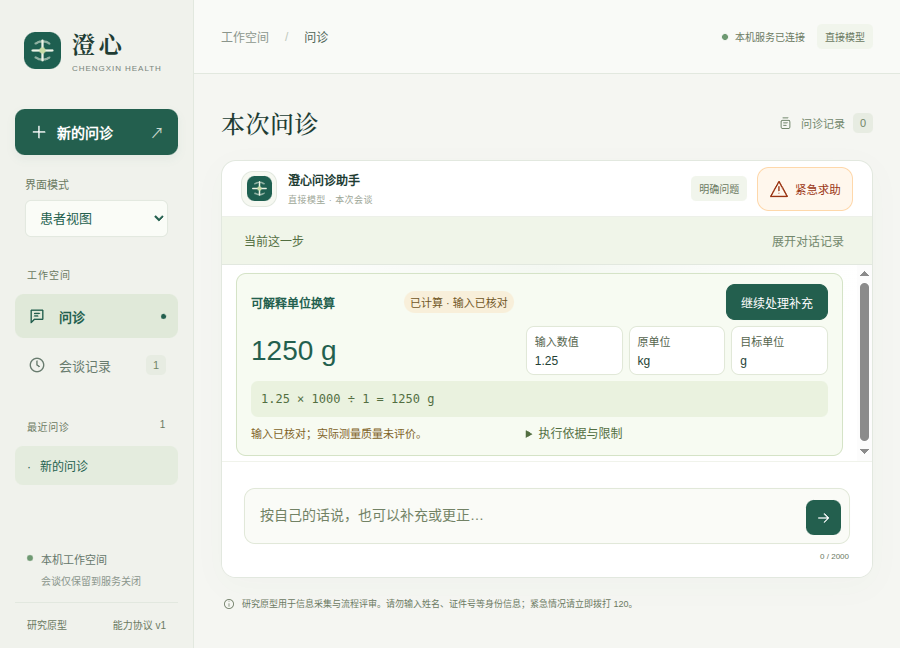

# v0.11.8：计算后接续同轮补充

修复计算优先时同轮病史没有继续处理的缺口。完成或跳过换算后，完整原话与原来源轮次返回问诊；失败可重试，不重复计算。先提供新信息时，旧补充保留独立入口；旧来源不能直接覆盖新事实，也不能借依赖失效间接撤回它们。输入、结果和待处理状态用简短文字与折叠原话呈现。

本轮是合成工程验证，不包含临床验证、患者理解难度研究或整体DSH／Codex能力结论。[设计副本](design.md) · [机器可读结果](results.json)。

## 缺口与独立复现

同一句话：“我自己32岁，咳嗽两天；请把1.25kg换算成g；昨晚用过药物甲。”

以同一套确定模型指令分别运行复制的v0.11.7与冻结的v0.11.8：旧版计算后直接返回开场，病例为空，剩下两条模型指令未被执行；新版继续调用实际问诊循环，记录5项信息后进入急症筛查，两个版本均只计算一次。[旧版轨迹](baseline-reproduced.json)、[新版轨迹](fixed-reproduced.json)、[对比结论](comparison-summary.json)、[复现驱动](compare_probe.py)。

这是控制器流程对比，使用本机确定指令，外部模型请求为0。不能用它推断真实模型的信息召回率或临床表现。旧版来源是[已封存的v0.11.7](../v0.11.7/source-final/)，运行时先复制到scratch，未改写旧归档。

## 要求与证据

| 要求 | 实现与核查证据 | 范围 |
| --- | --- | --- |
| 完成／跳过后接续完整输入 | [待接续状态与投影](source/src/medagent/calculation_followup.py)、[控制器接续](source/src/medagent/agent.py)、[12项新增检查](source/tests/test_calculation_supplements.py) | 使用原话及原来源轮次，计算不写病例；forwarded只表示已带入本轮处理 |
| 纯换算继续零额外调用 | [有界简单请求词法](source/src/medagent/calculation_followup.py)、[原有计算检查](source/tests/test_patient_calculations.py) | 不认识的剩余文字保留全文，可能多触发接续；不是完整临床语义分类 |
| 失败重试不重复执行 | [真实提供商轨迹](live-first.json)、[新增检查](source/tests/test_calculation_supplements.py) | 实际宿主结果保留，重试原话；重复run_capability被拒绝并反馈模型 |
| 新旧输入分开、较早来源保护 | [事实写入与失效门](source/src/medagent/consultation.py)、[新增检查](source/tests/test_calculation_supplements.py) | 核对当前事实版本；先验证全部受影响字段，再产生失效及任务取消；拒绝整批不部分写入 |
| 摘要、更正与求助衔接 | [新增检查](source/tests/test_calculation_supplements.py)、[原生回归](logs/native-package.log) | 待补充时不能确认摘要；更正不假装已处理旧补充；已有求助路径优先 |
| 原话可见、旧入口不可误用 | [组件](source/src/medagent/web/structured-ui.js)、[界面绑定](source/src/medagent/web/app.js)、[共享交互断言](source/tests/fixtures/calculation-supplements.mjs) | 原话按文本渲染；当前问题保留独立处理入口，历史按钮不操作当前状态 |
| 可解释结果仍可核查 | [最终包核对](package-audit-final.json) | 108个自有随包文件字节匹配，544个生产依赖版本匹配；不是全部依赖内容完整性证明 |

当前只保留一条计算请求的待接续输入。未解决前不以新计算覆盖它；普通新病史仍可继续提供。患者会谈依旧只保留在服务进程内，不新增跨重启病例存储、诊断或药物能力。

## 测试结果及早期失败

- 默认后端315项：261通过、54跳过。另运行51项实际DSH／集成检查，全部通过，合计**312项不重复后端检查**。54项跳过由这51项及3项长时间专项组成；3项长时间专项本轮未重跑。[默认日志](logs/backend-full-final.log)、[51项日志](logs/sdk-final.log)。
- 浏览器完整44组通过。最后将结果中的补充原话收入“执行依据与限制”后，受影响5组再次通过，避免短窗口增加一行而挤掉质量说明。[完整日志](logs/ui-full.log)、[最终定向日志](logs/ui-final-targeted.log)。
- 源码与最终打包版分别**28组原生检查全部通过**，包含900×680混合请求、页面恢复、服务重试、来源轮次、过期入口和保留新年龄。[源码日志](logs/native-source-full.log)、[打包版日志](logs/native-package.log)。
- DSH桥接21项通过，固定运行时检查通过；Prettier与8个本轮Python文件的Black检查通过。[桥接](logs/bridge.log)、[固定运行时](logs/dsh-check.log)、[Prettier](logs/format.log)、[Python](logs/black.log)。固定运行时检查中的宿主工具数0指患者决策配置；独立研发执行配置的终端、文件与子任务另由真实SDK检查覆盖。

首次新增的两组界面测试失败，因为fixture错误读取不存在的`snapshot.reply`；实际接口提供`state/events`。修正为读取最后一个回复事件后通过，未为迁就测试改变接口。[首次日志](logs/ui-first.log)、[两份原始轨迹](ui-first-failure/)、[修正后日志](logs/ui-second.log)保留。之后的紧凑布局是截图评审发现的问题，不能把早期截图冒充最终布局。

## 真实DeepSeek调用

两个新建合成会谈分别验证质量／体积换算后的用药补充，以及血糖换算后的过敏补充。共**6次实际提供商请求，均HTTP200**；另一次503由本机网关注入，未发送到上游，不计为付费请求。核对参数本身没有额外模型请求或病例写入；接续阶段才实际提取／澄清原话，保留原来源。[报告](live-first.json)、[评估脚本](source/scripts/evaluate_calculation_supplements.py)。

单轮上限10次、同输出目录累计20次，本轮仅一次运行。真实凭据仅在父进程网关读取，应用收到临时令牌，报告做相应替换。调用前冻结264个文件，之后逻辑、提示、界面及元数据均未变；同一快照覆盖最终运行包。它不是完整门诊诊断流程，也不证明跨专科、患者理解或临床有效性。

## 截图



[原生失败后的待重试状态](screenshots/67-native-calculation-supplement-retry.png) · [窄屏新问题与旧补充入口](screenshots/66-mobile-calculation-supplement-pending.png)。截图均为合成输入。

## 冻结复验与存储

[264个冻结文件](source/)及[摘要](source-files.json)通过[验证器](verify.py)运行137项选定离线检查；未调用外部模型或下载网络数据。[复验结果](frozen-verification.json)。这不是整仓库、操作系统或所有依赖的完整快照，也不替代原生及在线检查。

从项目根目录运行，输出使用新的归档外路径：

```bash
python3 -B docs/evaluations/2026-10-17/v0.11.8/verify.py \
  --project docs/evaluations/2026-10-17/v0.11.8/source \
  --output .runtime/calculation-followup-frozen-replay.json
./scripts/start-desktop.sh
```

验证器禁止pycache写入。目录在所有验证完成后才扫描配置凭据并封存；扫描覆盖原始文件及解码ZIP成员中的精确配置值，不声称发现任意秘密。

为留出构建空间，旧生成包0.10.1／0.10.2压缩保留在`dist/desktop/archives/`。分别核对29,538个文件、目录和链接的内容、权限位及链接目标后移除展开副本；当前与上一版本仍保留展开目录，历史评测归档未改写。[0.10.1存储记录](old-bundle-0.10.1-storage.json)、[0.10.2存储记录](old-bundle-0.10.2-storage.json)含恢复命令，索引和[所用脚本](archive-old-bundles.py)同时保留；存储整理不计入智能体能力。
