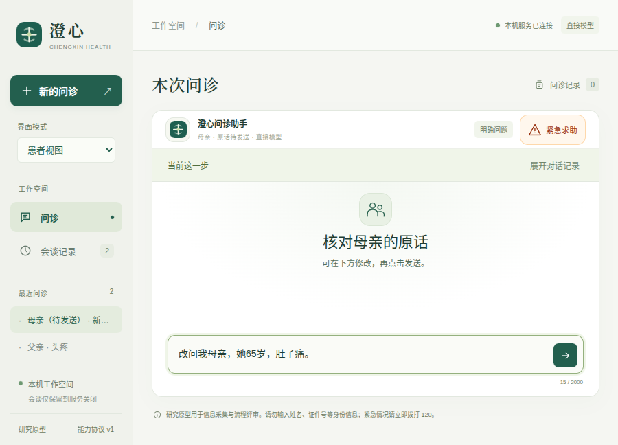

# v0.11.9：就诊对象与会谈草稿隔离

用对象图形卡区分已报告的父亲、母亲等称谓，防止两人同属`other_adult`而合并病例。新对象先核对可编辑原话，再发送；也可以返回原对象的问诊。各会谈的未发送草稿分别保留于页面内存，固定选项不吞掉另写文字。标题同时显示称谓和本会谈实际绑定的模型模式。

本轮为合成工程验证，未进行临床验证、患者理解难度研究或整体DSH／Codex能力证明。[设计与限制](design.md) · [机器可读结果](results.json)。

## 缺口与同指令复现

先为“父亲68岁、头疼”问诊，再输入“改问我母亲，她65岁，肚子痛”。相同的确定模型指令分别交给复制的v0.11.8和冻结的v0.11.9：旧版在同一病例把年龄68改成65、主诉改成肚子痛；新版在模型调用前显示对象入口，父亲的全部事实ID和值保持不变，该切换不增加模型请求。

[旧版原始轨迹](baseline-reproduced.json)、[新版轨迹](fixed-reproduced.json)、[相同指令与结论](comparison-summary.json)、[复现脚本](compare_probe.py)。旧版先从[已封存来源](../v0.11.8/source/)复制到scratch，未导入或改写历史封存文件。这个比较检查控制器流程，不代表模型智能或临床表现。

此外，首次图形回归实际复现了未发送文字在新会谈中沿用的问题。[失败日志](logs/draft-baseline.log)、[原始失败轨迹](draft-baseline-failure/)保留。

## 要求与证据

| 要求 | 实现及核查 | 范围 |
| --- | --- | --- |
| 同枚举的不同家人不合并 | [称谓投影](source/src/medagent/consultation_subject.py)、[写入前校验与检查点](source/src/medagent/consultation.py)、[16项新增检查](source/tests/test_consultation_subjects.py) | 已登记称谓与有限语言规则，不是身份核验 |
| 可返回原动作且保留有效新结果 | [工具循环](source/src/medagent/agent.py)、[检查点回归日志](logs/checkpoint-fixed-tests.log) | 无已完成结果变化时恢复；否则按最新状态规划，不回滚事实 |
| 新对象独立会谈，原话先核对 | [共享界面流程](source/tests/fixtures/consultation-subjects.mjs)、[原生检查](source/tests/desktop/consultation-subjects.spec.mjs) | 预填不调用模型、不写病史，发送后才处理 |
| 草稿与固定答案相互独立 | [页面实现](source/src/medagent/web/app.js)、[四组新增界面检查](source/tests/ui/consultation-subjects.spec.mjs) | 当前页面内存，刷新或关闭后不保证恢复 |
| 标题显示实际会谈模式 | 同一共享界面检查在修改全局设置后恢复旧会谈，仍断言旧模式 | 不把新全局配置冒充旧会谈后端 |
| 紧急求助优先、旧入口拒绝 | 新增后端检查及现有原生回归 | 有限工程规则，不证明急症识别覆盖率 |

## 本地与原生验证

- 默认收集331项，277项通过、54项显式跳过；其中51项实际DSH／SDK检查另行通过，合计**328项不同后端检查通过**。三个历史长时限检查本轮未重跑。[默认日志](logs/backend-release.log)、[首批50项通过及1项加载失败](logs/sdk-final.log)、[加载路径修正后第51项通过](logs/sdk-glucose-retry.log)。
- 浏览器完整48组通过；最后修正第三人称反身表达后，受影响4组再次通过。[完整日志](logs/ui-final.log)、[最终定向日志](logs/ui-release.log)。
- 源码与最终打包版分别**29组原生检查通过**，覆盖900×680对象选择和原话草稿，以及已有工作台、计算、测量、故障重试、求助等回归。[源码](logs/native-source.log)、[打包版](logs/native-package.log)。
- DSH桥接21项、固定运行时配置检查、Prettier和本轮10个Python文件Black检查通过。[桥接](logs/bridge.log)、[配置](logs/dsh-check.log)、[Prettier](logs/format.log)、[Black](logs/black-release.log)。配置检查的零宿主工具指患者决策传输，独立执行工作台仍支持终端、文件、联网及子任务。

DSH执行驱动首次缺少项目根目录的Python导入路径，前50项通过，最后新增血糖用例未能导入`tests`包。补齐路径后单独执行该用例通过；没有为此改动产品源码或重跑已通过的50项。两份日志保留，不能把首次加载失败写成已通过。该SDK批次启动后曾修正称谓模块，两个受影响的医疗DSH集成用例已在最终源码上另行重跑通过；其余执行底座相关来源未变。[最终医疗DSH复验](logs/sdk-medical-final.log)。

早期失败也保留：[新增界面第一次运行](logs/ui-first.log)因症状标题重复而选择到多个会谈，改为按会谈ID定位；[原始轨迹](ui-first-failure/)与[后续通过](logs/ui-second.log)可比较。[首次完整后端](logs/backend-full.log)的一项旧用例原本假定换人必调用模型，调整为多人语义输入后继续检验真正的模型批量提议拒绝。[检查点失败](logs/checkpoint-final-tests.log)发现显示对象卡前的失败补充可能被新原话覆盖，修正为在结果未变化时即时恢复暂态，并保留原来源与重试状态；[修正后日志](logs/checkpoint-fixed-tests.log)保存。

## 真实DeepSeek与迭代

两轮各新建父亲、母亲两个合成会谈，共**17次提供商请求，均HTTP200**：首次10次，修正后7次。明确字面切换和返回均不增加请求。第一轮真实模型保留“报告者的母亲患病，非当前对象本人患病”的归属；最终轮模型选择澄清并明确说明不记到父亲名下，没有将这条背景写成结构化病史。验证只支持没有错误归属，不能据此声称所有背景信息都被提取。

首次轨迹发现“为我母亲咨询她本人的不适”被错误拆成母亲与报告者本人，切换工具共尝试三次，前两次被拒绝，第三次缩短引文后成功。修正有限第三人称反身解析后，最终新会谈中的同类切换一次工具调用成功。“母亲和本人”等真正多人引文仍需澄清。两轮模型回复本身也有一次断言参数错误，分别被工具拒绝后修正；HTTP200不代表首次工具提议正确。不能将10次降至7次解释为统计性能提升。

[首次真实报告](live-first.json)、[最终报告](live-final.json)、[有上限的评估脚本](source/scripts/evaluate_consultation_subjects.py)。每次上限10次，同输出目录累计20次。实际凭据仅由父进程网关读取，报告中的真实凭据和临时令牌均替换。

首次调用前冻结271个文件；随后仅改称谓解析、新增回归及设计说明三个文件，再次冻结271个文件后运行最终7次请求。[首次快照](source-before-provider/)、[变更摘要](post-first-provider-changes.json)、[最终快照](source/)、[文件摘要](source-files.json)。最终快照覆盖打包程序；最终在线验证后未再改动这些来源。

## 截图与复验



[桌面对象选择](screenshots/69-native-consultation-subject-choice.png) · [窄屏对象选择](screenshots/68-mobile-consultation-subject-choice.png) · [窄屏核对原话](screenshots/68-mobile-consultation-subject-draft.png)。截图均为合成输入，图标采用现有本地SVG系统。

[验证器](verify.py)检查271个冻结文件并运行153项选定离线检查，无外部模型请求和网络下载。[复验结果](frozen-verification.json)。冻结范围是本项目源码、测试、接入配置及所选文档，不是所有依赖、操作系统或临床证据的完整快照。

```bash
python3 -B docs/evaluations/2026-10-17/v0.11.9/verify.py \
  --project docs/evaluations/2026-10-17/v0.11.9/source \
  --output .runtime/consultation-subject-frozen-replay.json
./scripts/start-desktop.sh
```

最终Linux包109个自有文件与当前来源一致，544个适用生产依赖版本与锁文件一致。[包核对](package-audit.json)。这不是全依赖内容完整性审计。所有验证完成后才扫描配置凭据并封存；扫描覆盖文件及解码ZIP成员的精确配置值，不声称发现任意秘密。

为构建腾出空间，旧生成包0.9.9／0.10.0已无损压缩保留在`dist/desktop/archives/`。分别核对29,529／29,532个条目的文件内容、权限位与链接目标，确认未被进程使用后移除展开副本；当前和上一版本仍展开保留，历史评估归档未修改。[0.9.9存储记录](old-bundle-0.9.9-storage.json)、[0.10.0存储记录](old-bundle-0.10.0-storage.json)含恢复命令，索引和[原脚本](archive-old-bundles.py)同时保留。存储整理不计入智能体能力。
