# 知微：图形界面设计与检查

更新日期：2026 年 10 月 17 日。对应当前可运行的桌面应用与浏览器开发预览。下方患者截图由真实 Chrome 操作仓库应用生成，使用合成病例与离线演示后端；执行工作台截图来自真实 Electron 与本地确定模型。独立窗口另见 [桌面版说明与截图](桌面应用使用与打包.md)。

v0.4 已接入版本化结构化展示与受控组件，体温图示随步骤切换，计算输入与执行依据分开展示，摘要支持更正后确认。见 [展示协议与组件扩展](结构化展示协议与组件扩展.md)。

## v0.11.16：已确认定位的修改与接续

问诊记录与当前摘要提供“修改定位”。核对卡先保留原部位、具体区域、左右和范围，可单项修改；取消保留原事实，确认后记录新版本并返回原问题。已有问诊关闭时显式修改会重开核对，旧摘要不自动视为再次确认。大部位变化会清空依赖细节，手机端打开修改时关闭记录面板。

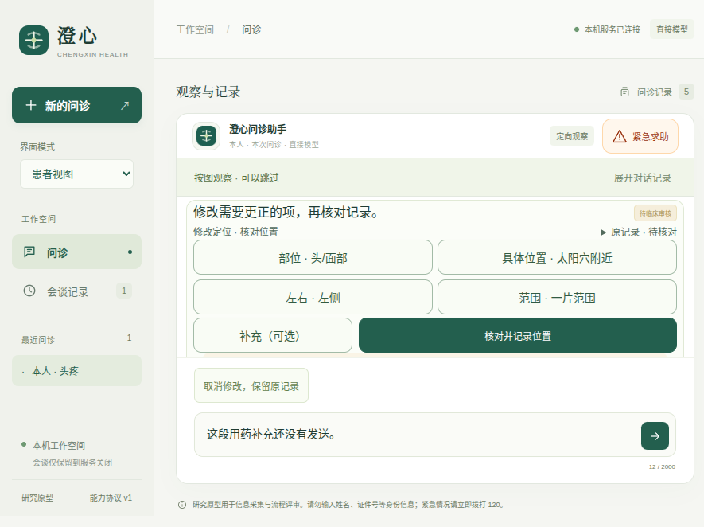

[390像素布局](assets/ui/78-mobile-location-revision.png) · [真实模型患者视图](evaluations/2026-10-17/v0.11.16/full-flow/patient/live-location-correction.png) · [版本、来源与接续规则](已确认定位的修改与问诊接续.md)。图形选择、未发送文字和原问题刻度草稿分别保留；主要入口在受检尺寸下至少44像素，确认前不写事实。完整软件检查与首次失败、复验证据见[0.11.16验收](evaluations/2026-10-17/v0.11.16/README.md)。患者理解与实际操作效果仍需独立研究。

## v0.11.12：部位图与独立点击目标

旧版浮在图上的部位按钮，在窄屏和小桌面窗口会出现胸／腹目标重叠。现在人体示意与五个独立选项并列，确认前只更新选中态；背／腰部显示背面，其他类别显示对应正面示意，四肢使用手臂／腿分组提示。不从图中标记推断左右、具体关节或症状数。

受检窗口中的五个主要部位按钮、确认及其他／跳过入口至少44像素高。小窗口压缩重复说明与外围留白，保留问题、示意、选项、确认、输入和求助可见；步骤原文与进度收在“分步说明”，仍可展开操作与恢复。测温与其他问题保留原布局，已有草稿与来源机制不变。

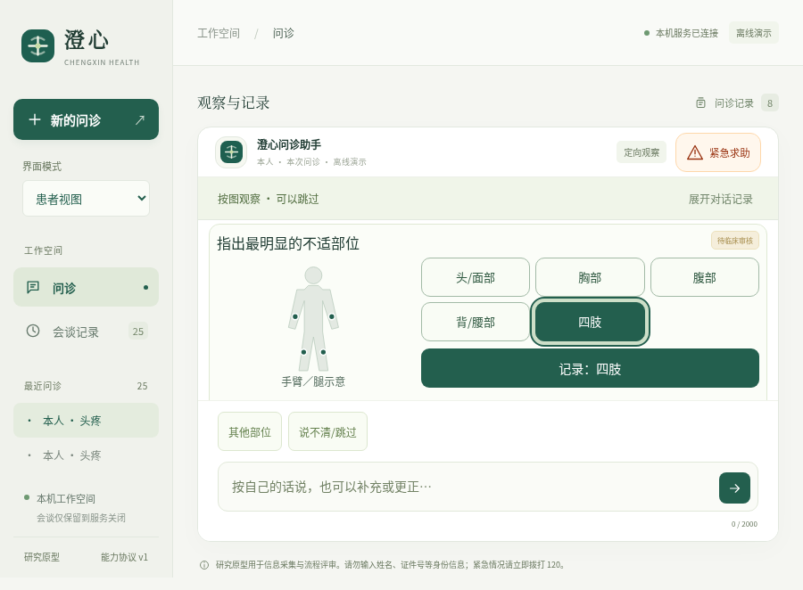

[390像素窄屏](assets/ui/74-mobile-location-layout.png) · [宽屏](assets/ui/74-wide-location-layout.png) · [原始重叠与检查](evaluations/2026-10-17/v0.11.12/README.md)。检查覆盖1440×1080、390×844、900×648网页视野及900×680原生窗口；不等于覆盖全部缩放、设备或无障碍使用场景，更不代表已证明患者理解效果。

## v0.11.11：图示操作的恢复与错误可见性

部位选择不再因切换会谈或展开历史而丢失；返回时保留同一次任务的选择、步骤与独立文字。未确认不写记录。录入错误可以保持测温第3步，较早任务的明确接续也有独立身份；新一次同名任务不继承旧进度。

900×680检查实际发现错误提示被旧滚动位置及随后出现的快捷选项挤出视野。现在在布局完成后保证错误整段进入任务视野并获得焦点，患者可直接重新填写或跳过。图示步骤仍保存，纠错不等于重新开始测量。

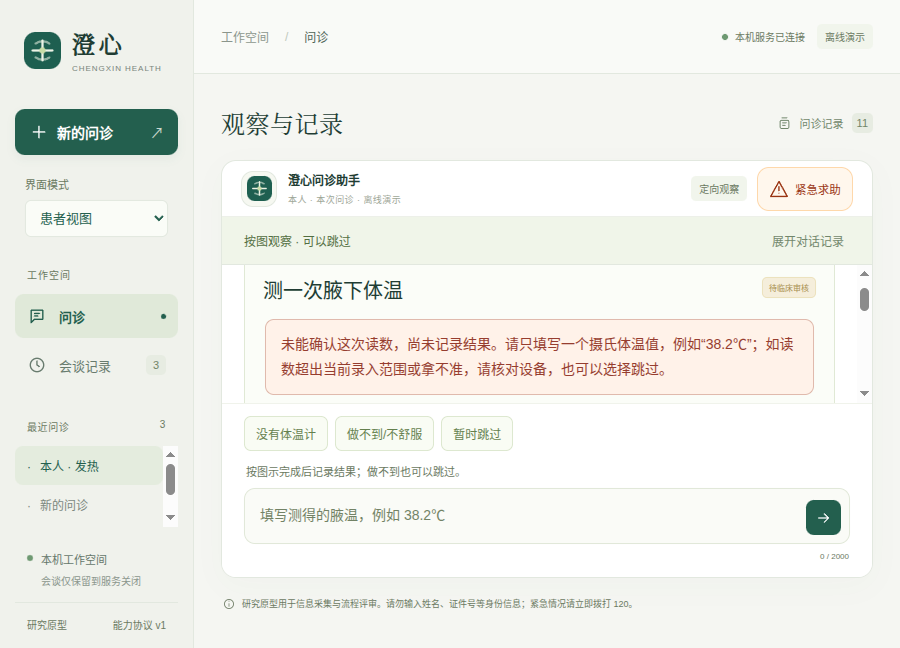

[部位图选择恢复](assets/ui/72-wide-location-draft.png) · [组件身份协议](结构化展示协议与组件扩展.md#v01111图示任务的交互身份与草稿) · [本轮验收](evaluations/2026-10-17/v0.11.11/README.md)。合成工程验证不代表测量质量或患者理解已验证；小窗口较大图示仍可滚动查看。

## v0.11.10：图形答案与文字补充

程度卡片先选分数，再点“确认5分”。点选不会清空输入框，确认只发送该分数，另写的补充仍待患者发送。0与10同样需要确认，无默认分数；只读、处理中的卡片和旧动作不能提交。当前页面内返回原会谈可恢复尚未确认的分数，刷新或关闭后不保证恢复。

900×680原生窗口初版检查发现选中分数后问题标题被挤出视野，最终采用左侧问题、右侧数值及两行刻度。问题、全部刻度、确认和输入同屏；较高窗口维持纵向布局，390像素窄屏使用两行触控刻度。没有修改端点含义或将刻度解释为诊断。

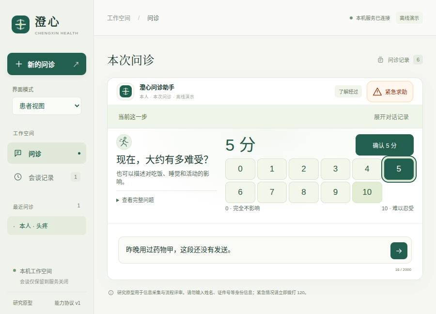

[窄屏截图](assets/ui/70-mobile-degree-draft.png) · [交互上下文与限制](结构化展示协议与组件扩展.md#v01110组件草稿与显式提交) · [本轮验证](evaluations/2026-10-17/v0.11.10/README.md)。截图使用真实控制器的离线演示，不是实际模型或患者结果，也未证明真实患者理解效果。

## v0.11.1：目录与列表范围

工作区文件区提供目录导航和分页；100项以内的单页目录隐藏翻页控件。当前目录的可见项计数与本页计数分开，隐藏／缓存需要显式切换。按相对路径可直接访问未出现在当前页或原概览深度内的实际文件；链接显示但不展开。

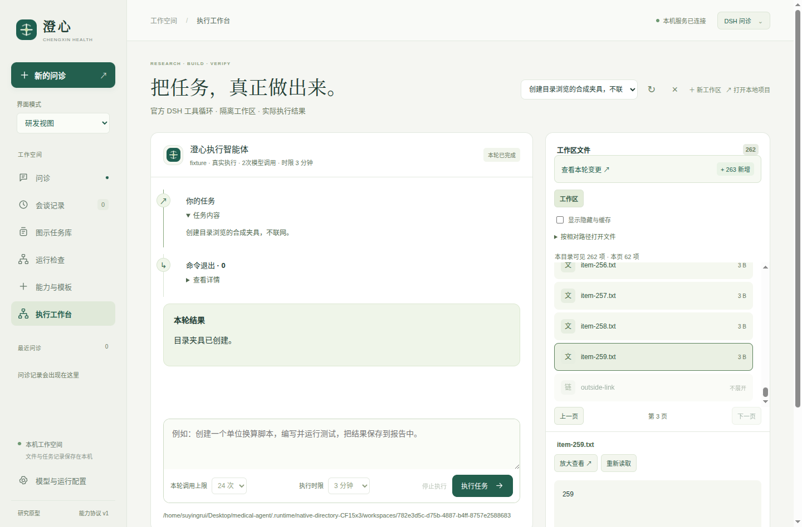

扫描不完整时使用未知数量和具体原因，不显示伪造的零或总数。下图主动加入了一个无法用UTF-8表示的测试文件名；其他文件和深层CSV仍可预览，原始字节名称不被替换成另一个看似可打开的名称。

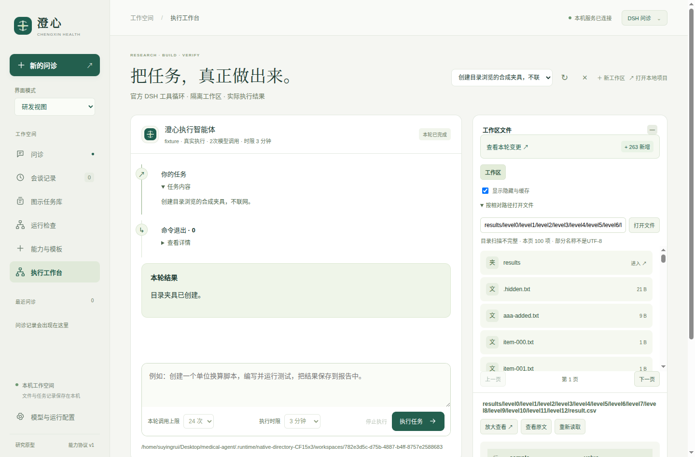

目录变化时重读第一页并提示；切换工作区后迟到目录响应被忽略，预览不因离开文件所在目录而误报“已移除”。完整边界与原生验证见[0.11.1验收](evaluations/2026-10-17/v0.11.1/README.md)。

## v0.11.0：直接查看实际图像与数据表

工作区文件增加图／表／文标记及选中状态。PNG／JPEG直接显示，CSV／TSV按真实单元格显示，可查看原文及放大；尺寸、行列、截断和“读取快照”直接标明。图表是实际执行生成的研究产物，不自动成为患者结论。内容变化或不可核对时提示重读；原文、HTML／SVG及公式字符串均不执行。

实际摘要核对不会重复改写内容相同的状态区域；原生回归通过DOM观察验证文本与属性都不变化，减少无意义的状态更新。该检查没有代替真实读屏用户评价。文件列表更新保留同一路径的键盘焦点，迟到响应不会覆盖新选择；切换工作区会关闭放大层。

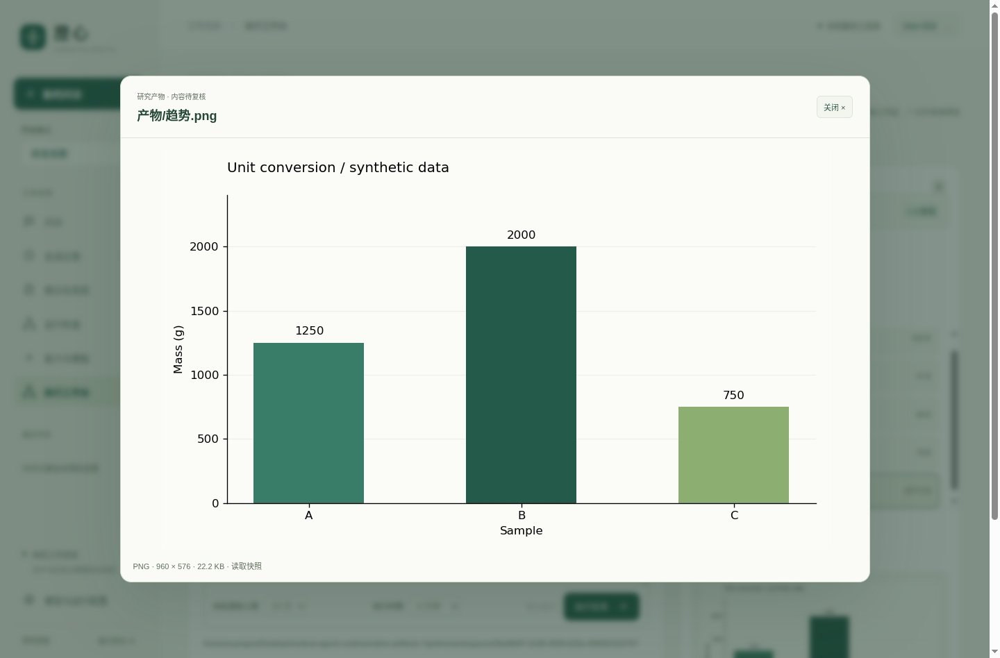

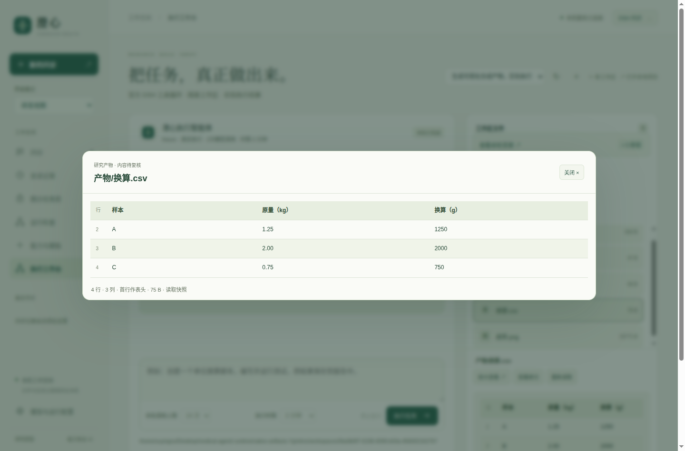

900像素窗口中也已检查放大内容适配，见[窄窗口截图](assets/ui/50-artifact-narrow.png)。这是桌面窗口检查，不是完整移动端产品。协议限制与真实模型失败／复验见[0.11.0验收](evaluations/2026-10-17/v0.11.0/README.md)。

## v0.10.6：参数纠正与实际检查分开展示

被拒绝且未执行的检查保留在工具历史中，显示具体输入错误；改正后的有效检查用独立短标记显示真实退出状态。历史错误不冒充仍待执行的必需检查，有效检查失败仍阻止完成。下图来自真实Electron和本地确定模型，已人工查看；右侧仅有一个实际验收标记，左侧可展开第一次错误详情。源码与打包版结果见[本轮验收](evaluations/2026-10-17/v0.10.6/README.md)。

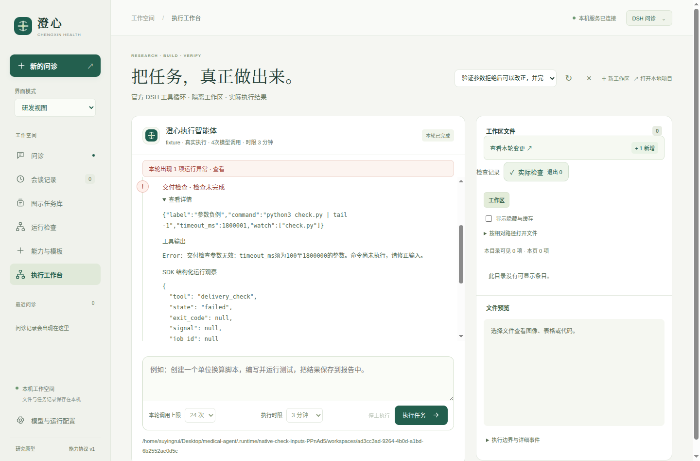

## v0.10.4：交付检查记录

工作台用短标记显示本轮已声明检查的最近退出状态，颜色与图标同步表达；点击定位到实际工具输出。相同命令复验后更新标记，先前失败仍可回看；已复验的检查使用平缓提示，普通未解决异常继续突出。检查记录不变化时不重建按钮，轮询保留键盘焦点。

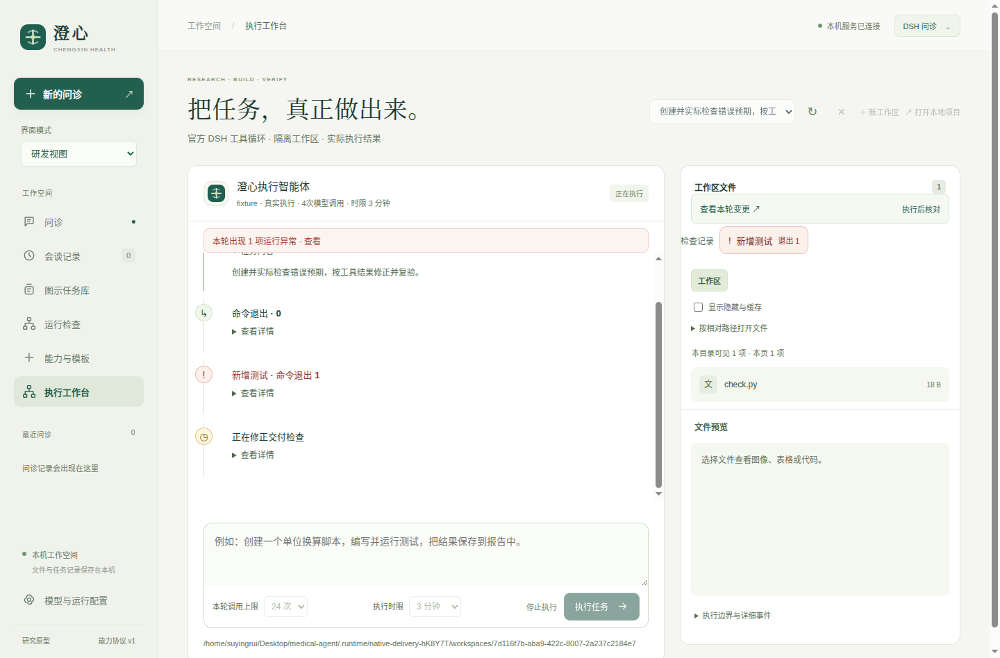

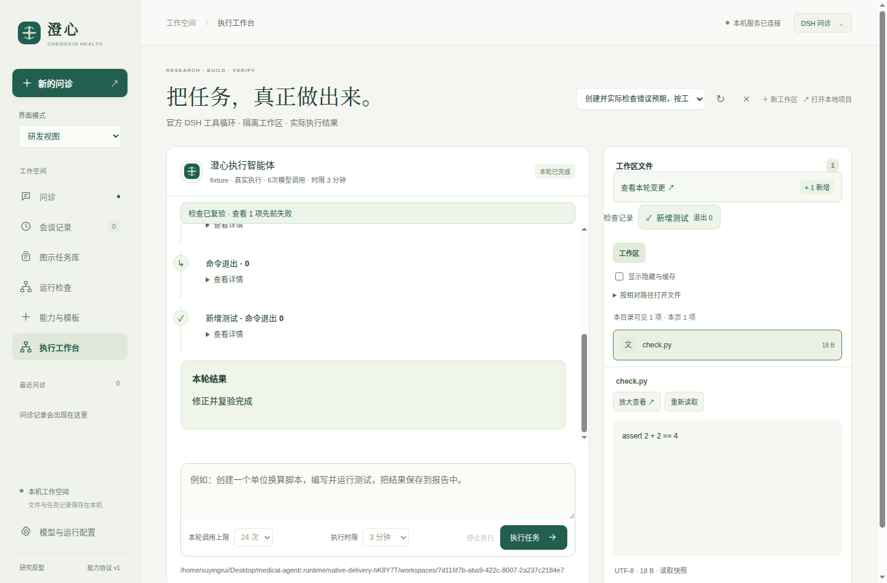

## v0.10.3：等待期间优先求助

患者会谈标题栏保留带图标的“紧急求助”，普通模型等待不锁住此入口。独立弹窗只需可选描述，失败保留草稿；成功卡片完整展示控制器原有操作说明，触发原因按需展开。不根据用户主动求助虚构临床症状，也不会代拨急救。取消紧急消息入场动画，避免关键操作说明短暂淡入；窄屏 390×844 已检查操作说明位于视口内。

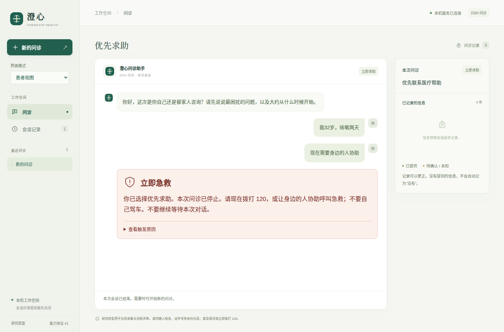

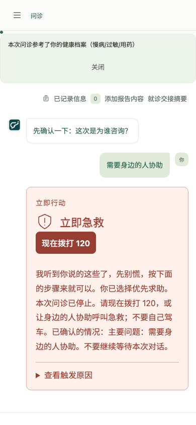

## v0.9：执行工作台

研发视图新增完整执行工作台：左侧连续展示任务、真实工具调用和返回、子智能体状态及本轮结果，右侧列出实际文件并提供文本代码预览。模型、目录、调用额度和停止入口直接可见；启动或切换页面不调用模型。查看展开详情时，轮询增量更新不会重新创建全部事件节点。

主回复结束但后台任务仍在运行时，状态继续显示运行中，保留停止按钮。前台完成不代表后台结束。源码与最终打包应用实际验证文件创建、代码执行、独立子智能体、前后台停止和同会话接续。患者问诊的聚焦界面保持独立，执行产物不直接写入患者事实。

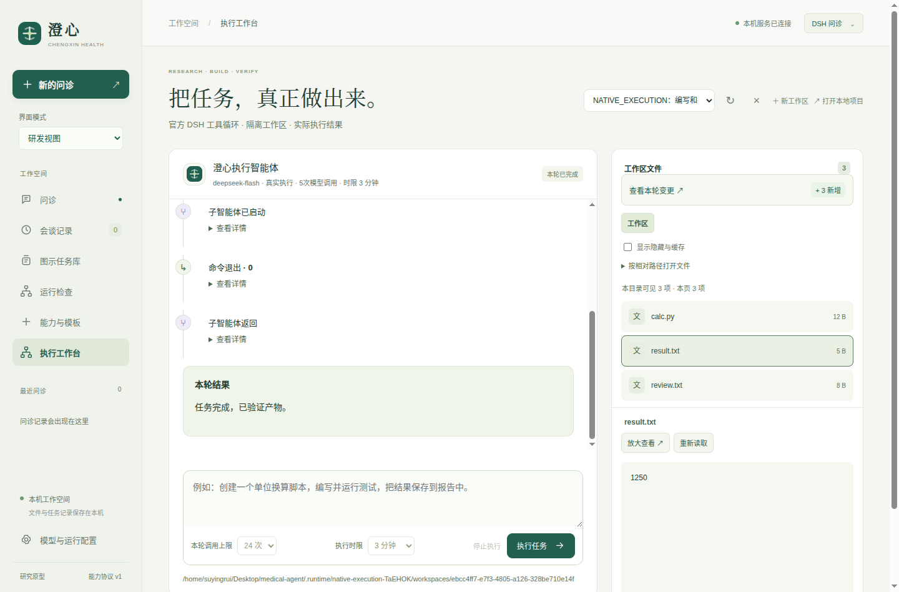

v0.9当时只提供文本和代码预览；0.9.3已加入跨重启恢复，0.11.0加入有界图像和表格。任意文件格式及任意HTML、JavaScript或SVG执行仍未开放；患者计算的独立输入核对见0.9.5设计。详情见[执行底座设计](通用执行底座与能力评测设计.md)。

v0.9.1 增加“继续未完成的执行”事件，说明单次输出截断后仍在原会话接续，额度与截止时间累计。使用真实打包窗口和本地确定模型验证恢复、代码运行与文件预览；下图同时显示接续事件和实际 `recovered.txt` 内容。

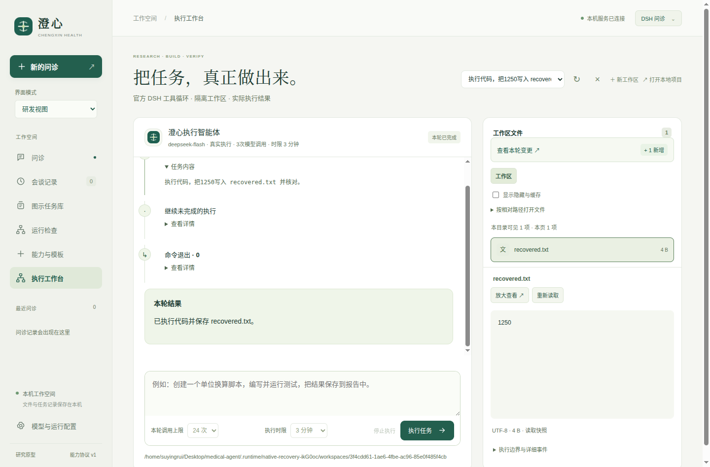

v0.9.2 的文件目录无法读取时，显示“工作目录不可用”，清除过期预览，数量显示未知并禁用新执行；运行中的任务仍可停止。恢复原目录后，状态和实际文件数量恢复。预览对应最后一次文件选择，新工作区不会接收旧请求的延迟报错。以下截图来自真实窗口中主动移走合成工作目录后的状态：

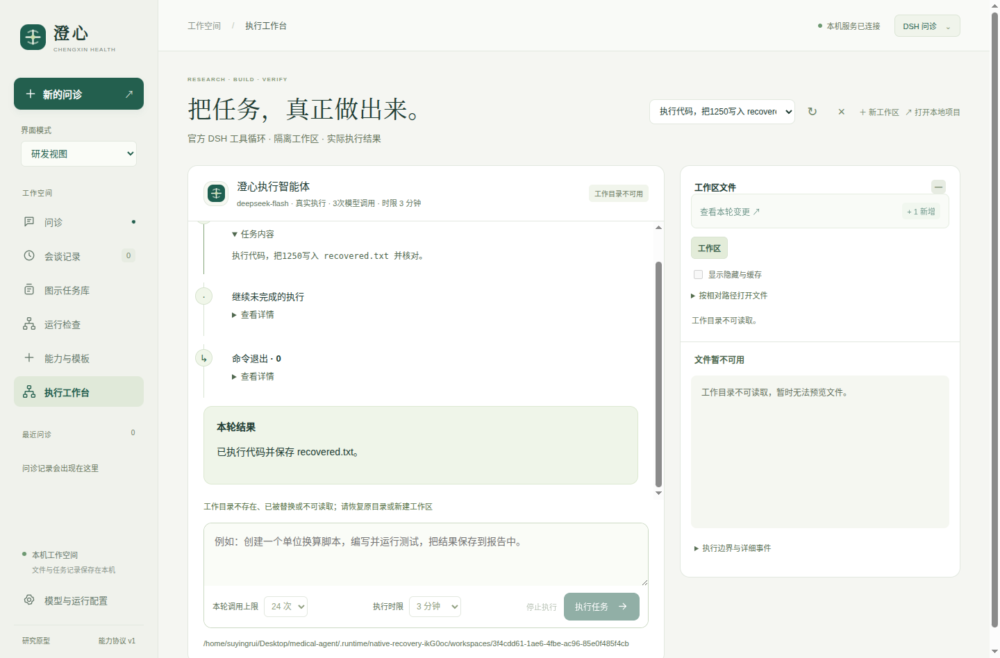

v0.9.3 新增工作区选择器、刷新与关闭入口。应用重启后，无凭据也能查看已保存任务与文件，恢复内容标注为历史记录；只有匹配原模型服务与当前密钥后才启用执行。侧栏按页面区分患者会谈的内存状态和执行记录的本机保存，避免混淆两者。

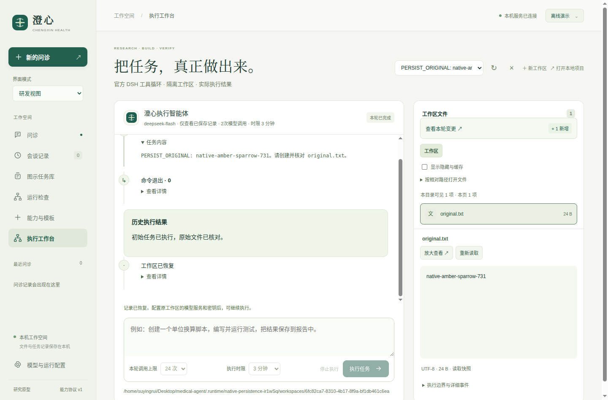

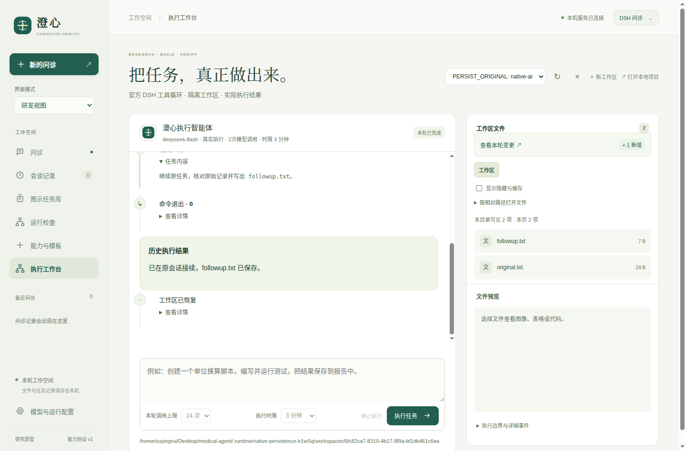

## v0.8：聚焦当前行动的可视化界面

当前问题独立显示，对话历史通过“展开对话记录”回看。咨询对象采用大图形选项，趋势采用方向图，不适程度用 0–10 刻度，呼吸、饮食和用药等问题提供与问题对应的图形线索。自由描述始终可用。固定问题提供完整原文入口；模型的临时追问直接展示实际问句，不套用固定短标题或刻度，以免改变问意。

紧急筛查的六项含义全部直接显示，阳性、阴性、未知均需明确选择，没有默认阴性。图标配文字，不靠颜色判断含义。手机尺寸压缩为两列信号卡，仍保留完整信号名称。

不适程度选择只填写草稿，发送后才记录；改写输入时刻度同步取消或更新。部位图先选、再确认，保留其他部位、跳过和自由补充；这是主观定位，不要求按压、扭转或诱发疼痛，也没有相机核验。温度任务逐步放大图示，停止条件直接显示，目的和使用限制按需展开。`observe.temperature` 素材更新至 0.5.0，仍待临床审核。

摘要优先展示已记录的年龄、体温和程度，再展示待确认项与分组事实。没有记录的指标不补成零；体温保留“自述、质量未评价”。摘要从顶部打开，旧摘要不抢占当前核对区域，历史和更正入口保留。测量输入不合法时，错误直接显示在当前图示任务中。

已完成多轮真实截图复查，修正摘要自动滚底、任务错误被折叠历史遮住、部位按钮重复，以及小屏信号显示不完整的问题。自动化检查不等同于目标患者理解或临床审核；不能由视觉精致程度推断建议准确性。

| 画面 | 实际截图 |
| --- | --- |
| 原生桌面当前问题 | [原生窗口](assets/ui/21-desktop-visual-question.png) |
| 紧急信号与明确选择 | [桌面](assets/ui/15-visual-safety-screen.png)、[手机尺寸](assets/ui/19-visual-mobile-screen.png) |
| 变化趋势与不适程度 | [趋势](assets/ui/16-visual-trajectory.png)、[程度](assets/ui/17-visual-severity.png) |
| 主观部位定位 | [先选再确认](assets/ui/18-visual-body-map.png) |
| 分步测温与摘要 | [图示](assets/ui/02-consultation-self-check.png)、[分组摘要](assets/ui/09-structured-summary.png) |

新增交互验收在 `tests/ui/visual-consultation.spec.mjs`，检查键盘、选择前后真实事实、未知状态、草稿同步、主观来源和错误隔离；没有把纯装饰截图当作临床效果证据。

## 1. 交付形态

这是接通问诊 API 的图形界面，可以创建会谈、提交回答、进行图示任务、修改事实、回看会谈、查看实际事件和配置模型。Python 服务同时提供静态页面与 API，启动后用浏览器访问，无需单独启动前端开发服务器。

```bash
PYTHONPATH=src python3 -m medagent.server --backend demo --port 18765
```

打开 <http://127.0.0.1:18765>。默认是固定规则演示；要评价模型问诊，需在右上角“离线演示”或左下角“模型与运行配置”中配置真实服务，并新建会谈。

当前电脑可以双击桌面的“知微”打开独立桌面窗口，内置页面渲染与本地服务管理，不需要打开浏览器。开发时仍保留浏览器入口，用于桌面与手机尺寸下检查。已生成 Linux x64 应用目录，尚无手机 App 或其他系统安装包。

v0.3 默认患者视图只显示问诊和会谈记录；左侧切换到研发视图后显示图示库、运行检查、能力与模板及模型配置。开始问诊后收起开场装饰；自查集中展示，可展开历史对话并返回原步骤。侧栏说明当前收集目的，不再展示线性问卷进度。

## 2. 信息架构

| 页面 | 使用目的 | 实际操作 |
| --- | --- | --- |
| 问诊 | 连续描述与补充信息 | 新建、回答、选择快捷选项、执行或跳过任务、更正信息、核对摘要 |
| 会谈记录 | 回看本进程的已有会谈 | 读取真实会谈列表、重放回复、恢复未结束的会谈 |
| 图示任务库 | 检查素材与步骤 | 查看图示、逐步翻页、查看限制；预览不产生测量结果 |
| 能力与模板 | 组合与验证受信能力 | 启停内容包、切换研究模板、独立换算、核对会谈版本 |
| 运行检查 | 复核工程行为 | 查看实际模型与工具调用数量、事件时间线、病例证据、导出记录 |
| 执行工作台 | 操作独立工作区 | 提交真实任务、观察工具与子智能体、停止执行、预览生成文件；仅独立桌面开放执行 API |
| 模型与运行配置 | 对接与检查服务 | 选择后端、填写端点和模型、测试连接、应用配置 |

桌面端以左侧导航、中间会谈、右侧病例记录组织内容。患者能持续看到已记录的信息，也能主动更正。移动端把导航与病例记录折叠，保留问诊空间。

## 3. 视觉与交互原则

使用暖白背景、深绿色主操作与较少的装饰，突出患者当前需要完成的一步。中文标题采用衬线字体，正文采用系统无衬线字体。界面不依赖外部字体或图标 CDN。

会谈每次呈现一个主要问题或一个任务。快捷选项与自由输入同时保留；输入法组合期间不会因 Enter 意外提交，Shift+Enter 可以换行。模型执行中锁定重复提交，同时轮询事件用于开发检查。终止会谈后隐藏输入入口。

图示任务将目的、当前步骤图片、上一步/下一步、停止条件与结果入口放在同一张卡片中。体温任务使用固定 SVG 的分步视图，其他旧任务保留整体图示。用户可以跳过；图库预览明确提示不会改变问诊。当前图示均为待临床审核的原型。

原型包含键盘焦点样式、跳转主内容、原生对话框、对话框可访问名称、消息更新提示和减少动画适配。已检查 1440×1080 与 390×844 两种视口；这不等同于完成无障碍认证或所有设备兼容性验证。

## 4. 实际页面截图

### 桌面问诊入口

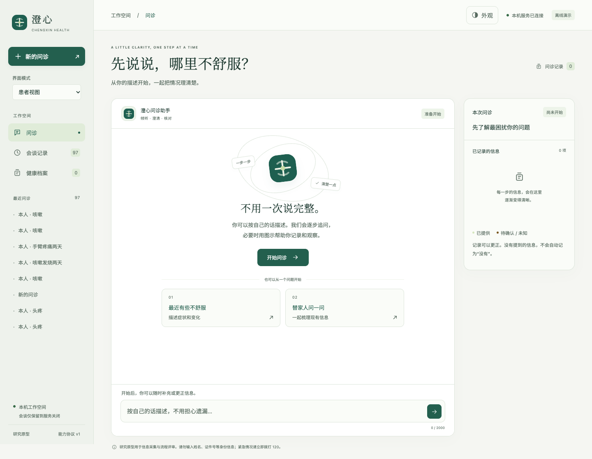

开始按钮创建实际会谈。示例入口仅填入草稿，患者提交后才发送。

### 会谈中的图示自查

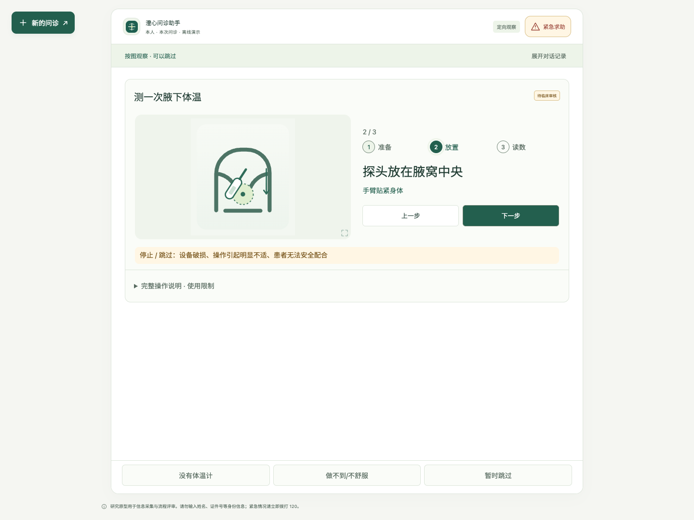

图示及步骤由任务内容包提供。患者输入的温度仍是患者报告值，不能据此宣称操作已由视觉模型核验。

### 运行检查

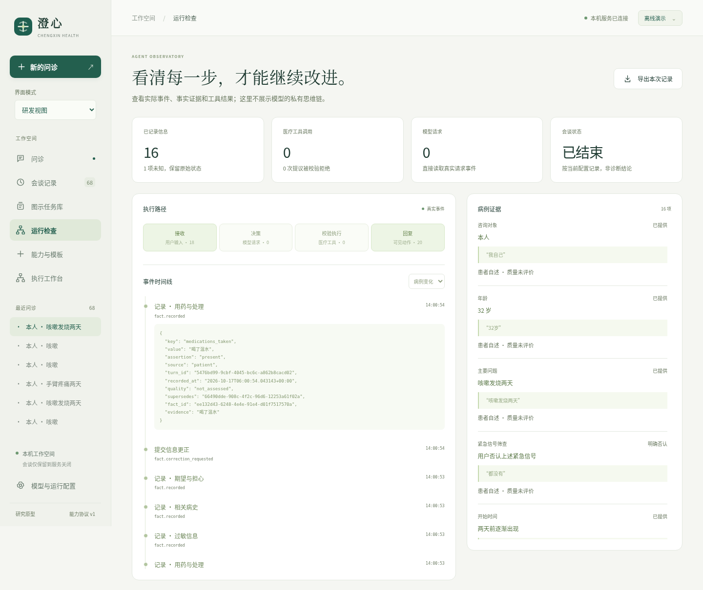

指标来自实际事件；演示模式的模型调用和工具调用显示为零。点击事件可展开载荷，筛选后仍保留真实事件顺序。证据面板显示来源、质量、原文与更正状态；缺少逐字证据时明确说明，不补造引文。

界面与界面导出会隐藏已识别的模型 reasoning/thinking 内容，保留可检查的工具提议、执行结果和病例变化。导出的 JSON 包含健康信息，下载即会在用户选择的位置形成文件。可选服务端开发日志仍可能保存原始模型响应，不适合收集真实患者数据。

### 图形化模型配置

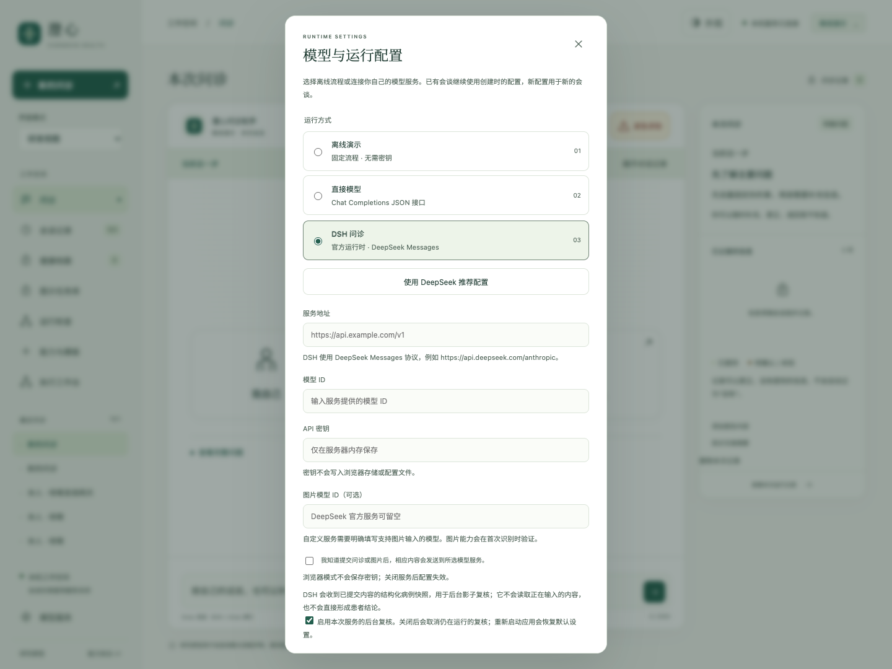

“测试连接”发送不含病例的最小协议检查，会产生一次模型调用；“应用配置”保存当前进程的连接设置。测试成功仅表示服务返回预期 JSON，不能证明其临床能力。

直接模型使用 Chat Completions，DSH 使用已固定发行版支持的 Messages 协议。切换服务地址或后端时需要重新填写该服务密钥，避免将原密钥无意发送给另一服务。应用后新会谈使用新配置；已有会谈继续使用创建时的后端。

### 图示任务库

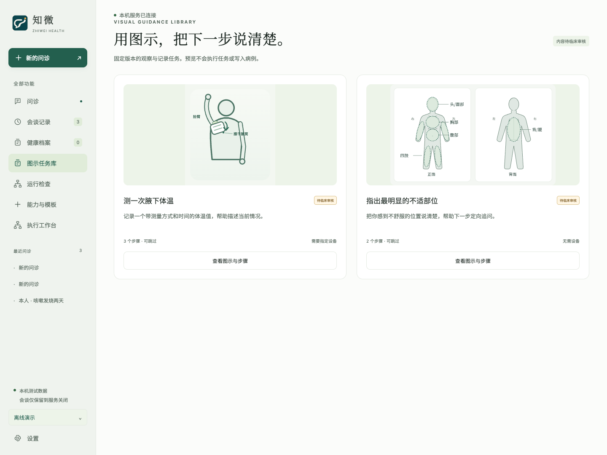

### 移动端

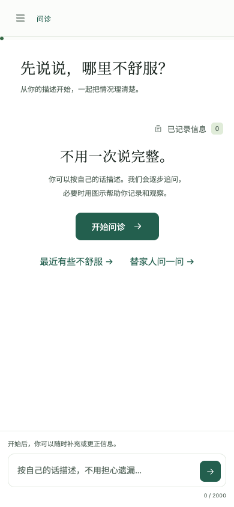

### 能力与模板

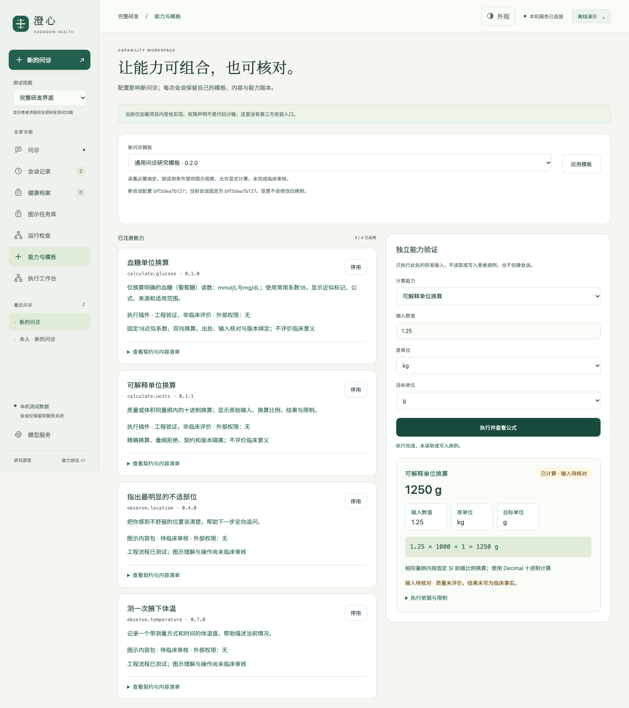

查看 [能力协议、API 和扩展方式](能力插件与问诊模板.md)。组合变更只影响新会谈；结果不随插件停用删除。

## 5. 状态、错误与数据边界

| 情况 | 界面行为 |
| --- | --- |
| 没有会谈 | 显示开场与开始入口，不虚构病例或调用次数 |
| 正在处理 | 提示正在整理；禁用重复发送与切换会谈；可查看实时事件 |
| 回答提交后连接断开 | 提示不能确认保存结果，尝试读取服务端会谈与事件；不盲目重复发送 |
| 已有事实需要更正 | 弹窗编辑，调用 PATCH，保留原事实并显示新结果 |
| 模型配置错误 | 在配置弹窗显示错误，保留当前有效配置 |
| 模型执行失败 | 显示控制器返回的失败与重试动作，不切成演示假装成功 |
| 风险升级或会谈结束 | 显示相应提示或摘要，停止普通输入 |
| 患者会谈服务重启 | 患者内存会谈与模型配置丢失；外观偏好独立保留，执行工作区另按持久恢复协议处理 |

浏览器开发服务没有用户认证：所有访问同一服务的浏览器共享进程中的会谈列表。桌面版另有随机端口和一次性实例凭证，普通浏览器不能访问其私有服务；它仍未提供生产用户身份与多租户隔离。当前用于本机合成病例和内部评审，默认监听 127.0.0.1。

患者内容和密钥不写入 localStorage/sessionStorage。密钥在当前表单中临时存在，应用或关闭后清空，服务端只返回是否已设置。运行中的后端在内存持有凭据；模型模式会将会谈信息发送到所配置的模型服务。可选 `--event-log` 会写入明文事件，浏览器导出也会生成文件。当前没有跨进程恢复、用户隔离、留存删除策略和生产数据保护能力。

## 6. 评审路径

1. 在离线模式开始问诊，观察单问、快捷选项与病例侧栏是否一致。
2. 输入合成年龄与主诉，检查患者、家长和未知信息的展示。
3. 对已记录的年龄做更正，核对当前值、旧值与下一动作。
4. 在发热/呼吸道演示流程进入体温卡片，翻步骤、尝试跳过、查看限制。
5. 完成到摘要，核对未知项和来源；从会谈记录重新打开。
6. 打开运行检查，筛选与展开事件，确认演示模式未伪造模型或工具调用。
7. 在模型配置中分别检查协议提示、非法地址错误和连接测试；配置真实服务后新建会谈再评价模型行为。
8. 切到手机视口，检查导航、输入、图示与病例记录；用键盘检查焦点和对话框。

## 7. 自动化验证与维护

```bash
npm ci --ignore-scripts
npm run test:ui
npm run format:check
PYTHONPATH=src python3 -m unittest discover -s tests -v
```

浏览器测试使用本机 Chrome，默认路径 `/usr/bin/google-chrome`，可通过 `CHROME_BIN` 指定其他路径。测试会启动独立的 18766 端口服务，使用合成病例，并更新本文截图。失败时保留 Playwright trace。

`tests/ui/workspace.spec.mjs` 验证完整演示会谈、分步图示、真实事件与导出、历史恢复、配置反馈、图库只读预览、手机布局、事实更正、提交响应丢失后的恢复，以及患者输入按普通文本展示。后端测试验证配置隔离、凭据不回显、切换服务的密钥处理及既有会谈保留。

主要实现：`src/medagent/web/` 为界面，`src/medagent/workspace.py` 为进程内配置与历史管理，`src/medagent/server.py` 提供工作台 API。后续可替换展示层而保留医疗控制器。

工程检查通过不代表已完成临床审核、患者理解试验、真实模型病例评价或急症覆盖验证。下一轮设计评审应结合真实模型的合成病例轨迹，再调整提问与任务内容。

## 8. v0.9.4 计算卡片

执行工作台复用标准计算组件，主视觉是结果与单位，下方显示三项输入和公式；状态明确保留“输入待核对”和“质量未评价”。原文引文、能力版本与实现摘要折叠在“执行依据与限制”中。模型文本与文件预览不参与结构化计算渲染。

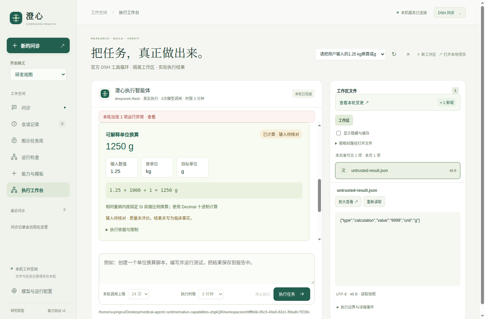

源码和最终独立桌面包均实际完成计算、展开依据、查看测试用伪造 JSON 并重启恢复旧卡片。两种运行各 6 组原生检查通过。图中右侧文件的 9999 是用于验证信任边界的合成草稿，并非产品认可的计算结果。详见 [计算回执设计](注册计算工具与执行回执.md)。

## 9. v0.9.5 患者输入卡与结果卡

问诊主区域新增三项可编辑输入和方向箭头；缺失字段留空，不通过长篇文字逐项补问。结果卡突出最终数值、单位、输入和公式，原话与执行依据可展开，计算后提供“继续问诊”。手机端压缩图标及间距，避免确认按钮被输入区遮住。

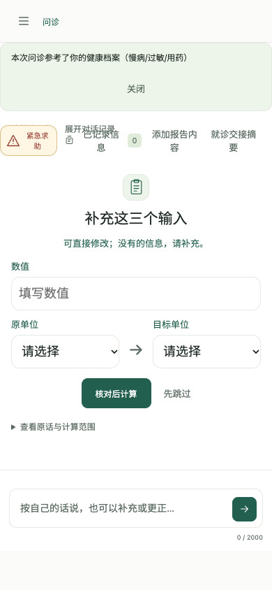

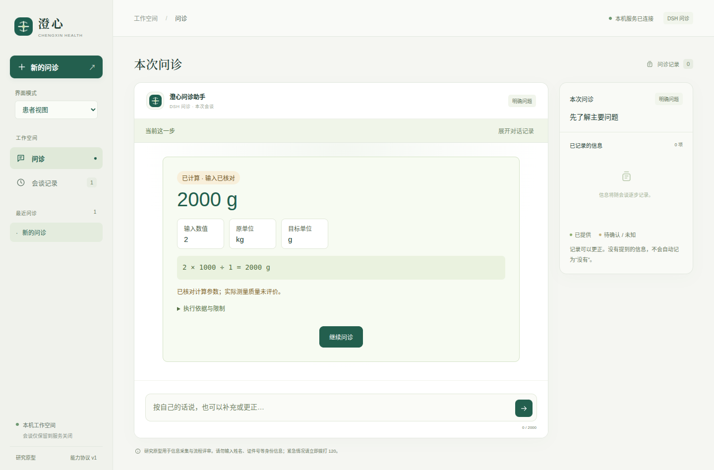

输入阶段不计算；用户把 1.25 改为 2 后按最终值计算，记录修改前后参数。输入已核对不等于测量已验证。服务已经完成而界面丢失返回时，恢复最新卡片且不重复执行。源码与打包版各 7 组原生检查，以及修复后实际 API 流程均通过。详见 [患者计算与问诊衔接](患者计算输入与问诊衔接.md)。


## v0.10.5 文件变化与复验状态

执行工作台保持紧凑检查标记。受检文件更新后，退出0保留为实际命令历史，右侧当前检查显示“需复验”；正在一次预算内纠错时不提前出现最终完成卡。原命令同范围重新通过后，标记恢复通过并显示最终结果。历史工作区只显示保存的退出状态，提示当前文件版本未重新核对。

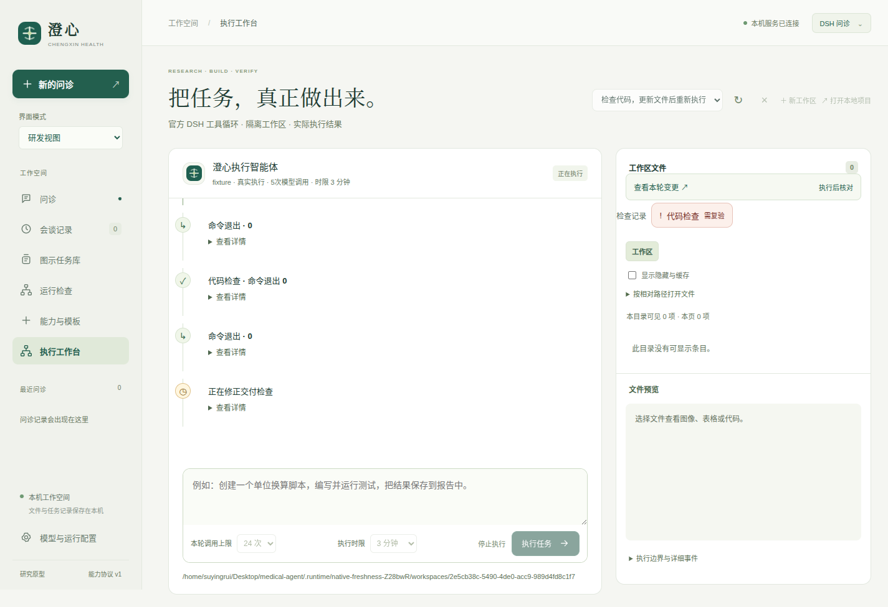

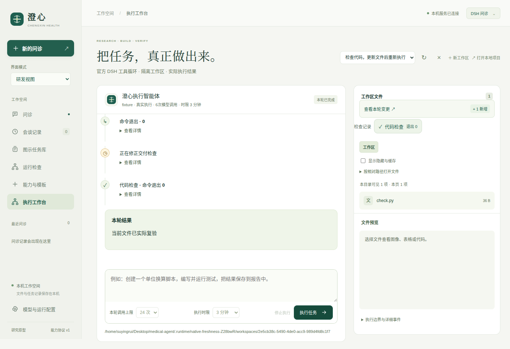

45／46是实际原生窗口截图，源码和打包版均执行交互；颜色之外保留文字与符号。验证记录见[0.10.5归档](evaluations/2026-10-16/v0.10.5/README.md)。

## 2026-10-18 多套皮肤与图示评审

入口位于右上角「外观」，患者与研发视图均可使用。提供六套完整皮肤，并可跟随系统自动切换浅色与深色：

| 皮肤 | 视觉方向 | 标题与形态 |
| --- | --- | --- |
| 知微绿 | 自然、安静，延续原有品牌 | 宋体标题，柔和圆角 |
| 海盐蓝 | 清透、利落 | 无衬线标题，紧凑圆角 |
| 鸢尾紫 | 柔和、舒展 | 宋体标题，更圆润的表面 |
| 暖砂金 | 纸张与暖色 | 宋体标题，米白表面 |
| 雾石灰 | 克制、专注 | 无衬线标题，小圆角 |
| 夜航 | 低亮度深色 | 无衬线标题，分层蓝灰表面 |

颜色统一到文字、表面、边界、选中、操作、警示等语义变量，覆盖问诊、会谈记录、图示、摘要、能力、运行检查、执行工作台与弹窗。急症与注意提示保留文字及稳定的语义颜色。切换不会重建问诊、提交选择、调用模型或清空未发送文字。

浏览器只在 localStorage 保存外观枚举；桌面版在当前应用配置目录的 appearance.json 保存 schema 和外观枚举。桌面每次启动使用随机端口与内存浏览器分区，因此另用只接受固定枚举的原生接口保存皮肤，并未改为持久化浏览器会谈。启动页、原生窗口底色及深浅外观同步。存储失败时本次窗口仍可切换，并显示未能保存的提示。

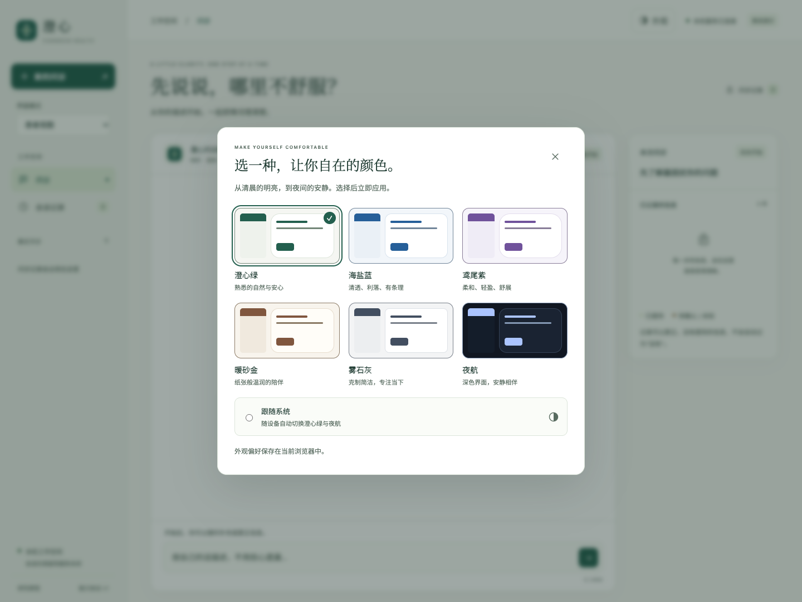

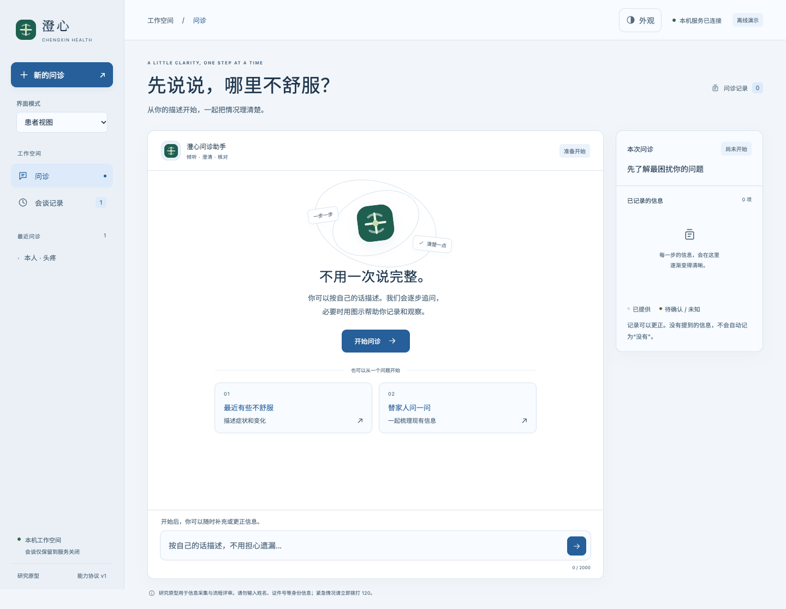

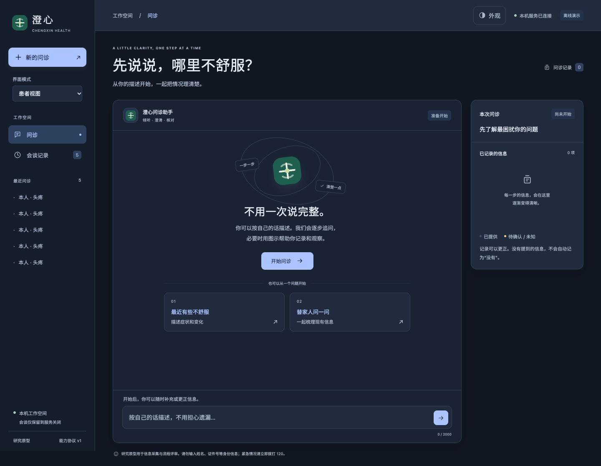

### 图示的现状与本次改善

目前模型通过结构化协议选择和填充受信组件；人体图与测温图来自仓库内的 SVG，不是模型自由生成的医学图片。现有两类任务分别是主观症状定位、数字体温计腋温测量。前者不能证明客观查体结果，后者仍是患者报告读数。

本次修正了交互人体图与素材预览之间的表现差异：正面有面部与躯干标志，背面有肩胛与背部中线；左右按患者自身标注。大部位以半透明虚线区域表示，四肢同时覆盖双臂与双腿，避免圆点造成精确定位的错觉。分步核对与最后确认的记录协议保留。头部细化示意也使用同一套皮肤颜色。

测温与素材预览支持放大当前步骤、键盘关闭及焦点返回。图片加载失败后保留分步文字，提示加载失败，避免只留下空白。图片内部的既有说明色不随皮肤重新着色；文字仍从本地字体生成矢量轮廓，并同步来源摘要。

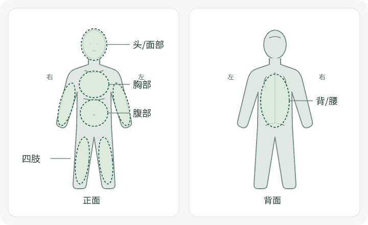

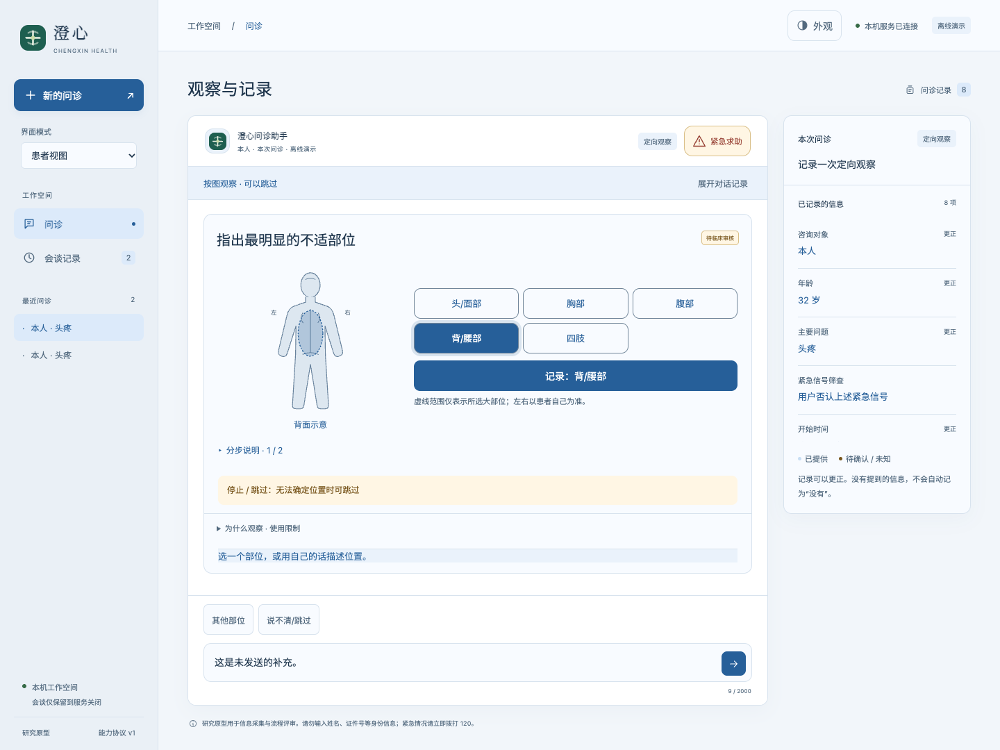

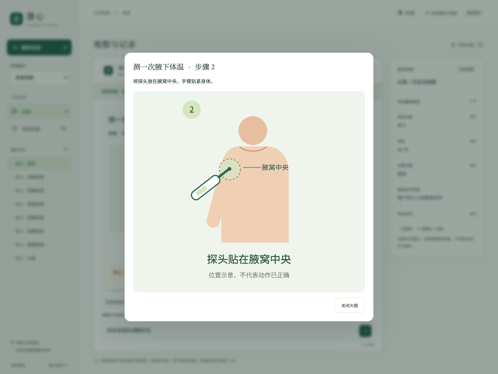

### 是否已经达到顶级

**尚不能这样评价。** 目前完成的是可复查的工程与视觉改进；专业医学插画、真实理解与操作效果仍有明确差距。优先级如下：

1. **先完善动作表达并审核。** 测温图需要更清晰的腋窝局部放大、探头与皮肤的接触、手臂贴紧的姿势及设备结束信号。不同设备的等待方式应以说明书为准，不能为了统一动画而固定一个时间；参考 [NHS 成人体温测量说明](https://www.nhs.uk/symptoms/fever-in-adults/) 与 [NHS 儿童体温测量说明](https://www.nhs.uk/baby/health/how-to-take-your-babys-temperature/)。具体图像、年龄适用范围与停止条件需要临床人员审核。
2. **再丰富定位层级。** 目前只有五个大部位及头部局部预设；颈部、手足、关节、骨盆等应通过受控内容契约逐步扩展。侧面、局部放大、多处不适与移动范围需要单独表达，不能仅凭用户点一个大部位生成精确坐标或左右结论。
3. **以实际理解效果验收。** 招募目标患者与照护者，包含老年人与低视力用户，记录方向判断、任务完成率、错误动作、跳过率和完成时间。比较新旧图示；工程测试不能替代理解和操作研究。
4. **再增加辅助表达。** 在审核后的静态图基础上加入可暂停、可回看的短动画、文字同步朗读和适龄插画。声音与动画不成为唯一的信息来源，也应尊重减少动态效果的系统偏好。

### 可复现检查

```bash
# macOS 本机 Chrome；其他系统可相应设置 CHROME_BIN
export CHROME_BIN="/Applications/Google Chrome.app/Contents/MacOS/Google Chrome"
npm run test:ui
npm run test:appearance
npm run test:desktop -- tests/desktop/appearance.spec.mjs
npm run format:check
python3 scripts/maintenance/outline_illustration_labels.py --check
```

外观测试覆盖六套皮肤的首页、选择器、定位草稿、研发页面、配置弹窗和带重要测量值的摘要；另检查 320／390 像素手机与短桌面窗口、方向键与 Escape、系统外观变化、刷新与多标签同步、存储失败、图示放大与加载失败。桌面检查实际关闭进程后重新启动，核对原生保存与外观恢复。

自动检查针对 [WCAG 2.2](https://www.w3.org/TR/WCAG22/) 的相关文字对比度、按钮与表单名称、对话框名称，以及操作边界的至少 3:1 对比度；主要操作仍采用至少 44 像素目标。该范围不等于整站 WCAG 符合性认证。未在本轮完成新的真实模型医学效果评价、临床审核或患者理解试验。

本轮最终源码在 macOS arm64 上通过 **96 项浏览器检查、3 项原生桌面检查**，另通过格式检查与两张图示共 21 处标签的生成一致性检查。[检查范围、源码摘要和截图摘要](assets/appearance/verification.json)与本节实际截图一同保留。此前的历史界面截图不覆盖。

## 2026-10-18 定向观察图示与注意力层级

本轮针对现有的腋温测量与主观症状定位，减少重复说明，并迭代检查桌面、矮窗口和手机的实际渲染。

- 测温默认突出一个动作：图示、短标题和一行提示；三段进度说明当前正在查看哪一步，不代表动作已执行或测量成功。准备设备在第一步展示，后续仍可在完整说明中查看。
- 步骤图聚焦动作区域，去掉同屏重复的图内标题。原始三步操作、设备要求、用途、结果填写提示与使用限制完整保留在可展开说明中。图片加载失败会自动展开文字；素材预览中的“不会记录结果”提示始终可见。
- 人体图支持点击大部位及 Enter／空格选择，与原有文字按钮同步。只有单独确认才写入记录；只读或处理中不能修改选择。区域高亮表示大部位，不产生精确坐标、左右结论或客观查体结果。
- 左右选项加入按患者自身方向绘制的正面图，范围选项以小点和虚线区域区分；“说不清”保留为独立选项。文字标签和至少 44 像素的备选按钮继续可用。
- 1440×1080、900×648、390×844、320×640 均检查当前动作、图示、操作按钮和完整停止条件是否落在任务区域内。小窗口减少重复页面标题及输入辅助文字，保留输入、跳过、紧急求助和对话记录入口。完整说明展开后可滚动阅读。

短标题仅匹配仓库中这一组确切的测温步骤与图示路径；其他能力或不同版本继续展示其完整原文。内容协议、读数范围、医学规则、来源与确认流程保持原有行为。原生测试改用独立临时配置，并在窗口及服务就绪后交互，避免启动时序干扰视觉验收。

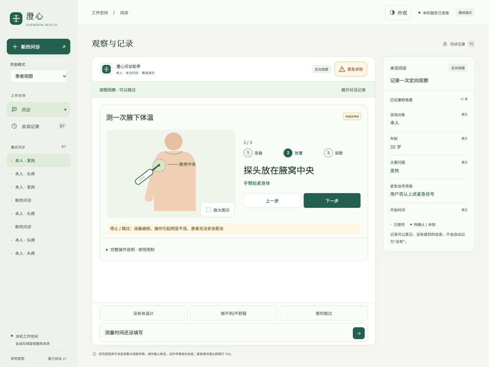

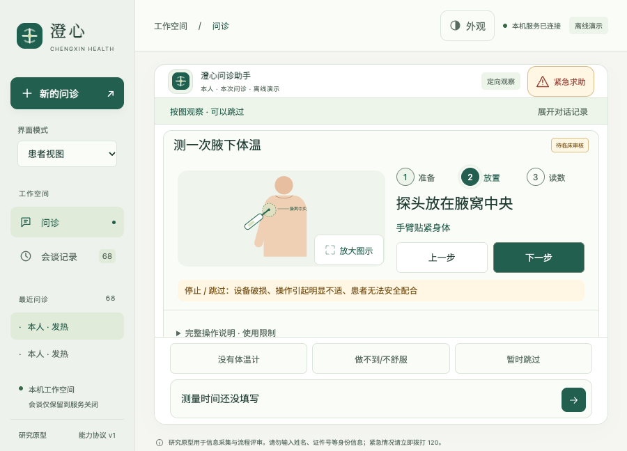

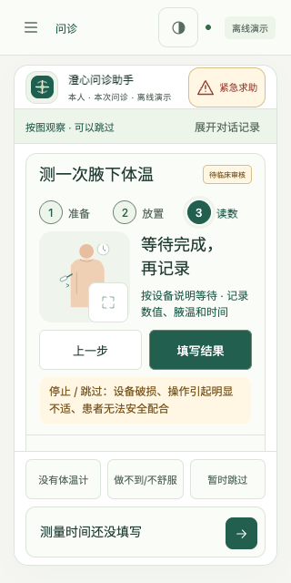

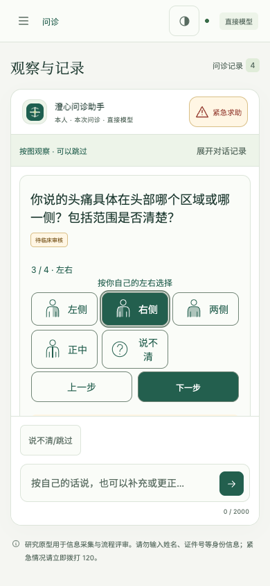

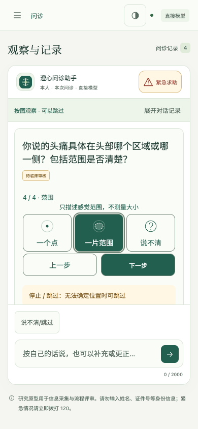

专项检查：`npx playwright test tests/ui/self-check-visuals.spec.mjs`。完整记录及源文件摘要见 [本轮验证记录](assets/self-check/verification.json)。本轮沿用工程验收范围，尚无新的临床审核或患者理解试验。

最终源码在 macOS arm64 上通过 **102 项网页检查、7 项原生桌面检查**，并通过格式与 SVG 标签生成一致性检查。原生范围包含窗口及私有服务生命周期、皮肤重启恢复、定位细化与更正、任务中补充对话、草稿恢复和测温反馈错误恢复。

后续视觉迭代沿用三项检查：当前动作是否一眼可见；非必要解释是否可以按需展开；小屏与键盘用户是否仍能完成选择、修改、确认和跳过。每轮保存实际截图，并验证草稿、来源与会谈进度没有因视觉切换而丢失。

## 2026-10-18 测温人物插图重绘

三步示意改为统一的人物矢量插图，重画头颈、肩臂、手部与衣着轮廓，以细描边和柔和明暗区分肢体。擦拭布和体温计由手持握，放置步骤保留腋窝局部标示，等待步骤展示手臂贴近身体。单步视框完整容纳人物与动作；手机保留放大入口。

本次修改 SVG 绘制、单步视框及相应生成产物，操作文字与交互流程沿用上一轮。局部生成的字体轮廓与图示摘要同步更新。工程复验通过 8 项图示／四种尺寸检查、1 项 macOS 原生桌面检查，以及 SVG 生成一致性检查；仍属于原型示意。

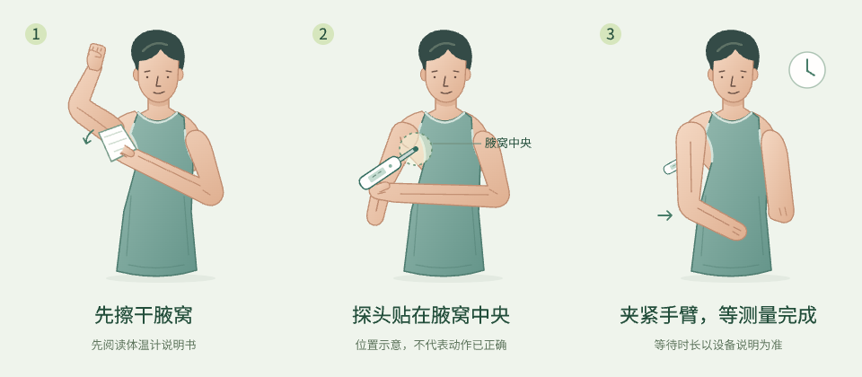

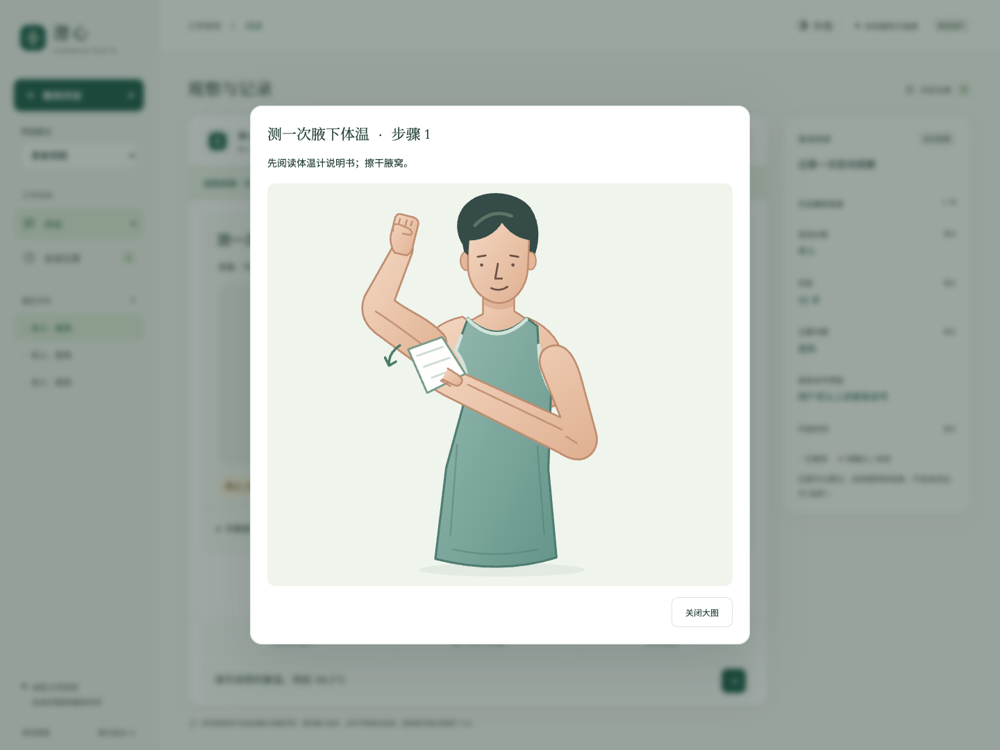

[本次检查与图示摘要](assets/illustration-redraw/verification.json)。

## 2026-10-18 无五官人物与执行状态迭代

按本轮反馈，体温人物回到无五官的简洁轮廓：去掉眼睛、眉毛、鼻子、嘴部与头发细节，使用平涂衣着和少量描边。三种手臂姿态、实际持握的擦拭布／体温计，以及腋窝放置点保留。图示不表示患者动作已经正确。已实际查看手机中的单步渲染，三个步骤继续使用原有说明、停止条件与确认流程。

参考 [Claude Artifacts 的独立成果区](https://support.claude.com/en/articles/17153992-what-are-artifacts-and-how-do-i-use-them) 和 [LangGraph 的中断／接续说明](https://docs.langchain.com/oss/javascript/langgraph/interrupts)，本轮取其“结果可直接查看”“清楚区分正在执行与等待人回答”的交互思路，实现仍使用现有 DSH 和宿主状态记录。

执行工作台新增简短状态卡，区分准备、运行、后台任务、待答复、待核对、已停止及已保存。待答复时可以直接定位可操作的问题。模型上报完成但仍有后台作业或运行失败时，概览继续提示运行／核对，不用推测的百分比或动画充当真实进度。

文件区新增图形速览入口：在当前目录这一页中优先展示图片、表格及文本，最多三项；点选后使用既有的受限预览接口。速览与完整目录互相收起，减少重复文件名和目录说明同时出现。切换视图保留预览，切换工作区清除旧选择；延迟返回不抢走用户已经移动的焦点。文件名与内容按文本处理，SVG／HTML 不作为可执行图像或网页载入。未点击文件前不自动读取图像内容。

本轮也修复执行输入框无障碍标签在窄屏造成的横向滚动。回归时发现 Python 3.12 默认的五连接等待队列在资源并发加载时会丢失连接，可能导致桌面脚本未完成初始化。用实际套接字在接受请求前排队 24 个静态资源请求，旧队列复现 BrokenPipeError，新队列通过；未授权资源读取仍为 401。相关行为依据 [Python socketserver 文档](https://docs.python.org/3.12/library/socketserver.html#socketserver.BaseServer.request_queue_size)，Windows 的 Test 模式也加入此检查。

本轮验证记录和截图见 `assets/focused-iteration/verification.json`。任务状态及文件区截图使用合成宿主记录验证界面，不能当作模型能力评测；测温截图来自实际离线问诊流程。最新 Windows 构建需以这一轮提交的 CI 结果为准，前一轮验收不覆盖新增界面。

本轮最后版本通过 108 项网页回归、5 项原生桌面检查、10 项服务／文件预览检查，以及字体轮廓生成一致性和格式检查。原生图形检查脚本还通过六套皮肤、重启、实际换算与文件速览。测温图本身成为完整的放大触摸目标，小角标保留入口提示，不再用文字按钮覆盖手臂。Windows 隔离方式的公开状态标签也改为对应实际的 ProcessContainer，并在实机完整执行检查中断言。

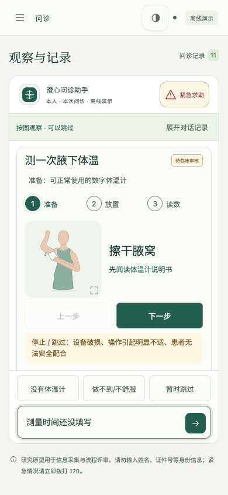

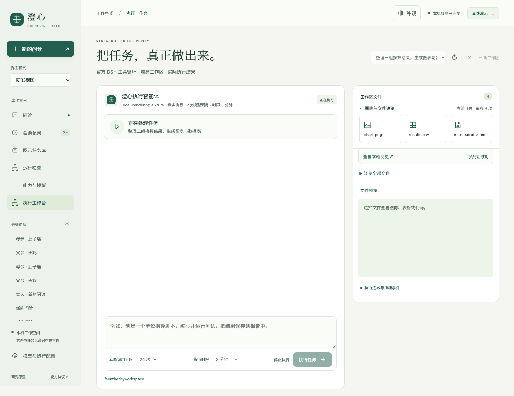

## 2026-10-18 数据图表与精简结果

执行产物中的 CSV／TSV 现在可以在表格、图表和原文之间切换。图表直接使用宿主读取并计算摘要的那份文件快照，不需要额外模型请求。用户可选择数值列；行标记、列名中的单位、原始数值和原行顺序保留。空白、公式、混合单位文本、非有限数或无法安全表示的整数不会被当成数值填入；其原表仍可查看。

参考 [Claude Artifacts 的就地查看产物设计](https://support.claude.com/en/articles/17153992-what-are-artifacts-and-how-do-i-use-them)，预览始终与文件和快照摘要相联系。条形从零点基线起画，符合 [英国政府 Analysis Function 的条形图指导](https://analysisfunction.civilservice.gov.uk/support/communicating-analysis/introduction-to-data-visualisation-e-learning/module-5-bar-charts/)。这是工作区数据预览，不增加医学参考区间、正常／异常判断或诊断推断。

图表标明实际展示的记录数量。长数据只使用当前文件预览已经提供的行，不把截断范围称为完整数据。刻度与数据共用滚动区，避免滚动条宽度使两者错位；键盘可以滚动长列表。放大查看和数值列切换保持同一快照。文件变化后仍显示“文件已变化”的提示；切换工作区清除旧图表。

执行智能体的长回复默认展示短预览，需要时展开完整原文。展开状态在状态轮询后保留，文字按文本显示。运行异常、需要回答的问题和交付检查仍独立呈现。若一轮已经结束但存在尚待核对的运行记录，标题显示“本轮已结束”，概览显示“结果待核对”，避免把结束状态当成验收结果。

本轮图形、边界数据与交互检查记录见 [数据图表验证](assets/chart-iteration/verification.json)。桌面检查在实际工作区写入 CSV，通过实际受限预览接口读取，并核对文件 SHA256、三行数值和零次智能体回合；本地模型服务收到的新增请求为零。浏览器检查另覆盖六套皮肤、三种尺寸、正负值、零值、缺失值、超出安全范围的整数、恶意标签、截断、文件变化、工作区切换、键盘滚动及长结果收起。

上一轮 `a5d5577` 的 [Windows 工作流](https://github.com/suyingrui2024/chengxin-medical-agent/actions/runs/39072806249)已通过源码与打包后的完整 SDK、六套皮肤、任务状态、原生隔离、安装及卸载检查。该记录覆盖无五官测温人物与任务聚焦迭代；后续数据图表与统一无五官人物的 Windows 验收见 `8ff7228`。

部位图的静态素材和可点击人体图也统一去掉了眼睛、嘴部及头部装饰，沿用原有区域、正背面与患者自身左右标记。体温图、部位图和人物小图标均经源码及实际渲染核对，保留简洁无五官形象。

本轮最终本地复验：117 项网页回归、6 项桌面检查、5 项图表数值检查、10 项服务与文件预览检查通过，格式与 SVG 生成一致性检查通过。Windows 图形检查脚本在本机也通过；其中实际 CSV 的图表预览不创建智能体回合，不增加模型请求。图表提交 `8ff7228` 已通过 [Windows 源码、打包版和安装器实测](https://github.com/suyingrui2024/chengxin-medical-agent/actions/runs/39075312555)。

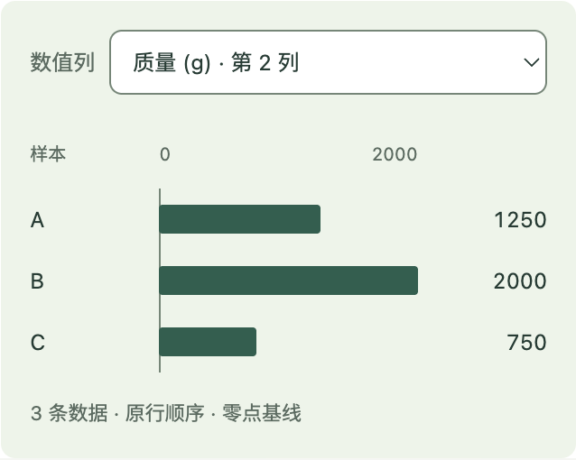

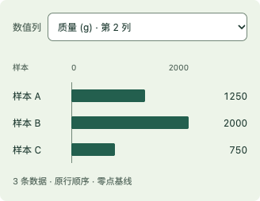

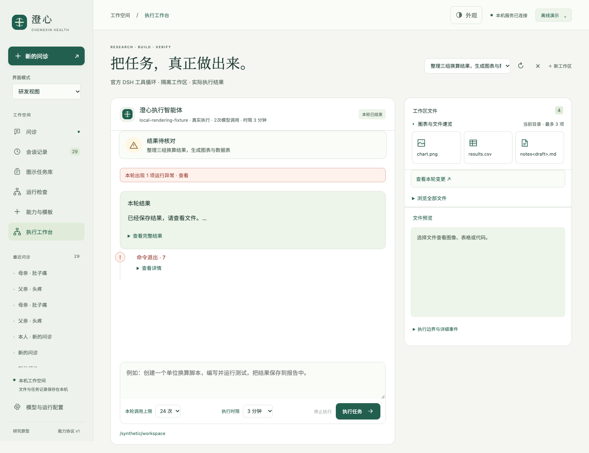

Windows 最终验收：[39075312555](https://github.com/suyingrui2024/chengxin-medical-agent/actions/runs/39075312555) 两套任务全部通过。真实 CSV 图表在源码、便携包和安装后的应用中通过文件摘要与数值核对；Windows 11 另通过源码与随包完整 SDK 执行、子任务、交付检查和会话接续。图表数值单元检查也在两套 Windows 环境运行。便携包 CRC、关键界面／执行源码及图示内容已与提交 `8ff7228` 核对；校验文件见本地 `dist/windows-validated/39075312555/verification.json`。

## 2026-10-18：简约人物与产物、回答交互

根据用户对人物仍显生硬的反馈，体温图回到公共标识式的单色人物：圆头、圆角躯干和手臂，不使用五官、肤色描边、手指、衣褶或阴影；用少量留白区分手臂与躯干。三个动作、探头位置、设备说明和停止条件保持原意，步骤图中不增加文字。已逐张查看三步原图和实际手机渲染。

本轮调研先核对官方文档，再与现有功能比较，避免重复添加相同面板：

| 参考来源 | 可借鉴的设计 | 本轮落实 |
| --- | --- | --- |
| [Claude Artifacts](https://support.claude.com/en/articles/17153992-what-are-artifacts-and-how-do-i-use-them)，Work with artifacts／View and export | 对话旁独立查看产物，提供原文复制和导出 | 在现有预览面板加入「复制原文」「保存快照」，复用已读取的原文；图表切换不改变复制、导出的数据 |
| [LangGraph Interrupts](https://docs.langchain.com/oss/javascript/langgraph/interrupts)，Review and edit state；[Agent Inbox](https://github.com/langchain-ai/agent-inbox) 的 edit／response 设计 | 回答前允许检查、改选和修改，然后显式接续 | 执行问答选项先成为草稿，可改选或「自行说明」编辑，点击「发送回答」才提交；保留已有宿主问题 ID 和会话接续机制 |
| [Cursor Reviewing and testing code](https://cursor.com/learn/reviewing-testing)，Self-review／Verifiable goals | 将生成内容、变更和实际验证分开核对 | 保留已有变更复核、失败提示与文件摘要；本轮补充草稿、快照导出、真实桌面剪贴板检查，不把模型自报完成当作验收 |

Agent Inbox 在本次查阅时已归档，只借鉴其交互思路，不引入该项目或替换当前 SDK。以上是设计参考与本项目的适配，不代表能力排名或模型推理性能提升。

快照导出范围：文字按纯文本 `.snapshot.txt` 保存，保留读取时的完整原文，包括表格视图未显示的行；PNG／JPEG 重新从带文件摘要的既有接口读取，并核对实际字节 SHA256 后保存。保存不会运行文件内容，也不启动模型回合。系统剪贴板使用操作系统原生换行；Windows 的 CRLF 仅在剪贴板验收比较时归一化，磁盘快照仍核对完整原始 UTF-8 内容。复制失败时提供可重试提示，切换工作区会清除提示，旧图像的异步读取不能向新工作区导出。桌面仅允许本应用主文档的剪贴板写权限，读取和其他权限仍拒绝；[Electron 权限文档](https://www.electronjs.org/docs/latest/api/session#sessetpermissioncheckhandlerhandler)。

回答草稿仅保留在当前问题界面内，普通轮询不重建输入。问题内容或选项变化、问题被移除、工作区或回合切换时不复用旧草稿。发送失败后可修改、重试；选择本身不发送请求。本轮没有增加新的审批或自动同意规则。

本地验证：125 项浏览器检查、6 项桌面检查、1 项含多种来源／权限边界的 Node 检查通过；最终图示另做四种尺寸复验。原生 GUI 脚本实际写入 CSV，核对系统剪贴板和导出的磁盘文件，并检查编辑后回答的请求体。问答渲染使用明确标注的宿主快照 fixture，不作为模型理解能力评测。验证记录与图片见 [本轮记录](assets/minimal-iteration/verification.json)。本轮提交 `c1542d1` 的 [Windows 复验](https://github.com/suyingrui2024/chengxin-medical-agent/actions/runs/39077907437) 两套任务全部通过，含 5 次源码／便携版／安装后实际窗口中的 CSV 复制、磁盘快照保存与回答草稿检查；问答检查使用宿主快照 fixture。详细平台、步骤与边界见 [Windows 记录](assets/minimal-iteration/windows-native.json)。

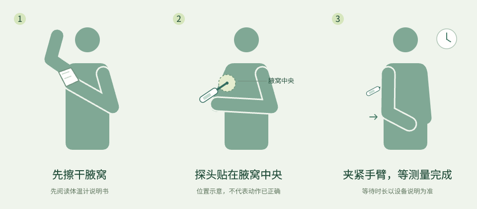

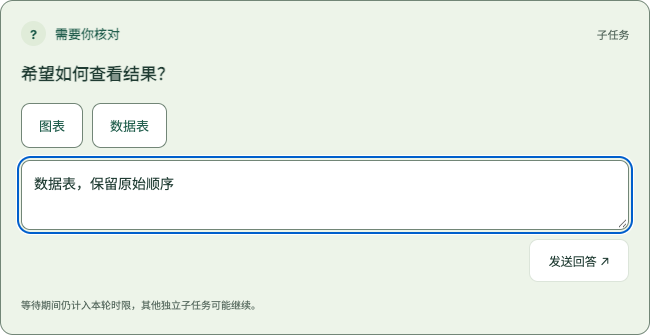

## 2026-10-18：连接恢复、状态一致性与手机操作

在 `10759a6` 上实际复现：已完成的工作区遇到一次临时状态读取失败后，八秒观察期内只有一次读取，自动刷新不再继续。旧界面仅显示「稍后重试」文字，刷新列表按钮也不负责重新读取当前任务。复现输出保留在 [本轮证据](assets/recovery-iteration/verification.json)，没有把首次失败改写成通过。

本轮对状态 GET 增加 15 秒超时、1／2／4／8／16／30 秒封顶的退避重试和「立即重试」入口。重连不重发任务、问题回答或工具操作，也不改变宿主执行、停止和预算规则。离开工作台后不再发出后续轮询；回到页面会重新读取。

连接正常时不显示新增面板。失败时只显示「状态暂未更新 · 正在重连」，原始错误按需展开，并按普通文字处理。已有任务结果、文件预览、未发送的任务输入和执行诊断保留；恢复时，只有焦点还在重连面板内才移到任务状态，正在其他位置编辑时不抢焦点。问题回答后，较旧 sequence 的延迟读取不能把状态退回待回答。切换工作区会取消旧读取，并核对工作区 ID 和激活轮次；无效响应不替换当前工作区。

手机和粗指针设备中，预览、回答补充、重试和目录操作按钮的点按区域至少为 44×44 CSS 像素。新增状态与预览操作在 320／390 像素、六套主题下检查边界及相关文字对比度；目录路径与直接打开按钮另作真实渲染检查。这是本轮检查范围，不代表完整无障碍认证。

桌面和 Windows 图形脚本增加同一连接恢复场景，使用明确标注的宿主快照 fixture 注入一次 HTTP 503，核对恢复和未发送任务的保留，不增加外部模型请求。完整 SDK、真实文件和安装器检查仍独立执行。本轮提交 `1953dab` 的 [Windows 验收](https://github.com/suyingrui2024/chengxin-medical-agent/actions/runs/39079554015) 两套任务全部通过。源码、便携版和安装后共5次真实窗口验证恢复与草稿保留；Windows 11另通过源码和随包完整SDK及接续。详细边界见[本轮Windows记录](assets/recovery-iteration/windows-native.json)。


## 2026-10-18：文件目录恢复与稳定布局

在 `83579e5` 上通过浏览器实际挂起目录响应，21 秒观察期内始终只有一次目录读取，列表无法自动恢复。原始失败保留在本轮验证记录中。它是目录读取的缺陷，与上一轮已修复的任务状态读取相互独立。

目录 GET 现在设有 15 秒超时；失败后按 1／2／4／8／16／30 秒封顶退避，下一次读取由已有工作台状态刷新触发，因此实际间隔还包含刷新调度时间。失败时提供「重新读取」，连续点击不会叠加请求。正常连接时隐藏重试按钮，沿用已有的一行目录状态，不增加常驻提示面板。

同一目录、同一隐藏文件范围的上次列表会保留，明确标为「上次列表」，条目暂时禁用，数量改为未知；重新读取成功后恢复操作。切换到其他目录或改变隐藏文件范围失败时，不把上一范围的文件作为新列表保留。请求记录包含实际目标路径、分页游标和页码，失败重试不会悄悄返回先前目录。分页过期时仍重新读取第一页。

切换工作区、目录范围、或者工作目录不可用时，取消被替代的读取并核对请求代次，旧响应不能覆盖新列表。失败时，如果键盘焦点所在的文件条目失效，会转到重试按钮；恢复后仅在焦点仍在重试按钮上时移回列表，不抢走正在其他位置编辑的焦点。任务草稿和已打开的文件预览保留，重试只发目录 GET，不重发任务、回答或工具操作。

手机与粗指针设备中的文件行、隐藏文件开关标签、按路径打开的折叠入口及重试按钮具有至少 44 像素的点按高度。文字继续按实际状态显示，旧列表不会被描述为当前完整目录。

本轮核对了 [assistant-ui Connection state](https://www.assistant-ui.com/elements/connection-state) 对传输状态与服务器运行状态的区分，以及 [TanStack 后台刷新示例](https://tanstack.com/query/latest/docs/framework/react/guides/background-fetching-indicators) 在后台读取时保留已有内容的交互。这里结合文件快照语义作出适配：旧列表可见但不可操作，且没有调用 SDK 的任务接续方法。仍使用已有 DOM 和宿主接口，没有新增这些框架的运行依赖。

验证包含挂起请求的真实超时、HTTP 503、手动重试去重、目录目标保留、隐藏文件范围变更、工作区切换取消、焦点与草稿保留；320／390 像素的六套主题另检查目录区域文字对比度、可访问名称和点按区域。桌面及 Windows 图形脚本复用明确标注的宿主快照夹具，检查真实窗口中的失败与恢复。这些检查不作为模型推理或临床效果评测。完整结果及 Windows 验收状态见 [本轮验证记录](assets/directory-iteration/verification.json)。提交 `682caf0` 的 [Windows 工作流](https://github.com/suyingrui2024/chengxin-medical-agent/actions/runs/39083192293)两套任务全部通过，源码、便携版及 Server 安装后共 5 次实际窗口核对目录恢复、旧列表标记和草稿／预览保留；Windows 11 另通过源码与随包完整 SDK。详见 [Windows 回执](assets/directory-iteration/windows-native.json)。


## 2026-10-18：原生放大与短窗口阅读

在 `59f8302` 的实际 Electron 窗口中，将 900×680 窗口放大到 200%，内容视口变为约 450×324 CSS 像素，测温内容区却被固定高度布局挤到仅 21 像素，内部仍有约 405 像素内容。小面积的嵌套滚动区使人物和操作步骤难以完整查看。本轮保留原始测量，不将一般手机截图当作原生缩放验证。

小高度视口现在采用页面纵向滚动，当前问题和图示按内容展开；文字、人物、按钮、停止条件和详细说明保留原有内容。会谈头部和焦点栏允许换行，历史对话仍有独立可滚动范围，当前摘要可以随页面展开。内容区展开规则只在问诊视图可见、已有会谈且视口高度不超过 560 CSS 像素时生效。

125% 放大时的窄列另将步骤标签排成编号在上、词组在下，避免「准备」「放置」「读数」被挤成单字竖排。

仅调整布局后还复现了一个焦点问题：新任务标题虽获得键盘焦点，却位于视口上方约 206 像素。现在进入下一问题、任务或反馈时，短窗口会同时将当前标题滚动到可视位置；填写结果仍转到原输入框，未发送的读数不会被覆盖。切换图示步骤、放大图和关闭图示不写入测量记录。

原生截图随后发现，既有的配置成功通知会在 200% 放大后遮住步骤按钮和停止提示。短问诊窗口中的通知现进入输入区的正常排版，保留完整文字与状态播报，不覆盖图示或操作；调整窗口或切换页面时同步更新显示位置，其他页面仍能收到提示。检查同时核对目标中心的实际命中元素，避免只凭尺寸和可见标记漏掉浮层遮挡。

设计参考 [W3C 文字放大说明](https://www.w3.org/WAI/WCAG22/Understanding/resize-text.html) 对 200% 放大后内容与功能保留的要求，以及 [重排说明](https://www.w3.org/WAI/WCAG22/Understanding/reflow.html) 对窄视口阅读的解释。这里采用纵向滚动与内容重排，不用继续缩小文字来容纳操作。这是本轮设计与检查依据，不是整站无障碍认证。

浏览器检查覆盖 720×518、600×432、450×324、320×256 四种短视口，逐项滚动并核对图片、当前动作、三步按钮、停止条件、图示放大与 Escape 关闭后的焦点；另核对程度草稿和人体定位的显式确认。检查会同时查找视口外及被祖先滚动区裁切的目标，顶层模态图示按实际模态边界核对。

原生检查使用 `webContents.setZoomFactor` 实际设置 125%／150%／175%／200%，读取真实缩放值，并操作完整测温任务，不使用 CSS transform 代替。Windows 图形验收脚本在已有检查结束后，通过应用配置切换到本地演示，再运行同一原生放大检查；既有换算、真实 CSV、系统剪贴板、磁盘快照和恢复检查仍独立核对。原生截图使用窗口 `capturePage`，保留实际设备像素。完整结果与 Windows 状态见 [本轮验证记录](assets/zoom-iteration/verification.json)。

提交 `3c0b430` 的 [Windows 工作流](https://github.com/suyingrui2024/chengxin-medical-agent/actions/runs/39086380368)两套任务全部通过；源码、便携版及 Server 安装后共 5 个真实窗口均完成上述四档原生放大测温检查，详见 [Windows 回执](assets/zoom-iteration/windows-native.json)。Mac 另在原生 200% 下实际完成换算接续，以及摘要编辑与确认，记录为 [两项补充探针](assets/zoom-iteration/additional-native-200.json)，不累加到 149 组网页与 7 组原生回归，也不称为 Windows 同流程验证。


## 2026-10-18：保留未完成任务的说明

交付检查失败时，宿主已保存模型的收尾说明，但界面原先只显示停止原因，未提供读取说明的入口。现在失败、取消与中断事件中的非空说明归入原事件卡片，默认折叠为「查看本轮说明」；恢复记录显示「查看历史说明」。展开后按原文显示，不解释 HTML，也不把模型自述当作检查通过。原失败状态、文件与检查记录保持独立。

本轮 19 组定向网页检查、1 组原生桌面检查及完整原生图形脚本通过；8 项离线持久化检查另核对真实保存、关闭与重新打开后的说明保留、密钥脱敏和不自动启动执行。网页及原生图形检查使用宿主快照夹具，不代表模型解决任务能力提高。完整范围与 Windows 复验状态见 [验证记录](assets/incomplete-iteration/verification.json)。提交 `8dfa04c` 的 [Windows 工作流](https://github.com/suyingrui2024/chengxin-medical-agent/actions/runs/39101689571)两套任务已全部通过，5 个真实窗口均通过说明保留和失败状态检查；两套平台另通过实际离线持久化检查。详见 [Windows 回执](assets/incomplete-iteration/windows-native.json)。

## 2026-10-18：产物读取超时与快照核对恢复

实际挂起预览 GET 时，原界面等待超过 18 秒后仍禁用「重新读取」。预览、快照核对及保存图像时的读取现在都有 15 秒中止时限，读取响应正文也在时限内。预览失败后恢复原有重新读取按钮，不自动重发保存或任务。快照核对失败时保留读取时的表格或图文，沿用原位置说明「当前文件未能重新核对」，关闭展开预览；请求结束至少两秒后才允许下一次核对。没有增加常驻提示面板。

切换文件、工作区或重置预览时，取消被替代的读取；旧响应仍须通过既有代次检查。图像保存失败后可重试，不生成下载；原有字节哈希检查保留。这里的快照保留针对后台核对失败，不代表显式点击重新读取时仍展示先前预览。

16 组定向网页检查覆盖三种真实挂起请求、文件／工作区切换取消，以及既有图表、复制、实际下载字节和图像一致性；1 组原生桌面检查及完整图形脚本另通过 HTTP 503 注入检查恢复。它们不作为推理能力或临床效果评测。完整范围与 Windows 复验状态见 [验证记录](assets/artifact-recovery/verification.json)。提交 `83a7fa8` 的 [Windows 工作流](https://github.com/suyingrui2024/chengxin-medical-agent/actions/runs/39102065354)两套任务已全部通过，5 个真实窗口均通过 HTTP 503 下的预览与快照核对恢复。详见 [Windows 回执](assets/artifact-recovery/windows-native.json)。

## 2026-10-18：较早子任务的回答

较早任务的子智能体仍在合法等待时，问题继续显示，并以「较早子任务」区分来源。选择答案后仍需显式发送，回答保持原任务标识；当前执行任务不切换。原问题过期后关闭，不能借用新任务时限继续等待。

新增网页检查在宽屏及 320 像素实际选择、发送并核对原任务标识；原生窗口另使用明确标注的宿主快照夹具核对同一交互。没有增加常驻说明面板，完整状态和 SDK 检查的不同范围见 [本轮记录](assets/ownership-iteration/verification.json)。


提交 `85337c4` 的[完整 Windows 工作流](https://github.com/suyingrui2024/chengxin-medical-agent/actions/runs/39110352224)两套任务全部通过；源码、便携版及 Server 安装后的 5 个实际窗口均通过较早子任务回答、失败恢复和既有放大检查。问答界面使用宿主快照夹具，真实回答回传由 Windows 11 源码与随包 SDK 另行验证；详见[回执](assets/ownership-iteration/windows-native.json)。

### 根回复后的后台活动

后续增量让现有状态行读取实时子任务快照：根任务已回复、没有命令作业时，仍能显示“1 个较早子任务运行中”，并保留停止操作。详细说明继续按需展开，没有增加常驻说明面板。历史子任务启动事件不会被当成仍在运行的证据。新任务超时后，仍有效的旧任务问题可以继续显式发送回答，回答携带原任务标识。

宽屏、320 像素和实际 Mac 窗口已核对；13 个定向网页场景通过。界面场景使用宿主快照夹具，实际停止与回答另外通过 SDK 检查。[本轮证据](assets/cancellation-iteration/verification.json)记录适用边界。`ec39f44` 的[完整 Windows 矩阵](https://github.com/suyingrui2024/chengxin-medical-agent/actions/runs/39114582635)已经通过，5 个实际窗口均核对根回复后子任务活动与停止操作，源码及随包各 6 项 SDK 方法另行通过；详见[验收记录](assets/cancellation-iteration/windows-native.json)。


