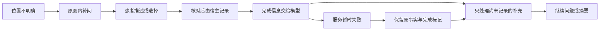

# 图示完成状态与定位澄清

v0.11.14改进图示之后的模型接续。上一版四个定向场景通过，但原始事件中仍有部位确认后重复提议、测温后尝试写入受保护字段、位置未知被记成伴随症状的问题。旧报告保持原样；本轮增加更严格的验收，不将旧通过门视作新通过门的证明。

宿主在处理观察后创建`observation_completion`，说明任务、结果字段、来源轮次、实际写入的事实ID、断言、质量及是否保留上次读数。`result_is_current`根据当前事实身份重新计算；更正使旧结果失效后，不会继续宣称它仍是当前记录。未完成的重复测量保留旧读数时，没有本次新事实ID，不能解释为新测得的正常结果。

完成信息与`completed_observation_with_supplement`分开：纯读数也有完成上下文，只有混合叙述才标为待理解的补充。服务错误时保留上下文和原始来源，重试不会重复写观察；成功接续或新的患者输入清除该瞬时标记。患者界面只提示“这次反馈已处理，后续对话暂时不可用”，不显示工具协议，不要求重新自查。原有纯重复测量的零模型接续保留。

部位任务公开自己的`result_key=symptom_location`。模型可以用`clarify(topic="symptom_location")`提出不超过80字的定位问题；只在当前未完成部位任务中允许，仍遵守每主题最多两次和既有动作／处方限制。补问替换原图标题，不额外生成长段解释，沿用原图示身份、选项和步骤。明确部位后恢复原标题与待核对示意。模型不能因此通过`record_facts`写入观察字段，也不能把主要问题的位置补充记成另一项伴随症状。

实现复用原有会谈内的观察反馈，不新增患者数据库或长期记忆。图示任务帧不回滚病史；完成标记也不是质量认证。内容仍为待临床审阅原型，语言规则和模型均可能理解错误。

验证包括[9项新增后端检查](../tests/test_observation_completion.py)、[共享界面流程](../tests/fixtures/observation-completion.mjs)、[三种窗口尺寸](../tests/ui/observation-completion.spec.mjs)、[原生检查](../tests/desktop/observation-completion.spec.mjs)。覆盖事实身份、来源、失效、服务重试、后续新输入、未知重复读数、定位澄清及其边界。预设模型检查只证明控制器和界面，不证明模型能力。

[真实模型驱动](../scripts/evaluation/medical/evaluate_self_check_conversation.py)在原有四个合成场景上增加三项要求：部位确认后不再次提议或重写观察、测温后不自行写入`temperature_c`、位置未知留在图示中而不写成伴随症状。记录每阶段请求数和实际交给后端的动态上下文；初始病例仍由脚本准备。单次最多14次请求，同目录累计最多28次，保留失败而不重置额度。此类定向结果不代表临床准确率、患者理解率或整体DSH／Codex能力。
