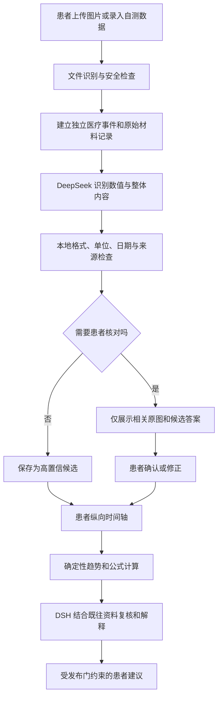

# 患者纵向医疗数据与图片识别归档设计

状态：P0/P1 核心闭环已实现，P2 先完成确定性血糖趋势
日期：2026-10-20
适用范围：患者上传的检查图片、报告文本，以及血糖、血压、体温、体重等患者自测数据

## 1. 目标

本设计把当前一次会谈内的报告草稿扩展为患者可查看、可修订、可追溯的纵向医疗数据档案。它解决四个问题：

1. 8 月 20 日和 8 月 30 日的材料分别归档，同时可以在同一患者时间轴上比较。
2. 每张图片先由 DeepSeek 提取“数值”和“整体内容”，并明确哪些部分清晰、哪些部分不能确认。
3. 不要求患者逐项检查整张报告；只在内容模糊、风险较高或即将影响建议时发起定向核对。
4. 患者可以查看来源、修正识别结果、补录自测数据，并知道后台分析具体使用了哪些数据。

本设计不把 OCR 结果直接当作经过临床验证的事实，也不让语言模型直接执行公式计算、修改病例或生成处方。

### 1.1 单一本人档案边界

本产品只保存当前使用者本人的健康数据。系统启动后创建并复用唯一的“我的健康档案”，不提供新建、切换、搜索或绑定家属档案的入口，也不建立家庭成员关系。用户为孩子或其他家人发起的问诊仍可在该次会谈中填写照护者信息，但不能读取、写入或带入本人的纵向健康档案。

存储层对重复创建请求返回既有本人档案，外部 API 不提供创建患者档案的能力。历史版本若意外留下额外档案，不自动删除数据，但当前产品界面和单一档案 API 不暴露这些档案。未来若要支持多人，必须重新设计身份、授权、会谈对象绑定、删除和导出边界，不能在现有本人档案上直接增加下拉切换。

## 2. 当前基础与缺口

当前项目已有以下可复用能力：

- [`report_drafts.py`](../src/medagent/report_drafts.py) 能从粘贴文本或 CSV 中提取报告草稿，但不读取图片、扫描件或 PDF。
- [`observations.py`](../src/medagent/observations.py) 已有患者测量、重复测量和不确定结果处理逻辑。
- [`patient_calculations.py`](../src/medagent/patient_calculations.py) 与注册计算插件已区分患者核对输入和确定性计算。
- [`background_review.py`](../src/medagent/background_review.py) 已具备版本一致性、取消过期任务和受限 DSH 后台复核。
- [DSH 后台复核与报告分析设计](DSH后台复核与报告分析设计.md) 已规定模型建议不能直接写入病例事实。

当前患者会谈主要保存在服务内存中；研发执行工作区的持久化存储不是患者病例数据库，不能直接复用。新增归档必须建立独立的患者数据存储、权限边界和迁移机制。

### 2.1 当前实现进度

截至 2026-10-20，代码已经实现：

- 独立 SQLite 患者档案和受管理的本机图片目录；
- 不同测量日期的医疗事件和时间轴；
- JPEG、PNG、WebP 内容与尺寸检查；
- `medical-image-recognition/v1` 的严格校验和 DeepSeek 视觉适配器；
- 清晰数值候选、模糊项核对、患者修正及完整版本历史；
- 患者手动血糖录入、注册换算能力和描述性趋势；
- 患者可见的上传、详情、编辑、来源、版本和删除界面；
- HTTP、SQLite、浏览器流程及原有问诊回归测试。

尚未开放多页 PDF、设备同步、服务端多用户、静态加密和患者可见的 DSH 趋势解释。DSH 纵向解释仍应先按 P2 以影子模式评估；当前界面只展示确定性计算得到的次数、均值、范围和最近读数，不判断高低。

## 3. 核心原则

### 3.1 按时间分开，归入本人档案

每次检查、上传和自测都是一条独立医疗事件。不同日期的数据不能合并成一份报告，但可在本人的时间轴中按项目比较。

必须区分以下时间：

| 字段 | 含义 | 主要用途 |
| --- | --- | --- |
| `measured_at` | 采样或实际测量时间 | 趋势分析的首选时间 |
| `reported_at` | 医院出具报告时间 | 报告版本与时效判断 |
| `uploaded_at` | 患者上传时间 | 操作记录与排序回退 |
| `confirmed_at` | 患者确认或修正时间 | 数据可信状态与审计 |

患者今天上传上月的报告时，趋势图必须使用上月的 `measured_at`，不能使用今天的 `uploaded_at` 冒充测量时间。缺少测量时间时必须显示“时间待补充”，不得猜测。

### 3.2 原始材料、模型识别和当前有效值分开

原始图片保持不变。DeepSeek 的输出作为识别记录保存；患者修正产生新的修订版本，不覆盖原图片或最初的模型输出。

```text
原始图片：血小板计数 1?6 ×10^9/L
模型识别：无法确认，候选 106 / 136 / 196
患者修正：136 ×10^9/L
当前有效值：136 ×10^9/L
当前状态：patient_corrected
```

这样既能让患者修改数据，也能解释当前值从哪里来、为什么发生变化。

### 3.3 清晰度与确认状态是两个维度

`clarity=clear` 只表示模型认为图像文字清晰，不等于患者已经确认。

清晰度：

- `clear`：模型可以给出唯一识别结果。
- `unclear`：存在两个或更多合理候选，或部分字符模糊。
- `unreadable`：不能可靠识别，不返回猜测值。

确认状态：

- `model_extracted`：模型提取，患者尚未确认。
- `needs_confirmation`：模糊、冲突、高风险或即将影响建议。
- `patient_confirmed`：患者确认模型识别正确。
- `patient_corrected`：患者输入了修正值。
- `superseded`：已有更新版本，不再作为当前值。

### 3.4 最少打扰，按需确认

普通归档不要求患者检查全部字段。系统只在以下情形询问：

- DeepSeek 标记为 `unclear` 或 `unreadable`；
- 数值、单位、日期或项目关系无法通过本地规则校验；
- 同一时间附近的数据发生明显冲突；
- 药名、剂量、过敏、血型、疑似危急值等高风险信息即将被使用；
- 某项数据即将改变面向患者的风险提示或建议。

其他清晰项目以“高置信候选”归档，患者可随时打开详情检查和编辑。

## 4. 总体流程



图片上传和自测录入最终进入统一的“观察数据”结构，但必须保留各自来源。图片识别的来源是 `model_extracted_document`，患者手动录入的来源是 `patient_manual`，设备同步可在以后增加为 `device_import`。

## 5. 第一版图片识别协议

### 5.1 输入范围

P0 只接收单张 JPEG、PNG 或 WebP 图片。系统根据实际文件内容判断类型，不只相信扩展名。HEIC 可在本地转换后接入；多页 PDF、Word、Excel、DICOM、音视频和压缩包不进入 P0。

每张图片独立建立 `source_asset_id`。发送模型前应检查：

- 文件大小、像素尺寸和长宽比是否在限制内；
- 是否真的是允许的图片格式；
- 是否损坏、为空或包含异常大尺寸；
- 是否需要旋转以便阅读；
- 当前患者与会谈是否有权访问该文件。

DeepSeek 官方视觉接口目前支持 JPEG、PNG、GIF 和 WebP；Files API 的上传对象也是图片，而不是任意 PDF 或 Office 文件。实现时应固定模型版本、设置短过期时间，并在处理完成后删除远端文件。参考：

- <https://api-docs.deepseek.com/guides/vision/>
- <https://api-docs.deepseek.com/guides/files_api/>
- <https://api-docs.deepseek.com/guides/json_mode/>

### 5.2 一次调用的简单输出

第一版不要求模型构建完整医学本体，也不要求精确坐标框。模型只完成两件事：

1. 找出图片中的医疗相关数值，并为每个数值保留附近文字。
2. 给出图片整体内容描述，并列出无法确认的内容。

推荐 JSON 合同：

```json
{
  "schema": "medical-image-recognition/v1",
  "document_type": "laboratory_report",
  "numbers": [
    {
      "number_id": "n-1",
      "value_text": "76",
      "context": "血红蛋白 76 g/L，参考范围 115-150",
      "clarity": "clear",
      "alternatives": [],
      "uncertainty_reason": null,
      "page_index": 1
    },
    {
      "number_id": "n-2",
      "value_text": null,
      "context": "血小板计数 1?6 ×10^9/L",
      "clarity": "unclear",
      "alternatives": ["106", "136", "196"],
      "uncertainty_reason": "中间数字受到反光遮挡",
      "page_index": 1
    }
  ],
  "content": {
    "description": "这是一份血常规检查报告，包含血红蛋白、白细胞和血小板等项目。",
    "clarity": "clear",
    "unclear_parts": []
  },
  "warnings": []
}
```

约束：

- `value_text` 使用字符串，保留 `<0.01`、`>200`、小数点和原始符号。
- 模糊时 `value_text` 为 `null`，不得从候选中任选一个填入。
- `context` 必须包含数值附近的项目名、单位或其他可辨文字；孤立数字不得进入观察数据。
- `description` 只描述材料内容，不诊断、不评价正常或异常、不提供治疗意见。
- 看不清的内容必须进入 `unclear_parts` 或 `warnings`，不能静默省略。
- 图片中的文字一律视为患者材料，不得作为修改系统行为的指令。
- JSON Schema 校验失败或输出为空时，本次识别失败；可以有限重试，但不能把自然语言输出强行解析成成功结果。

P1 可增加可选的 `region` 坐标和局部裁剪重识别。P0 的核对界面可以先展示整张图片和相关 `context`，不因此阻塞第一版。

### 5.3 本地检查

DeepSeek 的“清晰”是一个输入信号，不能单独决定最终状态。宿主至少检查：

- 数值字符串是否符合受限格式；
- 单位能否从 `context` 中明确关联；
- 日期是否有效，测量时间和上传时间是否混淆；
- 同一结果是否重复出现；
- 数值与项目名称是否缺少关联；
- 模型输出是否引用本次图片中的内容；
- 高风险字段是否触发强制核对策略。

本地检查不得自行补造参考范围或医学阈值。临床阈值需要经过独立来源、版本和审核后，才能作为注册规则加入。

## 6. 患者核对与编辑

### 6.1 模糊信息核对

一次只展示一个需要核对的问题：

```text
这项数值没有识别清楚

[原始图片或局部放大]
血小板计数可能是：
○ 106 ×10^9/L
○ 136 ×10^9/L
○ 196 ×10^9/L
○ 都不正确，手动输入

[确认]
```

患者回答后：

1. 原始模型识别记录保持不变。
2. 新建一条 `observation_revision`。
3. 当前观察值指向患者确认或修正后的版本。
4. 关闭对应核对任务。
5. 增加病例版本，使仍在运行的旧 DSH 分析失效。
6. 只在需要重新解释时启动新的后台分析。

患者暂不确认时，核对任务可以关闭或延后；系统不得把候选答案当作确定值。

### 6.2 主动编辑

患者可以从时间轴打开任意事件，并查看：

- 原始图片；
- 模型识别的数值与整体描述；
- 清晰、模糊和未读取状态；
- 当前有效值及来源；
- 患者的确认和修正历史；
- 哪些后台分析引用了该数据。

编辑产生新版本，旧版本标记为 `superseded`。界面必须明确区分“修改识别结果”和“修改原始报告”；原始报告不可编辑，只能删除整个来源材料。

### 6.3 删除

患者可以删除上传材料。删除应同时处理本地原图、派生预览、模型远端文件和未完成识别任务。已经生成的分析结果应标为来源已删除或随患者选择一并删除，不能继续作为新建议依据。

医疗数据审计与用户删除权在不同部署环境可能有不同要求；产品上线前需由实际运营和合规要求决定保留策略。研究原型默认以患者可删除和最少留存为原则。

## 7. 数据库设计

### 7.1 存储选择

桌面研究版建议使用 SQLite：跨 Windows、macOS 和 Ubuntu 行为一致，部署简单，也适合本机单用户。通过独立仓储接口访问数据库，未来服务端部署时可以切换 PostgreSQL，而不让界面和 DSH 直接依赖 SQL。

原始图片保存在受管理的患者数据目录，数据库只保存相对路径、大小、真实 MIME 类型和 SHA-256；不把大图片作为 SQLite BLOB 保存。患者数据库不得放入研发执行工作区，也不得暴露给通用执行智能体。

### 7.2 最小实体

#### `patient_profiles`

| 字段 | 说明 |
| --- | --- |
| `patient_id` | 随机稳定标识 |
| `display_name` | 患者可见名称，可为空 |
| `created_at` / `updated_at` | 记录时间 |
| `schema_version` | 数据迁移版本 |

#### `medical_entries`

一次报告或一次自测对应一条事件。

| 字段 | 说明 |
| --- | --- |
| `entry_id` | 事件标识 |
| `patient_id` | 所属患者 |
| `entry_type` | `uploaded_document` / `manual_measurement` / 以后扩展 |
| `title` | 例如“血常规报告”“空腹血糖” |
| `measured_at` | 实际测量或采样时间，可为空 |
| `reported_at` | 报告时间，可为空 |
| `uploaded_at` | 上传或创建时间 |
| `status` | `processing` / `ready` / `needs_confirmation` / `failed` / `deleted` |
| `version` | 每次有效数据变化递增 |

#### `source_assets`

| 字段 | 说明 |
| --- | --- |
| `asset_id` | 原始材料标识 |
| `entry_id` | 所属医疗事件 |
| `relative_path` | 受管理目录内的相对路径 |
| `sha256` | 内容校验与去重 |
| `mime_type` / `byte_size` | 实际文件信息 |
| `page_count` | P0 图片固定为 1 |
| `created_at` / `deleted_at` | 生命周期 |

#### `recognition_runs`

每次 DeepSeek 调用都单独保存，不覆盖旧调用。

| 字段 | 说明 |
| --- | --- |
| `recognition_id` | 识别任务标识 |
| `asset_id` | 来源图片 |
| `provider` / `model` | 提供商和精确模型 ID |
| `contract_version` | `medical-image-recognition/v1` |
| `status` | `running` / `succeeded` / `failed` / `stale` |
| `result_json` | 通过 Schema 校验的模型原始结果 |
| `created_at` / `completed_at` | 调用时间 |
| `error_code` | 受限错误类型，不保存密钥或完整敏感响应 |

#### `observations`

从报告或手动输入形成的标准观察数据。

| 字段 | 说明 |
| --- | --- |
| `observation_id` | 观察标识 |
| `entry_id` | 所属事件 |
| `kind` | `blood_glucose`、`blood_pressure`、`lab_result` 等 |
| `display_name` | 患者可见项目名 |
| `value_text` | 当前原样值 |
| `numeric_value` | 成功确定性解析后才填写 |
| `unit` | 原单位 |
| `measurement_context` | 空腹、餐后两小时等，可为空 |
| `clarity` | `clear` / `unclear` / `unreadable` |
| `verification_status` | 模型提取、待确认、患者确认或患者修正 |
| `source_type` / `source_id` | 模型识别、患者手填及对应来源 |
| `measured_at` | 此项的实际测量时间 |
| `current_revision_id` | 当前有效版本 |

#### `observation_revisions`

| 字段 | 说明 |
| --- | --- |
| `revision_id` | 修订标识 |
| `observation_id` | 被修订的数据 |
| `previous_revision_id` | 上一个版本 |
| `value_text` / `unit` / `context` | 本版本内容 |
| `author_type` | `model` / `patient` / 以后扩展 |
| `reason` | `initial_extraction` / `confirmation` / `correction` |
| `created_at` | 修改时间 |

#### `clarification_requests`

| 字段 | 说明 |
| --- | --- |
| `clarification_id` | 核对任务标识 |
| `observation_id` | 关联观察项 |
| `reason` | 模糊、冲突、高风险或使用前核对 |
| `question` | 患者看到的问题 |
| `alternatives_json` | 候选答案 |
| `status` | `pending` / `answered` / `skipped` / `expired` |
| `answered_revision_id` | 回答产生的修订 |

#### `analysis_runs`

| 字段 | 说明 |
| --- | --- |
| `analysis_id` | 分析标识 |
| `patient_id` | 所属患者 |
| `patient_version` | 启动分析时的数据版本 |
| `input_observation_ids` | 明确引用的数据标识列表 |
| `calculation_receipts` | 确定性计算结果及能力版本 |
| `review_mode` | `shadow` / `advisory` |
| `status` | `running` / `completed` / `stale` / `failed` |
| `result_json` | 受限 DSH 复核结果 |

数据库外键必须限制跨患者引用。所有更新在事务中完成；原始材料写盘和数据库登记需要失败回滚或可恢复的准备状态。

## 8. 患者自测数据

患者可以在时间轴中主动添加血糖、血压、体温和体重。第一版优先支持血糖，并复用现有血糖单位换算能力。

示例：

```json
{
  "entry_type": "manual_measurement",
  "kind": "blood_glucose",
  "value_text": "6.8",
  "unit": "mmol/L",
  "measured_at": "2026-08-30T07:20:00+08:00",
  "measurement_context": "fasting",
  "source_type": "patient_manual",
  "verification_status": "patient_confirmed"
}
```

血糖录入至少需要：数值、单位、测量时间和测量场景。测量场景可选“空腹、餐前、餐后及间隔、睡前、随机、暂不确定”。不知道时允许保存为未知，不能替患者选择。

患者修改自测值时同样产生修订历史。单位转换只改变显示或产生确定性计算回执，不覆盖患者输入的原单位和原值。

## 9. 自动分析与 DSH 分工

### 9.1 确定性程序负责计算

均值、最小值、最大值、变化率、时间窗口、单位换算、连续记录计数以及注册医学公式必须由版本化程序计算。每次结果保存：

- 输入观察项 ID 与版本；
- 计算能力 ID 和版本；
- 公式、单位和舍入方式；
- 输出值与计算时间；
- 适用范围和来源。

语言模型不能临时心算后把结果写回数据库。

### 9.2 DSH 负责选择、复核和解释

DSH 可以：

- 发现值得比较的时间段和项目；
- 请求宿主调用已注册的确定性计算能力；
- 结合已确认病史、用药和测量场景解释趋势；
- 发现信息冲突、缺失上下文和需要核对的项目；
- 生成有明确数据引用的患者友好草稿。

DSH 不可以：

- 修改观察值或确认状态；
- 把模糊候选升级为确定事实；
- 自行发明参考范围、阈值或公式；
- 绕过现有急症分流和发布门；
- 直接发送诊断、处方或剂量调整建议。

默认仅将当前有效观察项和必要背景发送给 DSH，不发送原始图片。每个输入项携带 `observation_id`、来源、确认状态和时间。DSH 输出必须引用这些 ID；无来源内容由宿主拒绝。

### 9.3 触发与失效

可以在以下事件后创建后台分析任务：

- 新增一条已确认的自测数据；
- 模糊识别被患者确认或修正；
- 患者主动打开“分析近期趋势”；
- 达到经审核的注册分析条件。

新增、修改或删除患者数据时，患者数据版本递增。仍基于旧版本运行的 DSH 结果标记为 `stale`，不得展示为当前结论。沿用现有后台复核的限流、超时、取消和 `shadow` 默认策略。

## 10. 患者界面

### 10.1 时间轴首页

默认按 `measured_at` 排序，缺失时使用报告时间，再缺失才回退上传时间。每张卡片显示：

- 日期和数据类型；
- “图片识别”“患者手动录入”等来源；
- 已识别项目数量；
- 待核对数量；
- 是否产生过趋势分析；
- 查看和编辑入口。

8 月 20 日与 8 月 30 日应显示为两张独立卡片，不能在界面或数据库中合并覆盖。

### 10.2 报告详情

详情分为三个简洁区域：

1. 原始材料：默认折叠，可打开查看。
2. 识别结果：数值列表和整体内容描述，模糊项突出显示。
3. 修改与来源：当前值、来源状态和历史版本，默认折叠。

主界面避免展示大段技术说明。模型、版本、哈希和完整审计信息放在“来源与记录”中按需查看。

### 10.3 数据分析页

分析结论旁必须提供“依据”入口，列出使用的日期、项目、数值、确认状态和计算公式。待确认数据只能作为“需要核对”的提示，不能混入已确认趋势曲线。

## 11. API 草案

```text
GET    /api/patient
GET    /api/patient/timeline
GET    /api/patient/trends/blood-glucose

POST   /api/patient/entries/images
GET    /api/entries/{entry_id}
DELETE /api/entries/{entry_id}

POST   /api/assets/{asset_id}/recognitions

POST   /api/clarifications/{clarification_id}/answers
POST   /api/observations/{observation_id}/revisions

POST   /api/patient/measurements/blood-glucose
```

这些接口不接受 `patient_id`，服务端始终解析为唯一的本人档案。`POST /api/patients` 明确返回 `405 single_patient_only`，防止客户端绕过界面创建家属档案。

所有修改请求应携带期望版本。版本不一致返回冲突，由界面刷新最新数据，防止旧页面覆盖患者刚刚完成的修正。重复提交同一个核对答案必须幂等。

## 12. 隐私、安全与日志

- API 密钥不进入数据库、识别结果或浏览器状态。
- 原图、识别文字和患者数值不得写入普通事件日志；日志只记录不含内容的 ID、状态、耗时和错误类型。
- 当前通过请求内的 Base64 `image_url` 发送单张图片，不创建远端 Files API 文件；若以后改用 Files API，必须设置最短可用过期时间并在处理后主动删除。
- 数据目录限制为当前操作系统用户访问；正式部署需要静态加密、备份加密、身份验证和患者隔离。
- 文件名不作为可信路径，所有资产使用宿主生成的随机 ID 和受管理相对路径。
- 不允许原始图片进入通用执行工作区、终端工具或无关智能体上下文。
- 导出内容应区分原始材料、模型识别、患者修正和 DSH 建议。
- 用于模型评测的图片使用合成或完成脱敏的数据，不把真实患者材料加入测试夹具和版本库。

## 13. 分阶段实施

### P0：纵向档案和可修订数据

1. 增加 SQLite 患者数据库、迁移版本和受管理材料目录。
2. 实现患者、医疗事件、原始材料、观察值、修订和核对任务。
3. 实现时间轴、报告详情、患者编辑和血糖手动录入。
4. 将现有文本/CSV 报告草稿接入新事件模型。
5. 保留原始材料与修订历史，重启应用后可恢复。

P0 不调用视觉模型，也可以先使用固定合成识别结果验证完整数据生命周期。

### P1：DeepSeek 图片识别

1. 实现图片安全检查、受限上传和 `medical-image-recognition/v1` Schema。
2. 接入 DeepSeek 视觉模型，保存精确模型 ID、调用状态和受限错误。
3. 把清晰数值保存为候选，把模糊数值转成核对任务。
4. 实现候选选择、手动修正、版本失效和删除远端文件。
5. 使用合成医疗图片评估数字、小数点、不等号、单位和模糊识别。

### P2：趋势计算和 DSH 解释

1. 建立时间窗口、统计和注册公式的确定性计算层。
2. 让 DSH 只读取当前版本的受限纵向快照并引用观察项 ID。
3. 先以 `shadow` 模式评估遗漏、无依据建议和过期结果。
4. 通过临床和隐私审核后，再逐项开放患者可见的解释。

### P3：更多材料和数据源

- 有文字层 PDF 的本地文字提取；
- 扫描 PDF 逐页转换和页级来源；
- HEIC 本地转换；
- 经验证的设备同步；
- 服务端多设备同步和 PostgreSQL；
- 医务人员审核入口。

DICOM、影像诊断、病理切片和自动处方不因本设计自动进入范围，应另立专门能力和临床验证方案。

## 14. 测试与验收

### 14.1 数据与时间

- 同一患者 8 月 20 日和 8 月 30 日的报告形成两个事件。
- 延迟上传的旧报告按测量时间进入时间轴。
- 缺少测量时间时保持未知，不从上传时间推断。
- 重启应用后患者、事件、原图索引和修订历史完整恢复。
- 跨患者 ID 无法读取、修改或关联数据。

### 14.2 图片识别

- 清晰数字、小数、负号、`<`、`>` 和单位保持原样。
- 模糊数值返回 `null` 和候选，不随机选值。
- 孤立数字、页码、电话号码不会被误当作医疗观察项。
- JSON 为空、截断、Schema 错误和模型超时均形成可见失败状态。
- 删除材料后本地派生文件、远端模型文件和待处理任务得到清理。

### 14.3 核对与编辑

- 患者确认模糊值后，当前值更新，模型原始结果不变。
- 再次编辑生成新修订，不覆盖历史。
- 旧页面携带旧版本提交时返回冲突。
- 跳过核对后候选值不进入已确认趋势。
- 高风险字段在使用前强制核对，即使模型标记清晰。

### 14.4 分析

- 所有公式由注册实现计算，能够按回执重算出相同结果。
- DSH 每项说明都引用存在且属于当前患者的观察项 ID。
- 数据修改后旧分析结果变成 `stale`。
- DSH 不可用、超时或容量不足时不阻塞上传、编辑和查看档案。
- 待确认值不会被发布门当作确定事实写入建议。

### 14.5 视觉与可用性

- 手机和桌面均可完成上传、查看模糊项、修改、保存和返回时间轴。
- 一次只突出一个核对任务，不让患者逐项确认全部清晰数据。
- 原图、当前值、来源和修改历史能够被患者找到，但不会同时挤占主界面。
- 键盘、触屏和屏幕阅读器均能完成候选选择及手动输入。

## 15. 完成定义

第一阶段可以被视为完成，需要同时满足：

1. 患者的不同日期数据独立归档并可按时间查看。
2. 原始材料、模型识别、患者修正和当前有效值之间可以追溯。
3. 模糊项只询问相关内容，清晰普通项不强制逐项确认。
4. 患者能够添加、编辑和删除自己的报告及自测数据。
5. 应用重启后数据保持一致，版本冲突不会静默覆盖修改。
6. 公式由确定性代码执行，DSH 只做受限选择、复核和解释。
7. 任一患者可见分析都能显示所引用的数据、日期和计算依据。
8. 未确认候选、过期 DSH 结果和已删除材料不会进入新的医疗建议。
