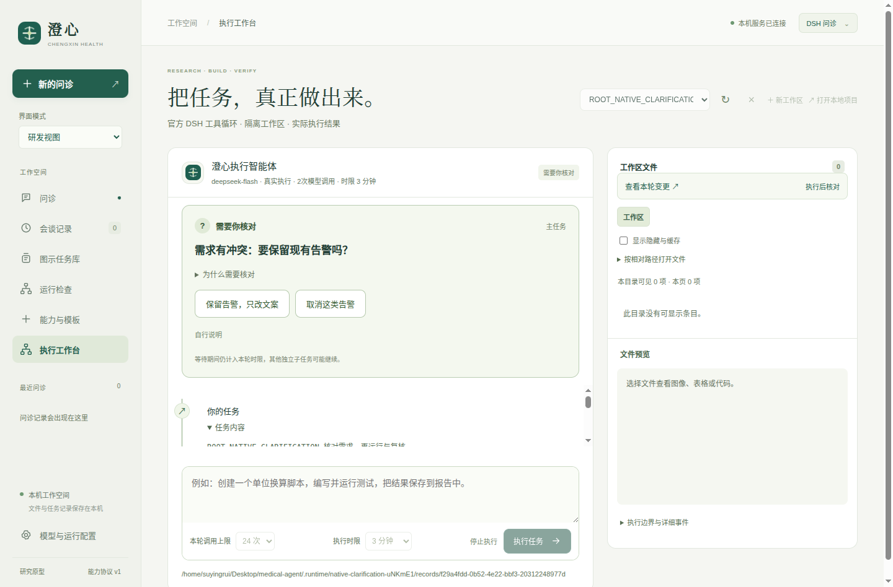

# 执行澄清与用户回答

实现版本：0.10.1。研发执行智能体新增 `request_clarification`，用于必要输入缺失、明确需求与现有行为／验收相冲突的场景。它不替代患者问诊控制器，也不要求每次命令执行都重新确认。

## 交互与执行

智能体先检查已有信息，确有关键不确定性时提出一个问题。卡片显示简短问题和两至三个互斥选项，也允许自由输入；没有预选或超时默认答案。选项点击即提交，自由回答另点“发送回答”。原因和历史回答折叠展示，输入始终按文字渲染。用户回答后原 SDK 工具调用返回，由原会话继续执行，不重新创建回合或文件基线。

单个智能体在该工具处等待，不为等待反复请求模型；工具标为非并行调用，同一智能体随后提交的工具需等待它结束。其他独立子任务仍可能继续。等待计入原 3／10／30 分钟预算，回答不会增加调用额度或延长时限。停止或到期同时使问题失效；旧回答不能成为后续新任务的输入动作。

每个问题最多 240 字符，原因最多 320，选项优先 8–20 字、硬上限 80，回答最多 2000。超过限制的请求明确指出字段及实际长度，不截断成可能改变含义的选项。每轮最多登记 8 个问题，每进程最多 64 个，同时等待最多 3 个；超过限制返回工具错误。

## 宿主记录与恢复

`execution-clarification/v1` 包含问题 ID、宿主回合、SDK 会话、问题与选项、创建和截止时间、状态及回答。主／子任务共用宿主登记通道，界面通过登记会话标识区分来源；这属于研发归属信息，不是对恶意同权限程序的身份认证。

状态为 `pending → submitted → answered`：用户回答先写入私有索引，再发送到工作进程；工作进程确认接收后才标为 answered。保存失败不发送，传输失败显示可重试，同一问题的相同回答可幂等重试。答案提交与任务最终正确是两项独立结果。

HTTP 回答接口只接受当前工作区的问题 ID、原回合 ID 和用户回答，复用桌面鉴权；不会从模型输出的 JSON 创建用户回答。发送前检查任务、目录身份和时限。停止、通信断开或到期标为 closed；重启时尚未完成的请求标为 interrupted，仅恢复历史，不自动重发用户回答或重放命令。近期最多保存 32 个问题，另受原 32 回合保留范围限制。

收到确认的回答作为真实用户文本来源保存。注册计算可以引用其中数值与原单位，回执的 `source_turn_id` 指向该回答的问题 ID，且保留原文引文；新进程恢复后也保留近期可用来源。输入仍未核对、质量仍未评价，结果不自动写入患者病例，不成为治疗授权。

此工具不能保证模型发现所有冲突，也不能撤销提问前已经发生的修改。其他子任务在等待期间可能写文件；用户需要长时间思考时应使用合适时限，超时后通过新任务重新说明需求。

## 验收与实际迭代

真实 SDK＋本机确定模型覆盖根任务和子任务等待、同回合接续、回答幂等、拒绝跨回合回答、保存失败不发送、停止与截止时间、后续同进程运行、未回答记录冷恢复，以及使用回答执行注册换算。原生桌面另覆盖短选项、自由输入、HTML 纯文本、输入草稿不被轮询刷新清空、提交成功后响应丢失的恢复，以及关闭工作区清空旧卡。

本轮完整回归最初为 179 项全通过，含真实 185 秒检查；最后的反馈改动后常规回归为 178 项通过、1 项长时检查跳过，另有 5 项定向 SDK 检查和新进程继续引用旧回答的检查通过。21 组浏览器、源码与打包版各 11 组原生场景通过；最终源码澄清场景另复验。11 项桥接断言、格式、90 个包内源码及随附文件和 544 个适用生产依赖版本核对通过。

首轮 Python 定向测试误读既有计算回执字段；原生故障注入首轮使用绕过 Electron 请求层的转发，未完成预期提交。失败日志保留，修正测试后复验通过；生产代码没有增加测试路径开关。

真实 DeepSeek 使用带明确行为冲突的合成项目和预设合成用户回答，共 26 次请求：

| 轮次 | 请求 | 结果与边界 |
| --- | ---: | --- |
| 初版任务 | 12 | 完成；首次选项超过 80 字，工具拒绝两次后成功提问，源文件在实际提问时仍为原始内容，独立行为与测试通过 |
| 改进工具反馈 | 7 | 提问和修复完成，无超长重试；没有新增回归，独立验收失败。原任务未明确“必须新增”，此失败含任务／判定不一致，保留原报告 |
| 明确新增契约 | 7 | 明确要求至少一个 unittest 回归并执行，任务完成，原测试和需求文件未改，独立检查与离线恢复通过 |

改进包含按字段返回长度错误、强调短标签，以及提示当前验证环境可用 python3。最后一轮同时改变了任务契约，不能把请求数差异全归因于能力提升，也不能将这些已知合成任务当作整体 DSH 对照或临床验证。三份源码快照、请求与失败记录分别保留。



```bash
# 本机确定模型＋真实 SDK，不调用外部模型
RUN_DSH_EXECUTION=1 PYTHONPATH=src python3 -m unittest discover \
  -s tests -p test_execution_clarifications.py -v

# 原生界面
DISPLAY=:1 XAUTHORITY=/run/user/1000/gdm/Xauthority \
  npm run test:desktop -- --grep 'native clarification'

# 默认只显示任务；显式 --live 才读配置并调用模型
PYTHONPATH=src python3 scripts/evaluation/execution/evaluate_execution_clarifications.py \
  --output /tmp/unused-clarification.json
```

三轮原始报告、在线冻结源码、最终快照、正反检查与零模型请求重放脚本见 [v0.10.1 归档](evaluations/2026-10-16/v0.10.1/README.md)。
