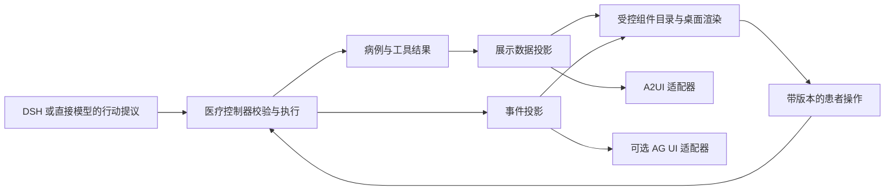

# 结构化界面项目调研与接入方案

调研日期：2026 年 10 月 15 日。适用版本：medical-agent v0.3。范围是患者桌面界面的结构化呈现、工具交互和插件展示，不调整临床规则或模型后端。

实施进展：v0.4 已完成第一阶段的自有受控组件和版本化展示投影，并补齐演示摘要确认。实现与限制见 [结构化展示协议与组件扩展](结构化展示协议与组件扩展.md)。下文官方 A2UI 渲染器、AG-UI 网络适配与插件宿主仍为后续计划。

建议保留当前 Electron、Python 控制器和已有界面，增加独立的展示数据层与组件目录；先采用受控组件，再通过适配器接入 A2UI。AG-UI 可以提供执行状态同步的设计参考，assistant-ui 可以提供工具卡片的交互参考。完整前端迁移和第三方界面插件应分别评估。

## 项目选择与结论

选择依据是官方协议与实现可检查、支持结构化交互、能够解释组件扩展方式，以及与现有桌面架构的关联。这是面向本项目的选型比较，不是产品排名，也不代表这些项目经过医疗用途验证。

| 项目 | 已核实的机制 | 对当前项目的适配判断 | 建议 |
| --- | --- | --- | --- |
| Google 发起的 A2UI | 使用组件目录、界面 surface、组件更新与数据模型更新描述界面，支持客户端操作回传 | 官方 Lit 实现可作为保留现有 DOM 界面的候选；协议版本与渲染器支持范围需要配对验证 | 优先做协议适配，再验证官方渲染器 |
| Vercel Labs json-render | Catalog 定义组件与动作，Registry 绑定平台实现，数据通过状态绑定进入组件 | 可直接借鉴目录和注册表划分；完整采用需要新增适配层、依赖和构建流程 | 先采用设计，按需要试接 core |
| assistant-ui | 将已知工具调用映射为 React 组件，展示参数、等待状态与结果 | 完整组件采用需要迁移或嵌入 React；现有医疗控制器仍须保留 | 借鉴工具卡片与会话交互，暂不整体替换 |
| AG-UI | 用运行、文本、工具调用、状态快照和增量事件连接智能体与前端 | 可在现有 Python 事件之外增加展示投影；不应直接广播全部内部事件 | 优先设计事件映射，跨客户端需求明确后接正式协议 |
| CopilotKit | 同时提供工具渲染、状态渲染、A2UI 与 MCP Apps 等接入方式 | 适合需要完整智能体应用基础设施的场景；当前采用范围应由前端迁移需求决定 | 借鉴受控组件路径，不与现有会话运行时重复建设 |
| MCP Apps | 工具关联预声明的 UI 资源，由宿主在沙箱 iframe 中加载并桥接通信 | 适合后续独立交互插件；当前服务 CSP 与插件体系尚不支持该宿主模型 | 后续建立独立插件宿主时采用 |
| NLM LHC-Forms | 用 FHIR Questionnaire 或自身 JSON 定义渲染表单，并提取用户答案 | 适合经审阅的量表和标准采集表；不能代替自适应问诊决策 | 未来通过专门的量表插件评估 |

机制依据分别见 [A2UI 协议](https://a2ui.org/specification/v0.9.1-a2ui/)、[json-render Catalog](https://json-render.dev/docs/catalog) 与 [Registry](https://json-render.dev/docs/registry)、[assistant-ui Tool UI](https://www.assistant-ui.com/docs/tools/tool-ui)、[AG-UI Events](https://docs.ag-ui.com/concepts/events)、[CopilotKit Generative UI](https://docs.copilotkit.ai/concepts/generative-ui-overview)、[MCP Apps Overview](https://apps.extensions.modelcontextprotocol.io/api/documents/overview.html)、[LHC-Forms](https://lhncbc.github.io/lforms/)。以下接入选择是结合本项目代码作出的工程判断。

## 最值得采用的机制

### 组件定义与组件实现分开

json-render 的 Catalog 描述允许出现的组件、参数与动作，Registry 将它们绑定到具体实现。目录定义与 React 等平台实现分离，动作通过应用提供的具名处理器执行。[官方说明](https://json-render.dev/docs/registry)

本项目已有 `capabilityRenderers`，但当前只注册 `calculation` 和 `step_task`；未知计算渲染类型会被忽略。可以扩展为统一组件目录，要求每种类型提供参数契约、默认展示、错误回退和可访问名称。首批保留问题、自查、测量、计算、摘要等领域组件，避免先开放大量任意布局组合。

这比仅把 JSON 漂亮地显示出来更有价值：患者看到的是输入框、逐步任务和可更正的记录，开发者才查看原始参数。

### 界面结构与数据分开更新

A2UI v0.9.1 将 `createSurface`、`updateComponents`、`updateDataModel`、`deleteSurface` 分开；组件可以按 ID 引用其他组件，数据绑定指向数据模型。协议与传输方式分离，因此采用其展示协议不必更换 DSH，也不必引入 A2A。[官方协议](https://a2ui.org/specification/v0.9.1-a2ui/)

对自查组件而言，当前步骤、患者已填内容和任务结果应拥有稳定 ID。后台更新一条记录时，只更新相关数据；不能重新创建整个任务，导致步骤、输入或键盘焦点丢失。自查内容可以通过已打包的分步图示表达，准备、执行与反馈使用同一个组件。

A2UI 的目录限制减少任意代码生成的需求，但实际安全还取决于组件实现、资源访问、动作授权和数据流控制。首版只提供已审核的本地图片和具名动作，不直接启用通用外链、任意函数或整个病例的自动回传。

### 将执行状态作为界面数据

AG-UI 定义运行和工具调用事件，并提供全量状态快照与 JSON Patch 增量更新。前者帮助初始化或重新同步，后者传输后续变化。[事件说明](https://docs.ag-ui.com/concepts/events)

本项目可先建立独立的展示事件，表达“开始执行”“完成”“失败”“已取消”，并为每次执行提供稳定 ID。数据量很小时先使用整张卡片替换，比立即实现所有增量补丁更容易验证。之后需要多客户端和流式更新时，再增加 AG-UI 适配。

现有 `EventStore` 保存的内部事件不能直接作为患者流：其中可能包含模型输入输出、工具参数和调试信息。展示层只投影患者需要的状态与依据；该设计也不需要展示模型内部推理文本。

### 工具结果直接驱动交互组件

assistant-ui 的 Tool UI 将工具调用与专用组件对应起来。核对过的天气示例中，同一个工具调用先提供参数，随后补充结果；组件据此显示等待或完成内容，而非等待模型再写一段描述。[Tool UI 文档](https://www.assistant-ui.com/docs/tools/tool-ui)

对应到医疗计算，模型只提出调用，数值、公式和版本从实际执行结果进入组件。患者更正输入后，旧结果应标为失效，新执行另有 ID；不能仅修改界面上的数字。取消和迟到结果的处理仍需要后端支持，流式协议本身不会提供这一保证。

### 第三方交互插件拥有独立宿主边界

MCP Apps 将工具、UI 资源、宿主和 iframe 视图分开，通过桥接通信交付参数、结果和操作。资源使用 `ui://` 标识，宿主负责沙箱及 CSP 等约束；不支持 UI 的宿主可以降级提供工具结果。[官方架构](https://apps.extensions.modelcontextprotocol.io/api/documents/overview.html)

这适合未来独立的交互图表或专科工具。当前应用仍是进程内受信能力注册表，不能仅在清单增加 `ui` 地址就宣称支持 MCP Apps。现有页面 CSP 为 `default-src 'self'` 等限制，若接入，需要独立设计 iframe 来源、资源加载、消息验证、能力协商及权限桥接，而不是笼统放宽 CSP。视图沙箱也不能隔离 Python 插件的后端进程权限。

### 标准表单与自然问诊分别承载

LHC-Forms 支持基于 FHIR Questionnaire 等定义渲染表单、提取用户答案。[项目文档](https://lhncbc.github.io/lforms/)

适合后续把有明确评分和版本的量表作为受控任务嵌入。量表答案、量表计算结果和问诊事实应保留各自来源；不能把一个填写未知项的表单自动视为已确认病例。中国大陆落地时，还要单独验证内容适用性、中文表达和实际数据接口，FHIR 支持本身不代表已对接医院或医保。

## 对当前代码的具体映射

| 当前实现 | 可以保留的部分 | 建议增加的部分 |
| --- | --- | --- |
| `domain.py` 的 `AgentReply` | 问题、快捷操作、任务、摘要和动作 ID | 在展示层增加 `ui_schema_version` 与可选展示块，不将领域模型改成某个 UI 库的模型 |
| `extensions/registry.py` | 能力版本、输入输出检查、来源与待确认状态 | 能力结果到展示组件的显式映射与版本兼容检查 |
| `web/app.js` 的渲染函数 | 现有计算、自查与摘要组件 | 独立组件注册表、错误边界、未知类型回退，以及局部更新 |
| `events.py` 与会谈 API | 已有执行事件和会话关联 | 仅含必要字段的展示投影、运行 ID、序号、重连同步与取消语义 |
| Electron 桌面壳 | 独立窗口、本地服务与实例凭证 | 为新组件打包本地资源；不改变桌面交付形态 |

建议的执行链路：



展示块建议包含协议版本、组件类型、稳定 ID、会话与执行关联、修订号、状态、数据和允许操作。数值必须带单位、来源、确认状态和依赖记录。展示块只引用所需事实，不默认包含完整病例或密钥。

患者操作仍发送给医疗控制器，携带当前动作 ID、记录修订号与目标 ID；控制器验证后才更正事实或执行工具。前端双向绑定适合编辑草稿，不直接赋予其确认病例、修改工具结果或绕过风险规则的权限。

## A2UI 适配实验

独立实验脚本为 [verify_a2ui.py](../experiments/structured-ui/verify_a2ui.py)。它调用当前的 `calculate.units`，得到真实十进制结果，再转换成 A2UI v0.9.1 消息。没有接入模型或创建患者会话。

实验固定 A2UI 提交 `1657e70119eaa3b76c2a106ac60c7c4dcfe206e0`，并检查三份官方 JSON 文件的 SHA-256；校验过程只使用本地契约解析引用。官方 v0.9.1 文件仍使用部分 v0_9 的 canonical ID，实验按原文件注册引用，没有自行修改官方契约。

已完成的验证：

- 实际执行 `1.25 kg → 1250 g`，保留输入待确认、质量未评价及能力版本信息。
- 创建界面、定义组件、填充数据共三条消息通过官方协议与 Basic Catalog 校验。
- 检查组件 ID、子组件引用、surface 对应关系和文本绑定结果。
- 拒绝四种畸形消息：混入 v1.0、未知组件、额外可执行字段、错误绑定类型。
- 当前能力拒绝质量与体积混算，以及未知单位。

这证明现有工具结果可以适配到官方结构化展示协议。它没有验证官方 Lit 组件在 Electron 内的实际渲染、用户操作回传、无障碍表现或性能；本轮没有更换生产依赖，也没有更新桌面安装包。

复现需要 Python 开发环境中的 `jsonschema` 4.x；本机使用 4.17.3，脚本同时兼容新版 `referencing` 接口。该依赖未加入应用运行依赖。

```bash
PYTHONPATH=src python3 experiments/structured-ui/verify_a2ui.py \
  --download --output /tmp/medagent-a2ui-example.json
```

`--download` 仅下载固定提交的三份公开契约，保存到 `/tmp/medagent-a2ui-v091`，不发送任何问诊数据。缓存已存在时，去掉 `--download` 即可离线重复校验。

## 分阶段接入与验收

第一阶段将现有计算、自查和摘要提取为带契约的展示组件，补上未知类型与渲染失败回退。保留旧回复字段，通过适配层逐步切换。验收要覆盖错误组件不会导致整段会谈消失、患者文字按文本展示，以及局部更新不清空当前操作。

第二阶段增加一个仅使用合成数据的桌面实验入口，将本次 A2UI 消息交给固定版本的官方 Lit 渲染器。现有源码中的 `@a2ui/lit` 为 0.13.0，提供 `./v0_9` 入口；安装时还需检查实际发行包、核心包与协议版本组合。验收需要真实 Electron 截图、离线资源加载、组件错误处理、键盘操作及与原界面相同主题。[核对过的 package.json](https://github.com/a2ui-project/a2ui/blob/1657e70119eaa3b76c2a106ac60c7c4dcfe206e0/typescript/renderers/lit/package.json)

第三阶段补齐运行与取消状态、动作修订检查、幂等提交和重连同步，再考虑 AG-UI 正式适配。验证取消后的迟到结果不能写入、旧按钮操作被拒绝、断线后恢复同一个执行结果。只有实际事件支持时才显示进度，不以动画或模型叙述代替执行证据。

第四阶段在独立需求出现后引入量表插件或 MCP Apps 宿主。接入第三方 UI 前，分别评估视图隔离、后端权限、数据访问范围、发布版本和退出路径。

视觉验收应覆盖大字模式、文字对比度、键盘与屏幕阅读器、窄窗口、未知数据、加载失败与长内容。最后用合成情境观察目标用户是否理解下一步、能否正确完成自查与更正结果。协议校验和截图测试不能代替这项观察。

## 源码版本与许可证

下表提交是本次通过官方 GitHub 接口核对的源码快照；源码中的 package 版本不等于已验证可安装的发行包版本。

| 仓库 | 固定提交 | 许可与采用注意事项 |
| --- | --- | --- |
| [a2ui-project/a2ui](https://github.com/a2ui-project/a2ui/tree/1657e70119eaa3b76c2a106ac60c7c4dcfe206e0) | `1657e70119eaa3b76c2a106ac60c7c4dcfe206e0` | Apache-2.0；官网列 v0.9.1 为 Current、v1.0 为 Candidate，固定版本实验避免混用 |
| [ag-ui-protocol/ag-ui](https://github.com/ag-ui-protocol/ag-ui/tree/c2197d84ff935ad15661af1db472852648e27dfa) | `c2197d84ff935ad15661af1db472852648e27dfa` | 仓库主许可 MIT；具体集成模块仍核对各自许可 |
| [assistant-ui/assistant-ui](https://github.com/assistant-ui/assistant-ui/tree/cd5fd6c30447fde8c8efc4b86bd2d7fb66614b9d) | `cd5fd6c30447fde8c8efc4b86bd2d7fb66614b9d` | MIT；本地 UI 库与可选托管服务分别评估 |
| [vercel-labs/json-render](https://github.com/vercel-labs/json-render/tree/72568f990e5502c4d3115691facb8ca928a5c9fc) | `72568f990e5502c4d3115691facb8ca928a5c9fc` | Apache-2.0；核对的 core 源码版本为 0.21.1，依赖 Zod |
| [modelcontextprotocol/ext-apps](https://github.com/modelcontextprotocol/ext-apps/tree/82221c0c8ce7661efa6771c9d461511b1650495f) | `82221c0c8ce7661efa6771c9d461511b1650495f` | LICENSE 描述 MIT 向 Apache-2.0 迁移，文档另有 CC-BY-4.0 条款；不能仅根据仓库元数据标成单一 MIT |
| [LHNCBC/lforms](https://github.com/LHNCBC/lforms/tree/433f80008bfe5f3d03b08269a6dc83f5a5f3c226) | `433f80008bfe5f3d03b08269a6dc83f5a5f3c226` | 自有 BSD 基础条款，涉及 LOINC、UCUM 内容时另有许可条件；核对的源码版本为 44.1.0 |

许可依据见 [A2UI](https://github.com/a2ui-project/a2ui/blob/1657e70119eaa3b76c2a106ac60c7c4dcfe206e0/LICENSE)、[AG-UI](https://github.com/ag-ui-protocol/ag-ui/blob/c2197d84ff935ad15661af1db472852648e27dfa/LICENSE)、[assistant-ui](https://github.com/assistant-ui/assistant-ui/blob/cd5fd6c30447fde8c8efc4b86bd2d7fb66614b9d/LICENSE)、[json-render](https://github.com/vercel-labs/json-render/blob/72568f990e5502c4d3115691facb8ca928a5c9fc/LICENSE)、[MCP Apps](https://github.com/modelcontextprotocol/ext-apps/blob/82221c0c8ce7661efa6771c9d461511b1650495f/LICENSE)、[LHC-Forms](https://github.com/LHNCBC/lforms/blob/433f80008bfe5f3d03b08269a6dc83f5a5f3c226/LICENSE.md)。本轮实验只缓存公开契约用于校验，没有将上述项目代码或术语内容复制进应用。
