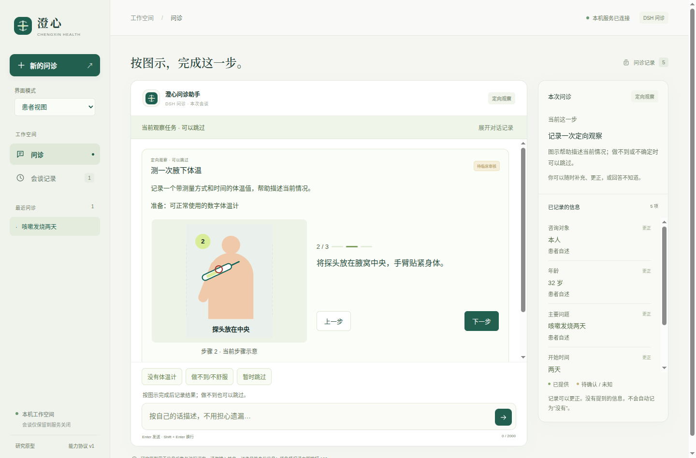
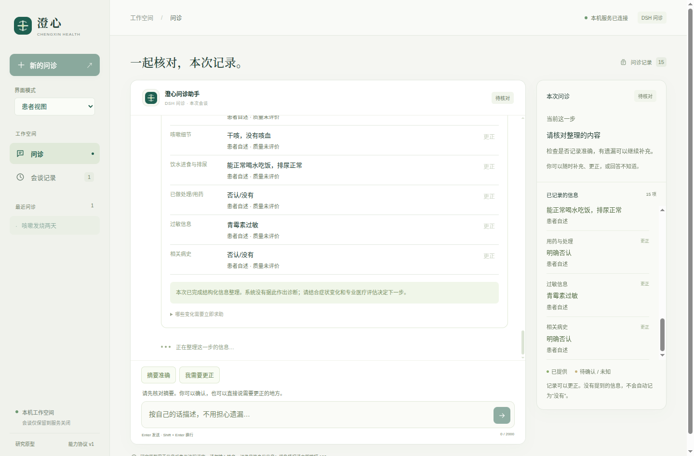
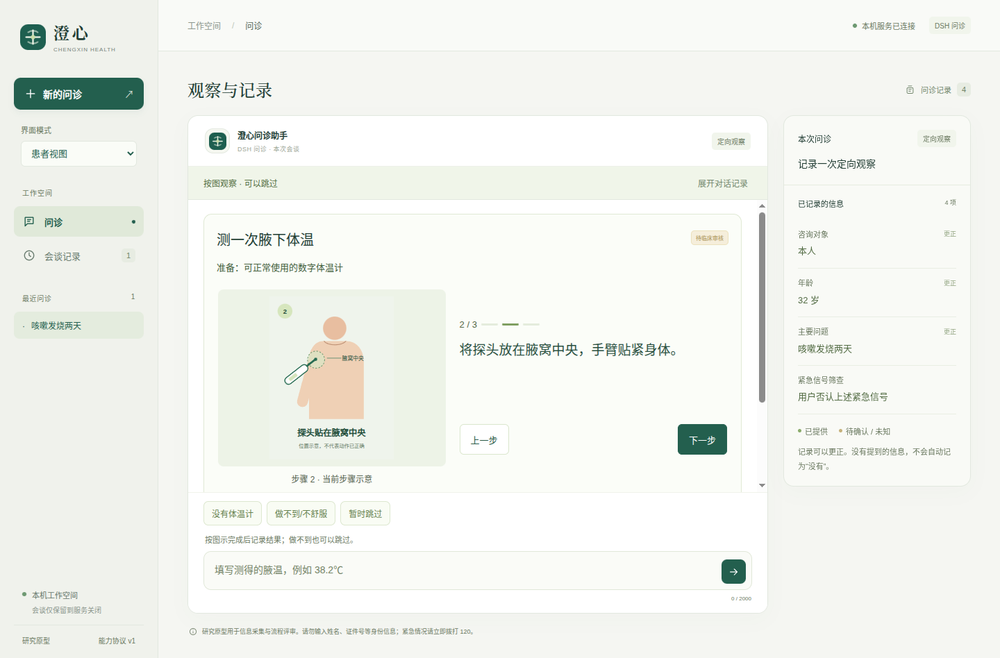
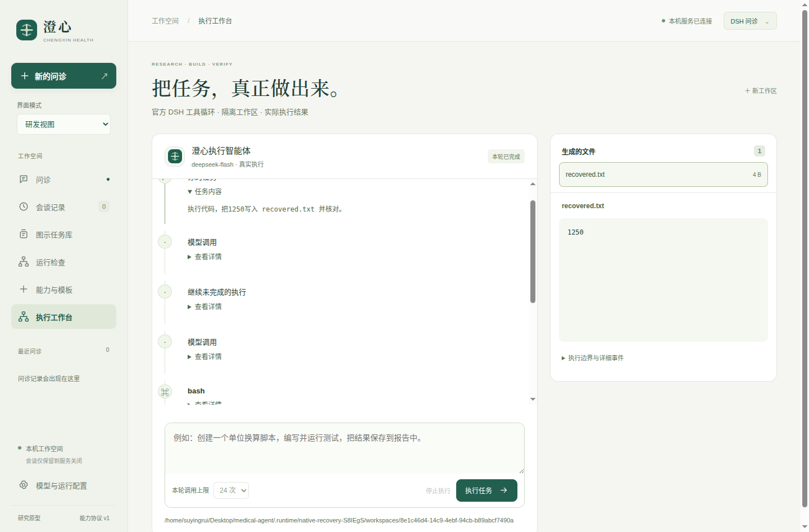

# 缓存优化与真实模型评测

日期：2026 年 10 月 15 日，Asia/Shanghai。本文记录 v0.5 历史评测、[v0.6 迭代](#v06-多轮状态与待办迭代)和 [v0.7 全流程验收](#v07-全流程验收与迭代)。使用用户配置的 DeepSeek 官方服务和 `deepseek-flash` 模型。所有输入均为项目内的合成病例。

v0.5 完成缓存布局调整、真实调用、失败分析、控制器修复和回归。当轮最终 DSH 的 12 个单场景及一个完整问诊全部通过预设工程检查；直接接口的九个单场景、一个完整问诊和三组额外措辞检查也全部通过。这是有限场景的工程结果，未经过医生审阅或真实患者研究，不能解释为临床准确率或医疗安全证明。

## 真实调用结果

| 最终评测 | 请求次数 | 工程场景 | 输入 token | 缓存命中率 | 单次调用中位耗时 |
| --- | ---: | ---: | ---: | ---: | ---: |
| 直接接口的主评测 | 48 | 10/10 通过 | 197,816 | 82.31% | 930 ms |
| DSH 的主评测 | 53 | 13/13 通过 | 267,925 | 80.69% | 1,218 ms |
| 直接接口的额外措辞 | 6 | 3/3 通过 | 22,778 | 84.29% | 1,174 ms |

依据为 [直接接口报告](evaluations/2026-10-15/20261015-07-final-compatible.json)、[DSH 报告](evaluations/2026-10-15/20261015-08-final-dsh.json)和[额外措辞报告](evaluations/2026-10-15/20261015-11-extra-compatible.json)。配置模型名为服务端别名，未冻结模型权重；两种后端的提示包装和传输不同，不能用此表判断框架能力优劣。

检查覆盖多事实提取、月龄换算、患者与咨询者归属、未知与否认、更正历史、真实单位换算、自查适用条件、提示注入和明确危险输入的独立路由。完整问诊明确请求图示测量，随后完成自查读数、来源和质量保留、未知项摘要及用户确认。DSH 完整流程共 14 次患者输入，25 次模型请求；其 38.2℃记录仍为患者报告、质量未评价。

DSH 的显式自查用例出现过一次提前调用提议，被控制器拒绝；模型随后完成必要筛查，再进入适用任务。这说明仍需执行边界，不能将场景通过解释为模型每一步提议均正确。

## 缓存对照

DeepSeek 默认提供上下文缓存，后续请求需要匹配已形成的前缀缓存单元；服务是尽力而为，不保证每次命中。API 用 `prompt_cache_hit_tokens` 和 `prompt_cache_miss_tokens` 返回实际用量。[官方缓存说明](https://api-docs.deepseek.com/zh-cn/guides/kv_cache/)

采用相同三个合成输入、同一模型、同一修订策略、相同输出上限，分别对旧布局与优化布局各进行一次规划请求，不执行规划出的工具。此对照控制请求数，不将不同长度的完整问诊混在一起比较。

| 指标 | 旧布局，3 次请求 | 优化布局，3 次请求 |
| --- | ---: | ---: |
| 输入 token | 9,967 | 10,324 |
| 命中输入 token | 4,224 | 9,600 |
| 未命中输入 token | 5,743 | 724 |
| 加权命中率 | 42.38% | 92.99% |
| 输出 token | 435 | 506 |
| 单次调用中位耗时 | 1,353 ms | 1,035 ms |

原始数据见 [旧布局探测](evaluations/2026-10-15/20261015-09-cache-probe-legacy.json)和[优化布局探测](evaluations/2026-10-15/20261015-10-cache-probe-optimized.json)。未命中输入减少约 87.4%；总输入增加约 3.6%，因此不能声称总输入 token 减少。这是顺序执行、已有其他请求预热的小样本观测，包含不同生成结果与服务端调度影响，不是冷缓存随机实验，也不保证相同比例的费用或延迟收益。

实际修改为：

- 工具定义、类型契约、问题目录和能力说明放入固定系统前缀，采用稳定的 JSON 排序与序列化；前缀不含患者、会话 ID、当前时间或随机工作目录。
- 患者事实、当前问题和最新输入放在后面；仅向模型发送决策所需的事实字段，完整来源和历史仍保留在病例及事件中。
- 图示资源和前端展示投影不重复进入模型上下文；候选问题引用固定目录，工具观察保留当前实际状态。
- 同一轮工具调用按追加消息推进，不改写已发送的前缀。模型仍依据当前病例重新决策。

## 真实失败与修复

首轮三个病例仅一个通过：模型把年龄写成字符串，或给 `unknown/absent` 填入非空值，导致原子批次被拒绝。保留原有校验，补充每个字段的值契约、数值和 null 示例；无效批次仍受总步骤上限约束，但不计入两次成功写入预算。

随后八个单场景通过，但完整问诊将“这些危险情况都没有”错误提议为阳性筛查。修复包括：固定筛查按钮由控制器解析记录；不确定表达不能写成阳性或阴性；否定引文不能支撑阳性确认；否认某一项或没有用药不能支撑整个筛查阴性。明确危险输入继续优先处理。

下一次完整问诊已能确认结束，但没有覆盖图示路径。由于图示是可选任务，之后为图示覆盖新增明确请求测量的病例，再验证完整路径。早期失败保留在 [首轮报告](evaluations/2026-10-15/20261015-01-pilot.json)、[首次完整流程报告](evaluations/2026-10-15/20261015-02-revised.json)和[后续完整流程报告](evaluations/2026-10-15/20261015-04-full-revised.json)。

旧布局的一次端到端试跑仅 1/3 通过，包含服务错误，调用次数与优化版不等，因此该次数据不作为等请求数缓存结论的依据。对照改用上面的独立探测，早期记录仍见 [旧布局试跑](evaluations/2026-10-15/20261015-05-layout-legacy.json)。

## 用量和数据处理

本轮 11 个评测文件累计 178 次规划请求，输入 807,779 token，输出 10,804 token，其中命中输入 634,112、未命中输入 173,667。数量包含开发迭代、失败和缓存探测，不代表运行 13 个新病例需要这么多请求。没有按未经核实的费率推算金额。

脚本设置单轮调用上限、单请求输出上限和目录累计调用上限；默认目录累计上限为 200。达到上限后停止继续请求。当前按顺序执行评测，目录累计机制不是跨进程并发配额系统。需要不同预算时可显式设置 `--max-total-calls`，不会自动提高额度。

密钥显式从 `.env` 读取，不执行 shell 语句、不进入模型消息或命令参数。报告只保存合成输入、病例记录、模型最终提议和允许的统计字段，写文件及归档前检查真实密钥未出现。报告不保存推理文本或请求头。`.env` 及其副本不进入桌面包，`.env.example` 保留为无密钥模板。

两种链路本轮均关闭思考模式，使用最多 2,048 输出 token；这有助于限定规划开销，但未评估开启思考模式的质量差异。DeepSeek 的思考开关及温度行为见 [官方文档](https://api-docs.deepseek.com/guides/thinking_mode/)。DSH 的固定版本将关闭思考表示为 `reasoningEffort: off`；其输入 token 与缓存 token 是互斥计数，归一化时合并为完整输入，避免重复计数。

## 复现与使用

直接接口和 DSH 使用同一个医疗控制器。脚本按 `.env` 中的后端配置运行；官方地址会按后端适配为 Chat Completions 或 `/anthropic`，不修改用户文件。

```bash
PYTHONPATH=src python3 scripts/evaluate_live.py \
  --cases all --full --max-calls 60 --max-total-calls 240 \
  --output .runtime/evaluations/new-run.json
```

输出路径必须是新文件，以保留已有证据。完整开发用例和附加措辞在脚本中公开定义；它们不是经过临床专家冻结的独立盲测集。报告提供策略、前缀、脚本和控制器摘要，便于核对当次配置。

上述复现命令显式将已有目录累计上限设为 240，因为本轮已使用 178 次。若只检查配置或运行本机回归测试，不会产生新的模型调用。评测时的[控制器](evaluations/2026-10-15/snapshots/agent-evaluated.py)、[脚本](evaluations/2026-10-15/snapshots/evaluate_live-evaluated.py)和[策略](evaluations/2026-10-15/snapshots/agent_prompt-evaluated.txt)快照已按最终 DSH 报告的摘要核对；快照用于审阅，执行时应使用项目正常路径。

缓存探测可添加 `--cache-probe --layout legacy` 或 `--layout optimized`，并把 `--cases` 限定为相同的三个 ID。探测不执行模型提议，不作为问诊质量评分。

真实模型桌面启动：

```bash
./scripts/start-desktop.sh --live
```

此入口显式读取项目根目录 `.env`，凭据只通过进程环境进入本地服务。打开窗口、读取配置和创建初始会谈不自动调用模型；提交患者描述后才产生调用。默认桌面图标继续使用离线演示。查看配置而不启动或调用：

```bash
PYTHONPATH=src python3 scripts/start_live_desktop.py --check
```

后续应由临床合作方审阅病例、标注必要信息及否定范围，并用独立病例和患者可用性观察评估。当前仍缺乏广泛临床覆盖、会话执行中断和生产数据保护；本轮合成测试不能替代这些工作。

## v0.6 多轮状态与待办迭代

本轮聚焦请求保留、事实更正和异常恢复，新增 **80 次真实 DSH 规划请求**，没有调用更多模型；与前轮累计为 258 次。全部使用合成病例。工程验收不将离线重放记作新的真实模型成功。

### 实际发现和修改

1. 更正年龄原先会删除体温，可能使已有风险线索丢失。现在保留同一患者的读数并按新年龄重评；原来源和质量不变。
2. 更正主诉原先只撤回部分观察，旧起病和用药仍可能保留。现在共用依赖规则；任务清单可声明 `invalidate_on`，症状定位依赖主诉，体温读数保留。更换已确认咨询对象需新建会谈。
3. 更正时残留活动任务、旧编辑覆盖新事实和病例/事件跨版本恢复。现在取消旧任务、在锁内校验原事实 ID，并原子读取会谈快照。
4. 第一轮真实评测发现：执行条件过滤后，模型会忘记患者先前明确提出的测温请求。新增 `request_self_check` 保存任务 ID、引文和来源轮次；条件未满足时等待，条件满足后控制器处理待办。登记本身不会执行自查。
5. 完整问诊遇到空回复；续测又因一次无效事实批次占用额外调用，在预设上限处停止。最后已明确回答期望与担心、全部适用字段均已处理且无待办时，由控制器直接通过摘要门生成待核对摘要，减少一次冗余模型决策。用户确认仍为结束条件。

### 原始证据

| 运行 | 新真实调用 | 结果与解释 |
| --- | ---: | --- |
| [状态回归](evaluations/2026-10-15/v0.6/20261015-v06-dsh-state-regression.json) | 54 | 9 个场景中 6 个通过；测温请求、带读数的年龄更正和完整问诊未通过，直接促成显式待办修改 |
| [待办修改后完整问诊](evaluations/2026-10-15/v0.6/20261015-v06-dsh-deferred-goal-final.json) | 22 | 待办、测温、年龄更正与读数保留通过；既往史阶段出现空回复，未完成摘要，整体未通过 |
| [失败前缀重放后真实续测](evaluations/2026-10-15/v0.6/20261015-v06-dsh-recovery.json) | 4 | 前 22 个决策离线重放；4 个新请求完成重试并写入余下事实，其中一次错误批次被拒绝；到达预算后未生成摘要，整体未通过 |
| [最终控制器离线重放](evaluations/2026-10-15/v0.6/20261015-v06-offline-recovery-verification.json) | **0** | 重放上述 26 个决策，包括空回复和无效批次；修复后的控制器完成重试、读数保留、摘要与用户确认，全部重放检查通过 |

本轮报告中已返回的用量合计为输入 429,924 token，其中缓存命中 340,864、未命中 89,060，输出 3,311。空回复没有返回完整用量；这些数值不能当作账单金额。没有重新做 v0.5 的缓存对照实验，因此不把跨版本命中比例归因于新架构。

**最终运行时代码尚未完成一次新的、从头到尾的真实在线复测。** 最后的摘要收尾修复使用已记录真实决策作离线回归，不能将其称为完整真实模型成功，也不将历史 v0.5 通过数作为 v0.6 的通过数。

人工检查还发现一条模型将“能正常活动”归入伴随症状的记录。引文存在、类型正确仍不能证明字段语义正确；当前自动检查没有完整覆盖这一类错误，需要由临床人员标注独立病例，评价字段归属和遗漏。

### 复现和下一步验收

```bash
# 零网络重放最终修复，默认只打印结果，不覆盖历史证据
PYTHONPATH=src python3 scripts/verify_recorded_recovery.py

# 本地回归，DSH 使用本机确定响应接口，不调用外部模型
RUN_DSH_INTEGRATION=1 PYTHONPATH=src python3 -m unittest discover -s tests -q
npm run test:ui
npm run test:desktop
```

最终工程回归为 94 项 Python 测试、13 组浏览器测试；独立桌面程序另有两组生命周期与交互检查。最终运行时和评测脚本保存在 [源码快照](evaluations/2026-10-15/v0.6/snapshot/)。真实报告记录运行时文件哈希；第一轮失败使用较早的运行时，不能用最终快照冒充该轮代码。离线验证报告记录修复后的文件哈希。

下一轮真实评测应事先规定新预算并保留原报告，先复测测温请求、带读数的年龄更正和完整问诊；随后使用独立病例覆盖否定请求、多对象、取消意图和字段语义。当前会谈锁不能抢占模型请求，尚无加密病例库和跨重启恢复；这些仍是进入真实患者试用前的工程与临床工作。

## v0.7 全流程验收与迭代

本轮新增 **155 次真实接口调用**，包含基线、失败分析和修复后复验；不再调用更多模型。最后累计上限为 180 次，多个报告共享同一目录并顺序运行。所有病例、截图和导出均为合成数据，没有使用真实患者资料。最终成功流程没有重放旧模型决策。

### 测试层次与实际结果

| 运行 | 真实调用 | 结果 | 说明 |
| --- | ---: | --- | --- |
| [v0.6 基线](evaluations/2026-10-15/v0.7/baseline.json) | 45 | 1/4 场景通过 | 复现儿童测温请求漏记；一次空回复；完整问诊因本轮分配的调用额度耗尽停止，并非临床结论失败 |
| [第一次修复后控制器](evaluations/2026-10-15/v0.7/final-controller.json) | 43 | 8/8 通过 | 包括单位换算、请求、婴儿年龄更正、任务中途更正、拒绝、重开、急症及全新完整问诊；这是中间代码版本 |
| [首次真实原生窗口](evaluations/2026-10-15/v0.7/native-live.json) | 26 | 2/3 流程通过 | 主问诊已确认，但年龄更正仍多调用模型，且测试等待浏览器下载事件超时；另外两项急症和故障重试通过 |
| [最终原生窗口](evaluations/2026-10-15/v0.7/native-live-final.json) | 26 | **3/3 通过** | 完整问诊、更正、原生文件写出、历史恢复；急症不请求模型；注入一次 503 后显式重试成功 |
| [最终定向接口](evaluations/2026-10-15/v0.7/final-focused.json) | 15 | **5/5 通过** | 未知/阴性措辞两组、带读数的婴儿年龄更正、拒绝与重开 |

最终原生和最终定向报告的 **41 个运行时文件哈希一致**，并与最终源码核对。中间版本的 8/8 不能与最终 5/5、3/3 合并成独立病例上的准确率。原始失败报告保留，未覆盖或删除。

第一次成功的全新控制器问诊包含 15 次患者交互、23 次模型请求，完成读数、年龄更正和摘要确认，没有重放或服务重试。最终原生主流程使用 24 次真实请求，另两次用于故障后的真实重试；本地注入的 503 不转发到模型、不计为真实调用。

### 发现的问题与最终修改

1. **明确请求仍会被漏记。** 内容包新增有限的 `request_phrases/cancel_phrases`，控制器保存匹配的请求及引文；模型仍可登记其他表达。任务的注册、适用性、急症前置条件和执行门保持独立。
2. **取消和重开缺乏确定状态。** 取消记录为未知且未执行，保留已有读数；明确重开撤回未执行的当前标记、保留历史，再等待任务条件。
3. **原文存在却不支持“未知”。** 原生轨迹里模型曾用“腋温38.25℃”把变化趋势记成未知。现在未知也需要患者明确的不确定表达；未提及的内容继续留作缺口。该守卫只处理有限词语，不能证明所有语义归属。
4. **更正打断了既有追问。** 活动问题增加追问标记。更正别的字段后保留未回答的追问；更正本主题则继续下一步。界面更正已确定性写入后，恢复任务、问题或摘要；没有待恢复问题时使用有限目录规划器，不重复交给模型提取。
5. **读数解析可能接受错误量纲。** 拒绝完整数值之外的年龄、时间、体重、血糖及明显异单位输入，例如 `38岁`、`38.2kg`、`38.2F`、`38.2%` 和 `发烧38天`。错误输入不写温度，也不消耗模型调用；允许重新填写或跳过。
6. **原生导出没有被实际验收。** 最初测试只等 Playwright 页面下载事件；Electron 需要监听主进程 `will-download/done`。现在在测试中预选合成文件路径，实际检查文件中的会谈 ID 和更正后的年龄。产品的导出功能未在此处改写。

### 最终原生窗口验证内容

完整流程依次经过自然开场、急症筛查、图示翻步、错误读数拒绝、实际读数 `38.25℃`、年龄从 32 更正到 40、病史与未知过敏、摘要、过敏更正、用户确认、文件导出和历史恢复。验收确认：

- 错误读数不写入结果且不请求模型；
- 更正年龄保留同一读数 ID，来源仍为患者自述、质量未评价；
- 年龄和摘要更正没有额外模型请求，前一个待回答问题继续保留；
- “喉咙痛”确实采集进伴随症状，未用活动能力替代；
- 摘要确认后关闭，导出 JSON 中包含正确的当前会谈和年龄；
- 回看历史不请求模型，没有渲染器异常；
- 急症路径没有模型请求事件；
- 注入服务故障后界面出现重试入口，重试复用原始输入，事实与未知保持正确。





第二张采集于摘要已渲染、仍在刷新本地运行事件的瞬间，所以可见短暂的忙碌提示。原生最终导出文件另存于 [合成会谈导出](evaluations/2026-10-15/v0.7/synthetic-session-export.json)。

### 复现、密钥与后续工作

工程回归为 **103 项 Python 检查、13 组浏览器检查、源码与打包版各 2 组桌面检查**。普通桌面检查也实际写出并读取了合成导出文件。原生真实接口另有一组自动化测试，内部包含上述三个独立流程；默认不会调用，须显式运行：

```bash
DISPLAY=:1 XAUTHORITY=/run/user/1000/gdm/Xauthority \
  npm run test:desktop:live -- --max-calls 40 --max-total-calls 180 \
  --output .runtime/evaluations/new-round/native-live.json
```

测试转发器仅监听随机本地端口，持有真实密钥，验证临时鉴权、限定请求路径并先预留调用额度。桌面与渲染器只收到测试用临时值；转发器的鉴权、上限、故障注入和密钥回显替换有本机单元测试。报告写入前检查真实密钥，默认关闭 trace；归档再次扫描。最终 [运行时与测试脚本快照](evaluations/2026-10-15/v0.7/snapshot/) 供文件哈希核对，包含运行时文件、测试入口和依赖锁。失败的中间版本仅保留对应哈希和原始轨迹，不能用最终快照冒充其源码。

本轮已完成工程全流程验收。仍需补充与开发脚本独立、由临床人员标注的病例，以及图示操作的真实用户研究。有限词语与类型守卫不能保证全部医疗语义正确；还缺少正在执行的模型回合抢占、加密病例存储、身份隔离和跨重启恢复。当前结果不支持宣称临床诊断准确率或已可向患者正式提供医疗服务。

## v0.8：可视化交互验收

本轮围绕患者注意力与交互，而非修改模型提示或临床规则。实现聚焦问题、大图形选项、趋势图、不适刻度、先选再确认的主观部位图、分步测温与分组摘要。多轮实际截图复查还修正了任务输入错误不可见、摘要自动滚底、部位选项重复、手机屏幕信号拥挤和桌面最小窗口输入区越界。

最终本地工程验收为 **105 项 Python 检查、19 组界面交互检查、源码与打包应用各 2 组原生桌面检查**。覆盖 1440×1080、390×844、900×680；检查键盘、无预设阴性、刻度草稿同步、部位确认与来源、实际更正、未知项、原生导出、急症提示、组件错误隔离与纯文本写入。格式检查通过。

实际 DSH 原生窗口另外执行了三个流程，全部通过；[原始报告](evaluations/2026-10-15/v0.8/native-live.json) 和 [合成导出](evaluations/2026-10-15/v0.8/synthetic-session-export.json) 保留完整轨迹：

| 流程 | 真实调用数 | 验收 |
| --- | ---: | --- |
| 全新完整问诊、图示、读数、年龄与摘要更正、确认、导出、历史恢复 | 27 | 通过；错误读数未记录、更正与历史无额外调用、自述质量保留 |
| 明确急症输入 | 0 | 通过；没有模型请求事件，立即显示求助 |
| 注入服务故障后重试 | 2 | 通过；重试复用原始输入，保留正确事实与未知 |

共 **29 次真实调用**，预设单轮上限 40；另一次本地注入的 503 不计为真实调用。使用既有授权的 DeepSeek 配置与合成病例，无真实患者输入。未新增模型训练、按压等查体动作或摄像头动作核验。



在线验收后，仅追加了不足 800 像素高的桌面窗口 CSS 适配；医疗控制器、提示、组件逻辑和模型测试脚本均未再修改。随后界面 19 组和最终打包应用原生检查使用最终布局。不能声称在线运行与最终全部源文件逐字相同。[在线快照](evaluations/2026-10-15/v0.8/snapshot-live/) 的 42 个运行时文件逐项匹配在线报告哈希；[最终快照](evaluations/2026-10-15/v0.8/snapshot-final/) 与 [差异记录](evaluations/2026-10-15/v0.8/verification.json) 保留这一个 CSS 差异。归档排除并扫描真实密钥。

这些证据支持界面交互和状态一致性的工程结论，不证明患者已能正确理解图示、完成真实操作，也不构成临床验证。下一步需要由临床人员审核图示，并让目标患者在不额外解释的情况下完成任务，观察理解错误、误选、放弃和遗漏。

## v0.9：完整执行底座与真实产物验收

2026 年 10 月 16 日新增官方完整 DSH `sdk` 执行工作台；医疗问诊仍使用受控协议。此次工程验收为 **111 项 Python 检查、19 组界面交互、源码与打包应用各 3 组原生检查**。新增原生流程实际验证代码和文件、前台子智能体、命令取消后同会话接续、主回合结束后的后台进程及后台子智能体。当前打包应用的 53 个运行时文件与最终协议检查快照逐项一致，生产依赖完整，未包含 `.env`、工作区、测试或评测资料。

真实 API 使用合成任务，共预留并发起 **174 次模型请求**，包括根任务、子智能体和辅助搜索。各轮报告和当时运行时快照均保留在 [v0.9 归档](evaluations/2026-10-16/v0.9/verification.json)：

| 轮次 | 请求数 | 实际结果与证据边界 |
| --- | ---: | --- |
| [最初实现](evaluations/2026-10-16/v0.9/initial/report.json) | 41 | 编码与搜索均未通过，保留失败轨迹 |
| [代理与预算修正](evaluations/2026-10-16/v0.9/proxy-and-budget/report.json) | 60 | 搜索通过；编码仍过度检查并耗尽预算 |
| [预算感知编码](evaluations/2026-10-16/v0.9/budget-aware-coding/report.json) | 14 | 当时的正常输入、实际子智能体复核及接续通过；后续扩展高精度检查失败，不能视为全面正确 |
| [预算感知检索](evaluations/2026-10-16/v0.9/budget-aware-search/report.json) | 5 | 实际搜索、打开官方文档与来源文件通过 |
| [高精度修复](evaluations/2026-10-16/v0.9/precision-repair/report.json) | 21 | 重现并修复上下文舍入问题；扩展检查、实际子智能体与接续通过 |
| [发布流程验证](evaluations/2026-10-16/v0.9/release-validation/report.json) | 30 | 高精度修复及接续、真实搜索全部通过，包含持续后台生命周期实现 |
| [最终协议检查](evaluations/2026-10-16/v0.9/final-protocol/report.json) | 3 | 最终代码真实创建、读取并核对 `ready.json`；已加入单次输出额度限制 |

本轮最重要的反例是：生成程序使用了 `Decimal`，现有测试和子智能体复核均通过，但超过默认 28 位有效数字仍被上下文舍入。保留 [扩展检查失败](evaluations/2026-10-16/v0.9/extra-precision-failure.json)；之后通过重现、修复、低精度调用方上下文及极小数的独立检查验证修复。这说明“调用公式”“程序成功”“另一智能体认可”都不能替代适用范围与独立数值验证。既有注册单位工具另有明确输入范围，不受这份自由生成脚本的缺陷影响。

发布流程验证后，最后四个运行时文件发生了修改：网关拒绝超额 `max_tokens` 请求，事件保留用量及实际模型信息，界面显示真实执行模型。随后 111 项后端检查包含超额请求拒绝，最终打包原生 3 组检查与 3 次真实协议调用验证最后版本。不能将前面的 30 次在线请求描述为逐字相同的最终代码验收。[最终快照](evaluations/2026-10-16/v0.9/final-protocol/snapshot/) 与各轮哈希供复核；早期评测脚本没有同时留存的部分明确标为 `evaluator-at-archive.py`，不冒充当时精确脚本。

构建测试另发现自动裁剪遗漏官方 DSH 的传递 peer 依赖。现改为按锁文件安装完整生产依赖，打包时保留它们；最终原生验收实际启动完整 DSH，而不是只打开离线界面。

上述验收不证明整体能力不劣于 DSH。还需要冻结任务、匹配环境和预算、独立 SDK 基线及重复配对比较；也未完成跨应用重启的会话恢复、任意项目目录导入或受审医疗工具到执行底座的整合。原型仍未通过临床验证。

## v0.9.1：独立 DSH 对照与截断恢复

新增独立官方 SDK 驱动，冻结单位项目修复、CSV 跨文件功能、金额计算与委托复核三组项目及接续任务。每条路径每项最多 24+8 次请求，检查器关闭候选运行时后独立执行。任务、源文件与隐藏检查在调用前快照，评测条件与限制见 [配对评测设计](执行能力对照评测.md)。

首轮有效对照使用修改前的 0.9.0 产品路径，合计 **110 次预留转发请求**，原始结果和对应快照见 [首轮报告](evaluations/2026-10-16/v0.9.1/paired-before/report.json)：

| 项目 | 产品 | 官方 SDK 基线 | 产品 / 基线请求数 |
| --- | --- | --- | ---: |
| 单位模块与 CLI 修复 | 未完成：产物通过隐藏检查，但额外复核耗尽预算 | 未完成：输出截断，产物不正确 | 26 / 7 |
| CSV 分组聚合与 CLI | 通过 | 通过 | 25 / 10 |
| 金额计算与独立子智能体 | 通过 | 未完成：观察期限结束，接续产物检查失败 | 21 / 21 |

产品为 2/3，基线为 1/3；每项只有一次运行，不能据此声称整体优于 DSH。此前启动驱动的相对路径问题导致一次无效对照中断，另有 **16 次保守预留**，见 [中断账本](evaluations/2026-10-16/v0.9.1/interrupted-baseline/initial-interruption.json)。中断或截止时尚未收到响应的请求仍计入额度，不能把所有预留次数说成已确认成功或已结算的模型请求。

据此实现 0.9.1：必要检查通过后及时收尾，按需委托且依赖结果时前台等待，减少重复检查和任务外长报告；明确的输出截断可在同一会话自动接续一次，继续消耗原调用额度和截止时间，不对服务错误盲目重试。已有本地测试先重现两项失败，修复后四项恢复测试全部通过。

0.9.1 通过 **119 项 Python 检查、19 组患者界面交互、源码与最终打包应用各 4 组原生检查**。新增原生组实际经历截断、自动接续、终端运行、文件写入和界面提示，并检查没有渲染器异常。当时冻结的 53 个运行时文件与在线评测和桌面包一致，密钥与工作区未进入交付包。[本版本核验记录](evaluations/2026-10-16/v0.9.1/verification.json) 保存源文件哈希和验收范围。



优化版每项两次的真实配对复测已经完成，沿用相同任务及检查哈希，全部主任务、子任务合计 **165 次预留转发请求**，低于预设 256 次上限。[完整报告、源文件与产物](evaluations/2026-10-16/v0.9.1/paired-after/report.json) 包含全部十二次运行，未剔除失败：

| 项目 | 产品两次结果 | SDK 基线两次结果 | 产品两次请求数 | 基线两次请求数 |
| --- | --- | --- | --- | --- |
| 单位模块与 CLI 修复 | 通过、通过 | 通过、未完成 | 16、16 | 13、4 |
| CSV 分组聚合与 CLI | 通过、通过 | 未完成、未完成 | 11、13 | 8、11 |
| 金额计算与独立复核 | 通过、通过 | 未完成、未完成 | 22、20 | 19、12 |

产品 **6/6**，SDK 基线 **1/6**；一个配对双方通过，五个配对仅产品通过。基线失败包含输出截断和观察期限结束；部分代码即使通过产物检查，回合未正常完成也仍判失败。产品共 98 次请求，两轮各 49 次；修改前单轮为 72 次且有未完成项。这是本轮观察，不是单独控制提示改动的因果结论。三个自建项目及其重复高度相关，没有独立设计者的广泛保留集；同约束 SDK 基线也不代表无限制默认 CLI，不能据此宣称整体超过 DSH。

此阶段包含无效中断对照 16 次、首轮 110 次、重复复测 165 次及下述恢复 5 次，共 **296 次保守预留转发**。未收到响应的中断请求计入上限，不据此推算实际结算费用。

### 真实提供商截断恢复

另一次真实 API 验收仅把首个上游请求的 `max_tokens` 改为 32，让提供商实际返回截断；后续请求恢复为运行时原有的 8192 上限。网关没有伪造或改写提供商的结束原因。智能体识别 `max-tokens` 后在同一会话自动接续一次，最终实际生成并运行脚本，保存并核对结果，总计 **5 次请求**，未超过原先 8 次预算。[真实报告](evaluations/2026-10-16/v0.9.1/real-recovery/report.json) 和精确的评测脚本均留存。

候选运行时关闭后，独立检查删除旧结果文件，在相同文件隔离中重新执行生成的脚本，核对标准输出和重新生成的 JSON，检查通过；见 [独立产物复核](evaluations/2026-10-16/v0.9.1/real-recovery/independent-artifacts.json)。请求变换的本地测试确认只有第一个已鉴权请求的额度改变，第二个请求不变，提供商响应内容原样返回。这个用例验证了真实提供商的截断协议与接续路径，不代表所有长任务或所有异常均能恢复。

## v0.9.2：文件边界与预览状态

继续检查发现，工作目录被外部移走、删除或替换时，根目录打开异常未被转换成可处理结果，可能导致状态/预览请求中断。另有旧文件预览请求延迟失败覆盖新工作区的情况。现保留原目录 fd 及 inode 身份，在列表、预览和新执行前核对；不可读取时返回结构化存储提示、禁止新执行并清除旧预览，仍允许停止已运行任务。原目录恢复后清除警告，不静默采用同名新文件夹。

界面把无法读取的文件数量显示为“—”，而不是暗示文件已变成零个。切换新工作区重置预览标题与内容，并丢弃旧请求的成功或错误返回；同一工作区快速切换文件也只采用最新一次选择的结果。这是当前进程内的文件状态处理；没有因此实现跨应用重启恢复、病例持久化或任意目录导入。

新增两项后端检查覆盖根目录缺失、符号链接、不同 inode 替换、恢复、执行前拒绝及关闭时 fd 回收。完整后端 **121 项**、患者界面 **19 组**、源码与最终打包版各 **4 组原生检查**通过。原生检查实际移走正在运行命令的工作目录，确认停止仍返回成功，恢复后同会话接续；另一流程检查目录警告、未知数量、恢复和旧预览延迟报错不污染新工作区。

当前版本另以 **3 次真实请求**验证正常工作区创建、实际写入和读取核对文件；[报告与版本核验](evaluations/2026-10-16/v0.9.2/verification.json) 保存范围及哈希。该在线检查后仅补充了文件数量未知状态与预览请求顺序的 UI 修正；后端与 DSH 循环保持一致，最终 UI 由原生交互验证。对应旧 UI 文件根据补丁反向重建并逐字匹配在线报告哈希，归档明确区分在线版本与最终版本。

v0.9.1 的六次配对成功和真实截断恢复属于其冻结版本的证据，不冒充整套测试已在 v0.9.2 重新在线运行；本次正常路径在线检查及完整本地回归用于验证新增的目录处理。仍不宣称已达到临床产品要求或全面不劣于 DSH。

## v0.9.3：原会话冷恢复与离线查看

新增宿主恢复索引、跨进程工作区锁、近期任务展示，以及复用官方 `agents.resume` 的 SDK 适配器。关闭应用后，通过工作区选择器恢复；没有密钥时只查看本机文件和记录，配置原模型服务及当前凭据后再执行。没有将“重新列出旧文件”当作模型上下文恢复。设计、记录范围和旧版本边界见 [工作区恢复与存储](执行工作区恢复与存储.md)。

真实 DeepSeek 验收 **6 次请求**，原任务 3 次、重启后接续 3 次，全部上游返回成功。宿主关闭旧运行进程，再建立新管理器和新运行进程；中间无凭据读取历史没有模型请求。接续指令没有重新提供原会话的随机项目代号，评测网关在转发新进程首次模型请求前，确认消息中已经包含原代号；续跑保存了正确代号与计算结果。最后关闭候选运行时，独立重新执行生成代码并重建结果，也通过。[真实报告与源码快照](evaluations/2026-10-16/v0.9.3/real-cold-resume/report.json) 保留完整检查。

最终通过 **130 项后端、19 组患者界面、源码与打包版各 5 组原生桌面检查**。新增原生流程实际打开两个独立窗口，确认第二个不能接管占用中的工作区；原窗口关闭后，无凭据启动、选择历史、查看旧文件，再通过图形界面输入新凭据并接续原会话。打开、关闭、查看与配置阶段均检查没有额外模型调用。

迭代中保留了构造器不支持已有目录的失败、测试进程意外继承旧环境凭据的失败，以及侧栏提示接入时错误 DOM 选择器导致的导航回归。后者触发 7 组界面失败和 4 组原生失败，修正后完整重跑通过；没有删除或放宽原有断言。部分中间 trace 因测试产物目录重叠未保留，归档明确标明，不冒充完整原始快照。[迭代摘要和核验记录](evaluations/2026-10-16/v0.9.3/verification.json) 区分这些失败与最终证据。

真实调用后增加了错误配置下仍可离线查看的保护，并完善页脚存储提示与按钮尺寸；最终运行时与在线冻结版有 4 个文件差异，分别归档并列出哈希。DSH 恢复适配器和模型循环在这段差异中未改变，最终图形行为由完整原生检查验证。不声称在线运行与最终每个字节完全相同。

执行索引不保存配置密钥，已知配置密钥在标题/文本截断前脱敏；任务记录仍是本机明文研究资料。患者病例持久化、旧版本自动导入、任意项目目录导入和受控医疗工具接入尚未完成；本轮不替代临床审核，也没有重新证明整体能力不劣于 DSH。

## v0.9.4：注册计算、错误修正与视觉回执

完整 DSH 新增 `medical_capabilities` 和 `medical_calculate`，主任务与子任务实际调用同一宿主注册实现。新工作区固定模板、启用项、注册表和实现摘要；清单/代码变化拒绝冒用旧版本。参数类型、用户原文的数值与原单位均核对，量纲不匹配返回真实错误。当前仅开放单位换算，不包含临床公式或第三方插件安装。设计与扩展要求见 [注册计算工具与执行回执](注册计算工具与执行回执.md)。

两轮真实 DeepSeek 分别 **9 次、10 次请求，合计 19 次**，均通过：先实际尝试质量到体积并收到拒绝，再改为正确质量换算；子智能体执行体积换算；旧进程关闭后无凭据查看回执，新进程从原模型上下文与旧用户输入继续计算；独立新工作区缺参数时没有生成虚构成功回执。成功结果保持输入待核对和质量未评价，也没有执行临时脚本替代注册计算。[第一轮](evaluations/2026-10-16/v0.9.4/first/report.json) 与 [修复后第二轮](evaluations/2026-10-16/v0.9.4/second/report.json) 均保留请求账本、冻结源码和评测器。

第一轮常规算例通过后，额外反例检查发现 `1 000kg` 和 `1e 3kg` 可被截取为较小数字片段。已保留 [原始反例与修复说明](evaluations/2026-10-16/v0.9.4/local-iteration-failures.json)，收紧完整原文的数字前缀核对，加入空格分组、间隔指数、间隔小数点和全角逗号反例，再进行第二轮在线验收。没有把第一轮成功当作所有输入格式均可靠。

最终 **138 项后端、19 组患者界面、源码与打包版各 6 组原生检查**通过，另有 2 项 DSH 适配测试和格式检查。新增原生检查实际渲染 `1250 g`、输入、公式、原文出处与版本，确认模型回复和 JSON 文件中的 `9999 g` 不会渲染为宿主计算卡片，关闭应用后仍能无模型调用查看旧回执。源码与打包测试串行执行，避免覆盖失败产物。患者界面代码在后续数字解析修复中未变；最终后端及两种原生运行均重新检查。

第二轮真实调用、最终源码与独立桌面包的 **57 个运行时文件逐字哈希相符**；索引、工作区、密钥与评测资料未进入包。[核验清单](evaluations/2026-10-16/v0.9.4/verification.json) 保存具体版本与验证范围。该结果证明本轮注册计算路径的工程行为，不能证明测量准确、医疗有效或整体能力已不低于 DSH。

## v0.9.5：患者输入核对与原问诊衔接

患者端旧计算调用只校验参数类型，仍能接受模型直接填写的数值。本轮改为“明确请求 → 可编辑输入卡 → 用户核对后计算 → 查看结果 → 继续原问题”。数值与原单位预填需与请求原文对应，缺失参数保持空白。计算、错误回显与恢复此前问题由控制器处理，输入确认不升级实际测量质量，不写临床事实。研究执行工作台继续使用自己的注册计算协议。细节与截图见 [患者计算交互](患者计算输入与问诊衔接.md)。

两轮真实 API 均运行在**实际 v0.9.5 原生桌面包**，共 **6 次请求**，没有用界面模拟结果代替实际工具执行。第一轮 3 次请求：修改参数后算出 2000 g，并恢复原问题；随后缺参数请求绕回了咨询对象，整轮判为失败。原驱动未保存该失败步骤的模型轨迹，保留了失败屏幕和请求账本，不声称已精确定位它第一次返回的工具错误。[首轮报告](evaluations/2026-10-16/v0.9.5/first/report.json) 保留此缺口。

检查发现模型看到的是完整执行输入契约，与允许缺字段的提议语义冲突。现分别提供可缺字段的 `proposal_input_schema` 与完整的 `execution_input_schema`，显式未知参数按缺失处理，并补充空输入卡的协议示例。修复后第二轮 **3 次请求**通过正常换算、缺参数补齐、试图跳过核对和紧急信号优先四个场景；每步响应与事件均保留。核对计算、返回原问题及紧急信号处理没有新增模型请求。[第二轮实际报告](evaluations/2026-10-16/v0.9.5/second/report.json) 给出逐项结果。

最终通过 **150 项后端、21 组患者界面、源码与打包版各 7 组原生检查**及格式检查。新增检查覆盖修改初始数值、跨量纲失败后保留编辑、旧提议与重复确认拒绝、病例更正使旧卡失效、紧急输入绕过过期卡、原有澄清措辞恢复，以及服务已计算但可用响应丢失后的同快照恢复。手机检查确认没有横向溢出，确认按钮完整位于主交互可见区域。

本地迭代还捕获了单位数组在错误回显分支触发 TypeError、选择框可访问名称包含选项文本、故障注入重发绕开桌面鉴权后被正确拒绝，以及启动模式切换早于监听器绑定的竞态。后者通过初始禁用模式控件及延迟模块加载检查处理，没有靠拉长超时或去掉断言通过。旧“模型提议后立即计算”的两项集成断言迁移为完整核对流程，保留原多事实、实际结果和紧急绕过检查。[失败与修复记录](evaluations/2026-10-16/v0.9.5/local-iteration-failures.json) 区分产品问题、测试工具问题和协议迁移。

第二轮在线验收、最终源码与打包版的 **60 个运行时文件**逐字一致，这次明确包含临床提示文件。原提议/执行契约也同步到旧布局评测器，避免当前目录与缓存对照目录不一致；未因此声称重新完成了缓存性能对照。[核验清单](evaluations/2026-10-16/v0.9.5/verification.json) 保存版本、测试日志与范围。患者病例依旧只在服务内存，当前仅开放单位换算，尚无临床有效性或全面 DSH 能力对照结论。
