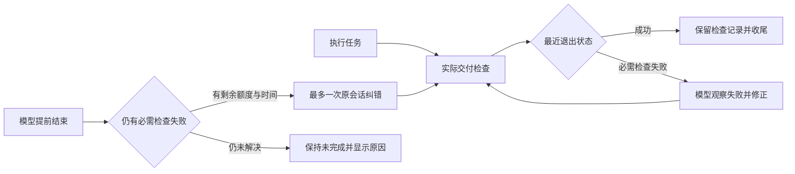
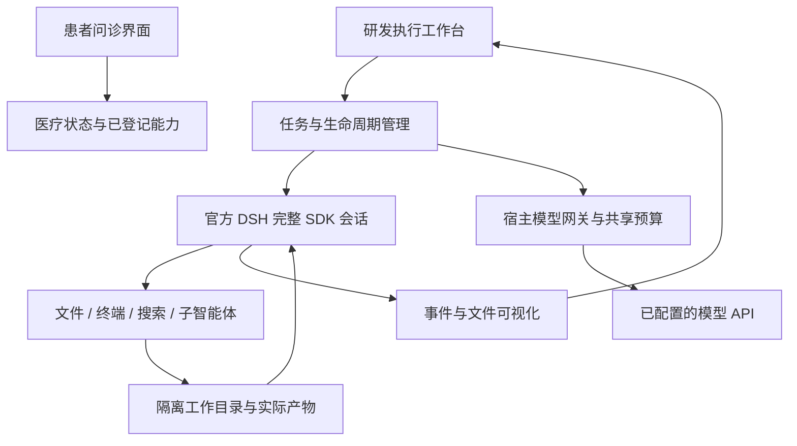
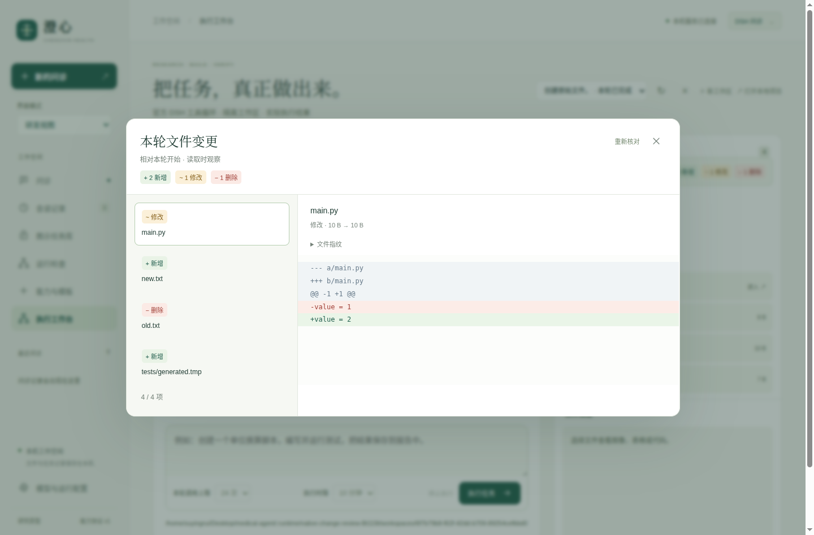

# 通用执行底座与能力评测设计

## v0.10.6 参数接受边界、长检查与范围语义

`execution-delivery-contract.mjs` 供工具与完成门共用。只有通过类型、字段、数值区间和路径校验的调用才登记验收；被拒绝而未执行的提议保留错误详情，允许改正参数或调用形式。有效调用未取得预算归属或结果仍是未知；不能靠无效重试、参考标记或无关成功清除已经接受的失败。完成门区分接受的调用和仅提出的调用，不把自然语言需求自动视为已验证。

`delivery_check.timeout_ms` 现支持100至1,800,000毫秒，默认60,000；实际取参数与原任务剩余时间的较小者。后台作业保持同一ID，每段 `job_output` 等待至多600秒，运行中继续读取同一作业；不重新启动命令、不增加模型请求、不重置任务截止时间。超时和取消仍回收作业。工具服务时限容纳最长合法检查及回收开销，不再在旧135秒处截断。142秒实际检查已跨越旧上限；跨600秒路径另有实测与记录，不能用短命令替代长时边界证据。

范围中的 `.` 或普通父目录保留默认缓存排除规则，因此不能在合并时吞掉 `node_modules/pkg` 等显式监控项；显式项只观察所选子树，不隐式展开整个依赖目录。覆盖判断使用同样规则，不能将默认根范围冒充已覆盖显式缓存输入。默认读取仍不跟随链接；链接与扫描上限的未知行为保留。

路径以Unicode标量顺序规范化，Node以UTF-8字节排序、Python以码点排序，避免全角与补充字符组合造成合法摘要被拒绝。内容与目录身份核对、普通命令退出状态和临床回执边界均保持独立。

这些修正来自[新增公开任务对照](新增公开任务对照设计.md)与本地反例。旧版313次请求及原始评分保持冻结，不能把新版局部修复当作旧对照重新通过。新版本的验证范围见[0.10.6验收](evaluations/2026-10-17/v0.10.6/README.md)。

## v0.10.5 检查结果与文件版本关联

`delivery_check` 在命令实际退出 0 后，通过宿主只读辅助进程计算文件摘要；交付前再次观察，同范围文件变化则标记“需复验”，原命令重新执行并核对当前版本后解除。缺失或不完整的摘要保持未知，旧退出 0 不自动成为交付证据；实际进程退出状态仍完整保留。

可用 `watch: ["src", "tests", "pyproject.toml"]` 明确检查输入。默认 `["."]` 观察工作区内文件，排除 `.git`、`node_modules`、Python 与常见检查缓存；显式指定这些目录内的路径时会观察所指定内容。原样命令的范围只可扩展，不可缩小。无关报告位于显式范围外时不导致重复检查；范围选择仍需覆盖真正依赖，模型声明本身不证明覆盖充分。

宿主核对目录设备／inode 身份，以目录 fd 和不跟随链接的方式读取，检查单个文件读取前后的身份、大小与时间，并计算内容 SHA256。摘要包含路径、类型、权限、长度与内容，不返回源码文本。默认扫描最多 20,000 文件、256MB 总内容、单文件32MB，另有深度、元数据和5秒进程时限；超限或不可读取时没有成功摘要。目录内链接仅记录链接目标文本摘要，不读取目标内容；显式将链接当作输入时保持未知。空目录不是文件证据，外部运行环境也不在这个摘要内。

这是检查结束与交付前的有界文件观察，不是原子文件系统快照，不能证明检查运行期间没有并发写入，也不证明测试收集数量、断言预期、需求覆盖或临床有效性。背景写入仍应等待或停止；根任务不为未来子任务结果背书。仅检查并报告的参考项也显示过期状态，不触发自动修改。

桌面沿用紧凑检查标记：文件版本变化显示“需复验”，摘要不可用显示“版本未核对”，复验成功再显示退出0；点击查看实际输出，范围在悬停说明中可查。研发原生验收保存45／46号截图。工程结果与真实模型定向验证见本轮归档；没有覆盖旧对照结果或宣称整体超过DSH。

## v0.10.4 显式交付检查与预算内纠错

新增 DSH 原生工具 `delivery_check`，把声明的交付检查纳入实际执行反馈。示例参数：

```json
{"label":"新增测试","command":"python3 -m unittest tests.test_new -v","required":true,"timeout_ms":60000}
```

工具复用官方 Bash、后台任务及 job_output；命令仍在当前工作区隔离环境运行。超时上限 120 秒，同时受原任务剩余时间约束；超时和用户取消都回收该检查拥有的进程。返回的 `execution-delivery/v1` 来自真实 SDK 作业状态，包含命令 SHA256、名称、用户回合、退出码及有限输出，不从程序打印推断成功。

`required` 默认 true。用户只要求检查并报告时使用 false，失败照常记录，不自动扩展为修改。相同用户回合中，同一原样命令的必需声明只能保留；并发子任务较迟返回的参考记录也不能将其降级。复验原样重用命令，新的无关成功命令不会清除先前未解决项。主、子任务检查使用同一工作区和原共享预算。



控制器分别记录规范工具调用中的必需声明与实际返回状态，按用户回合、原样命令及实际调用身份关联。工具未能取得归属或执行结果时，声明仍为未知，不能因回执缺失而视为通过；同命令取得更新的真实成功回执后可以解除，新重试缺失结果时不能借用旧的成功。同一智能体使用事件顺序，跨智能体使用规范事件时间；同毫秒或时间未知而无法确定先后时保留未知，可再次复验解除。根任务声称完成时，有至少 2 次剩余调用且超过 15 秒，最多接续一次纠错；原调用总额、进程累计额、截止时间、工作区和会话保持累计。纠错后仍未解决，或无余量时，保持未完成。后台子任务未来才会提出的检查不在当前声明集合内，继续由既有后台状态展示；这里不宣称根回复覆盖所有仍在运行的子任务。

`execution-observation/v1` 为 delivery_check 增加可选的 `check_key/check_label/check_turn_id/check_required`；宿主校验归属、类型和摘要，旧 Bash/job_output 记录继续可读。桌面只显示简短状态标记，点击定位输出；无数据变化时不重建按钮，保留键盘焦点；同命令复验成功后，可查看先前失败。冷恢复直接显示已保存观察，不重放命令或调用模型。

状态表示检查最近一次实际运行。它没有自动发现所有新增测试，没有证明测试预期或覆盖充分，也未自动核对后续每次文件变化使旧成功失效；修改后仍应复验。普通 Bash 不自动成为必需交付门；通用命令退出 0 不等于确有测试执行。确定数量与最小编辑约束由本轮独立验收器另行核对。这些研究执行记录不是医疗计算受信回执，不写入患者事实。

工程回归执行 207 项后端检查，包含实际 185 秒任务；24 组患者界面和源码版 14 组原生检查通过。并发声明、请求开始计数等最后修正另有定向及原生复验；最终打包和逐项记录见 [0.10.4 归档](evaluations/2026-10-16/v0.10.4/README.md)。三个真实 DeepSeek 场景共 14 次请求：错误数学预期修正、版本 API 参数修正、仅检查不修改。前两项分别观察退出 1→0，后一项保留退出 1，原文件未改。提示包含明确流程与最小编辑契约，属于工程符合性验收，未证明宽泛效率或编码优势。削弱断言后命令退出 0 的负对照仍被独立契约拒绝。

## v0.10.2 绘图运行环境与公开 TEST 对照

本轮补充只读挂载 `/etc/matplotlibrc` 与 `/etc/fonts`。本机 Debian Matplotlib 的默认配置依赖前一个路径；系统字体解析依赖后一个目录。它们不属于用户私有字体或账户配置。真实 SDK 的已有执行链现实际验证 NumPy/SciPy、无字体配置错误、PNG 文件签名，以及报错后修复、子任务复核与原会话接续。患者渲染器没有因此自动获得图像诊断或任意 HTML 执行能力。

新增独立评测采用 SWE-bench Lite 官方 TEST 的全部 300 个 ID 排序后固定种子洗牌取前六题，没有按难度、仓库、依赖或成功率筛选和替换。任务覆盖四个仓库；这是公开历史数据，可能存在模型训练污染，不能称为未见保留集，也不是官方容器评分。源码、原始描述、全部 FAIL_TO_PASS 和 PASS_TO_PASS 保留。详细方法与结果见 [公开 TEST 随机样本对照](公开TEST随机样本对照.md)。

设计日期：2026 年 10 月 16 日。实现目标版本：0.9。当前采用固定官方 DSH 0.2.0-rc.2；下文将实现、验收与尚未证明的目标分开记录，不以“使用了 DSH”替代能力评测。

## 1. 目标与结构

把现有固定医疗工具循环扩展为能操作环境的系统：读写文件、编写和运行代码、联网检索、委托子智能体、检查结果、修复错误和继续工作。保留患者聚焦界面及现有问诊状态规则。医疗公式的输入、单位、适用条件与来源仍需核对，程序执行成功不自动构成医疗结论。



问诊引擎仍通过原来的 JSON 决策协议操作已登记医疗工具。执行工作台使用官方完整 `sdk` profile，直接继承其真实工具循环、文件工具、终端、任务、搜索、子智能体和上下文管理。没有重写另一套同名工具来假装实现 DSH 能力，也不修改上游依赖源码。

## 2. 执行能力与权限

每个工作区拥有持久文件夹和独立 DSH 运行资料。正常后续回合复用同一运行进程、会话和文件。创建工作区、打开页面或配置模型不自动发送模型请求；提交任务才开始执行。既有工作区固定创建时的模型设置。

执行运行在 Linux bubblewrap 文件命名空间：只读系统运行时、只读项目依赖与适配代码、可写 `/workspace`、该工作区自己的 `/state`、私有临时目录。项目源码目录、项目 `.env`、用户主目录以及其他工作区不挂载。`/proc` 对应私有 PID 命名空间。隔离不可用时启动失败，不回退到宿主无限制命令。

网络明确允许，未宣称提供网络命名空间隔离或完整资源配额。官方匿名网页获取只访问公开 HTTP(S) 地址并验证连接目的地；终端仍具备授权的网络能力。因此这不是多租户不可信代码托管服务。

真实提供商密钥只存在宿主进程。SDK 运行时接收可撤销的随机网关凭证；模型及子智能体共享同一调用预算，不能通过新建子智能体获得额外额度。网关限制请求路径、拒绝重定向、限制请求体和请求时间；提供商响应与事件流对真实密钥和临时凭证进行替换。宿主不把患者病例、桌面鉴权令牌或环境中的其他密钥传入执行环境。

当前执行 API 仅在独立桌面已有的随机令牌鉴权内开放，另检查 Origin。普通无鉴权开发服务器返回拒绝；切换“研发视图”本身不是鉴权。

显式配置且不含嵌入凭据的 HTTP(S) 系统代理会传入执行环境；本机模型网关始终绕过代理。网页提供商复用官方代理与公开目的地策略，不把代理环境中的虚拟 DNS 地址直接当成公开 IP 放行。含凭据的代理配置不直接传给模型环境。

## 3. 生命周期、取消与失败

状态为 `created → starting → running → completed / failed / cancelled`，取消期间为 `cancelling`。同一工作区同时仅允许一个新回合；重复提交返回冲突。当前每轮可选择 12、24、48 次调用，服务端允许范围为 1–64，单运行进程累计最多 200 次，单轮执行时间上限 180 秒。

官方 SDK 没有取消线协议。第一方 Cordis 适配器在私有 Unix socket 上调用官方 `Agent.cancel`、等待 Agent 空闲，并停止本运行时拥有的任务。正常取消保留 SDK 进程和会话；无法确认取消时关闭运行时以保证停止，而不假装仍可无损接续。控制接口不提供宿主命令或宿主文件访问能力。连接使用 fd 相对路径，避免用户长目录超过 Unix socket 路径上限。

只有实际 `turn/end` 的原因是完成，且存在最终回复，才显示本轮完成。服务错误、空回复、超时和预算耗尽均不得归类为完成。后台任务需单独展示运行状态，根 Agent 空闲不代表后台进程全部结束。关闭桌面或宿主管道断开时回收运行时和进程树。

每次模型决策可读取宿主网关给出的真实共享剩余预算与时间，避免子任务并行时无法掌握额度。普通执行采用官方默认推理配置，每次输出上限 8192 token。根回合返回后，后台子任务沿用仍受调用数和时间限制的预算租期，事件订阅持续有效；不会因为主回复先完成就切断子智能体的模型访问。后台结果单独呈现。

v0.9.1 对明确的 `max-tokens` 结束增加最多一次自动接续：剩余调用至少 2 次、进程累计余额至少 2 次、原截止时间剩余超过 15 秒且未取消时，使用同一官方会话继续原任务。调用计数、预算租期、截止时间和进程均不重置。第二次仍截断则报告失败；服务错误和额度耗尽不进入该恢复。界面显示“继续未完成的执行”，最终仍按真实完成状态判定。

v0.9.6 将前台等待与任务总时限分开：命令默认等待 10 秒，单次最多 30 秒；超过后由官方 job runtime 保留同一进程并返回任务 ID。`job_output` 默认等待 10 秒、最多 30 秒，等待结束时仍可继续读取同一任务，180 秒总时限与共享调用额度继续生效。用户仍可停止任务。第一方 `execution-shell.mjs` 继承固定官方 `SandboxBashExecutor`，为 Bash 命令默认启用 `pipefail`，使 `python ... | tail` 保留前面命令的非零退出码。它保留原有执行、后台任务、取消和文件隔离机制；嵌套 shell 与脚本内部自行处理的错误仍服从调用方语义。

覆盖配置使用“禁用原 `bash-sandbox`、插入派生执行器”，因为官方补丁机制会拒绝直接改变既有插件名称。`dsh:check` 现在同时展开医疗最小 profile 和完整 SDK profile，核对替换实例、等待配置及后台移交；真实集成检查另验证退出码 7 和请求等待 600 秒时实际约 30 秒后交还控制、同一后台进程继续完成产物。患者问诊保留原受控工具路径。

配对评测发现简单任务追加复核会耗尽额度，因此提示改为按需委托、通过必要检查后收尾，避免重复检查和未请求的长报告；工具能力与权限没有因此减少。这是待真实重复评测验证的行为优化，不以修改提示本身视为效果已证明。

## 4. 可视化与文件

执行工作台显示用户任务、实际工具调用和返回、子智能体启动与返回、当前状态、实际生成文件及 UTF-8 文本/代码预览。事件增量更新，查看已展开详情时不被轮询重建打断。纯文本与代码通过 `textContent` 展示；不执行模型 HTML、脚本或 SVG。

v0.9.6 按会话与调用 ID 合并工具调用和返回，一次调用对应一张可展开状态卡；调用次数集中在标题栏，原始模型请求仍留在详细事件中。前台非零退出与后台 `completed, exit code: N` 分别显示红色退出状态，移交或继续等待显示琥珀色时钟。输出过长时保留头尾，退出标记不会因只截取开头而消失。状态卡反映工具返回的执行状态，任务正确性仍由独立检查判定。

文件预览逐级使用目录 fd 和 `O_NOFOLLOW`，拒绝越界、符号链接和特殊文件，并限制大小。文件列表同样通过目录 fd 遍历，避免链接替换竞争造成宿主目录遍历；限制数量与深度。运行输出文件保留在本机。v0.9.3 的执行工作区新增宿主索引和官方 DSH 冷恢复：可以离线查看近期任务、关闭及重新打开工作区，匹配原配置后继续原模型会话。患者问诊仍保持原有内存状态方式。范围见 [执行工作区恢复与存储](执行工作区恢复与存储.md)。

v0.9.2 在会话存续期间保留根目录 fd，固定原目录 inode，避免移走或删除再创建后静默采用同名新目录。列表、预览和提交执行均检查目录身份。不可读取时状态接口仍返回可解析结果和存储提示，不影响停止入口；恢复原目录后清除提示。界面不以零替代未知文件数量，也不会把旧工作区延迟返回的预览错误写进新工作区。这不构成对具有同一操作系统用户权限的恶意进程的完整隔离保证。

桌面工作区默认位于桌面“澄心工作区”目录，可通过 `MEDAGENT_EXECUTION_ROOT` 指定。源码直接调用管理器时默认项目 `workspaces`，测试指定临时目录。打包排除工作区、密钥、病例日志和评测产物。

## 5. 插件与医疗能力接入

已有 `medical-capability/v1` 继续描述医疗计算和观察能力；通用执行底座复用 DSH 的 Cordis 插件组合。第一方执行覆盖配置、控制适配器与图形投影独立维护。第三方代码安装属于另外的信任与权限决策，不能仅通过一个任意 manifest 宣称已获得沙箱权限。

v0.9.4 已将注册单位换算接入完整 DSH 的 `medical_capabilities` / `medical_calculate`：固定能力与实现摘要，核对用户原文中的数值和原单位，返回公式、单位与待核对回执，并在原生界面渲染与保存。当前没有自动送入医疗状态控制器，后续临床公式需逐项审核。详见 [注册计算工具与执行回执](注册计算工具与执行回执.md)。自由编写的脚本持续标为研究产物。当前未把任意终端执行开放给患者问诊，也未自动将文件结果回写病例。

## 6. 验收门与 DSH 对照

| 目标 | 能证明的证据 |
| --- | --- |
| 文件与代码执行 | 实际文件内容、真实运行结果和独立隐藏输入检查 |
| 观察错误并修复 | 第一轮故意运行失败，后续请求确实包含错误，修复后实际运行成功 |
| 子智能体 | 官方 lineage 通知、独立子会话工具事件及实际复核产物 |
| 持续会话 | 同一进程、会话、已有文件用于后续回合 |
| 取消和接续 | 长进程被中止，后续副作用文件未出现，同会话再次执行成功 |
| 联网 | 真实搜索和打开网页的结果，来源可访问且确实来自工具返回 |
| 共享预算 | 主任务、辅助搜索、子任务共用额度，越限不再请求上游 |
| 文件隔离 | 命令无法读取未挂载的宿主密钥或写入宿主保护区域；路径/链接/特殊文件检查 |
| 问诊回归 | 原有患者流程、自查、未知、更正、摘要与急症门仍通过 |
| 桌面交付 | 实际打包应用运行上述交互，包含停止、文件预览和进程回收 |

与 DSH 的比较需固定同一版本、模型、提示、预算、任务、依赖和网络环境，重复运行文件编辑、调试、跨文件修改、搜索、委托和中断等任务；由独立检查器判定成功，并记录成本、耗时和失败。已有三个冻结项目各两次的同约束配对，产品 6/6、官方 SDK 基线 1/6。这些自建项目样本不足以代表整体能力；还需独立设计者的广泛保留集及大型项目等任务，不宣称“顶尖”“无错误”或全面不劣于 DSH。

已建立独立官方 SDK 驱动、冻结项目及隐藏产物检查，具体匹配条件、正反验证和统计边界见 [执行能力对照评测](执行能力对照评测.md)。完整执行底座的首批真实调用与失败修复见 [v0.9 验收记录](缓存优化与真实模型评测.md#v09完整执行底座与真实产物验收)。

现已补充四个真实公开仓库 DEV 任务、每个重复两次。严格判定产品 2/8、SDK 基线 1/8；恢复冻结测试、配置和依赖后的实现检查为 4/8、3/8，共 289 次请求。发现接口语义遗漏、修改受保护测试和执行收尾问题；当前可靠性不足，整体不劣于 DSH 仍未证明。该本机适配没有采用官方 SWE-bench harness，也不覆盖临床有效性。[逐项结果与原始证据](执行能力对照评测.md#5-公开仓库-dev-任务补充)。

## 7. 可复现命令

```bash
# 真实 DSH + 本地确定模型，无外部模型花费
npm run test:execution

# 原生桌面实际文件、子智能体、停止与接续
DISPLAY=:1 XAUTHORITY=/run/user/1000/gdm/Xauthority npm run test:desktop

# 真实 API，只使用合成任务；宿主读取 .env，报告拒绝写入密钥
PYTHONPATH=src python3 scripts/evaluate_execution.py \
  --max-total-calls 60 --output .runtime/evaluations/new-execution-round/report.json
```

真实评测应保留失败记录，不覆盖同一报告。代码检查在相同隔离策略下执行，不能把模型生成代码拿到持有密钥的宿主直接 import 来验证。网络失败不替换为虚构搜索结果。最终验收记录应补充实际通过项、源码哈希与尚未验证的范围。

## 8. v0.9.6 记录的缺口与本轮处理

1. 结构化工具反馈：0.9.7 已通过正式 `tools/result` 扩展点独立投影退出码、信号、后台任务 ID 与状态，并验证误导输出、后台非零退出、子会话及冷恢复。实现与边界见第 9 节。
2. 任务契约仍须与判定一致。明确“保护文件逐字不变”与“保留原断言但允许追加测试”的区别，声明允许的新文件、输入、产物及检查命令；若比较算法能力，两条路径应得到相同契约。保持旧报告原样，不能把消除任务歧义后的提升全部归因于模型能力。
3. 后台准备阶段已新增真实 SDK 检查。原记录推测 preparing 会产生 starting 作业状态；核对固定发行版源码后，该推测不成立，其准备阶段实际属于 running。0.9.7 验证准备中保留预算、结束唤醒、拒绝关闭与取消，不声称修复了一个已复现的 starting 生命周期缺陷。适配层对额外 starting 值的容忍属于边界补齐。

已知 DEV 任务可用于开发与故障定位；还需信息充分的独立保留任务、长期上下文与真实问诊质量评估。当前代码正确性样本不足以证明整体达到 DSH，临床与目标用户验证仍是单独的验收门。

## 9. v0.9.7 结构化运行观察

终端输出中的“[exit code: 7]”可以只是程序打印的字符串。0.9.7 使用官方 `tools/result` 钩子的规范 `result.value`，独立传递研发运行观察；原模型工具文本保持原样。前台 Bash 采用 `exitCode`、`signal`、`timedOut`、`aborted` 等字段；后台移交采用任务 ID。`job_output` 采用任务状态，且仅对 Bash 生产者解析其独立 `job.detail` 的退出码或信号，不扫描命令输出，也不将其他生产者的描述当作进程状态。

`execution-observation/v1` 保留运行 epoch、递增序号、SDK 会话/回合/步骤/调用标识、宿主任务归属和有限状态字段，不保存 stdout 副本。工作进程将 SDK 调用与观察关联后传给宿主；同一个调用与返回渲染为一张卡。重复的调用 ID 可通过不同 SDK 回合区分；未知结果显示状态未提供，不能猜测为成功。子会话沿用实际会话标识，不合并为主任务的同名调用。

控制 socket 保留最近 256 条观察，每页最多 64 条，工作进程按游标读取；观察被覆盖时发出缺失事件。宿主整批校验字段、类型、归属和标识，拒绝无效批次、去重并保存最多 128 条近期观察，且只保留仍存在的近期任务。旧 v1 索引未带观察字段时仍可读取；不会根据旧回复补造观察。冷恢复产生明确标记的已保存运行观察，不重放命令或自动请求模型。原始工具输出未因此全部进入宿主恢复索引。

主回复结束不等于所有命令正确。界面顶部另列“本轮出现 N 项运行异常”，可以定位首项详情；对同一后台进程的重复读取按任务 ID 去重。该提示记录本轮曾出现的异常，修复后仍保留过程证据，不将它等同于最终任务失败。没有运行观察时也不推断检查已通过。

后台准备、运行和停止均不得被宿主误当作已静止。固定 SDK 0.2.0-rc.2 的作业类型实际为 `running/stopping/completed/killed/failed`，其中进程准备也属于 running；适配层额外容忍 starting，但本轮没有声称固定 SDK 会发出该作业状态。真实 SDK 测试通过测试目录内的延迟执行器制造准备阶段，验证主回复完成后保留预算、后台结束自动唤醒、准备中拒绝关闭、取消后不生成迟到文件。生产代码没有增加测试开关，也没有修改上游依赖。

这些观察来自与智能体代码同一执行环境的 SDK，通过该环境内的控制 socket 传递，属于研发反馈，不是对抗同一用户权限恶意程序的证明或医疗受信回执。患者注册计算仍使用独立的宿主校验与回执通道；任意终端状态或 JSON 不会自动写入临床事实。

本地真实 SDK 验收包含实际失败、打印误导状态但退出零、子会话关联、跨回合及无凭据冷恢复。原生界面实际检查 0/7/9 的卡片、异常定位、长输出与离线恢复。真实 DeepSeek 定向实验使用相同合成任务，7 次请求全部 HTTP 200，11 项检查通过，69 个冻结运行与评测文件在结束时保持一致。这里只证明所测反馈链路，未重测宽泛编码能力，也不代表临床验证。

```bash
# 本地模型 + 真实 SDK；无付费调用
RUN_DSH_EXECUTION=1 PYTHONPATH=src python3 -m unittest \
  tests.test_execution_observations tests.test_execution.FullDshExecutionTests -v

# 只显示评测任务，不读取 .env 或请求模型
PYTHONPATH=src python3 scripts/evaluate_execution_observations.py \
  --output /tmp/unused-observations.json

# 显式真实模型；全新路径，单次12–32、父目录累计64次上限
PYTHONPATH=src python3 scripts/evaluate_execution_observations.py --live \
  --max-calls 24 --output .runtime/evaluations/observation-new/report.json
```


## 10. v0.9.8 数值运行时与明确任务契约

数值代码不仅依赖 Python 包，也依赖系统动态库的真实解析路径。原隔离环境未挂载 /etc/alternatives，系统 NumPy/SciPy 经该目录解析 BLAS/LAPACK 时失败。当前将该系统目录和 /etc/ld.so.cache 只读挂载；工作区与运行资料的写入边界保持原策略。真实 SDK 回归实际执行 SciPy 对 NumPy 单位矩阵的行列式，随后继续原有错误修复、子智能体和状态恢复，不仅检查配置中存在挂载字符串。此修复同样用于独立官方 SDK 对照。

宿主已有 NumPy/SciPy 与评测工作区自己的依赖分开：新增任务使用的 pandas/h5py 等 wheel 只解压在固定评测工作区，不因此成为产品默认全局依赖。项目仍仅验证当前 Linux x64 环境，未宣称支持任意主机或全部数值库。

新任务契约由 scripts/execution_task_contract.py 同一份目录、文件名和规则定义生成用户提示和判定，明确已有测试不能追加，新测试位于 regressions/test_*.py。原四题的旧提示哈希保持不变，新四题另立实验。具体任务、原始/参考预检、历史 Python 兼容、测试 ID 截断处理和比较边界见 [新增公开任务设计](执行能力对照评测.md#8-v098-明确契约与新增公开任务)。


## 11. v0.9.8 记录的后续验收

v0.9.8 工作区展示文件列表和代码预览，当时没有独立于 Git 的逐轮变更快照与差异工具。新实验中留下了可能来自上游 CLI 测试的 fixed-suffix 产物，说明仅靠提示要求核对文件还不够。下一步应让主任务和子任务查询本轮新增、修改、删除的实际文件，在界面中直接定位；自动清理必须区分原始文件与本轮临时产物，不能猜测后删除用户文件。

v0.9.8 每轮总时限固定 180 秒、可选调用量最多 48 次（API 上限 64），单工作进程累计最多 200 次。这适合受控研究任务，尚不足以证明长时间、大仓库任务能力。后续应提供显式可选的长任务预算并验证到期停止、后台任务、恢复和共享额度，保持默认额度可预期；独立 SDK 对照也须使用相同预算条件。

原 issue、现有接口与测试要求冲突时，应明确展示待核对需求。新的 SQL 实验显示，猜测维护目标或扩大既有行为都会影响验收；一组已知任务的需求澄清复核不能替代更广泛的真实任务质量与临床验证。


前述文件差异与显式长预算已在 v0.9.9 实现，见下一节；需求冲突核对和广泛能力验证仍待完成。

## 12. v0.9.9 文件变更与长任务预算

研发执行底座保留官方 DSH 的文件、Bash、联网和主／子任务循环。新增的观察工具不会开放患者病例写入，也不把生成代码或差异视为医疗受信回执。当前只操作应用管理的独立工作区，没有任意 IDE 目录选择或导入。

每轮提交前由宿主保存文件基线，失败则不启动模型。基线位于 `.index/changes/<工作区ID>/<回合ID>.json`，不挂载给模型；目录权限 0700、文件 0600，原子保存。最多保留近期 32 轮、每份 4 MB。比较按内容 SHA-256、文件种类和权限，能发现同大小、复原 mtime 的修改，也能显示只修改权限的情况；无需 Git。删除文件保留此前允许保存的文本。新一轮从实际当前内容重新建立基线，不把上一轮修改重复计入。

主、子任务均可调用 `workspace_changes`，参数为可选 `path`、`limit`、`offset`。实际观察由宿主固定当前工作区、目录身份与回合后执行，模型不能提供别的根目录或读取基线路径。每页最多 200 项，每轮最多 32 次、每进程 256 次工具请求。桌面独立窗口用相同宿主接口展示新增、修改、删除、未验证项，代码差异直接着色，哈希与权限按需展开；查看、分页和冷恢复不请求模型。旧任务缺少基线时显示不可用，不从回复中补造差异。关闭窗口、切换工作区后忽略旧请求结果。

扫描有明确边界：最多 20,000 个条目、50,000 次目录项访问、32 层，单文件哈希上限 32 MB、总读取上限 256 MB；超限、变化中或无法读取的部分标为未验证，不能用不完整列表推断新增、删除或干净状态。`.git`、`node_modules` 与常用 Python 缓存目录不扫描。链接仅比较链接文字的哈希，不跟随目标；空目录不计入变更；特殊文件不读取内容。该观察不提供全工作区同一时刻的原子快照，也不能证明变更由某一个智能体独占产生。

差异文本只保存每文件最多 32 KB、合计约 512 KB 的候选，优先代码；环境配置、密钥文件、证书和评测依赖目录不保存文本预览，当前配置密钥会替换。大文件、二进制或未留存旧文本时，只提供元数据和可得的哈希，不声称能完整显示差异。资料仍是本机明文研究数据，不是通用秘密识别或加密存储。工具只观察，临时产物由智能体核对来源后执行清理，不自动删除用户文件。

默认每轮时限保持 180 秒，桌面可选 3／10／30 分钟，执行 API 的 `time_budget_seconds` 严格接受 1–1800 的整数。单次 Bash 和 job_output 等待仍最多 30 秒，之后继续读取同一后台任务。宿主到期取消主任务、后台命令和子任务，主回复先结束但后台仍在运行时也继续计时；状态与预算可跨重启查看，后续正常回合使用同一进程。模型调用次数仍独立限制，增加时长不会自动增加调用额度。启动和基线扫描位于 SDK 执行计时之外。

本地检查使用真实官方 SDK 和本机确定模型：小预算到期后不出现迟到文件、同进程继续 600 秒预算、主回复结束后的后台任务仍被到期停止；另有实际睡眠 185 秒并收集原后台任务的检查，跨过旧版 180 秒限制。首轮长时测试误读了命令文本的完成标记，墙钟断言捕获失败；修正为只读取工具返回后，全量 168 项后端检查通过。21 组浏览器检查与 源码与打包版各 9 组原生桌面检查通过。桥接工具定义另有 7 项断言。

真实 DeepSeek 定向验收共 13 次请求，全部 HTTP 200，完成主／子工具调用、代码修复、原测试保护、临时产物清理和无凭据恢复。首轮独立验收器复用 unittest 加载器导致第二目录不可导入，原报告保留失败；修正为每目录独立加载器与明确根目录后，对同一产物零模型请求重验通过。运行代码未因此改动。归档候选离线重放通过，恢复原减法缺陷的反向检查被拒绝。原始报告、修正验收、源码快照、请求记录与重放命令见 [v0.9.9 归档](evaluations/2026-10-16/v0.9.9/README.md)。此合成任务不代表广泛编码能力对照，更不证明整体达到 DSH 或临床有效性。



```bash
# 包含实际 185 秒检查，无付费模型请求
RUN_DSH_EXECUTION=1 RUN_DSH_LONG_EXECUTION=1 RUN_DSH_INTEGRATION=1 \
  PYTHONPATH=src python3 -m unittest discover -s tests -v

# 默认仅显示任务；显式 --live 才读取配置并调用真实模型
PYTHONPATH=src python3 scripts/evaluate_execution_changes.py \
  --output /tmp/unused-changes.json

# 全新路径，单次最多 24、同一父目录累计 48 次请求
PYTHONPATH=src python3 scripts/evaluate_execution_changes.py --live \
  --max-calls 20 --output .runtime/evaluations/new-changes/report.json
```

v0.9.9 结束时剩余工作包括已有目录显式接入、需求冲突核对及更广泛独立保留集；其中目录接入已在 v0.10.0 完成，见下一节。新版新增工具和可选预算改变了运行条件，旧公开任务成绩保持历史版本归属，不重新解释为新版能力分数。


## 13. v0.10.0 原生选择已有项目

已实现原生文件夹选择、直接编辑原目录、独立运行资料、主／子任务差异观察，以及无凭据冷恢复。渲染器没有提交任意路径的接口；目录由 Electron 主进程经专有父进程管道绑定。旧管理工作区兼容，原生选择器取消不改当前选择。设计、范围、实际截图与复现命令见 [本地项目目录与原位执行](本地项目目录与原位执行.md)。

此能力补齐通用执行工具的已有项目入口，不是新的编码能力分数。尚需继续验证大型项目与长期上下文，解决需求冲突核对，并开展独立保留任务与临床流程质量评价。


## 14. v0.10.1 执行中的结构化澄清

已实现 request_clarification：必要输入与冲突由简短卡片向用户核对，回答实际送回原 SDK 调用，主／子任务使用同一宿主回合、原调用额度和时限；停止、到期和重启拒绝旧问题。回答可作为注册计算的真实原文来源，仍不升级测量质量或写入患者事实。实现、原生截图、失败与三轮真实评测见 [澄清设计](执行澄清与用户回答.md)。

这提供了核对机制，不保证模型发现所有冲突。首轮和复测的选项长度、解释器探测、回归测试契约差异均有独立记录。更广泛的保留任务、大仓库、长期上下文和临床流程质量仍未完成验证，整体达到 DSH／Codex 的结论仍未证明。

## 2026-10-18：检查输入与生成输出分开绑定

本轮用实际子进程和Python宿主摘要复现了一种边界：检查先读取`good`，等待期间另一个写入者把文件改成`bad`，检查按先前读取值退出0。只在结束后采集快照时，记录会与最终`bad`文件匹配，却没有证明检查读取过该版本。原始反例不调用模型，保留在`docs/assets/inputs-iteration/`。

另复现了原生路径别名被漏算的情况：在本机大小写不敏感文件系统中，`SOURCE.TXT`实际指向`source.txt`，旧字符串筛选却记录0个文件，修改内容后摘要仍相同。宿主现在通过固定父目录句柄和实际文件标识解析原生拼写，按真实名称采集，再核对范围状态；不跟随符号链接和重解析点，不把缺失与空目录混为同一状态。保留原始声明路径；不能核对时不返回可用证明。大小写敏感文件系统上不臆造别名。反例、修复后结果见`assets/inputs-iteration/native-alias-proof.json`。

`delivery_check`新增可选`inputs`，用来声明检查前后必须保持相同的输入范围；原`watch`继续绑定检查结束后的文件版本。生成的报告、结果文件放在`watch`范围内，不作为不变输入。两者在同一命令、同一回合内均只能扩展；后续调用省略`inputs`不会取消已声明的输入要求，较晚返回的无输入证明也不能满足宿主已登记的输入范围。

例如，`node check.mjs`核对`src`并生成报告时，可以使用：

```json
{
  "label": "回归检查",
  "command": "node check.mjs",
  "inputs": ["src", "check.mjs"],
  "watch": ["."]
}
```

工具在启动命令前核对`inputs`，命令退出0后先采集`watch`结束快照，再核对`inputs`。只有两次完整输入摘要及范围一致才附带`inputs_verified`。结构化观察将其保存为`check_inputs`；宿主完成门还会核对声明范围与结束快照。输入变化、开始快照缺失、范围不覆盖或证明缺失都不能仅凭退出0完成必需检查。只检查并报告的`required=false`仍不触发自动修改，原本一次纠错、预算、取消和时限规则保持不变。

界面保留原始退出码，输入版本未核对时显示「输入待复验」，不显示通过标记；重新运行同一命令、核对输入与结束版本后才恢复已复验状态。字符串或命令输出不能伪造这项受信观察，恢复索引继续读取没有新字段的旧记录。

没有声明`inputs`的旧调用继续采用结束快照语义，不把它描述为执行期间输入稳定的证明。前后摘要一致也不能证明文件中途没有短暂变化后恢复，不能证明命令读取了所有声明文件、测试覆盖充分或预期正确。输入范围应按实际代码、测试和配置明确声明；仍受既有扫描与请求上限约束，额外采集两次摘要不增加模型请求。

本地真实文件检查覆盖稳定输入与新生成报告、检查期间的并发修改、缺失开始摘要、同命令输入范围扩展与省略，以及原始退出状态和界面提示的区分。原生 Windows 完整 SDK 另增加输入变更拒绝、生成输出允许和冷恢复场景；提交 `2e949f6` 已通过 [Windows 验收](https://github.com/suyingrui2024/chengxin-medical-agent/actions/runs/39081442480)，源码与随包解释器的两次完整模块运行均通过。两套平台各 31 项 Node 检查通过，Python 各 11 项通过、1 项因文件系统不提供相应 Unicode 别名而跳过，ASCII 大小写别名实际通过。具体模块、断言、日志摘要及边界见 [Windows 记录](assets/inputs-iteration/windows-native.json)。SDK 使用本地合成工具计划，不作为真实模型性能提升证据。

## 2026-10-18：模型流式文本的 Unicode 边界

宿主网关使用 UTF-8 流式解码，并为跨分段密钥脱敏保留末尾文本。实际 HTTP 反例发现，随后按 JavaScript 字符串长度切分待转发内容时，可能恰好拆开 UTF-16 代理对；两次独立写入会把一个四字节字符变成两个替换符。问题可影响回答、代码与名称中的部分字符，不只是界面表情。

转发边界现在遇到完整代理对时向前退一个代码单元，下一段一起发送。原有解码、脱敏保留范围、调用计数和预算保持原语义。三项新检查通过真实宿主子进程及 loopback HTTP 网关核对完整文本，覆盖代理对切分、上游 UTF-8 字节切分，以及跨段合成密钥与 Unicode 同时出现；连同相关交付与观察检查共 17 项 Node 检查通过，配置展开检查另通过。

三项传输检查仅以测试 loader 替换 SDK 客户端，不启动真实 SDK、执行命令或验证文件隔离，也不作为模型任务表现评测。提交 `561b89b` 的 [Windows 工作流](https://github.com/suyingrui2024/chengxin-medical-agent/actions/runs/39102424997)两套任务已全部通过，各完成三项相同网关检查；真实完整 SDK、原生隔离与安装另有独立步骤通过。状态、原始失败及回执见 [验证记录](assets/gateway-stream/verification.json)。

## 2026-10-18：命令进程保留启动时限

真实宿主与官方 SDK 的配对反例发现：原任务给后台命令两秒时限，不追加指令时会按时取消；在主回复后追加十秒任务，原宿主计时器被替换，旧命令却能在第四秒写出文件。反例使用 Mac 上的直接 SDK 调查启动器，仅运行固定合成命令和本地确定响应，不绕过或修改应用的生产隔离入口。

命令执行器现在在启动前读取宿主的绝对毫秒截止时间，为该进程建立不可被后续回合延长的停止期限。Bash 与 Windows PowerShell 共用同一校验；后台及等待后移交的命令沿用任务期限，普通前台已有的更短停止期限继续保留。原工具等待参数不变，继续使用相同任务 ID 收集输出；没有通过禁止后续指令来规避这个问题。时限不可用、过期或读取失败时，命令不会以无期限状态启动。

修复后同一真实 SDK 调查中，旧迟到文件不再出现；新增的独立前台命令执行三秒、超过原任务两秒期限后仍写出自己的文件，证明原任务期限没有停止新任务。38 项 Node 检查通过，包含原等待参数不被修改、短期限保留和无效期限拒绝。Windows 完整 SDK 源码与随包检查另加入旧后台命令和独立后续命令场景，尚待 CI 验收。

本次修复固定的是命令进程的启动期限，未重构跨回合子智能体的模型调用归属。Mac 调查没有外层文件隔离，不替代 Windows 原生隔离验收，也不作为模型完成率评价。原始对照、调查脚本、当前结果和 Windows 状态见 [验证记录](assets/command-deadline/verification.json)。

## 2026-10-18：子任务保留原始预算与问题归属

真实 SDK 的配对反例确认，主回复后追加独立任务会替换全局当前预算：原任务三次共享调用已经用完，旧子智能体却借用了新任务额度继续请求，后续子事件也被记到新任务。没有后续任务的对照组不能获得这次额外调用。原始控制、反例及完整边界保存在本轮记录中。

控制器现在保留任务授权，依据 SDK 的规范父子创建通知绑定后代会话。普通模型调用、结构化宿主工具、进程启动期限和子事件沿用原任务；调用在异步读取前预留，进程累计 200 次上限保留。规范返回的 SDK 回合记录用于核对迟到的创建通知；尚未取得归属的会话短暂等待规范通知，不能退回使用新任务授权。

辅助搜索的官方提供器没有发送普通模型接口的会话头。本轮继续使用官方 `DeepSeekSearchProvider` 的查询、结果映射、来源、取消及上限，通过按发起会话区分的本地路由绑定原任务，不修改 SDK 私有实现。辅助请求同样计入该原任务的调用次数和截止时间。

尚有效的较早子任务问题继续显示，增加「较早子任务」短标记，回答送回原任务且不切换当前任务。问题按原截止时间关闭；停止工作区时撤销所有保留授权。320 像素画面与按钮操作另有实际检查。

配对实测分别覆盖旧额度用尽拒绝借用、新任务仅一次额度时旧任务仍可正常继续、旧请求按原时限中止、真实用户回答回传，以及辅助搜索在有／无原额度下的转发与拒绝。这里使用真实宿主和 SDK、固定工具计划与本地确定响应；Mac 调查没有外层文件隔离，不作为推理完成率评测。51 项 Node、12 项宿主检查、21 个不同网页场景和原生界面检查通过，Windows 源码及随包隔离 SDK 复验待完成。完整日志、调查脚本和适用边界见 [本轮记录](assets/ownership-iteration/verification.json)。

根会话的自动唤醒仍沿用当前根上下文，本轮不宣称已经证明所有父级自动通知的因果隔离。未带会话标记的兼容请求仍采用现有当前上下文；新的第三方提供器需另行接入，不能由本轮两种已验证提供器推断其归属正确。

前一轮 `7f13b44` 的 Windows 11 完整 SDK 检查未通过：独立后续命令的文件在脚本回复结束时不存在，日志未保留该命令回执，不能据此确定根因。当前测试显式请求受支持的 30 秒前台等待，仍受其独立 20 秒任务时限约束，保留旧文件不出现及新文件出现两项要求，并在失败时输出工具与作业记录。原失败见 [初次 Windows 记录](assets/command-deadline/windows-initial-failure.json)，修订后需重新验收。

### Windows 后续命令调查与尚未解决的取消归属

带诊断的 `d89d5b5` 在 [Windows 工作流](https://github.com/suyingrui2024/chengxin-medical-agent/actions/runs/39105929239)中仍未完整通过。Windows 11 的预算、搜索与回答归属方法通过，但独立后续命令在自己的 20 秒时限中止。回执确认旧作业已经按原期限停止，新作业已登记并保持运行；尚不能由此判断它停在 PowerShell 的哪个阶段。Server 源码、便携及安装后三个窗口通过，不替代未执行的 Windows 11 随包检查。

`3b49063` 对每个受管 PowerShell 进程使用 Microsoft 文档提供的 `PSModuleAnalysisCachePath=NUL`，排查并行、可终止进程共享异步缓存的影响。原命令、任务时限、前台等待和两项文件断言均保留；相同检查仍失败，这项干预已在 `0948706` 撤回，不能把相关 PowerShell Core 问题当作 Windows 5.1 根因证明；`11bb3a2` 增加命令入口标记及失败时的真实文件状态，以区分进程启动、命令运行与结果返回阶段。专用诊断入口仅检查此源码方法，不替代完整矩阵验收。完整事件和边界见[调查记录](assets/command-deadline/windows-investigation.json)。

另一个真实 SDK 配对调查已复现尚未修复的问题：原子任务有 15 秒期限、等待三秒后可完成；追加一个已正常回复的两秒独立任务后，后者保留的全局停止计时器会中止仍有效的旧子任务。下一轮需按原授权选择性停止后代、请求与作业，同时保留用户显式停止整个工作区的能力。它与本轮“不能借用新调用额度”的修复是不同问题，记录状态明确为[已复现、未修复](assets/ownership-iteration/short-followup-open-issue/verification.json)。

### 显式加载系统命令后的完整验收

时间戳实测显示，后续命令在独立任务开始约 1.5 秒后已进入脚本，却未在 20 秒期限前到达 `Start-Sleep` 后的纯 .NET 标记。这个证据排除了单纯入口太慢的解释，尚不能定位 Windows 内部的模块发现或等待实现。Windows PowerShell 初始化现在在工作区命令发现前显式导入系统 `Microsoft.PowerShell.Utility`，该模块归属可核对 [Microsoft 的 Start-Sleep 文档](https://learn.microsoft.com/en-us/powershell/module/microsoft.powershell.utility/start-sleep?view=powershell-5.1)。未扩大文件授权，也未改变原命令、预算、等待参数与文件要求。

`85337c4` 先通过包含两个子场景的源码专用诊断，再通过[完整 Windows 矩阵](https://github.com/suyingrui2024/chengxin-medical-agent/actions/runs/39110352224)。Windows 11 源码和随包各 4 个 SDK 方法通过；五个真实窗口、两套平台各 51 项 Node 检查通过，宿主检查各 16 项通过、1 项条件跳过，Server 安装与卸载通过。专用源码隔离边界探针另核对宿主文件与环境拒绝；随包步骤运行实际隔离 SDK 并核对带空格的运行时路径，不将其描述为重复运行边界探针。详细范围见[Windows 记录](assets/ownership-iteration/windows-native.json)。

原 `7f13b44`、`de34f7c` 与 `d89d5b5` 失败没有改记为成功；相关源码摘要及日志哈希保留。当前通过支持这项初始化修复，不是 Windows 内部停滞位置的完整跟踪，更不是模型推理能力得分。上述根自动唤醒与选择性取消问题仍待后续修复。
