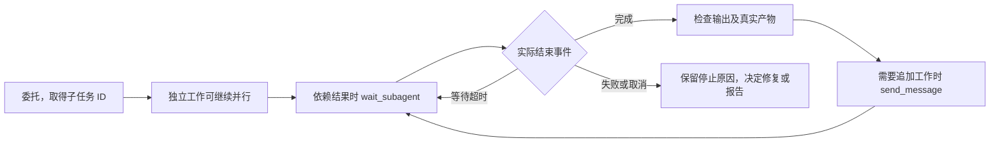

# DSH 后端

此目录包含真实官方 DSH SDK/CLI 的医疗决策适配和完整执行底座。运行时使用统一固定的 `0.2.1-rc.2` 包；研究源码快照单独记录在 `../../vendor/upstream.lock.json`。

医疗决策路径：

- `bridge.mjs`：通过官方 `DeepSeekHarness` 启动医疗覆盖配置，返回最后提交的文本和运行事件。
- `medical.patch.yml`：关闭默认编码工具、日志上传与插件清单上传。
- `check.mjs`：解析真实 `--dump-config` 输出，确认禁用项；只把 `!!js` 当作文本读取，不执行配置表达式来做检查。
- `tests/runtime-smoke.mjs`：真实 DSH + 本机确定模型响应，检查零宿主工具、事件和回收。
- `tests/bridge.test.mjs`：环境隔离与覆盖配置单元测试。

完整执行路径：

- `execution-worker.mjs`：官方完整 SDK 生命周期、密钥隔离网关、共享预算和有限截断恢复。
- `execution.patch.yml`：保留官方完整工具，配置研究执行行为。
- `execution-subagents.mjs`：监听官方子任务激活开始／结束事件，提供显式 `wait_subagent`；只等待调用者自己的直接子任务，不阻塞整棵会话树。
- `execution-capabilities.mjs`：向主任务与子任务注册能力查询、受信计算工具，经宿主网关调用固定 Python 实现；不执行模型指定代码。见 [回执协议](../../docs/注册计算工具与执行回执.md)。
- `isolated-entry.mjs`：在 bubblewrap 内启动官方 CLI，只挂载当前工作区及必要运行资料。
- `execution-delivery.mjs`：注册 `delivery_check`，嵌套调用官方 Bash/job_output，沿用同一任务、取消和隔离。必需／参考检查分别处理，同一用户回合的同一命令不可降级；typed 结果投影到运行观察，不能由 stdout 冒充退出状态。
- `execution-delivery-contract.mjs`：工具与宿主共用参数校验；未接受的提议不提交验收，有效调用缺失结果仍为未知。长检查持续读取同一作业，受原截止时间与取消约束。
- `execution-checkpoints.mjs`：范围合并、覆盖与规范顺序；保留显式缓存例外，使用与Python一致的Unicode顺序。宿主摘要实现见 `src/medagent/execution/checkpoints.py`。
- `execution-control.mjs`：复用 SDK 私有控制管道处理取消与后台状态。
- `execution-admission.mjs`／`execution-job-admission.mjs`：在根任务的消息接纳边界区分用户任务、子任务通知和后台作业通知，沿用原任务的预算归属。
- `execution-budget-context.mjs`：在任务接纳后读取预算并追加简短提示，避免新任务展示上一任务已过期的额度。
- `execution-sdk.mjs`：复用官方 SDK 服务器，在原会话存在时调用官方 `agents.resume`；需要恢复却缺失历史时拒绝新建空白替代。只用于执行工作台，医疗最小桥接仍保留原配置。
- `execution-observations.mjs`：读取 SDK 规范工具结果，分开记录进程状态和终端文字；与主/子会话、SDK 回合及调用标识关联，经控制管道分页传给宿主。属于研发运行观察，不是医疗计算回执。
- `execution-shell.mjs`：继承官方 sandbox Bash 执行器，默认启用 `pipefail`；完整 profile 配置前台默认 10 秒、最多 30 秒后交还后台任务 ID，保留官方任务与取消生命周期。`job_output` 默认等待 10 秒，显式等待最多 600 秒，仍受本轮截止时间限制。
- `check-artifacts.mjs`：在相同文件隔离下执行宿主选定的独立产物检查。

完整执行工作台实际支持文件、终端、代码、联网及子智能体，不与医疗问诊路径的空工具配置混用。说明与测试见 [通用执行底座](../../docs/通用执行底座与能力评测设计.md)。

## 执行工作台预算口径

模型调用、联网与子智能体派生共享同一个预算池，不存在各自独立的额度：

- **拦截点**：`execution-worker.mjs` 把 SDK 的模型端点改写为本机回环网关，一切模型流量（含子智能体后代、搜索的内层 LLM 请求）必经网关的 `/model/messages` 处理器；无主、已取消、过截止或超调用数一律返回 429，且先预留计数再放行，根与并发后代共享同一硬上限。运行时可经 `GET /model/budget` 自查剩余额度。
- **回合与终身**：每回合模型调用上限 `max_calls` 默认 24、合法域 1–64（`src/medagent/execution/`）；每回合时限默认 180 秒、上限 1800 秒（`src/medagent/execution/limits.py`）；worker 进程终身模型调用硬顶 200 次。注册能力（capabilities）另有独立预算：32 次/回合、256 次/进程终身。
- **联网归因与上限**：搜索走 `execution-search.mjs` 注册的官方 `DeepSeekSearchProvider`——其内层 LLM 请求经网关的 `/sessions/<发起者会话>` 作用域路由发出（按会话归因、计入同一预算池），并由 `recordRequest` 把请求落为会话事件 `web/deepseek-search-llm-request`；抓取经 chengxin web 插件包装上游 fetch provider，同样归因到发起会话并落 session 事件。搜索 provider 的 `maxUses` 为 3（`execution-search.mjs` 与 `execution.patch.yml`）；此外 chengxin web 插件设每会话上限：同一会话内 search 与 fetch 合计不超过 30 次，超限抛 `WEB_SESSION_BUDGET_EXCEEDED` 并落 `web/budget-exceeded` 事件。
- **子智能体**：`execution.patch.yml` 中 `tool-subagent`（spawn）与 `tool-subagent-fork`（fork）的 `maxDepth` 同为 2；后代不另设预算，其全部模型调用计入上述共享池。
- **不在此口径内**：医疗决策桥（`bridge.mjs` + `medical.patch.yml`）是零工具面——无联网、无子智能体、无宿主工具，不适用本节预算；临床问诊的限额独立于执行工作台、另行规定。

## 子任务完成与消息接续

锁定版本的官方 `subagent`／`subagent_fork` 始终立即返回子任务 ID。旧的 `run_in_background=false` 和配置中的 `backgroundMode` 已不构成等待契约，当前配置与评测提示已移除这些用法。



`wait_subagent({agent_id, timeout_ms})` 默认最多等 30 秒，可指定 1–600000 毫秒。等待使用事件通知，不轮询模型、不创建新子任务；它与父任务共享截止时间，调用者取消会中断等待。超时只结束本次等待，停止子任务需使用官方 `interrupt_agent` 或工作区停止操作。

结果为 `execution-subagent/v1`，包含子任务 ID、本次激活 ID 和 `state`。已结束的结果另有 `stop_reason`、有限长度 `output` 和 `output_truncated`。

| state | 含义 |
|---|---|
| `completed` | 官方运行时确认本次激活完成；仍须核对检查结果与产物 |
| `failed` | 本次激活出错、被拒绝或达到输出上限，不转写为成功 |
| `cancelled` | 子任务被中断 |
| `timed_out` | 等待时间用完，子任务可能仍在运行，没有最终输出 |

授权按官方事件携带的实际父智能体对象确认，不能凭模型提供的会话 ID 读取其他任务结果。`send_message` 只确认送达；接续启动的新激活会替换上次结果，旧激活的延迟事件不能覆盖新结果。根任务仍只在自己的回合内收尾，不自动等待所有后台后代，也不把其他回合的通知当成本次结果。

观察缓存仅在当前 SDK 进程内有效，每个父任务最多保留 256 条近期完成记录，待完成记录不被淘汰。进程重启或历史记录淘汰后，无法观察的等待会明确报错；先通过 `send_message` 接续子任务再等待，不能把磁盘中的旧答案当作新完成。无需继续执行时仍可离线查看宿主保存的历史事件。冷接续使用路由默认生成参数，因此执行 profile 同时固定 `llm-deepseek.maxTokens=8192`，与网关硬上限一致；不会通过放宽网关来接纳越界请求。

该工具仅用于研发执行工作台。子任务文本仍是待核对证据，不是医疗计算回执，也不直接写入患者事实。

后台作业完成也可能唤醒同一个根智能体。消息归属以实际 `tool/call` 与 `job/registered` 事件建立，不以当前前台任务或程序打印的文字决定。锁定 SDK 的 `tool-jobs` 通知缺少独立的 job ID 来源字段，适配器只从其固定通知包头取 ID，再核对该会话已登记的原始创建调用；来源、登记或包头不匹配均拒绝接纳。旧作业通知和新用户任务一起到达时，旧通知延后，仍使用旧任务额度；已停止任务的迟到通知被移除。升级 SDK 时需要复验该包头契约。

安装与检查：

```bash
npm ci --ignore-scripts
npm run dsh:check
npm run test:dsh
npm run test:dsh:integration
RUN_DSH_INTEGRATION=1 PYTHONPATH=src python3 -m unittest tests.integration.test_dsh_e2e -v
```

以上命令在项目根目录运行。合成测试无需外部模型密钥。启动实际模型问诊见 [项目说明](../../README.md)。

医疗桥接传输协议：Python 用 stdin 传入 `{"messages":[...]}`；桥接用 stdout 返回 `{"final_response":"...","events":[...]}`。患者数据不放进 shell 命令或参数，也不经过 `eval`。此路径的医疗工具由 Python 控制器执行，因此其 DSH 内部模型工具列表为空；完整执行路径另有持久 JSONL 控制协议和真实工具循环。

固定发行版使用 DeepSeek Messages 适配器，需提供该协议端点；一般 Chat Completions 服务使用项目的 `compatible` 后端。桥接每次决策启动独立 DSH home；Python 父进程拥有外层临时目录，正常结束和强制中断都会回收，不依赖被终止 Node 进程执行 finally；不隐式读取用户的 `~/.dsh`。

上游源码与 npm 包的 API 可能存在差异。升级时同时更新 CLI、SDK、协议包和锁文件，重新运行真实集成测试；不要只改一个版本或用 `--legacy-peer-deps` 掩盖冲突。
